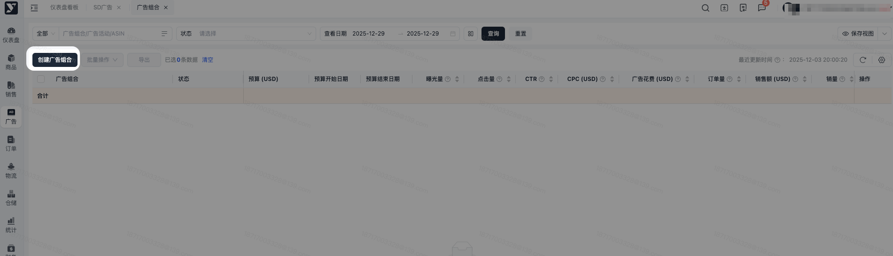
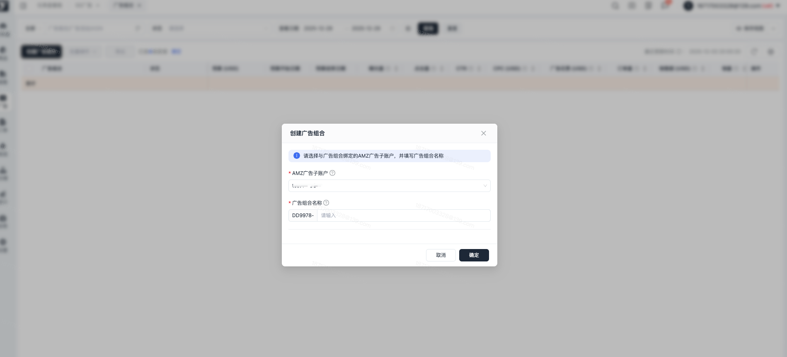
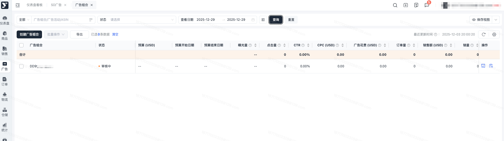
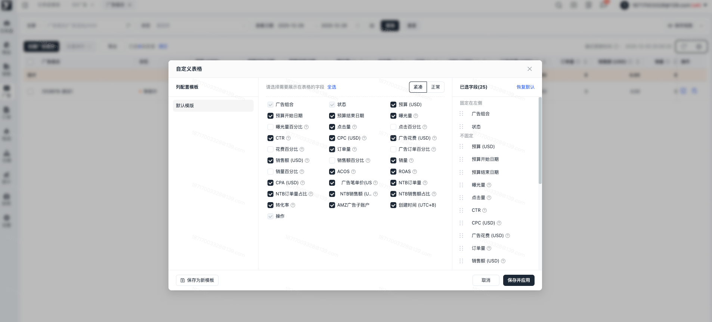
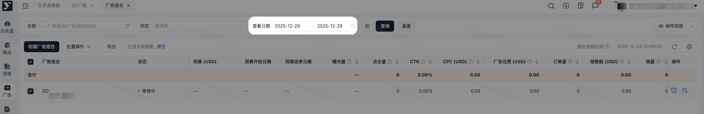
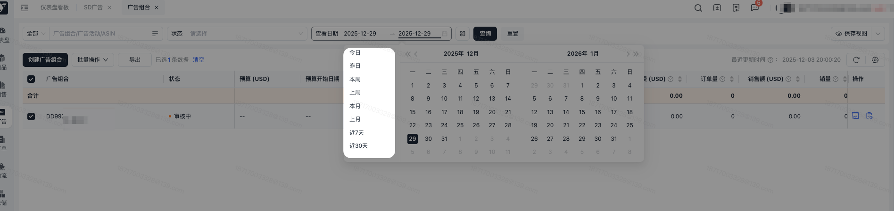
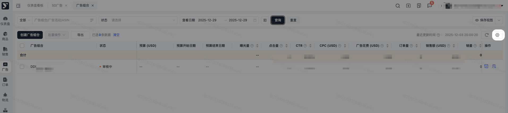
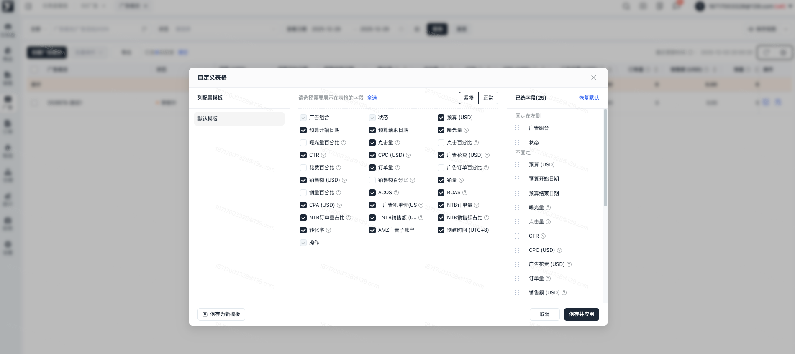
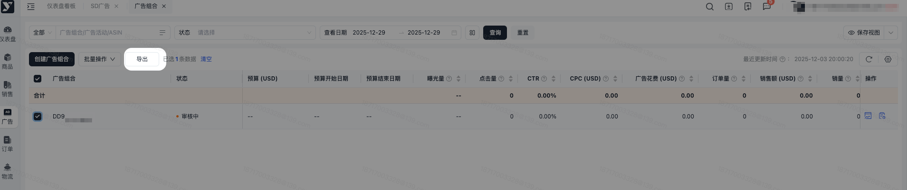

# 飞书文档：广告组合

## 文档信息

| 项 | 内容 |
| --- | --- |
| 远程文档 | https://q1njej8cpab.feishu.cn/wiki/MozCwZdEkiAHeTkmbkjcqz56nAg |
| 图片处理 | 本地下载（assets/images） |
| 快照时间 | 2026-08-06 |
| 来源命令 | `lark-cli docs +fetch --api-version v2 --doc https://q1njej8cpab.feishu.cn/wiki/MozCwZdEkiAHeTkmbkjcqz56nAg --doc-format markdown --as user --format json --jq .data.document.content` |
| 格式处理 | fd-doc-markdown-sync/scripts/normalize-feishu-doc-markdown.mjs |

---

广告组合

## 功能介绍

1. 广告组合即Portfolio，亚马逊广告系统允许用户将同一种商品的不同类型广告按Campaign维度组合到一起，去进行数据分析、控制预算等操作；Portfolio目前支持将SP、SB（含SBV）、SD广告放到一个组合。
2. 通过广告系统，卖家可以完全脱离亚马逊后台，直接在系统中，完成与广告活动相关的所有分析与维护操作，并通过各个增益功能，实现精细化的广告投放，提高广告收益。

## 数据更新频率

1. **结构数据（曝光量前面的字段数据）更新频率：每10分钟一次**
2. **报表数据（曝光量及之后的字段数据）的更新频率：每小时一次**

PS：不同于亚马逊只保留65天(daily)的广告报告数据，会保留所有同步回来的广告数据，供卖家分析参考。

## 创建条件

**创建前**：当您初次打开广告组合页面，会出现如下页面提示。

（当广告账户被冻结后，也会出现该页面，且无法再看到广告活动历史记录）

📢 此时，请先前往【广告管理】-【广告财务】-【广告账户】开通账户，随后前往【广告充值】进行充值操作。当您的账户可用余额大于0时，可开始创建广告活动。

## 操作流程

### 创建广告组合

点击【创建广告组合】，进入创建页面

进入【创建广告组合】页面，需选择AMZ广告子账户、填写广告组合名称。

### 广告组合列表

创建成功后，列表会生成一条“审核中”的数据；此时亚马逊正在审核您的广告组合，只需等待5分钟左右，可获取审核结果。

列表数据展示：

### 广告组合详情

- 您在详情页面可添加广告活动
- 审核通过后，状态变更为“投放中”，可开始在广告组合中添加广告活动；
- 点击“广告组合名称”，进入广告组合详情页
- 进入广告组合详情页，点击【添加广告活动】，可开始添加SP/SB/SD广告活动

**添加广告活动时请注意**：
1. 广告组合及其所属广告活动必须属于同一个AMZ广告子账户。
2. 单个广告活动仅可存在于一个特定的广告组合里，不能同时归属多个广告组合。
3. 支持将SP、SB、SD广告添加至广告组合，但仅当广告活动处于投放中、活动未开始、超出预算、已暂停状态时，才可将其添加至广告组合。

**添加广告活动页面已经为您筛选出符合以上条件的广告活动**

点击【确定】，广告组合详情页会生成已添加的广告活动数据

### 移动广告组合

同亚马逊后台一样，我们也同样支持批量移动到其他广告组合。

**注意：如果广告活动带有“添加中、移动中、移除中”的操作状态，则不可进行批量移动操作**

点击【移动到广告组合】，可选择你要移动的广告组合

### 从广告组合移除

同亚马逊后台一样，我们也同样支持批量从广告组合移除。

**注意：如果广告活动带有“添加中、移动中、移除中”的操作状态，则不可进行批量移除操作**

### 广告组合设置

支持在广告组合列表修改广告组合名称

也可在广告组合详情页中修

点击 广告组合设置后，在弹窗中可修改名称、预算上限方式、未使用的广告活动预算共享。

预算上限选择的方式不同，需要设置的内容不同：

1. 当预算上限方式为按日期范围时，需要设置上限金额和日期范围的区间日期；
2. 当预算上限方式为每月定期时，需要设置上限金额和日期范围的结束日期（开始日期固定为每月1日）
3. 当预算上限方式为无预算上限时，无需进行其它设置

勾选未使用的广告活动预算看，表示该组合中的广告活动共享其他活动未使用完的广告活动预算。

### 修改状态

同亚马逊后台一样，我们也同样支持启用、暂停和归档广告活动。

“启用”和“暂停”的操作方式有2种：单个操作 + 批量操作，而“归档”只支持批量操作。

**① 单个操作**

找到要启用或暂停的广告活动，点击启停按钮，即可一键启用或暂停。

**② 批量操作**

勾选要批量启停或归档的广告活动，点击对应启停或归档的按钮即可。

注意：归档后的数据不可恢复。

### 调整预算

我们可以在广告组合内，直接调整SP/SB/SD广告活动的预算；调整后，相应广告类型的广告活动中也会统一同步调整预算。

调整方式分2种：单个调整 + 批量调整；

**① 单个调整**

点击预算金额右侧的图标，可以直接调整预算。

**② 批量调整**

选中要批量调整预算的广告活动，点击【调整预算】，进入设置页面。

**注意：若勾选的广告活动既有每日预算和生命周期预算，则不可进行批量修改预算；当您选择同一预算类型时，才可修改预算**

### 修改开始日期

选中要批量修改结束日期的广告活动，点击【修改结束日期】，进入设置页面。

### 修改结束日期

选中要批量修改结束日期的广告活动，点击【修改结束日期】，进入设置页面。

（当前版本不支持在列表页针对单个广告活动修改结束日期，只能选中目标数据后在批量操作中执行）

### 查看日期

广告组合、广告活动 可筛选今日、昨日、本周、上周、本月、上月、近7天、近30天、自定义日期范围内的数据指标，帮助您分析广告表现

- 广告组合、广告活动：默认展示当前洛杉矶日期

- 由于广告活动需要拉取亚马逊广告活动的“top of search IS”数据，当您点击“查询”时，页面顶部会提示“正在获取Top of search IS数据中，请稍等”；一般1s内可成功获取，若但选择日期范围较大，最多需要等待10s左右
- 获取成功后会提示“数据获取成功”

### 自定义列

每个卖家，都有自己的分析模式，看重的指标也不尽相同。因此，为了匹配每位卖家的分析习惯，我们上线了【自定义列】功能，卖家可以根据自己的分析习惯，自定义排序广告活动的指标。

点击【自定义列】，进入设置页面。

进入“自定义列”设置页面，我们可以鼠标按住指标，上下拖动，以进行排序；

当指标过多，还可以开启或取消展示某个指标，勾选或取消复选框即可；

如果设置错误，点击【重置】，可以回到设置时的状态，重新设置；

设置完成后，点击【确定】，保存自定义列的设置。

### 导出

支持导出所有列表数据，以方便卖家进行二次分析。

当筛选出想要的结果后，点击【导出】，即可导出当前查询结果。同时，导出的历史文件可以在“下载中心”查看。

## 常见问题

#### **Q1：为什么广告活动不能从广告组合中移除？**

A1：因为当您的广告活动状态是“已结束”、“已归档”，或带“添加中”、“移动中”、“移除中”这样的状态时，不支持从广告组合中移除。

#### **Q2：为什么广告活动不能移动到其他广告组合？**

A2：因为当您的广告活动状态是“已结束”、“已归档”，或带“添加中”、“移动中”、“移除中”这样的状态时，不支持移动到其他广告组合。

#### **Q3：创建了广告组合后，多久能更新审核结果？**

A3：提交广告组合后，5分钟内可查询到广告组合审核结果。

#### **Q4：在广告组合中广告活动的指标数据会同步更新吗？**

A4：会的，每小时会同步更新一次亚马逊的最新数据。

#### **Q5：创建广告组合时 为什么要选择AMZ广告子账户？**

A5：AMZ广告子账户是用于投放和管理亚马逊广告的独立账户，可分别设置商品、预算及查看数据。
