# 飞书文档：VCDF货件

## 功能介绍

VCDF货件，当DF正常落单后，系统将自动生成DF物流，您可在此处下载该DF订单的货件面单，并查询物流轨迹。

## 页面路径

【物流】-【VCDF货件】

## 注意事项

要求在最迟发货时间之前，将订单信息和货件面单给到海外仓进行发货处理，否则可能面临亚马逊的罚款。

## 系统流程

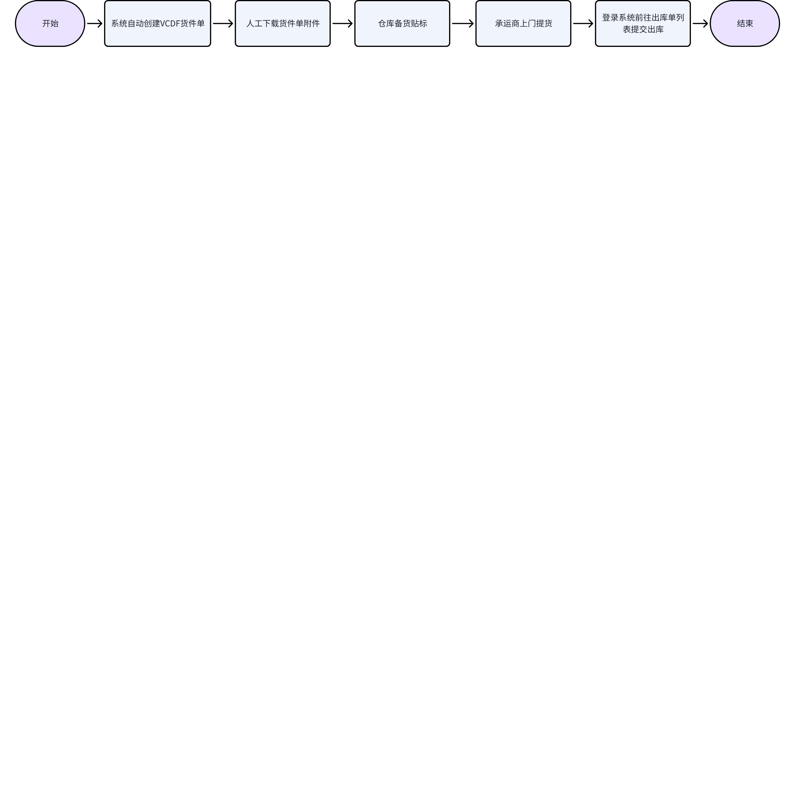

## 操作指南

### 查看VCDF货件单列表

1. 功能描述：DF订单更新为【配货中】时，可在系统查看VCDF货件单
2. 状态说明：

 1. 待提货：还未在出库单管理提交出库
 2. 运输中：已在出库单管理提交出库，但货件单下所有的包裹还未签收
 3. 已到达：货件单下所有的包裹都已全部签收
 4. 已取消：货件单被取消

 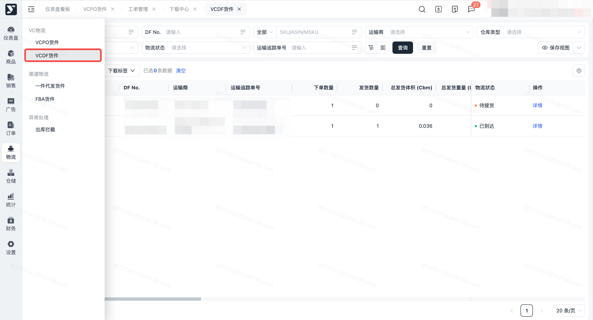

### 查看货件详情

1. 功能描述：查看VCDF货件单详情信息，包括：时间信息、基本信息、装箱信息、附件信息、产品信息
2. 操作步骤

 1. 点击【详情】按钮，进入货件单详情页面

 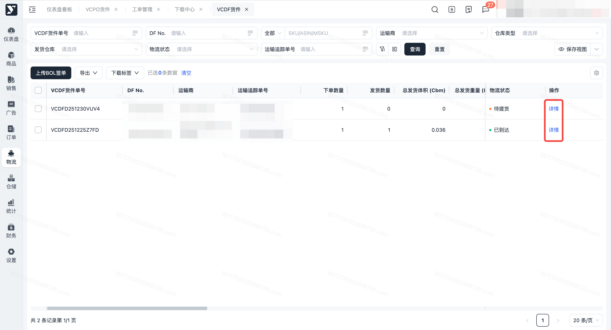

### 批量下载标签

1. 功能描述：批量下载货件单标签，当前系统可下载标签类型为“Shipping label、BOL签单”
2. 各标签类型可下载节点：

 1. Shipping label：VCDF货件单创建成功后，即可下载
 2. BOL签单：货件单已出库，且已上传BOL签单，可下载
3. 操作步骤：注意事项：已取消的货件单，不可下载标签附件

 1. 在VCDF货件单界面，批量可选货件单，鼠标悬浮在【下载标签】按钮上

 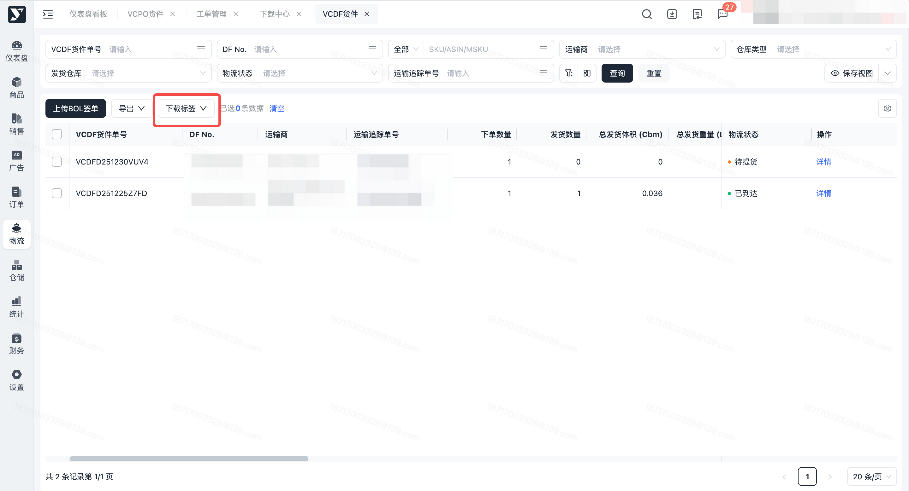

 1. 点击【Shipping label】/【BOL标签】，下载成功，列表的【Shipping label 标签状态】更新为“已下载”

 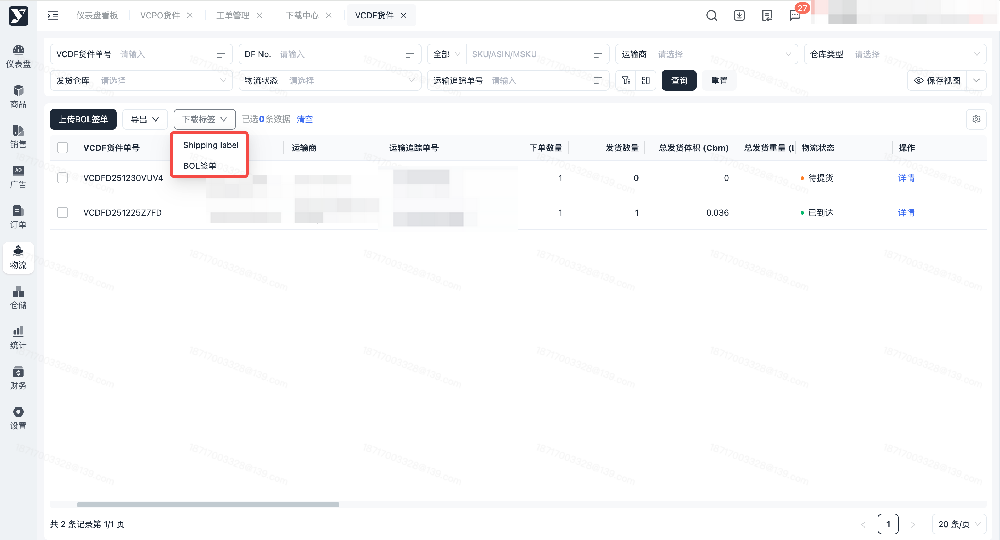

 1. 文件准备完成后，前往下载中心，点击“下载”按钮，可以将标签下载到本地

 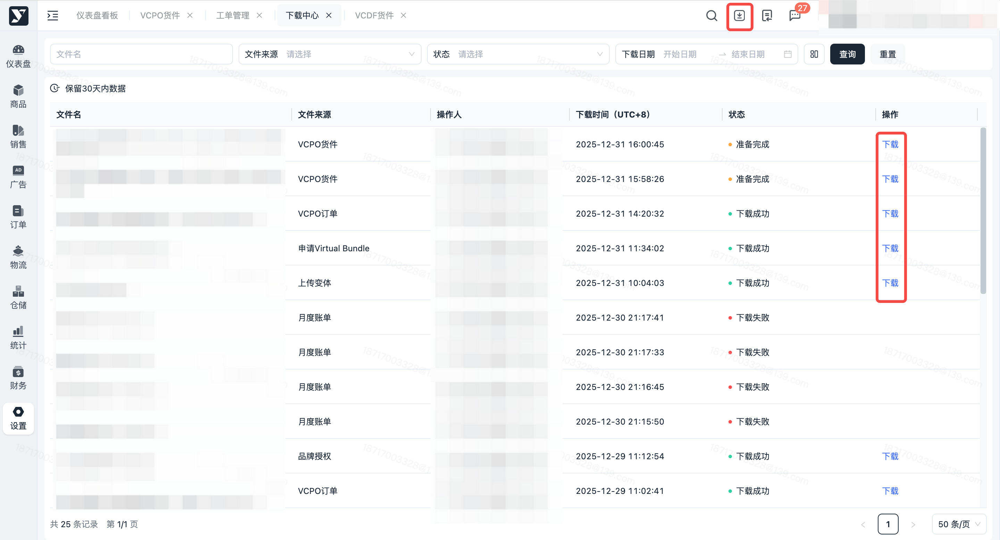

### 上传BOL签单

1. 功能描述：运输中、已到达的货件单支持批量上传BOL签单；若提交出库时BOL签单上传错误，可在此页面重新上传。
2. 操作步骤：

 1. 点击【上传BOL签单】按钮，进入文件上传界面

 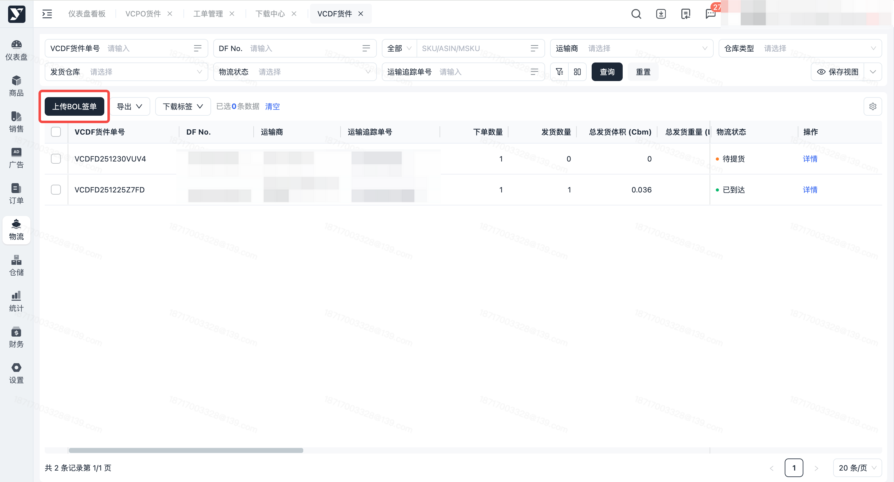

 1. 点击选择本地需上传的文件或将需上传的文件拖拽入上传框，点击【确定】按钮

 - 上传文件需按DF No. 命名
 - 支持文件格式为：ZIP、PDF

 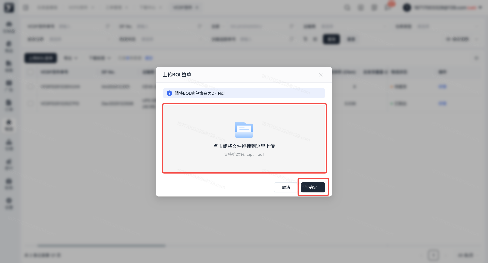

 1. 上传成功，BOL签单显示在货件单详情页面

 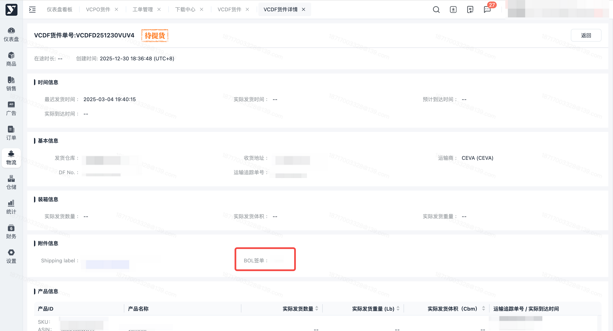

 1. 上传失败，系统会在“上传结果” 弹窗中显示失败数量、失败原因

 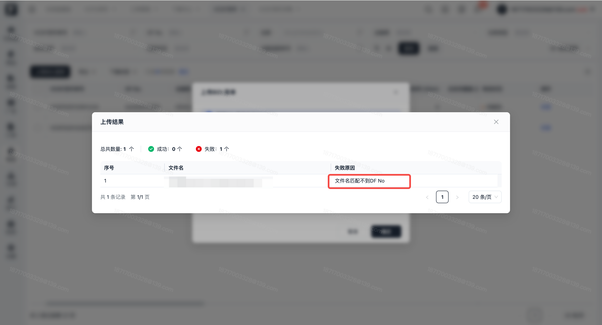

### 查看物流轨迹

1. 功能描述：VCDF货件单确认发货后，可在此页面按单个货件单查看物流轨迹
2. 操作步骤：

 1. 在VCDF货件页面，点击【详情】按钮，进入VCDF货件详情界面

 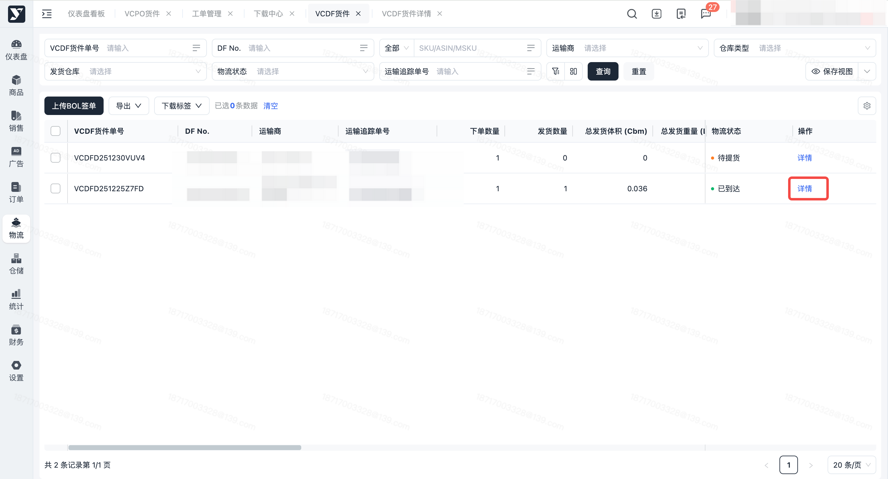

 1. 在产品信息栏位 ，点击【运输追踪单号】，进入查看包裹状态界面，显示包裹详细物流信息

 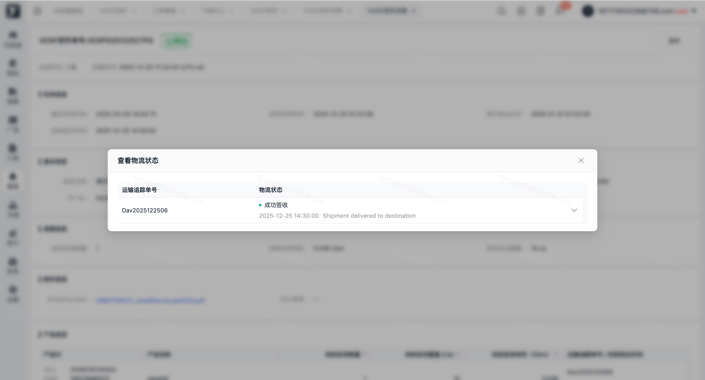

### 导出

1. 功能描述：按条件搜索、勾选后，导出货件单列表、货件单详情
2. 操作步骤：

 1. 按条件搜索或勾选指定货件单后，点击【导出】按钮，选择需要导出的对象

 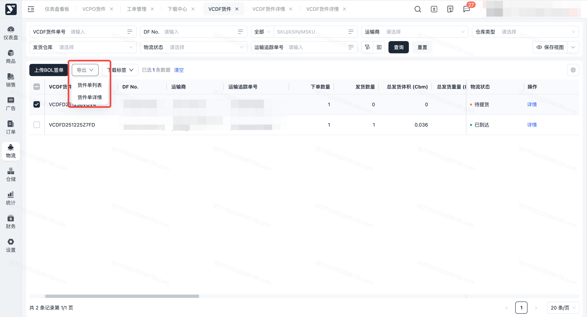

 1. 导出成功，可前往【下载中心】下载文档；或当下载内容不多时，系统会自动保存文档至电脑本地

 
