# 飞书文档：VCPO货件

VCPO货件

## 功能介绍

VCPO货件，在VCPO订单被确认并接受后，系统将自动为已接单订单创建货件单，可通过该模块追踪货件单的物流轨迹，查询实际到达时间

## 页面路径

【物流】-【VC物流】-【VCPO货件】

## 注意事项

1. 一票货件单可能包含多个VCPO订单，一个VCPO订单也可能被拆分到多票货件单发货；
2. 当VCPO订单的发货仓库、Ship To Location、Window start、预计提货时间均一致时，可创建为一票货件单
3. 货件单创建成功后：

 1. 若您使用平台仓，系统会自动将订单信息和附件信息同步至仓库，并告知仓库人员备货、发货；
 2. 若您使用自己的商家仓，则需将货件单运输商信息及附件同步您的仓库人员。
4. 一票货件单所有包裹均到达后，货件单状态才会从运输中变更为已到达
5. 货件单实际到达时间为包裹最早的到达时间

## 系统流程

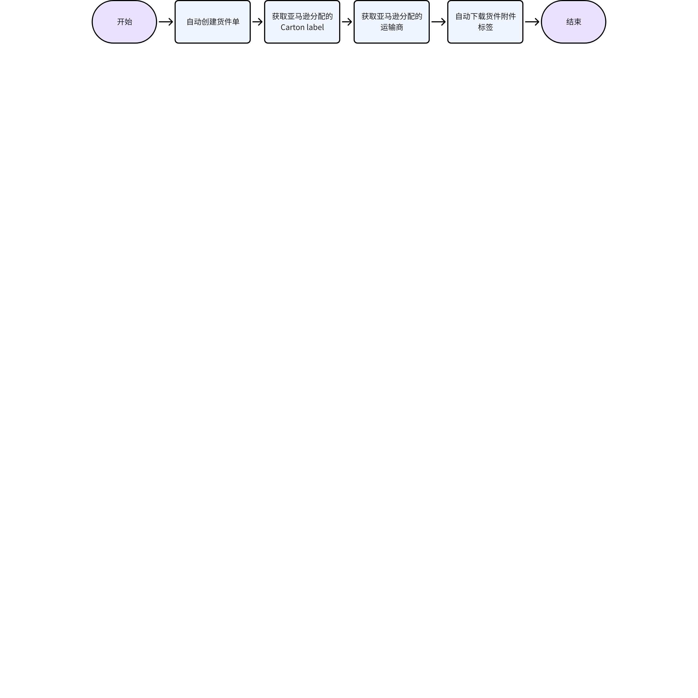

## 操作指南

### 查看货件单列表

1. 功能描述：查看VCPO货件单信息，包含VCPO货件单信息、ARN、ASN、状态等
2. 操作步骤：点击菜单【物流】-【VC物流】-【VCPO货件】，查看列表

 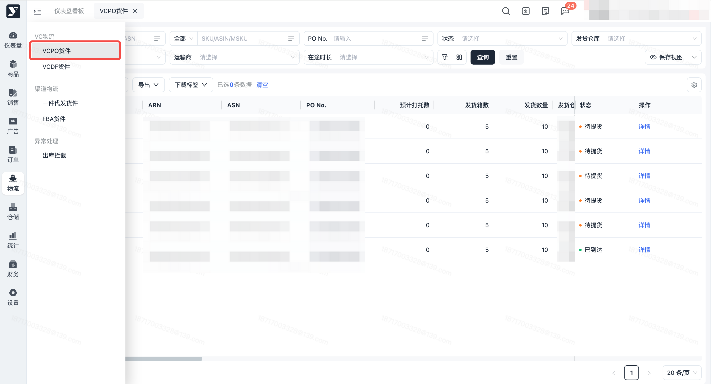

### 查看货件单详情

1. 功能描述：查看VCPO货件单详情信息，包含VCPO货件单附件信息、产品信息、发货信息等
2. 操作步骤：

 1. 点击菜单【物流】-【VC物流】-【VCPO货件】

 

 1. 点击【详情】按钮

 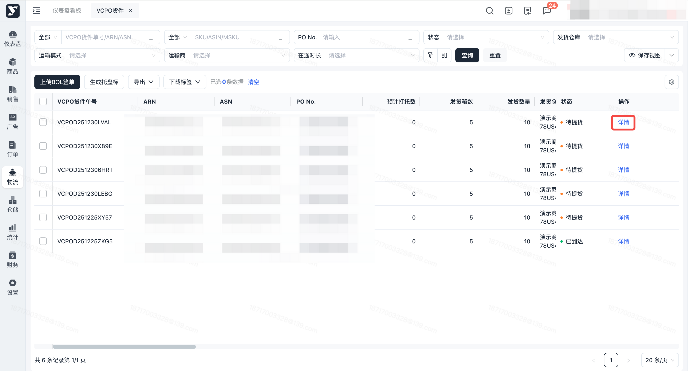

### 编辑货件单

1. 功能描述：编辑待推送Amazon货件单的预计打托数、总重量、总体积

 1. 特别说明：如有调整预计打托数的需求，请提前联系您的专属客服
 2. 编辑待推送Amazon货件单的条件：货件单状态=待推送Amazon 且仓库类型=商家仓
 3. 预计打托数限制：需≤发货箱数
 4. 总体积限制：

 1. 当预计打托数>0

 1. 需≥预计打托数\*0.1416(Cbm)
 2. 需≤预计打托数\*3.9360(Cbm)
 3. 需≤27.5522Cbm
 2. 当预计打托数=0

 1. 需≤27.5522Cbm
 5. 总重量限制

 1. 当预计打托数>0

 1. 需≥预计打托数\*15(Lb)
 2. 需≤44000Lb
 2. 当预计打托数=0

 1. 需>0
 2. 需≤44000Lb
2. 操作步骤：

 1. 点击【编辑】按钮
 2. 修改预计打托数、总重量、总体积，并点击【提交】按钮

### 生成托盘标

1. 功能描述：输入指定标签数量生成系统托盘标签

 1. 满足生成托盘标的条件：

 1. 运输模式= LTL/TL
 2. 且货件状态=待提货/运输中
 3. 且仓库类型 = 商家仓
 4. 且 预计打托数托盘数显示为0（可能不会自动生成托盘标的运输商包含：AACT CTII EXLA TFIN ABFS CNWY XJLW 等）
 2. 特殊场景说明：

 1. 货件单已有托盘标，再手工生成创建标签，手工生成的会覆盖详情界面原有附件
 2. 实际打托数大于预计打托数时，请按照实际托盘数生成托盘标数量
 3. 通过【生成托盘标】功能生成的托盘标文件命名格式：前缀Manual_pallet label_ARN_标签数量
2. 操作步骤：

 1. 点击【生成托盘标】按钮

 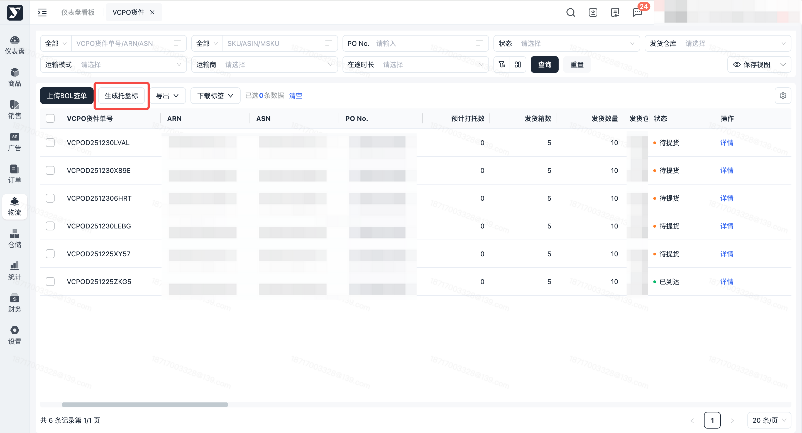

 1. 进入生成托盘标弹窗页面，按条件搜索需要生成托盘标的货件单说明：此页面默认 仅显示LTL/TL模式预计打托数为0 且 待生成托盘标的货件单

 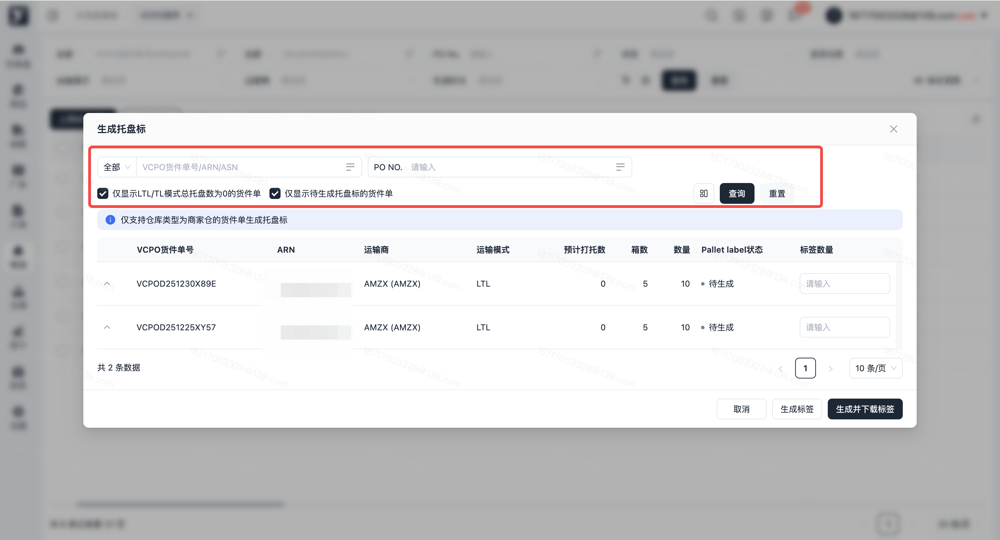

 1. 输入【标签数量】，点击【生成标签】或【生成并下载按钮】，标签创建成功后将显示在货件单详情 - Pallet label 栏位

 1. 生成标签：点击后，系统自动生成托盘标签，不会自动下载
 2. 生成并下载标签：点击后，系统自动生成标签，并下载到本地

 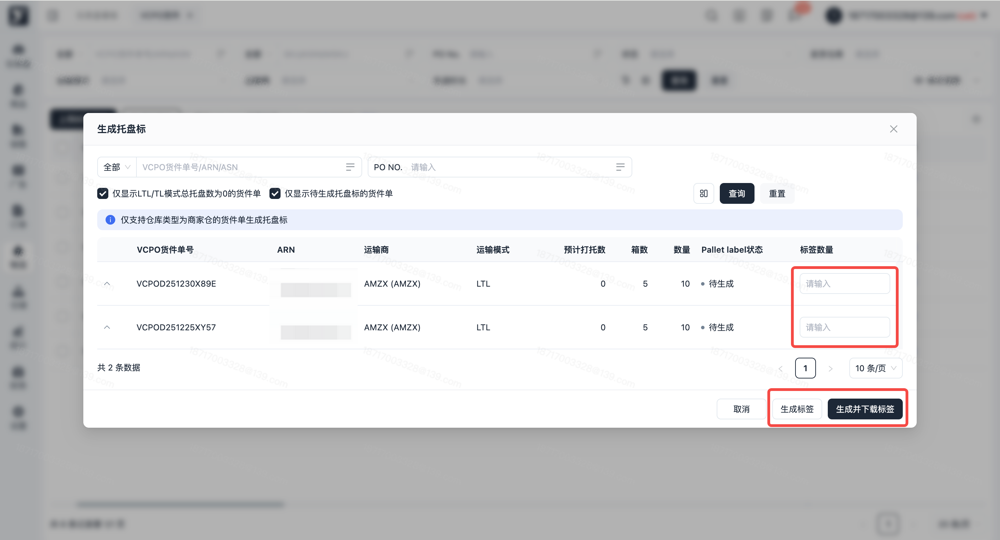

### 上传BOL签单

1. 功能描述：支持对运输中或者已到达的货件单上传BOL签单。适用出库时上传的BOL签单文件有误，可通过该功能重新上传

 1. 满足上传BOL签单的前提条件：货件单状态=运输中、已到达
 2. 上传文件命名规则：ARN，例如：28924479831
 3. 支持文件格式为：ZIP、PDF
2. 操作步骤：

 1. 在VCPO货件页面，点击【上传BOL签单】按钮

 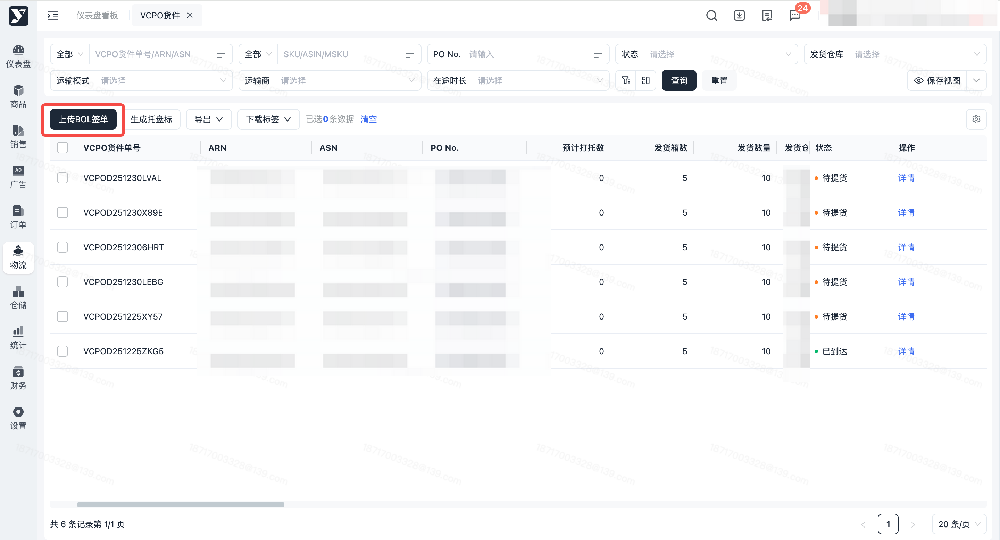

 1. 选择需上传的zip、pdf 文件，点击【确定】按钮

 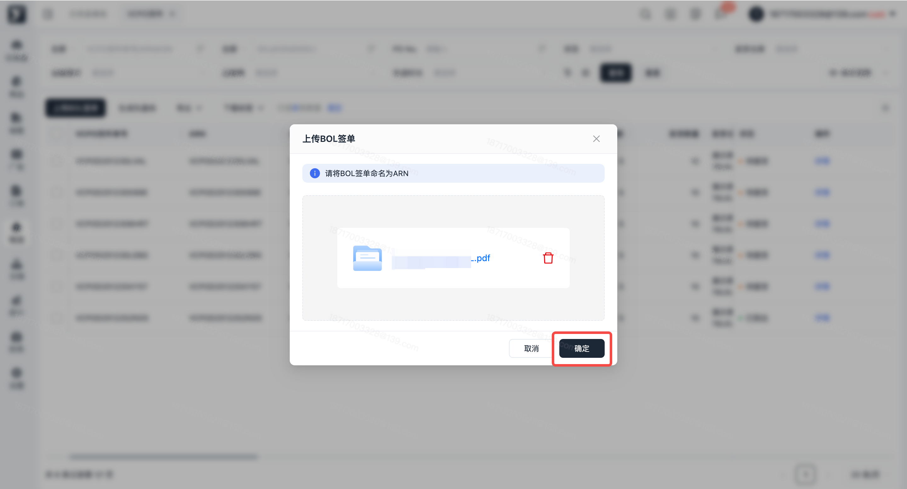

 1. 上传成功，返回列表界面并提示“操作成功”
 2. 上传成功的附件，显示在货件单详情页面 - BOL签单栏位

 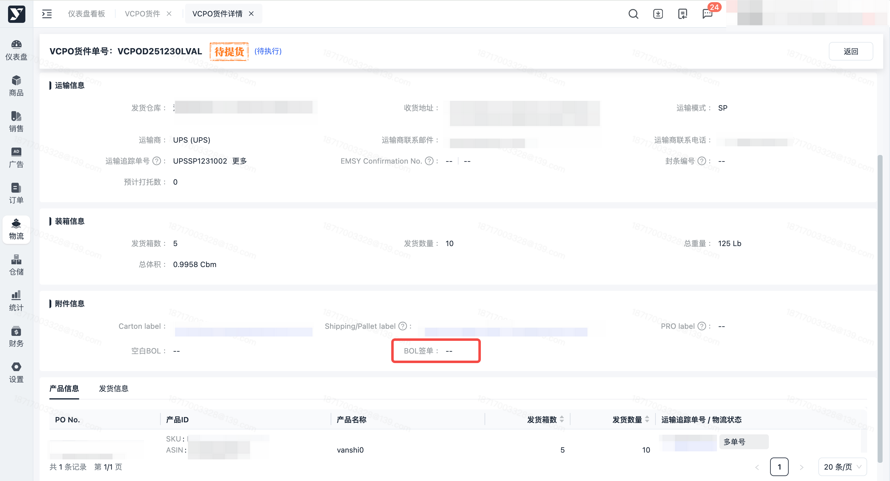

 1. 上传失败，弹窗返回上传结果，上传失败的文件，显示文件名及失败原因；可点击【下载结果文件】自动跳转下载中心，下载失败的Excel 文件到本地电脑

 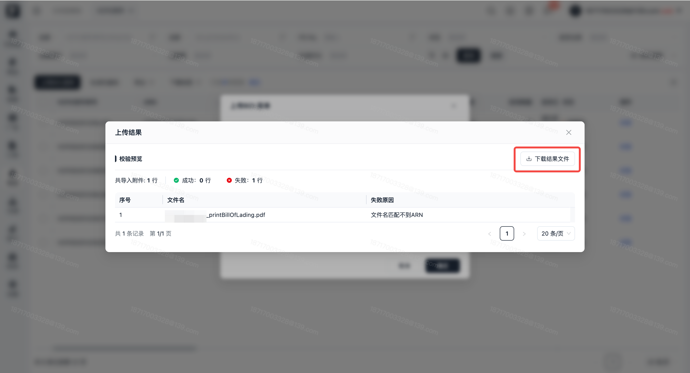

### 下载标签

1. 功能描述：批量下载VCPO货件标签

 1. 满足批量下载的前提条件：

 1. 货件单状态为 “待提货、运输中、已到达”
 2. 且 仓库类型为 “商家仓”
 2. 可批量下载的标签范围：Carton label、Shipping/Pallet label、Pro label（仅当运输商为AMZX有此标签）、空白BOL、BOL签单
2. 操作步骤：

 1. 批量勾选货件单，鼠标悬浮在【下载标签】按钮上，点击需要下载的标签类型，点击【所有标签】时，默认下载全部类型

 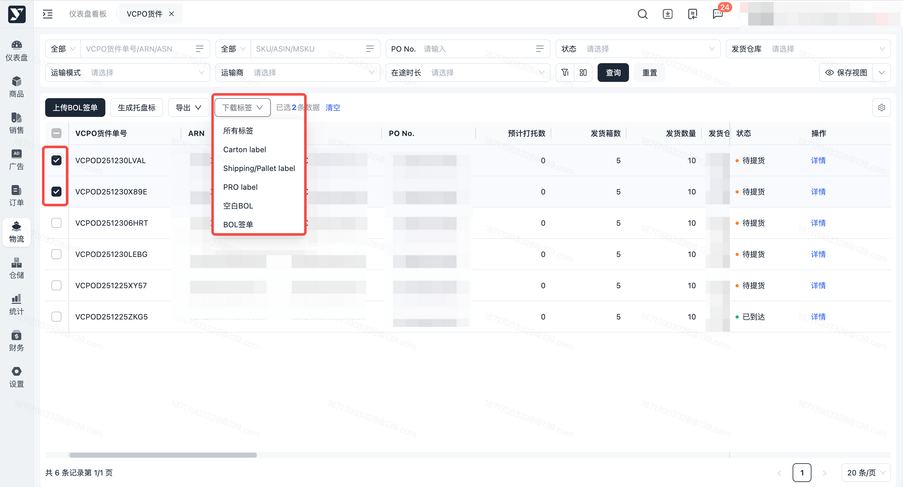

 1. 文件准备完成后，前往下载中心，点击【下载】按钮，可以将标签下载到本地

 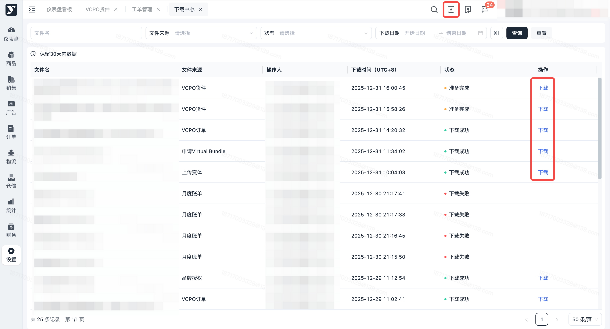

### 导出

#### 货件单列表

1. 功能描述：按条件搜索或勾选后导出货件单列表
2. 操作步骤：按条件搜索或勾选指定货件单后，点击【导出】-【货件单列表】按钮，导出货件单列表信息

 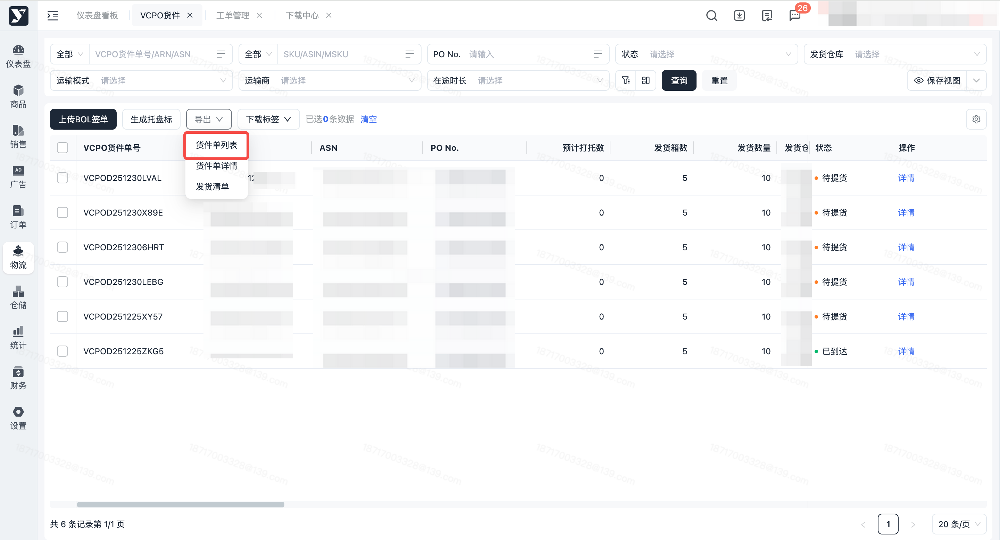

#### 货件单详情

1. 功能描述：按条件搜索或勾选后导出货件单详情
2. 操作步骤：按条件搜索或勾选指定货件单后，点击【导出】-【货件单详情】按钮，导出货件单详情信息

 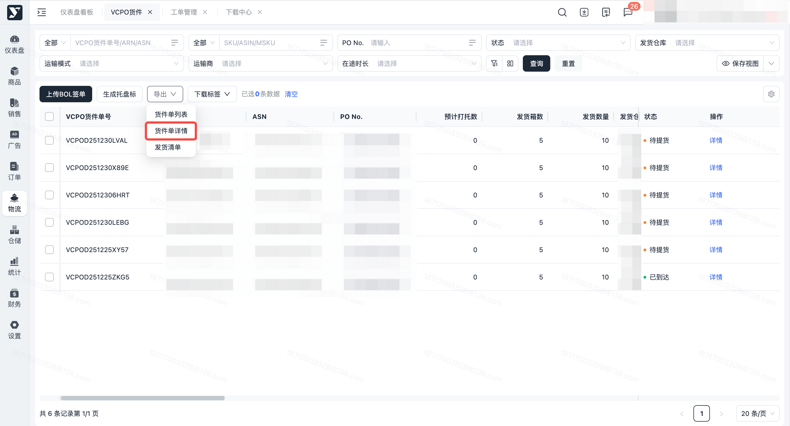

#### 发货清单

1. 功能描述：按条件搜索或勾选后导出货件单发货清单
2. 操作步骤：按条件搜索或勾选指定货件单后，点击【导出】-【发货清单】按钮，导出货件单发货清单

 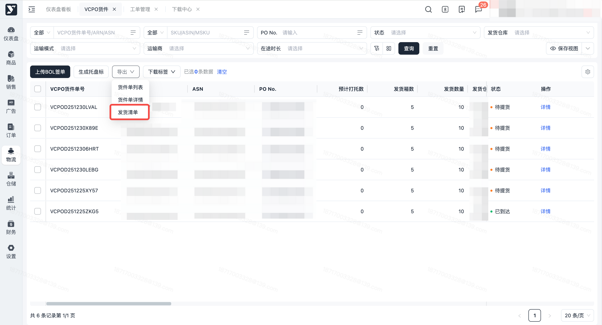
