# 飞书文档：一件代发货件

## 文档信息

| 项 | 内容 |
| --- | --- |
| 远程文档 | https://q1njej8cpab.feishu.cn/wiki/UOzywnYwBiupA5k3qFscqtZHnle |
| 图片处理 | 本地下载（assets/images） |
| 快照时间 | 2026-08-06 |
| 来源命令 | `lark-cli docs +fetch --as user --doc "<remote>" --jq ".data.markdown"` |
| 格式处理 | fd-doc-markdown-sync/scripts/normalize-feishu-doc-markdown.mjs |

---

一件代发货件

## 功能介绍

一件代发订单创建审核通过后，系统自动创建一件代发货件单，您可在此处查看货件状态和货件轨迹，且下载相关附件。

## 页面路径

【物流】-【渠道物流】-【一件代发货件】

## 系统流程

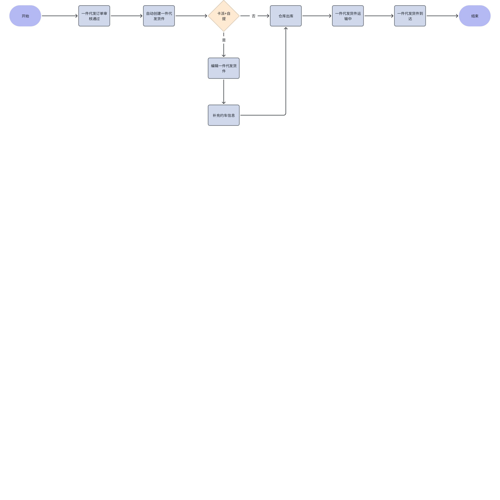

> 画板来源：token=`VeYgwxEpthC0pjbbDC1cu6ILnic`

## 操作指南

### 一件代发货件列表

1. 货件单状态：

 1. 待提货：一件代发订单创建审核通过后，系统自动创建一件代发货件单，货件单初始状态为”待提货“
 2. 运输中：一件代发出库操作出库后（由我司物流员操作出库），货件单状态更新为”运输中“
 3. 已到达：系统获取到物流轨迹已签收，货件单状态更新为”已到达“
 4. 已取消：您手动取消一件代发订单，系统联动取消一件代发货件单，货件单状态更新为”已取消“

 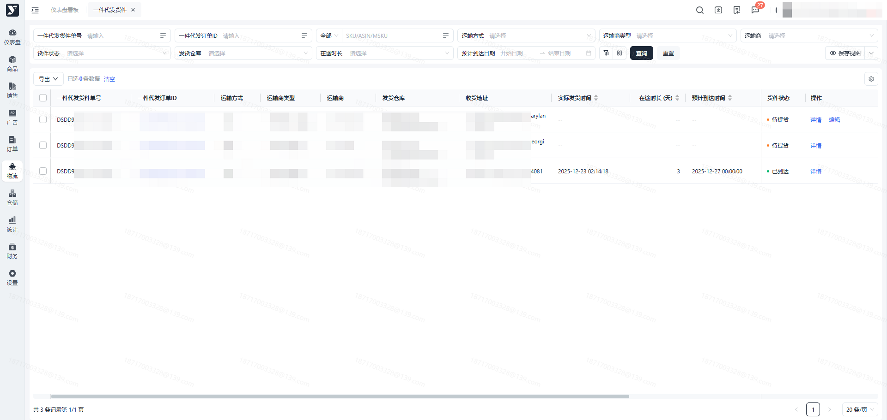

### 查看货件详情

1. 在货件单列表点击【详情】按钮，可查看货件单详情信息

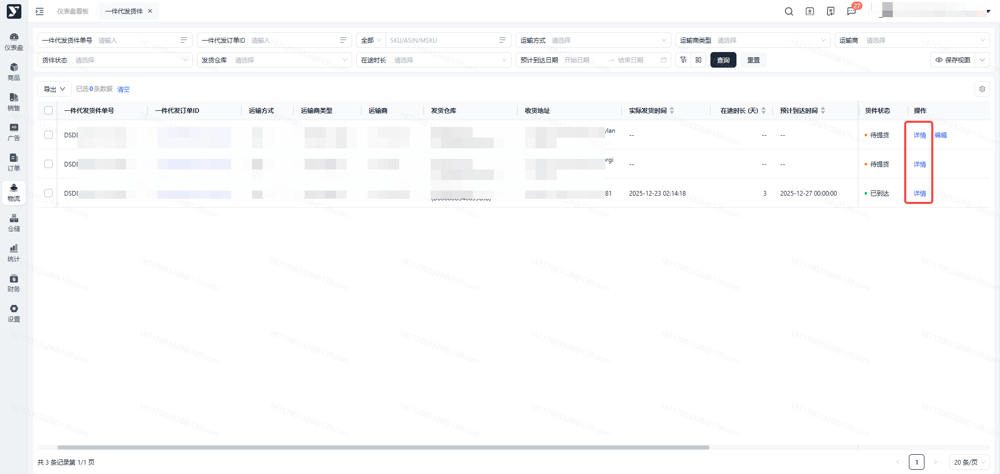

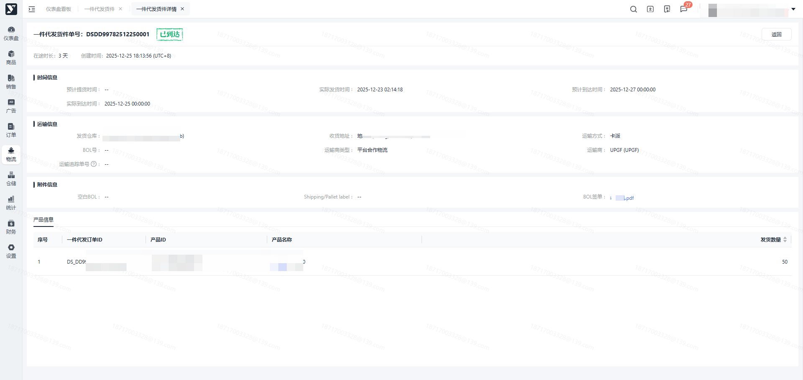

#### 下载附件

1. 功能描述：可在货件单详情下载【Shipping label、空白BOL、BOL签单】附件
2. 满足下载的前提条件：说明：Shipping label 需要您在创建一件代发订单时提前上传说明：空白BOL需要您【编辑】货件单时提前上传

 1. Shipping label ：运输模式为【快递】，且运输商类型为【客户物流（自提）】模式时，可下载

 1. 空白BOL：运输方式为【卡派】，且运输商类型为【客户物流（自提）】模式时，可下载

 1. BOL签单：运输方式为【卡派】，且一件代发订单已出库后，可下载

 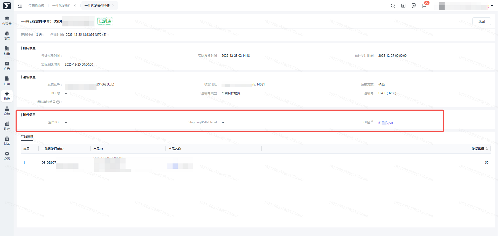

#### 查看运输追踪单号

1. 在货件单详情，可查看运输追踪单号

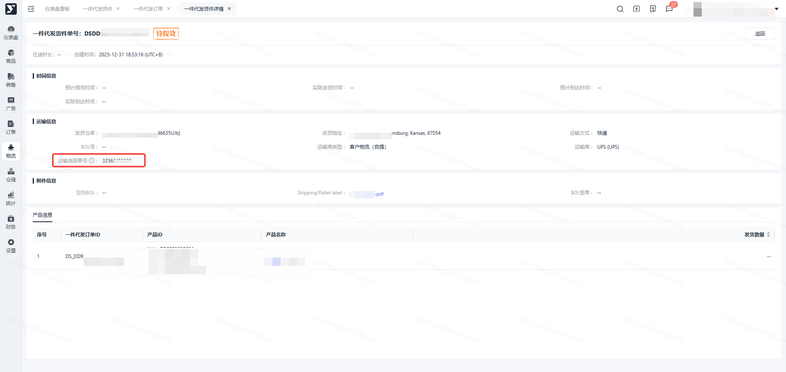

### 编辑货件单

1. 功能描述：货件单状态为【待提货】，且运输方式为【卡派】，且运输商类型为【客户物流（自提）】时，可编辑货件单；货件单仅允许编辑一次
2. 操作步骤：

 1. 点击【编辑】按钮，进入编辑页面

 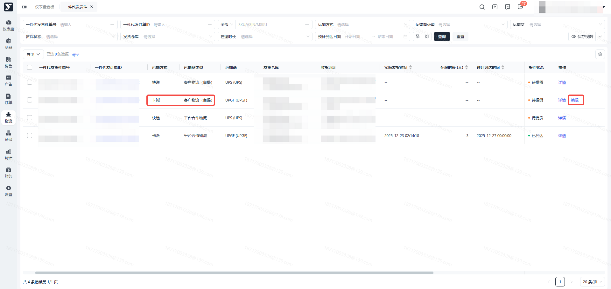

 1. 在【约车信息】栏位，填写【BOL号、预计提货时间】信息、上传【空白BOL、Pallet label】附件

 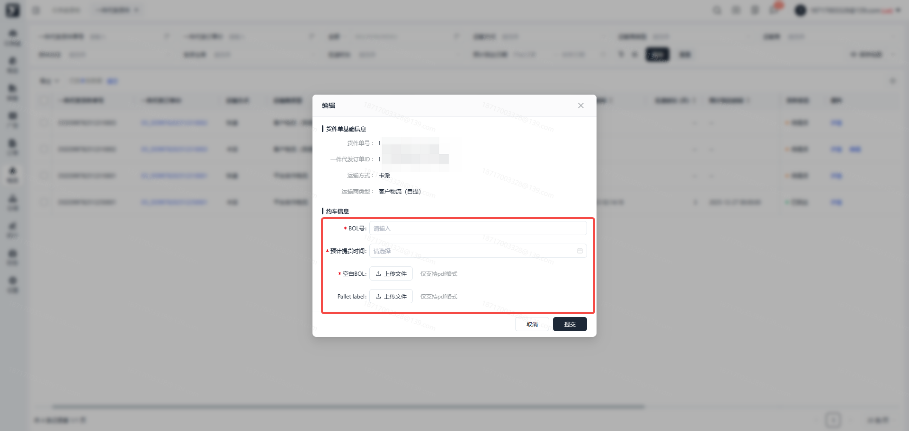

 1. 点击【确定】按钮，保存编辑信息

注：必须编辑此约车信息，否则无法出库。

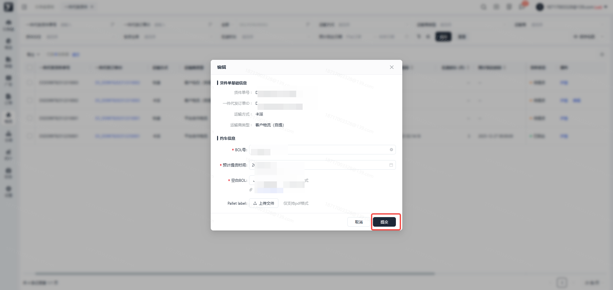

### 导出

#### 导出列表

1. 功能描述：支持全量、按条件搜索、勾选导出一件代发货件列表
2. 操作步骤：

 1. 点击【导出】-【导出列表】按钮，导出一件代发货件列表

 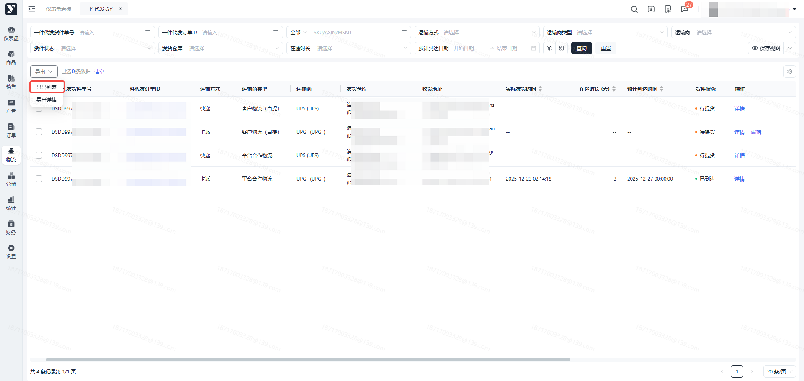

#### 导出详情

1. 功能描述：支持全量、按条件搜索、勾选导出一件代发货件详情
2. 操作步骤：

 1. 点击【导出】-【导出详情】按钮，导出一件代发货件详情

 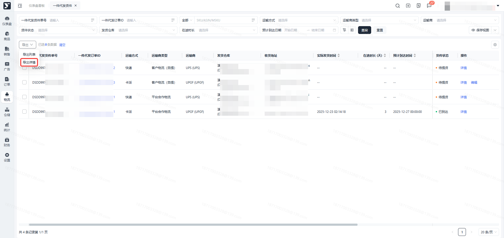
