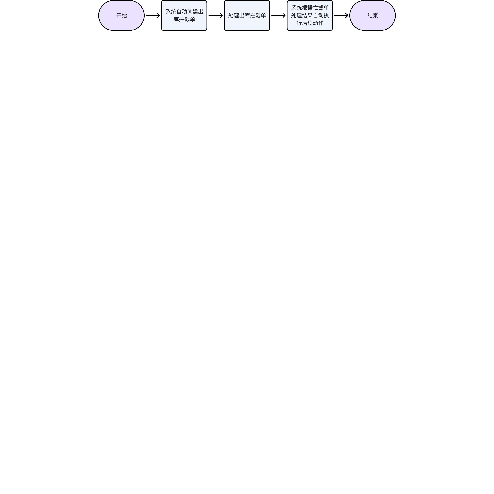
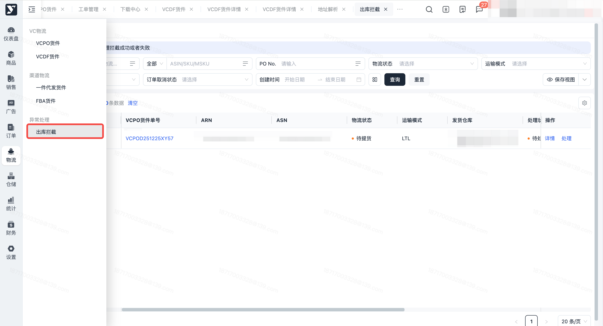
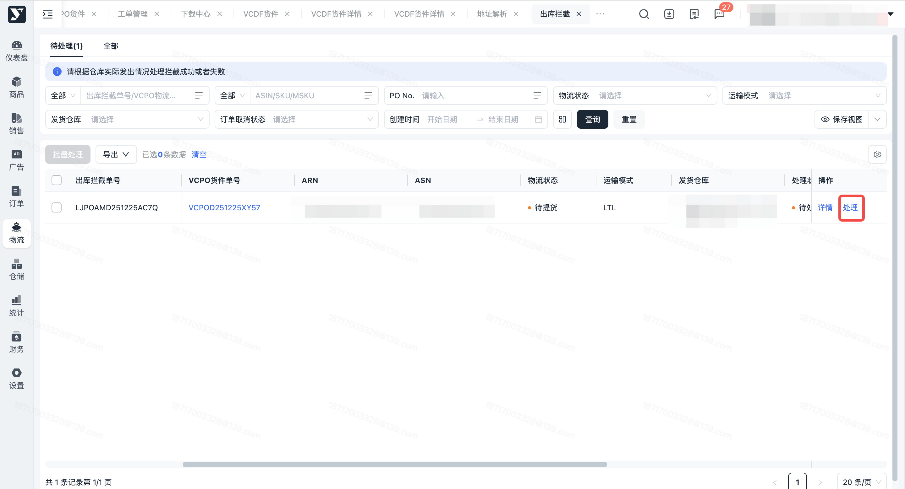
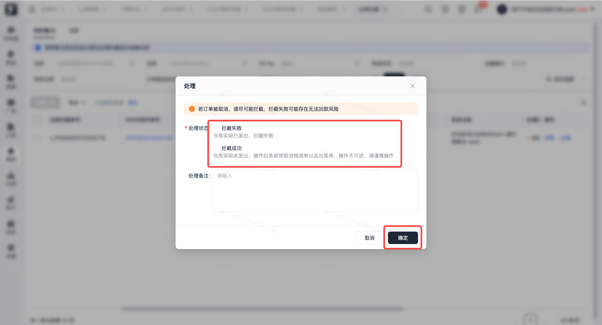
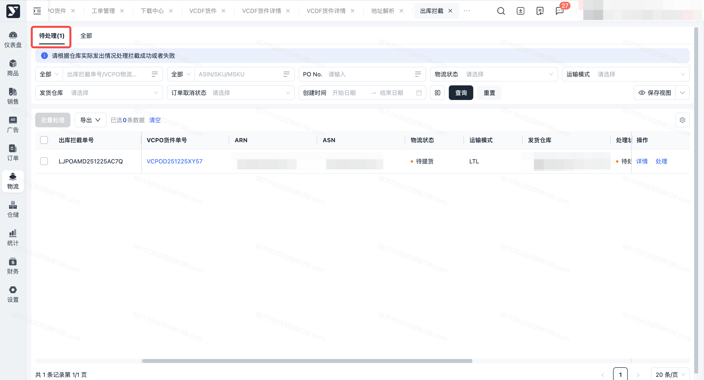
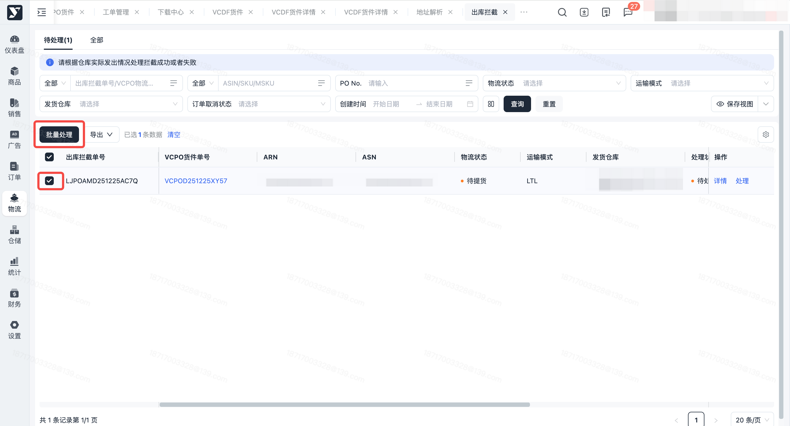
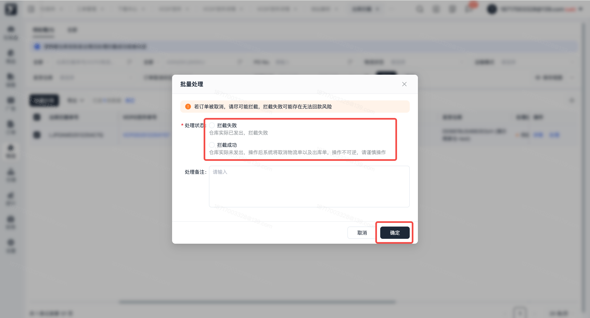
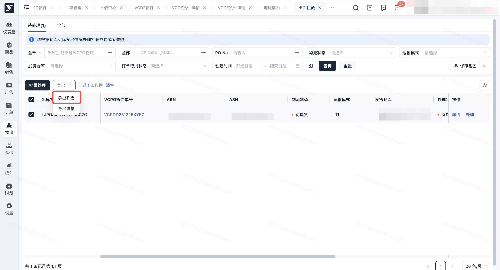
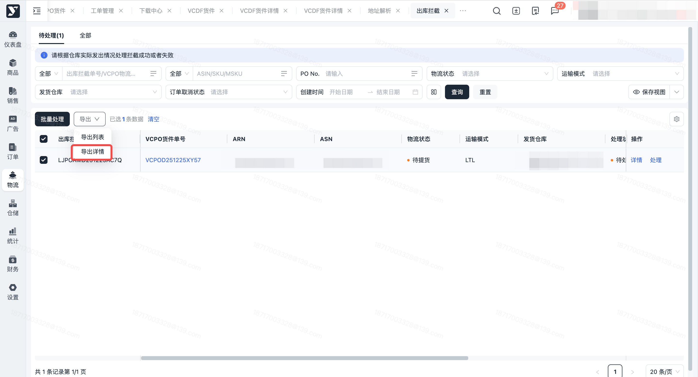

# 飞书文档：出库拦截

## 功能介绍

出库拦截模块，主要负责VCPO订单、VCDF订单取消后的系列异常处理，涵盖货件单、出库单及订单发货状态。当亚马逊取消订单后，系统会自动针对指定状态的订单创建出库拦截单；处理人根据仓库实际发货情况，将拦截单标记为 “拦截成功” 或 “拦截失败” 后，系统将自动同步处理货件单、出库单及订单发货状态。

## 页面路径

【物流】-【异常处理】-【出库拦截】

## 注意事项

1. 针对PO类型

 1. 若一个货件单部分PO订单被取消，部分PO订单未被取消，也会被以货件单的维度创建一个出库拦截单
 2. 运输中货件单包含“到达待取”或者“成功签收”的物流轨迹时，系统将自动处理为“拦截失败”
 3. 若出库拦截单一直为待处理状态，对应的商家仓货件单会关闭物流轨迹超时自动签收任务
2. 出库拦截单创建后，仍然可以正常在系统操作出库，但出库的时候会有弹窗提示存在订单被取消

## 系统流程

## 操作指南

### 查看出库拦截单列表

1. 功能描述：查看出库拦截单部分单据信息，包含出库拦截单号、参考单号、ASN、物流状态、处理状态等

 1. 处理状态：待处理、处理中、拦截成功、拦截失败
 2. 物流状态、运输模式：5分钟更新一次
 3. 货件单号：单号可点击，点击后跳转至【VCPO货件】/【VCDF货件】页面
2. 操作步骤：点击菜单【出库拦截】，查看列表

### 查看出库拦截单详情

1. 功能描述：查看出库拦截单全部单据信息，包含出库拦截单号、参考单号、ASN、物流状态、处理状态等
2. 操作步骤：出库拦截单列表，点击【详情】按钮

 

### 单个处理

1. 功能描述：单个处理 “待处理” 状态的出库拦截单

 1. 出库拦截单类型=PO出库拦截

 1. 若物流状态为“待提货”：

 1. 出库拦截单处理为拦截成功后：系统将自动取消VCPO货件单、出库单，取消原因为“亚马逊取消PO”
 2. 出库拦截单处理为拦截失败后：系统无变更
 2. 若物流状态为“运输中”：

 1. 出库拦截单处理为拦截成功后：系统将自动取消VCPO货件单、出库单，取消原因为“亚马逊取消PO”；针对已出库产品，系统将自动创建一笔其他入库单并自动入库来平库存
 2. 出库拦截单处理为拦截失败后：VCPO货件单开启自动到达任务
 2. 出库拦截单类型=DF出库拦截

 1. 出库拦截单处理为拦截成功后：系统将自动取消VCDF订单、货件单、出库单，取消原因为“亚马逊主动取消订单”
 2. 出库拦截单处理为拦截失败后：系统无变更
 3. 若处理时报错，请查看注意事项中的处理限制
2. 操作步骤：

 1. 点击【物流】-【异常处理】-【出库拦截】-待处理Tab

 

 1. 点击【处理】按钮

 

 1. 选择“拦截成功”或者“拦截失败”，点击确定

 

 1. 弹窗提示操作成功，待处理Tab将隐藏“已处理”的出库拦截单

### 批量处理

1. 功能描述：批量处理“待处理”状态的出库拦截单

 1. 出库拦截单类型=PO出库拦截

 1. 若物流状态为“待提货”：

 1. 出库拦截单处理为拦截成功后：系统将自动取消VCPO货件单、出库单，取消原因为“亚马逊取消PO”
 2. 出库拦截单处理为拦截失败后：系统无变更
 2. 若物流状态为“运输中”：

 1. 出库拦截单处理为拦截成功后：系统将自动取消VCPO货件单、出库单，取消原因为“亚马逊取消PO”；针对已出库产品，系统将自动创建一笔其他入库单并自动入库来平库存
 2. 出库拦截单处理为拦截失败后：VCPO货件单开启自动到达任务
 2. 出库拦截单类型=DF出库拦截

 1. 出库拦截单处理为拦截成功后：系统将自动取消VCDF订单、货件单、出库单，取消原因为“亚马逊主动取消订单”
 2. 出库拦截单处理为拦截失败后：系统无变更
 3. 若处理时报错，请查看注意事项中的处理限制
2. 操作步骤：

 1. 点击【物流】-【异常处理】-【出库拦截】-待处理Tab

 

 1. 勾选出库拦截单，点击批量处理

 

 1. 选择“拦截成功”或者“拦截失败”，点击确定

 

 1. 弹窗提示操作成功，待处理Tab将隐藏“已处理”的出库拦截单

### 导出列表

1. 功能描述：按条件搜索或勾选后导出列表
2. 操作步骤：按条件搜索或勾选指定出库拦截单后，点击【导出】-【导出列表】按钮，导出出库拦截单列表信息

 

### 导出详情

1. 功能描述：按条件搜索或勾选后导出详情
2. 操作步骤：按条件搜索或勾选指定出库拦截单后，点击【导出】-【导出详情】按钮，导出出库拦截单详情信息

 
