# 飞书文档：约车单管理

## 文档信息

| 项 | 内容 |
| --- | --- |
| 远程文档 | https://q1njej8cpab.feishu.cn/wiki/CCcmwehVLi0yR6kxn4ocIa35nYe |
| 图片处理 | 本地下载（assets/images） |
| 快照时间 | 2026-08-06 |
| 来源命令 | `lark-cli docs +fetch --as user --doc "<remote>" --jq ".data.markdown"` |
| 格式处理 | fd-doc-markdown-sync/scripts/normalize-feishu-doc-markdown.mjs |

---

约车单管理

## 功能介绍

约车单管理，支持针对需要约车的LTL/TL VCPO货件单、CEVA VCDF货件单创建约车单，可在该模块跟进约车情况，并查看最终和运输商确认的提货时间

## 页面路径

【物流】-【约车管理】-【约车单管理】

## 注意事项

1. VCPO货件单首次约车无需人工介入，仅当货件单超过亚马逊预计提货时间未被提走、需要二次约车时，才需要创建约车单；VCDF货件单首次/二次约车均需创建约车单
2. 补充信息后，系统将自动针对待约车列表中【待创建】数据创建约车单
3. 若待约车列表没有预期的货件单，可通过“待约车列表”的【更新列表】功能刷新列表数据
4. 同一订单类型、同一发货仓库、同一运输商、同一期望提货时间的货件单创建为一票约车单

## 系统流程

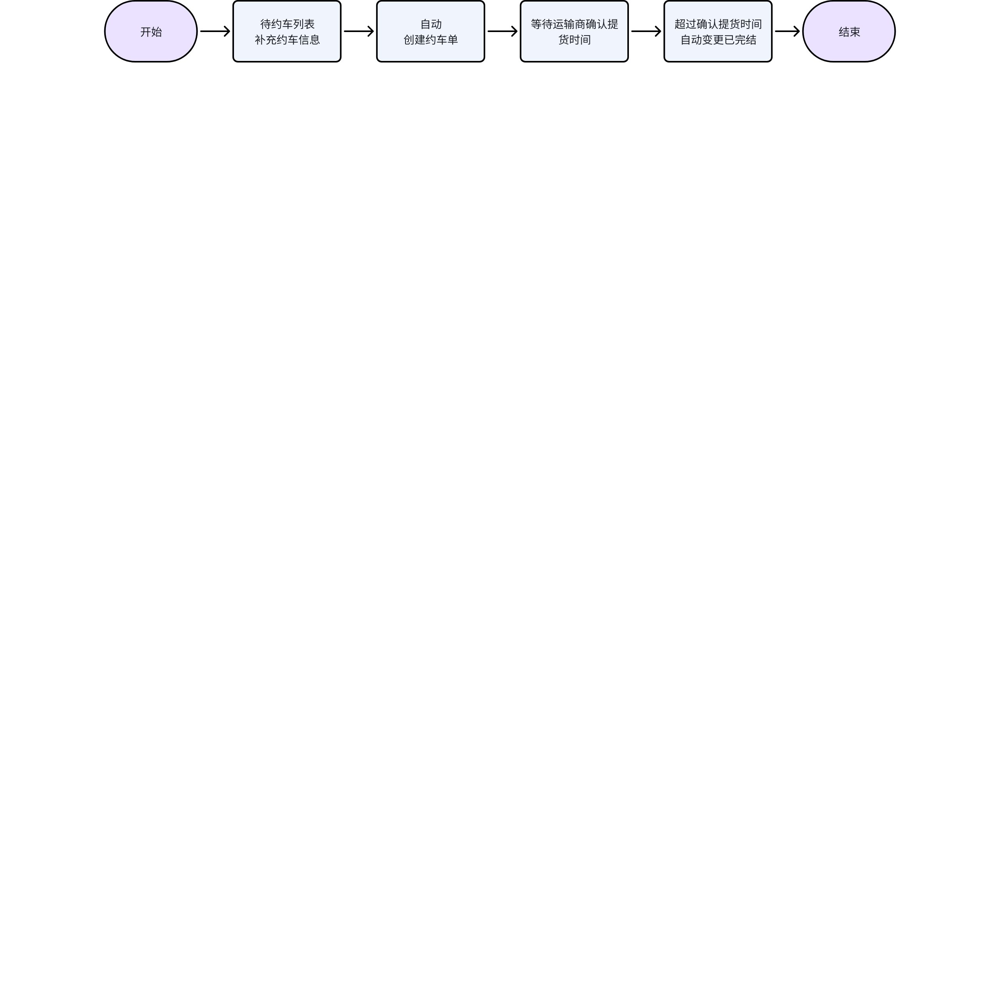

> 画板来源：token=`HeuTwjVgAhU2oIbS4YScEu0jnYd`

## 操作指南

### 查看待约车列表

1. 功能描述：查看待约车数据，包含VCPO货件单号、订单类型、原定提货时间等
2. 操作步骤：点击菜单【物流】-【约车管理】-【约车单管理】，点击待约车列表Tab

 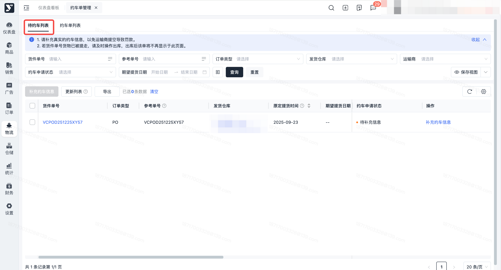

### 查看约车单列表

1. 功能描述：查看约车单部分数据信息，包含约车单号、货件单号、订单类型等
2. 操作步骤：点击菜单【物流】-【约车管理】-【约车单管理】，点击约车单列表Tab

 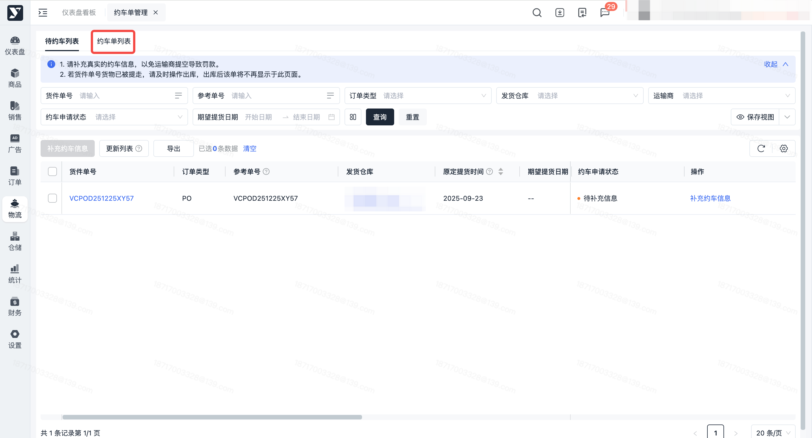

### 查看约车单详情

1. 功能描述：查看约车单全部数据信息，包含约车单号、货件单号、订单类型、货件单信息等
2. 操作步骤：点击菜单【物流】-【约车管理】-【约车单管理】，点击约车单列表Tab-【详情】按钮

 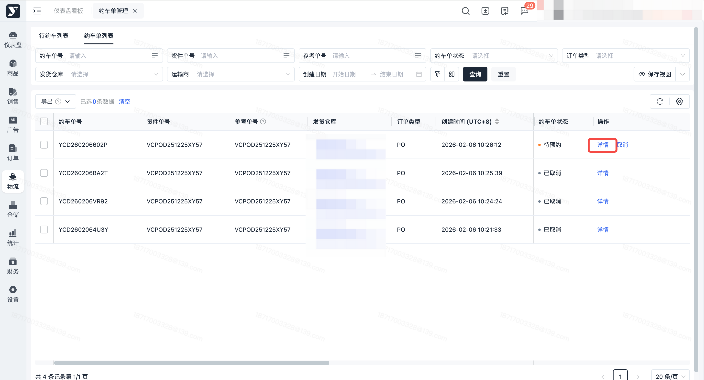

### 创建延迟提货

1. 功能描述：针对VCPO货件当前时间小于亚马逊预计提货时间的货件，仓库可能因为人力不足、爆仓等原因，明确告知某个货件无法按时备好货，为了避免运输商上门提空，影响仓库绩效，针对此类货件单，也需要创建约车单，重新和运输商确定一个新的提货时间
2. 操作步骤：

 1. 点击菜单【物流】-【约车管理】-【约车单管理】，点击待约车列表Tab

 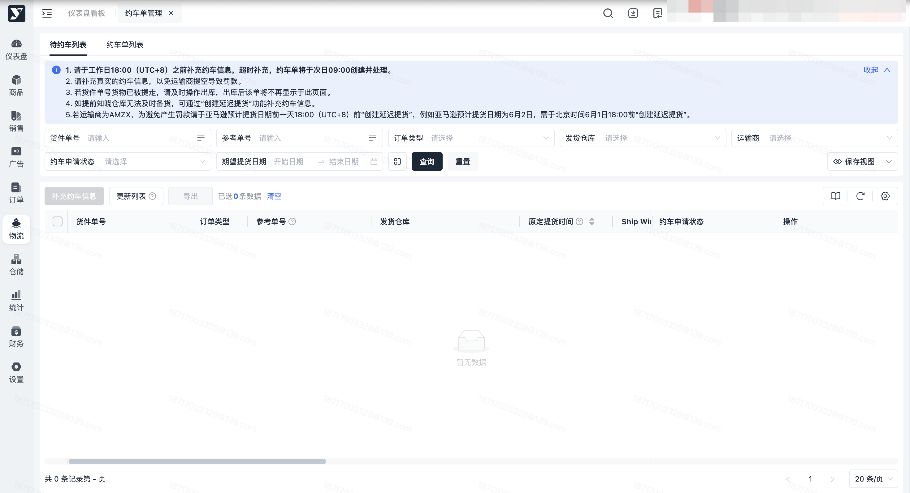

 1. 点击【创建延迟提货】按钮，输入筛选条件，填写期望提货时间、实际打托数后点击【确定】按钮

### 更新待约车列表

1. 功能描述：更新待约车列表数据，待约车列表数据显示的前置条件如下

 1. 订单类型=PO

 1. 且 货件单状态=待提货
 2. 且 运输模式=LTL/TL
 3. 且 运输商不为空
 4. 且 该VCPO货件单没有有效的约车单

 1. 有效的约车单同时满足：约车单状态=待预约/待运输商确认/已预约 且货件单关联状态=正常关联
 5. 且 当前时间≥亚马逊预计提货时间（日期）的VCPO货件单
 2. 订单类型=DF

 1. 且 货件单状态=待提货
 2. 且 运输商简称包含CEVA
 3. 且 该VCDF货件单没有有效的约车单

 1. 有效的约车单同时满足：约车单状态=待预约/待运输商确认/已预约 且货件单关联状态=正常关联
2. 操作步骤：点击菜单【物流】-【约车管理】-【约车单管理】，点击待约车列表Tab-【更新列表】按钮

 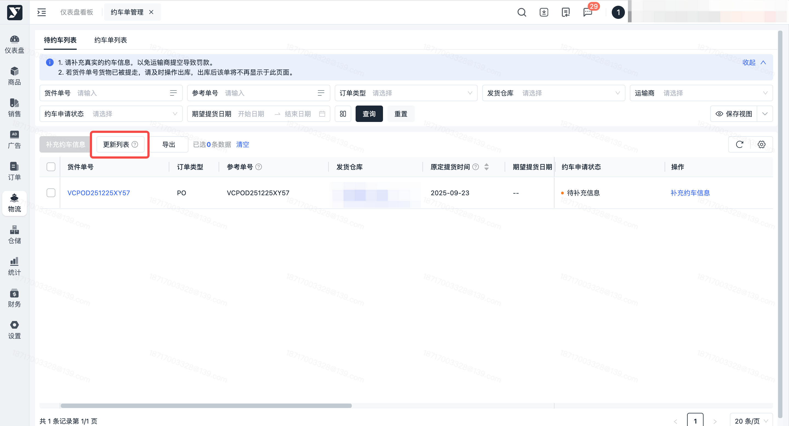

### 补充约车信息

1. 功能描述：针对需要约车的货件单，需要补充约车信息，包含期望提货时间、实际打托数、约车原因

 1. 期望提货时间：最早可选当前日期后的第一个工作日，最晚可选当前日期后的第二个工作日
 2. 实际打托数：请尽量填写准确的打托数，以便于运输商分配合适的车辆，须大于0，且不大于26

 1. 此字段添加后，不会联动更改货件单的实际打托数
 3. 约车原因：填写此次约车原因，包含首次约车、运输商未上门、仓库未备好货、其他

 1. 当选择其他时，需填写【具体原因】
 4. 批量应用：批量补充约车信息时，可以填写期望提货时间、实际打托数、约车原因后批量填充进所选的货件单
 5. 注意事项：约车信息在创建约车单前可多次补充
2. 操作步骤：

 1. 点击菜单【物流】-【约车管理】-【约车单管理】，点击待约车列表Tab

 

 1. 点击行上【补充约车信息】按钮或者勾选待约车数据后点击页面【补充约车信息】按钮

 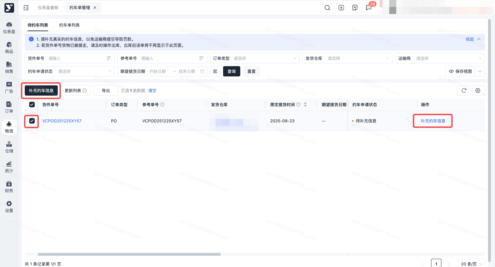

 1. 填写期望提货时间、实际打托数、约车原因后，点击【确定】按钮

 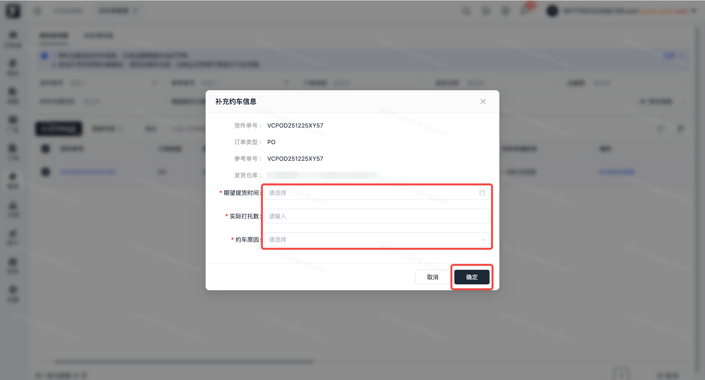

### 取消约车单

1. 功能描述：支持取消待预约约车单，取消后，货件单可重新在待预约列表创建约车单
2. 操作步骤：

 1. 点击菜单【物流】-【约车管理】-【约车单管理】，点击约车单列表Tab

 

 1. 点击【取消】按钮

 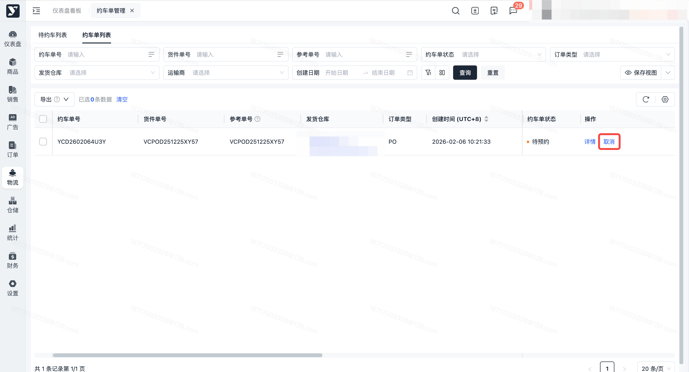

 1. 输入取消原因，点击【确定】按钮

 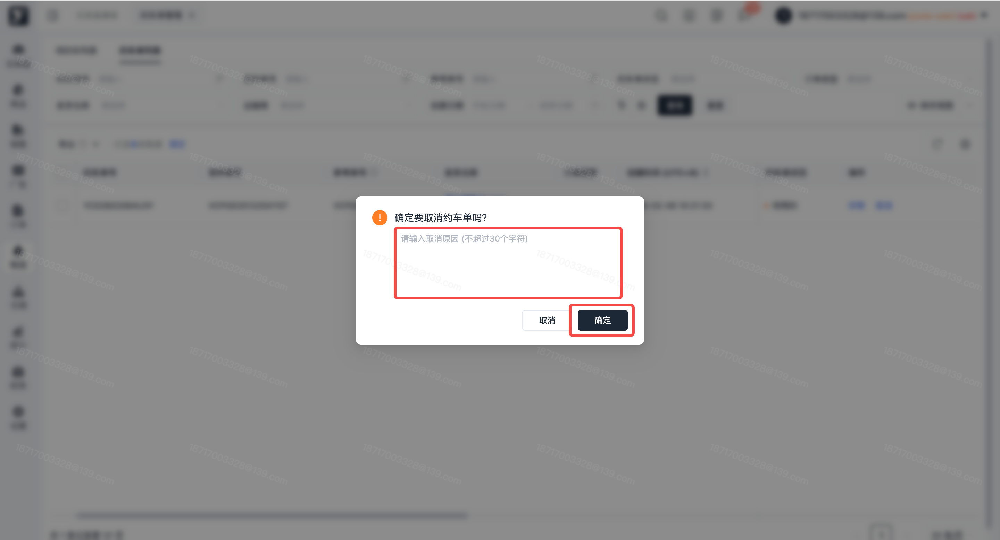

### 导出待约车列表

1. 功能描述：按条件搜索或勾选后导出待约车列表
2. 操作步骤：按条件搜索或勾选指定待约车数据后，点击【导出】按钮，导出待约车列表信息

 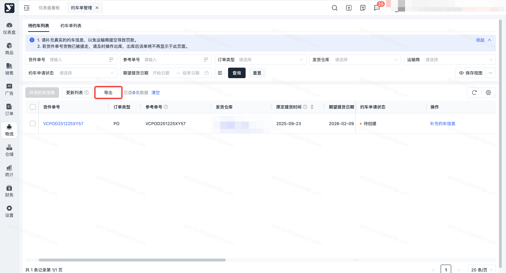

### 导出约车单列表

1. 功能描述：按条件搜索或勾选后导出约车单列表
2. 操作步骤：按条件搜索或勾选指定约车单后，点击【导出】-【导出列表】按钮，导出约车单列表信息

 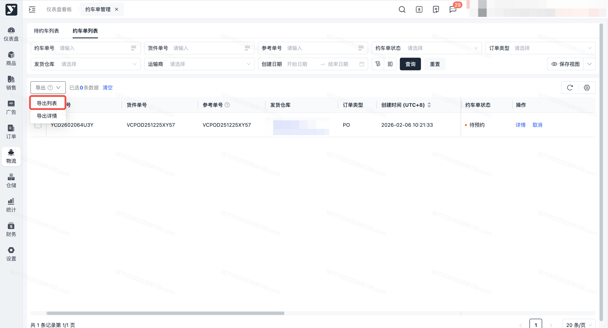

### 导出约车单详情

1. 功能描述：按条件搜索或勾选后导出约车单详情
2. 操作步骤：按条件搜索或勾选指定约车单后，点击【导出】-【导出详情】按钮，导出约车单详情信息

 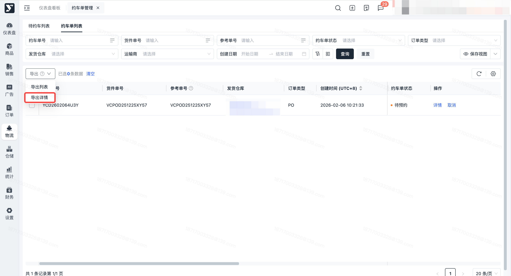
