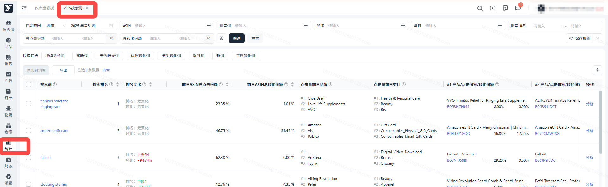
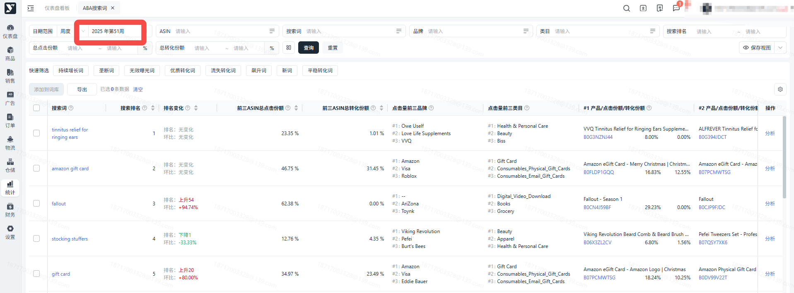
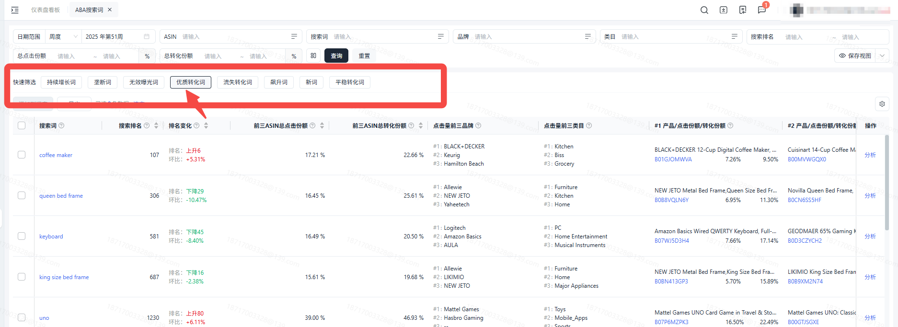
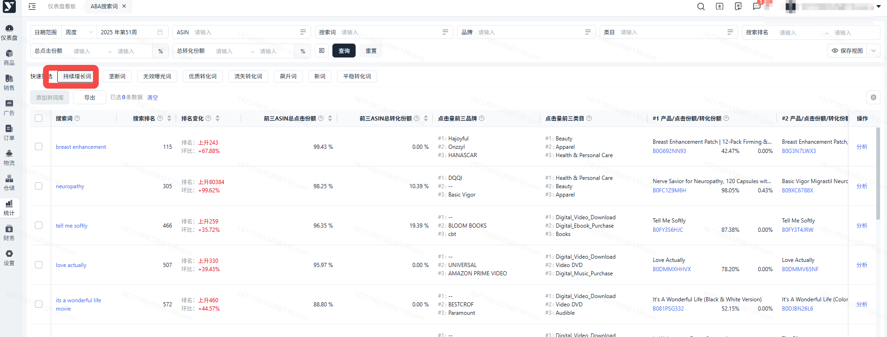
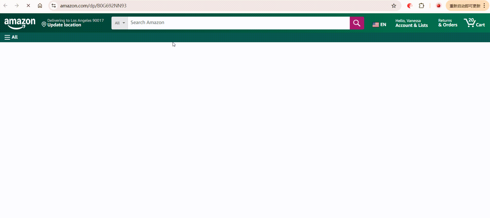
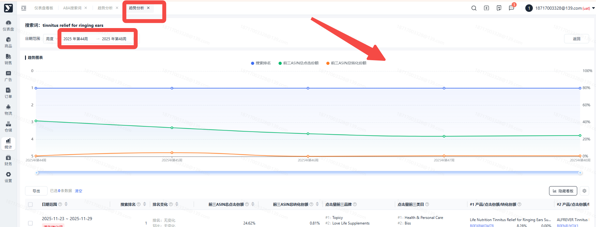
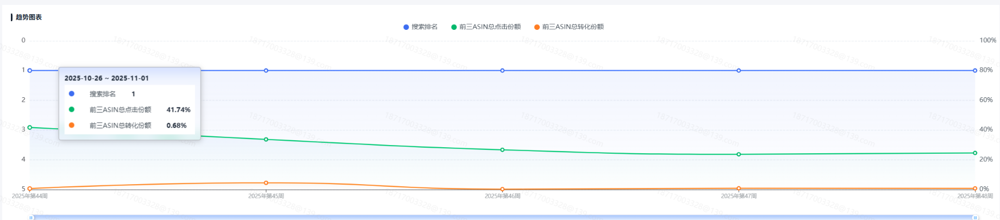
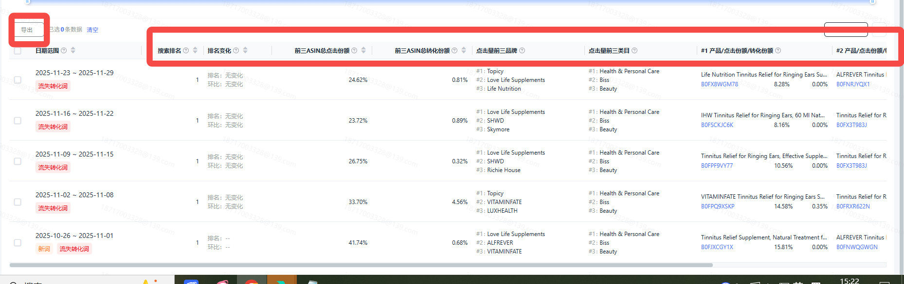

# 飞书文档：ABA搜索词报告

## 文档信息

| 项 | 内容 |
| --- | --- |
| 远程文档 | https://q1njej8cpab.feishu.cn/wiki/Ru7VwkfydiHA7QkcjXfcrFYynGf |
| 图片处理 | 本地下载（assets/images） |
| 快照时间 | 2026-08-06 |
| 来源命令 | `lark-cli docs +fetch --api-version v2 --doc https://q1njej8cpab.feishu.cn/wiki/Ru7VwkfydiHA7QkcjXfcrFYynGf --doc-format markdown --as user --format json --jq .data.document.content` |
| 格式处理 | fd-doc-markdown-sync/scripts/normalize-feishu-doc-markdown.mjs |

---

ABA搜索词报告

当前版本：v1.0.0

## ABA搜索词

亚马逊品牌分析（Amazon Brand Analytic）提供的搜索词报告（Top Search Term）包含三大核心要素：搜索词本身、对应的搜索排名以及排名前三的ASIN信息。这项功能为卖家提供了多维度的市场分析工具：首先，通过监测搜索词搜索热度，可以准确把握市场趋势变化，同时追踪自身产品在TOP3搜索词中的排名和份额变动；其次，分析搜索词搜索量排名趋势能够评估特定搜索词的垄断程度，从而发掘潜在的市场机会；此外，基于核心搜索词进行扩展延伸，建立完善的搜索词库，可高效应用于Listing内容优化和广告投放策略调整，确保快速响应流量变化，精准选择搜索词提升运营效果。

## 注意事项

1. 数据范围：目前平台系统支持查看周度/月度/季度的搜索词报告。
2. 更新频率：周度数据每周更新一次；月度数据每月更新一次，季度数据每三个月更新一次。
3. 数据存量：每次更新，单个时间周期最多存储30w条数据。
4. 数据保留时段：周度数据保留一年，月度数据保留两年，季度数据保留四年。
5. **暂不支持数据导出功能。**

## 字段说明

1. **搜索词：**亚马逊网站中买家的搜索词内容。
2. **搜索排名：**在查询日期的搜索量排名，排名越靠前表示搜索量越大。
3. **排名变化：**排名指本期搜索排名较上期相比的变化情况。环比指本期的搜索频率排名相对于上期的百分比变化，计算公式为（本期排名 - 上期排名） / 上期排名 × 100%
4. **前三ASIN总点击份额：**搜索词Top前三产品的点击份额总和。
5. **前三ASIN总转化份额：**搜索词Top前三产品的转化份额总和。
6. **点击量前三品牌：**该搜索词下点击量最高的3个品牌。
7. **点击量前三类目：**该搜索词下点击量最高的3个类目。
8. **产品/点击份额/转化份额：**该搜索词下排行TOP3的产品信息及其点击份额和转化份额。

## 操作流程

##

1. 操作路径：【统计】-【 ABA搜索词】

1. 进入列表后默认展示为周度，且最新更新一周的报表数据。

1. 筛选搜索词

 1. **通过时间、排名、前三商品的点击份额/转化份额、排名变化趋势等筛选条件获取搜索词**

 - 数据范围：支持周、月、季度，默认选“周”维度，可根据实际需要进行切换。
 - 搜索排名/总点击份额/总转化份额：输入想要查询的数据范围，至少需要输入一个值时才查询。
 - **直接通过搜索词、ASIN、品牌、类目搜索搜索词，**支持最多200个的批量搜索，一次查询，方便快捷。

 
2. 快速筛选：

 

 1. 支持选择标签，快速筛选出符合规则的词汇。
 2. 快速筛选可与搜索框进行组合查询，同时查找出满足快速筛选条件和查询框的词汇数据。
 3. 标签定义规则如下：

##

1. 您可以看到搜索词的排名（排名越小，搜索量越大）、趋势、排名变化、前三点击份额和前三转化份额及前三商品的明细转化份额。

 - 根据搜索词排名趋势变化，了解搜索词当前流量处于增长状态还是下滑状态
 - 根据搜索词的排名，评估市场容量
 - 根据前三商品的点击份额和转化份额，判断市场机会。份额高低表示被垄断的程度，前三份额占比越高，机会越小；前三份额占比越小，机会越大。

 
2. 跳转交互1：点击搜索词后跳转至亚马逊网站中，该条搜索词搜索结果页面。

1. 跳转交互2:点击ASIN跳转到产品的Listing页面中。

 1. ABA搜索词中的出现的ASIN不与供应商挂钩，亚马逊提供的全站所有的ASIN数据池。

 

##

1. 点击某搜索词在操作栏的【分析】功能，可进入该词汇的近期趋势分析页面。

 1. 支持查看多周期的名次及份额变化趋势，以便你对需要重点关注的关键词进行进一步分析，通过关键词的排名趋势和前三商品份额的趋势变化，分析关键词的需求波动及垄断程度变化

 

 
2. 在词汇的趋势分析页，可调整查看的日期维度和范围，页面会根据查询范围生成趋势图表，表内包含搜索排名、总点击份额、总转化份额指标。

1. 列表页会展示查询日期范围内该搜索词的历史表现，及在每一时间周期符合的标签。

## 常见问题

##

答：如果品牌名称未通过亚马逊品牌注册中心注册到特定品牌，可能会显示为“-”。

##

答：在周期内出现时间不连续情况，说明该搜索词在对应时间区间内未被系统收录。
