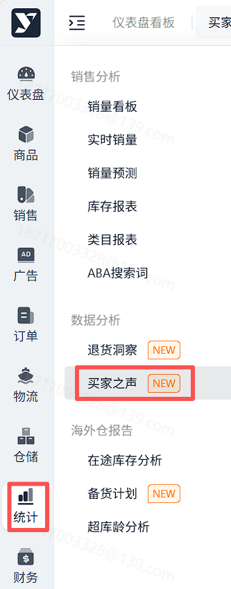
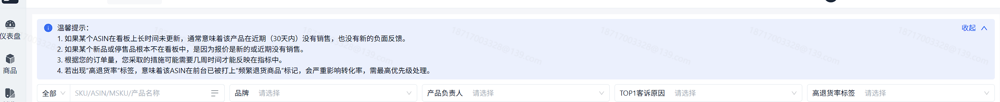
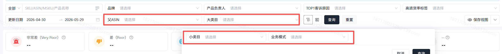
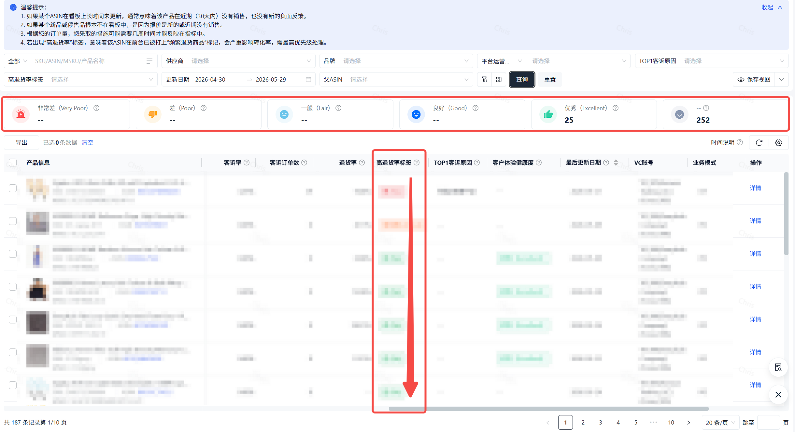
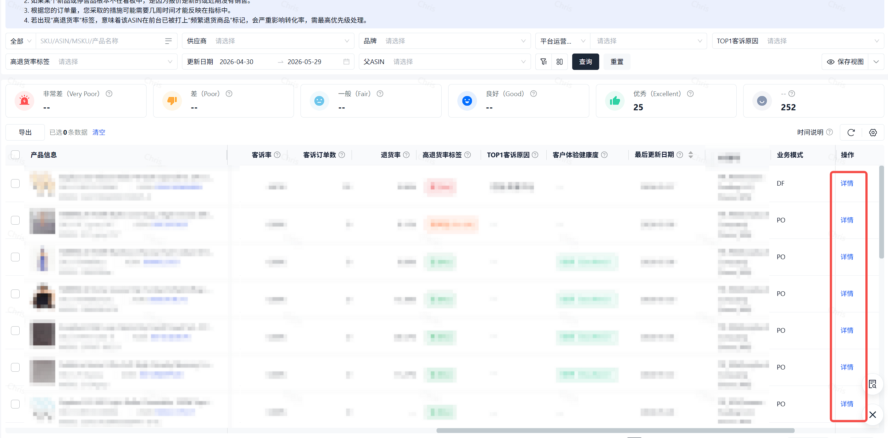
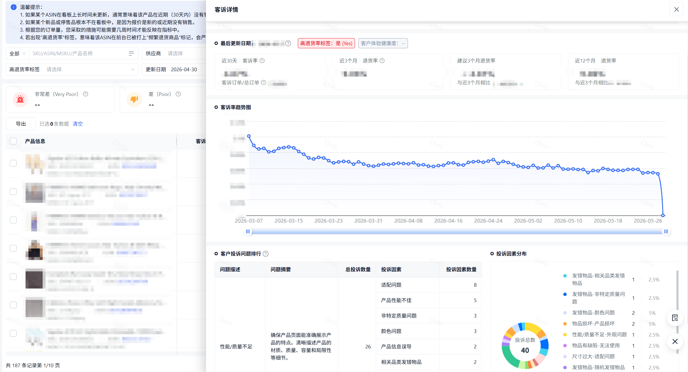

# 飞书文档：买家之声

## 功能介绍

1. 买家之声（Voice of the Customer）有助于收集和分析客户反馈，监控客户满意度并识别产品问题，从而提升客户体验并优化产品列表；
2. 数据每日更新，但亚马逊并非会为所有ASIN频繁更新数据。ASIN当前记录的时效性，可以通过表格内“
**最后更新日期**”进行确认；

## 名词解析

| 字段名称 | 解释 |
| --- | --- |
| 客诉率 | 客诉率（NCX Rate） 是基于该产品最近30天的订单，计算其中客户报告了问题（如质量、描述不符等）的订单所占的比例。它反映了产品近期的客户体验健康度。 |
| 客诉订单数 | 客诉订单数（NCX orders）在收到商品最近一份订单之前30天内买家反馈了商品/商品信息相关问题的订单数量 |
| 退货率 | 退货率（Return rate）是基于过去 12 个月中客户发起退货的已发货商品总数计算的。退货率是退货订单的百分比，计算方法是退货订单数量除以订单总数。 |
| 高退货率标签 | 指ASIN在前台是否被打上“频繁退货商品”标记。亚马逊在确定哪些ASIN会被标记为“频繁退货商品”时，会使用多种销售和退货信息，包括但不限于： 1. 足够的近期销售以确定准确的退货率 2. ASIN的退货率 3. 具有类似属性产品的平均退货率 |
| 客户体验健康度 | 客户体验健康度（CX Health）评估来源于指最近30天的订单与反馈。是将您产品的负面体验率 (NCX Rate) 与同类产品进行对比后的评级。建议审核所有CX健康度为‘差’和‘极差’的ASIN以了解和解决问题。 |
| 最后更新日期 | 最后更新日期（Last updated）显示的是最近一次订单/负面客户体验（NCX）发生的日期。仅对最近有销售的offer，才提供NCX评分和CX健康状况。 |

## 页面路径

统计->数据分析->买家之声

## 操作说明

### 横幅提醒，功能使用说明

### 筛选条件

支持AISN相关的，多维度的筛选

支持“父ASIN”、“大类目”、“小类目”、“业务模式”的筛选

### 默认排序规则，客户体验健康度筛选

1. 默认按照退货率标签，从是到否进行排序，高退货率标签的靠前
2. 可以点击上方卡片，对客户体验健康度的等级点击，进行筛选

### 客诉详情，了解“客诉率趋势”以及“客户投诉问题排行”

1. 详情进入位置如图

1. 客诉详情页面如图，可查看“客诉率趋势图”以及“客户投诉问题排行”

