# 飞书文档：备货计划

## 功能介绍

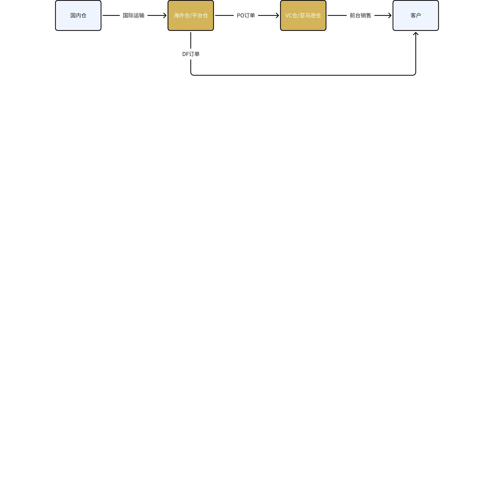

如图所示为货物在VC业务中的仓库流转，**【海外仓/平台仓】和【VC仓/亚马逊仓】**都需要避免断货影响前台销售。

根据销量预测，预测ASIN未来的库存趋势。

在尽可能保证不断货的基础上，提示下一次需要的备货数量以及备货每个阶段对应的时间点。

根据【销量预测】的数据来源，分为了两张看板，分别为：

1. 【自建销量预测】（提供的备货计划）
2. 【亚马逊销量预测】（提供的备货计划）

## 注意事项

### 【自建销量预测】

1. 需要通过【调整备货规则】手动维护才能够获取正确结果。三个子板块，分别是：

 1. 【预测销量规则】：通过规则和系数的调整，对ASIN未来销量做出预测
 2. 【销量去噪】：通过对历史销量进行调整，避免对预测销量产生影响
 3. 【补货规则】：决定了海外仓/平台仓的备货周期，以及在此处调整“安全库存水位”
2. 以上功能的详细操作见下方操作流程

### 【亚马逊销量预测】

1. 顾名思义，亚马逊提供了计算备货计划所必须的销量预测数据。
2. 无需频繁维护，但是依然有控制项。

 1. 【调整补货规则】：决定了海外仓/平台仓的备货周期，以及在此处调整“安全库存水位”（数据同步【自建销量预测】中的【备货规则】）
3. 因为【亚马逊销量预测】的维护成本低，并且反映了亚马逊视角的市场需求。所以其他功能引用备货计划数据会优先引用【亚马逊销量预测】（提供的备货计划）

### 海外仓/平台仓的维护

1. 为了获取海外仓/平台仓的【备货期内预计入库】需要供应商配合完成海外仓当前在途物流的新增。
2. 具体位置：仓储->入库单列表->新增入库单->必须填写预计到达时间->提交；

1. 平台端和客户端数据互通。鼓励供应商自助通过此功能完成备货计划的维护和计算。
2. 参与计算的ASIN：

 1. 产品列表中，所有处在接单状态的ASIN
 2. 如果ASIN的所有offer均没有正在接单，在此处搜不到对应的ASIN
3. 更新频率为每日一次，支持手动刷新预测

## 操作流程

### 查询条件

支持通过两种销量预测数据获取备货建议，位置在顶部

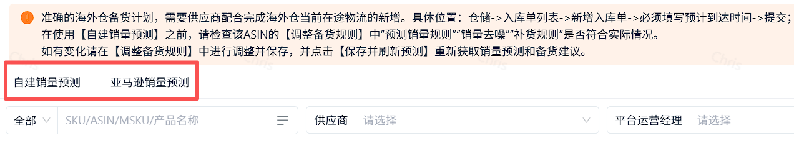

支持通过asin、供应商、建议生产/采购日期、建议国内发货日期、建议BTR日期、建议DF接单时间进行筛选

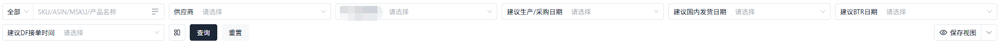

同时支持点选仓库状态分布，进行组合筛选

### 自建销量预测

#### 路径

【报表】->【海外仓报告】->【备货计划】->【自建销量预测】

#### 顶部卡片

1. 提供根据海外仓库存状态、VC仓库存状态统计的ASIN数量

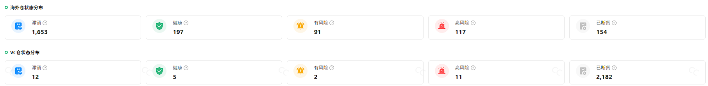

1. 海外仓库存状态释义

 1. 滞销：海外仓可用库存>未来2个备货周期总销量
 2. 健康：海外仓可用库存>未来1个备货周期总销量
 3. 有风险：未来1/2个备货周期总销量＜海外仓可用库存未来60天销量
 2. 健康：VC可售库存>未来28天销量
 3. 有风险：未来14天销量＜VC可售库存
通过调整备货规则，让自建预测销量更符合预期

##### 功能入口

自建预测销量->调整备货规则。如图

##### 【预测销量规则】

1. 默认销量算法

 1. 支持以“动态计算”或“固定值”两种方式对未来的基准销量做出预测

 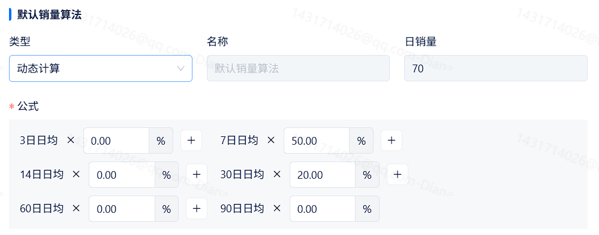

 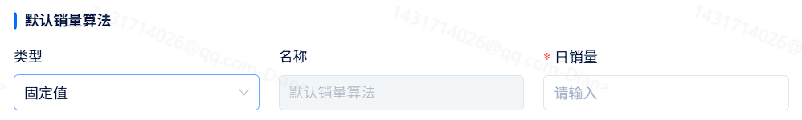

 1. 动态计算：使用不同时间段的去噪销量进行加权计算得到未来的“日销量”
 2. 固定值：输入一个日均销量，作为未来的“日销量”
2. 活动系数

 1. 如果未来时间段有预定活动的覆盖，会通过活动系数对未来的“日销量”进行百分比的修正。修正结果会与【特殊时间段系数】叠加

 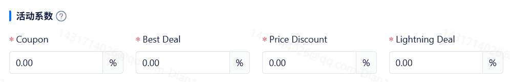
3. 特殊时间段系数

 1. 如果未来时间段有促销/节日活动，会通过系数对未来的“日销量”进行百分比修正。修正结果会与【活动系数叠加】
4. 修正销量算法

 1. 支持以“动态计算”、“固定值”或“历史销量”，三种方式对未来的一个时间段的销量做出预测调整。

 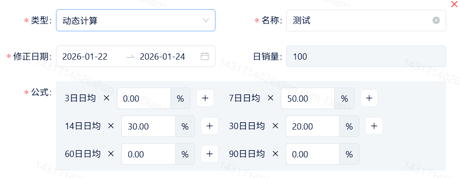

 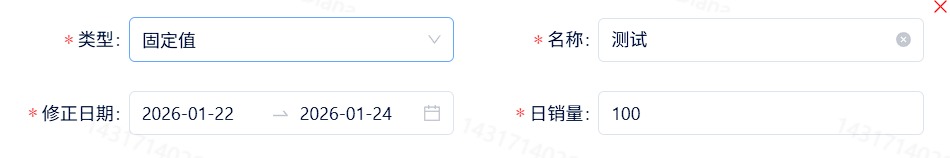
 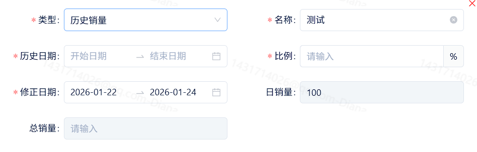

 1. 动态计算：使用不同时间段的去噪销量进行加权计算，得到未来一个时间段的“日销量”
 2. 固定值：直接输入一个日销量，作为未来一段时间的“日销量”
 3. 历史销量：选择过去一个时间段的历史销量，直接挪用到未来作为对应时间区间的销量预测。并支持百分比调整。
 4. 需要注意：一旦将未来的销量通过【修正销量算法】进行修正，该区间将不再受到【活动系数】和【特殊时间段】系数的影响，避免重复计算。

##### 【销量去噪】

针对性的调整历史销量数据，抹平异常的波峰和低谷，避免对【自建销量预测】中的【动态计算】造成影响

1. 支持以“固定值去噪”和“百分比去噪”，对历史销量进行修正

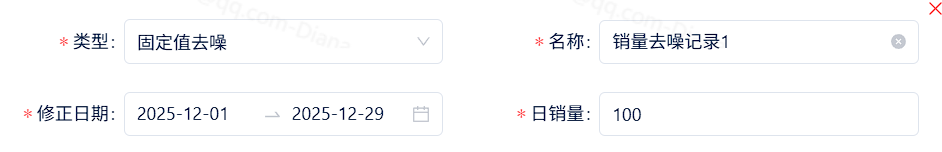

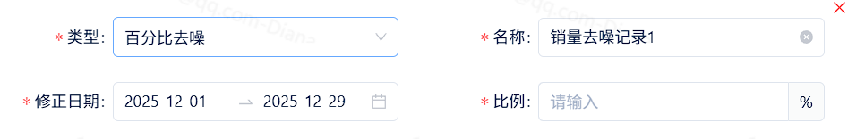

1. 固定值去噪：直接输入一个日销量，替换一段时间的历史销量参与销量预测的计算。
2. 百分比去噪：输入一个比例，将一段时间历史销量按比例计算后，再参与销量预测的计算。

##### 【补货规则】

1. 海外仓备货周期

 不同ASIN根据自身情况可能有不同的备货周期，建议主动维护。海外仓备货周期会影响备货计划中各个时间点。

 1. 海外仓备货周期默认48天，如图：

 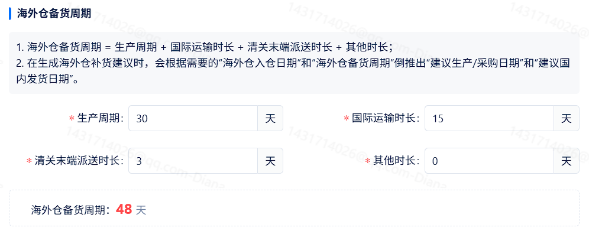
2. 安全库存相关

 安全库存水位指的是海外仓要留未来X周预测销量的库存，作为可能发生突发情况的兜底。

 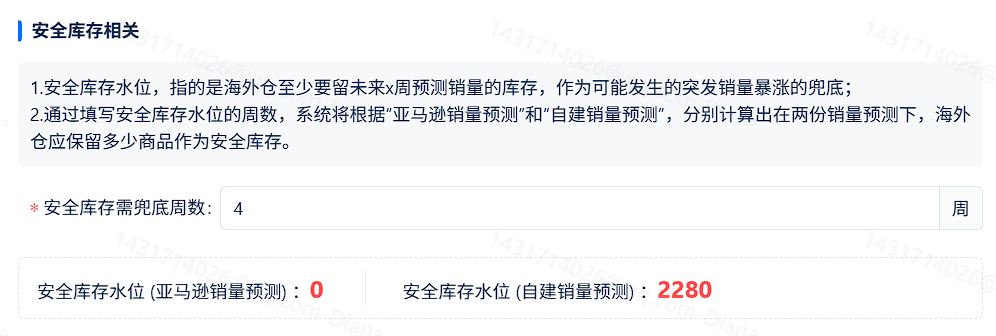

 1. 如果没有安全库存水位，海外仓备货建议只会避免断货。
 2. 根据亚马逊销量预测与自建销量预测两套预测值，安全库存水位也会有对应的两个值，对应两套备货计划的计算。

##### 【预测销量预览】

在左侧进行的调整，最终会影响到自建预测销量。通过【保存并刷新】按钮完成对预测销量预览的刷新，确认自己的调整结果。

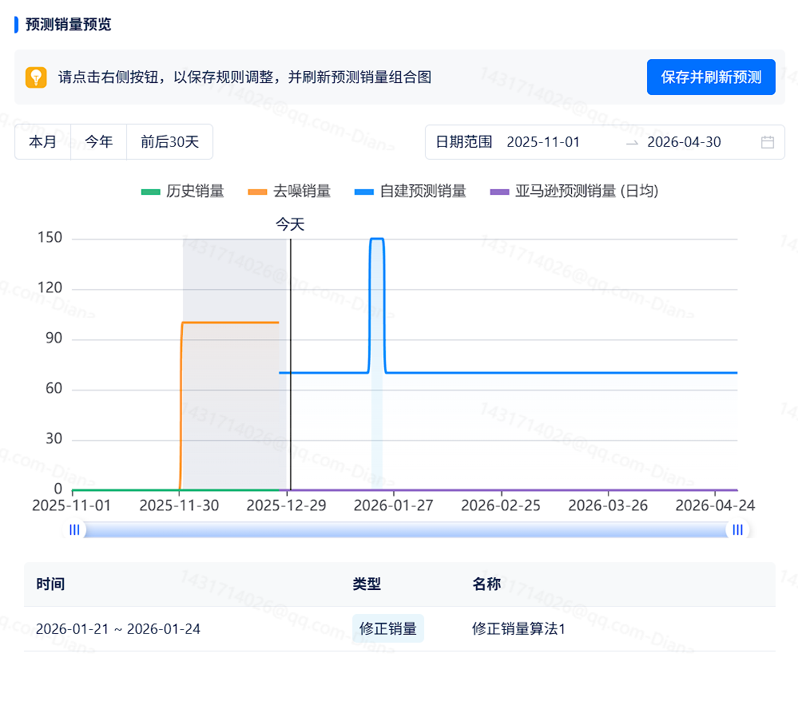

1. 在“今天”的左侧，是来源于亚马逊销量报表的历史销量，以及经过【销量去噪】调整后的“去噪销量”

 1. 色块覆盖的区间，指的是区域内存在【去噪销量】的影响。
2. 在“今天”的右侧，是通过【预测销量规则】获得的未来预测销量

 1. 色块的覆盖区间，指的是区域内存在【活动系数】【特殊时间段系数】或【修正销量算法】的影响。
3. 在此反复调节，并点击【保存并刷新预测】，得到符合预期的自建销量预测曲线。

#### 补货建议明细

##### 功能入口

1. 自建预测销量->调整备货规则。如图

 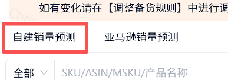

 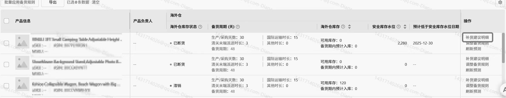

##### 【海外仓补货预览】

1. 海外仓/平台仓的历史可用库存，根据【自建预测销量】进行逐日扣减，直到低于“安全库存水位”的日期，就是备货计划需要的“预计入仓”日期。
2. “建议备货数量”约为在“预计入仓”日期，将“未来可用库存预测”抬升至“满足一个备货周期”的商品数量。
3. 海外仓目标库存量=未来一个备货周期的预测销量+安全库存水位

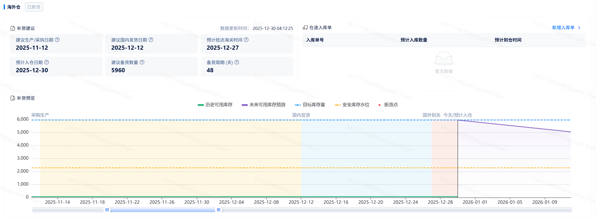

1. 如果有“在途入库单”影响到了“未来可用库存预测”，入库单的预计入库时间和入库数量将会在折线图上呈现。
2. 注意：如果已有在途但是没有录入系统的入库单，需要录入后刷新预测。避免影响“未来可用库存预测”的准确度。

##### 【VC仓补货概览】

1. 由于VC仓无法确认在途库存的具体入仓时间，所以将会混合最新的“亚马逊可用库存+亚马逊在途库存”，作为“未来可用库存预测”的基数。
2. 亚马逊可用库存+亚马逊在途库存，根据【自建预测销量】进行逐日扣减，直到低于“安全库存水位”的日期，就是备货计划需要的“预计入仓”日期。
3. “建议备货数量”约为在“预计入仓”日期，将“未来可用库存预测”抬升至“目标库存量”的商品数量。

 1. VC仓目标库存量=未来28天的预测销量

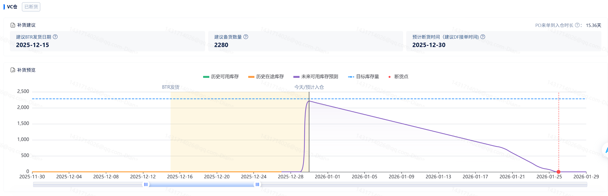

1. 建议BTR发货日期，根据VC仓为避免断货需要的入仓时间，通过供应商历史PO订单的动销速度向前推算时间得出。

 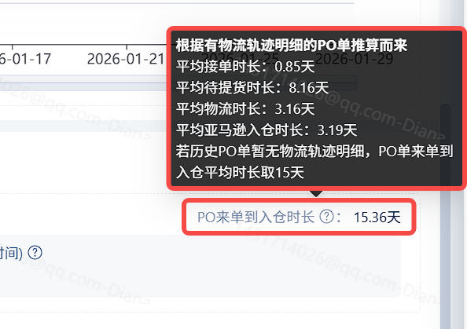

 1. PO订单的动销速度计算方法还有待于进一步开放给供应商查验。
2. 注意：由于主动向VC仓补货只能够通过BTR的方式，理想情况下需要根据预计断货时间反推BTR发货日期。如果BTR申请失败且没有PO来单遭遇断货，请在预计断货时间及时打开DF接单方式。

#### 列表

1. 通过以上的【调整备货规则】以及【补货建议明细】获得的总结性内容，在外部以列表的形式进行预览，方便筛选和快速查询。
2. 需要优先关注“高风险”和“有风险”，以及“断货”的库存状态，尽量防止任何一个正在运营的ASIN，其中某个仓库出现断货的情况。

### 亚马逊销量预测

#### 路径

【报表】->【海外仓报告】->【备货计划】->【亚马逊销量预测】

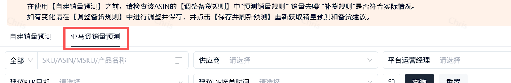

#### 和【自建销量预测】的使用区别

1. 由于亚马逊销量预测已提供了一份每个ASIN的销量预测（实为市场需求预测），【亚马逊销量预测】备货计划板块无需手动维护销量预测。

 1. 也受亚马逊销量预测的影响，如果该ASIN的销量预测拉取失败，库存状态即显示为“无预测销量”，无法获取亚马逊销量预测的备货计划。
2. 因为亚马逊销量预测最细颗粒度为【周】，并没有精确到【日】所以造成了以下影响

 1. 海外仓/平台仓的“预计低于安全库存水位日期”，为一个周的时间范围
 2. VC仓/亚马逊仓库的“预计断货时间（建议DF接单时间）”，为一个周的时间范围
 3. 为留出冗余避免库存不足，备货建议给到的建议日期均为从“一个周的时间范围”的周一往前进行推算
3. **使用亚马逊销量预测获取备货计划，依然需要进行手动维护的项目**

 1. 如果已有在途但是没有录入系统的入库单，需要录入后刷新预测，才不会让海外仓/平台仓的在途库存影响到备货计划的计算。
 2. 想要获取相对准确的备货计划，依然需要调整【海外仓备货周期】和【安全库存相关】。这两个项目只需要调整一次，如果无后续变化可以不用频繁调整。
4. 亚马逊销量预测暂无【补货建议明细】的页面，但是关键决策依然可以通过列表中的总结性内容得到结果。

### 批量应用备货规则

将一个已维护好的ASIN【预测销量规则】、【销量去噪】、【补货规则】，批量应用到相似的ASIN上，减少重复设置的工作量

#### 功能入口

列表的左上角

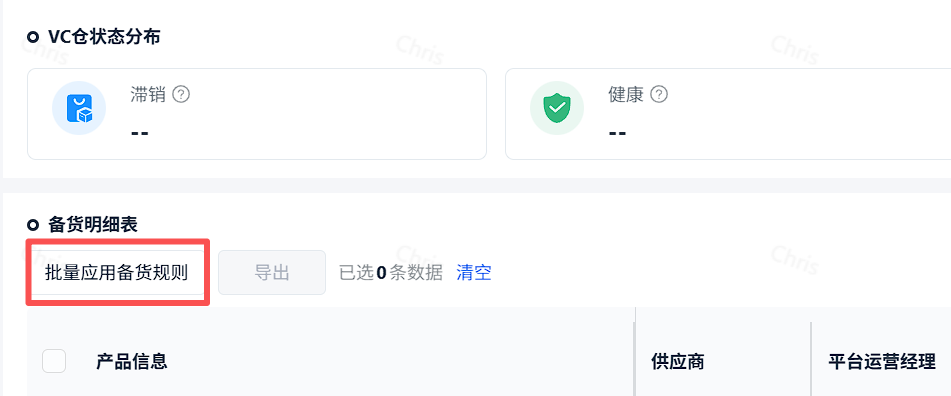

#### 功能介绍

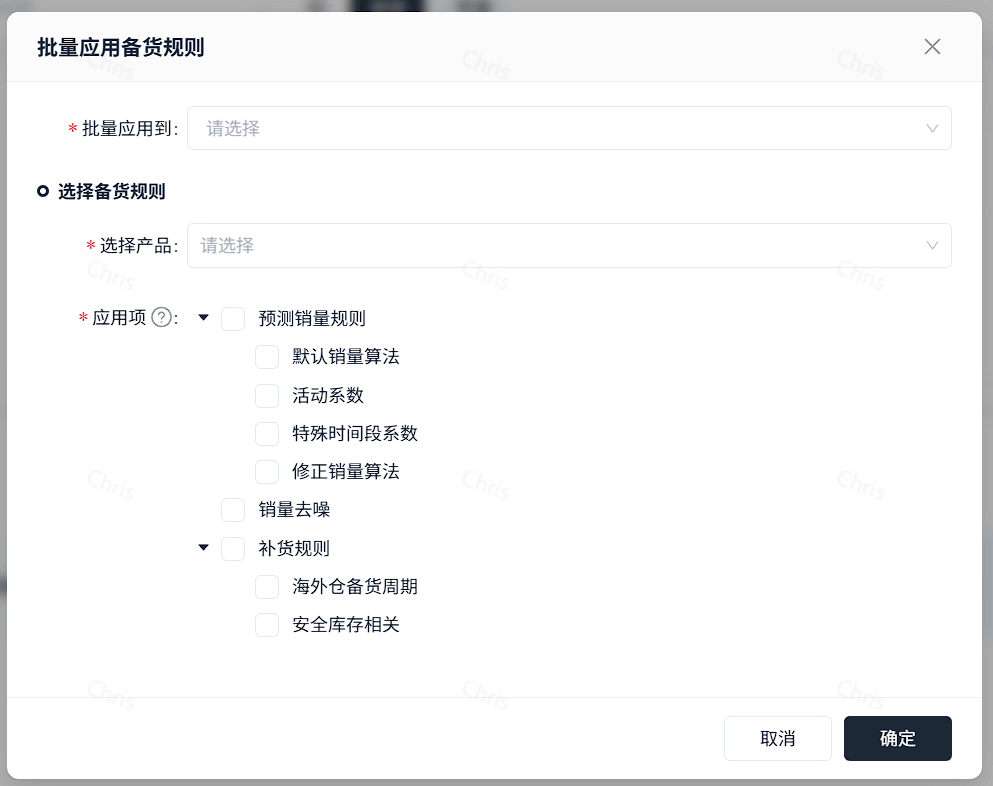

1. 多选“批量应用到”的ASIN；
2. 选择被复制的已设置好的ASIN；
3. 单选或多选应用项，

 1. 选择的应用项将会覆盖到“批量应用到”的ASIN；
 2. 未选择的应用项将会保持原状不会被覆盖；
4. 确认无误后点击保存。
