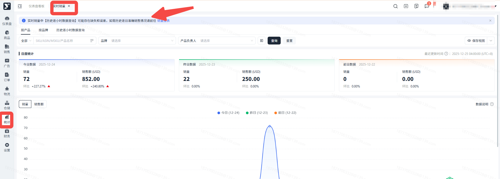
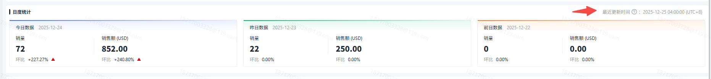
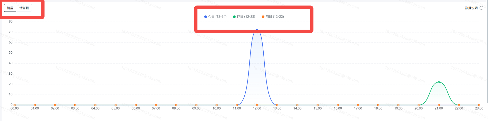
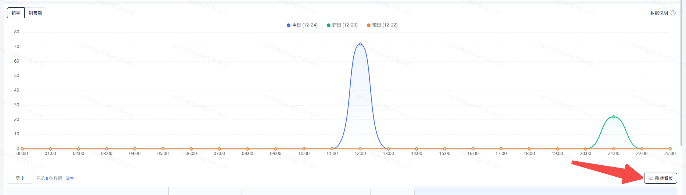
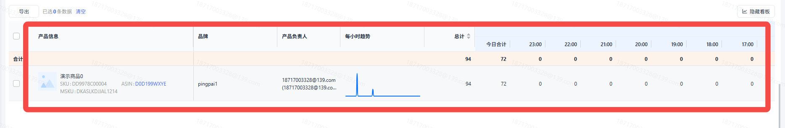
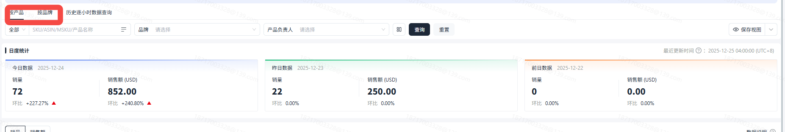
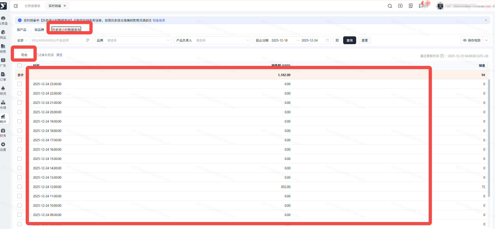
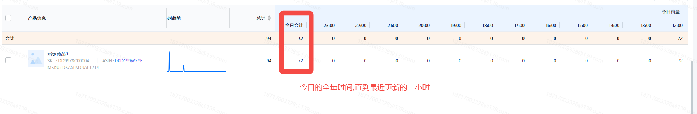
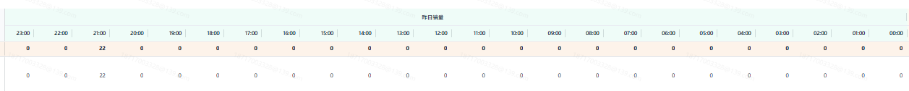
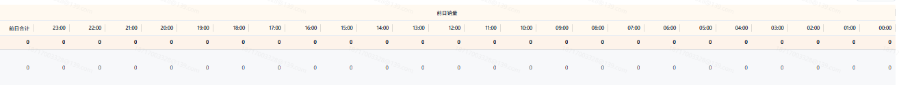

# 飞书文档：实时销量

## 文档信息

| 项 | 内容 |
| --- | --- |
| 远程文档 | https://q1njej8cpab.feishu.cn/wiki/TYpiwMyotizF5HkHLwYc9JM8nsh |
| 图片处理 | 本地下载（assets/images） |
| 快照时间 | 2026-08-06 |
| 来源命令 | `lark-cli docs +fetch --api-version v2 --doc https://q1njej8cpab.feishu.cn/wiki/TYpiwMyotizF5HkHLwYc9JM8nsh --doc-format markdown --as user --format json --jq .data.document.content` |
| 格式处理 | fd-doc-markdown-sync/scripts/normalize-feishu-doc-markdown.mjs |

---

实时销量

## 功能介绍

实时销量是统计产品在近三天内在亚马逊网站产生的销量和销售额数据的报表，实时销量数据来源于亚马逊VC【Report】-【Real time sales】报表中。

## 注意事项

1. 实时销量报表数据目前每半小时更新一次。
2. 实时销量中的销量和销售额数据是终端用户在亚马逊网站上下单产生的销售数据，不跟业务类型的订单挂钩。

## 操作流程

##

1. 实时销量页面主要由三部分数据组成：**日度统计、趋势图、列表数据、历史逐小时数据查询**
2. **日度统计**注：当日数据仅统计了0点到最新更新一小时的汇总，前两日数据统计了0点到23点完整的销售数据。

 

 1. 分为今日、昨日、前日三种卡片，统计已配置的产品当日产生的销量和销售额总和，以及环比值。
3. **趋势图**

 

 1. 根据近三天每小时的的销量横向对比，目的是帮助识别销量高峰和低谷时段，通过对比不同日期的同一时段销量，分析是否存在规律性波动，如工作日与周末的差异。
 2. 可控制折线图隐藏或展开。

 
4. **列表数据**

 1. 提供两种维度的列表查看维度，进入默认选中【按产品】展示数据，可手动切换为【按品牌】展示数据。

 

 1. **按产品**

 1. 一条数据对应一个产品，产品不区分业务类型。

 
 2. **按品牌**

 1. 一条数据对应一个品牌，仅汇总已配置的产品去重后的品牌数据。

 
 3. **历史逐小时数据查询**

 1. 可以查询实时销量记录的历史逐小时的数据集合。由于是快照数据，所以【历史逐小时数据查询】可能存在缺失和误差，如需历史逐日准确销售情况请前往【销量报表】

 
 4. **时间范围定义**：数据展示的时间范围包括两部分：

 - **当天**：从0点开始到最新一小时的数据（即当天已过时间段）。

 

 - **前两天**：完整的48小时数据（即前两天的0点到24点）。

 

 

## 常见问题

##

答：亚马逊数据每小时更新一次；系统每隔半小时请求一次亚马逊的数据。

##

答：亚马逊没有给出对于实时销量统计的准确定义，目前已知的是实时销量包含了PO和DF销量，并且包含了退货数量的，这也是其中有些数据表现为负数的原因。
