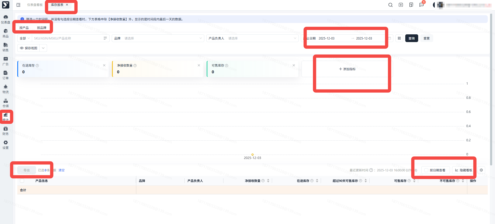
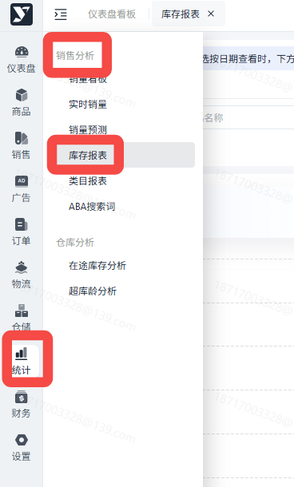
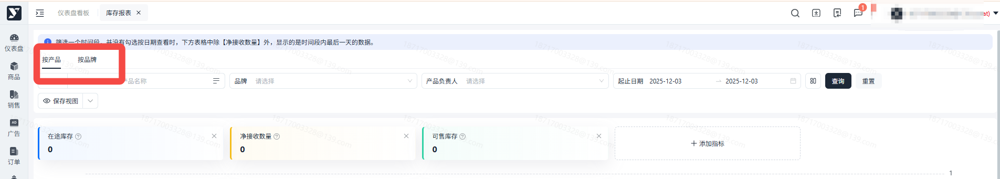
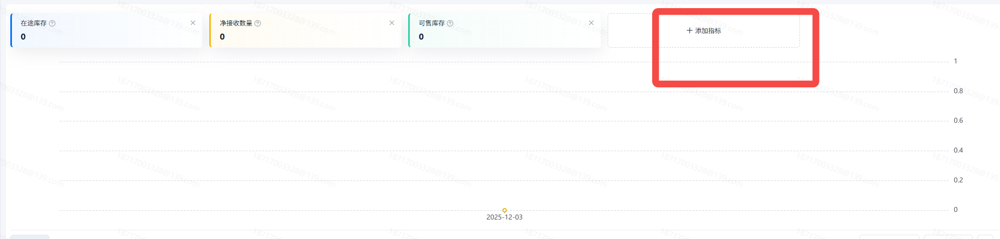
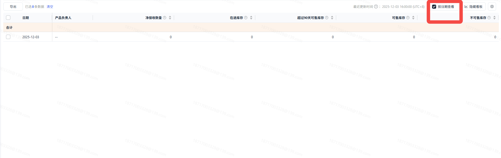
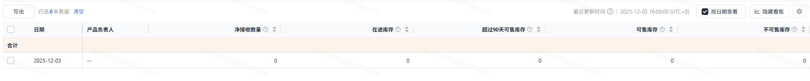

# 飞书文档：库存报表

库存报表

## 功能介绍

1. 此报表可以展示当前产品在亚马逊仓库中的情况，包括可售库存，不可售库存，及积压库存情况；

## 注意事项

1. 库存数据中的部分字段，包括**“在途库存”、“可售库存”、“不可售库存”、“可售库存成本”、“不可售库存成本”、“未履行顾客订单数量”、“超过90天可售库存”**展示选择日期最后一天的情况，其余的两个**“净接受数量”和“净接受金额”**展示选择日期的聚合数量；
2. 库存报表的更新频率一般会有2-3天延后（跟亚马逊的报表保持一致）

## 操作流程

### 页面路径

1. 统计->销售分析->库存报表

##

点击屏幕上方的“按产品”、“按品牌”来切换下方筛选和表格内的聚合维度。需要注意按品牌时，运营负责人查看自己负责的ASIN数据不生效。

##

支持多选库存相关的指标，在折线图中进行聚合查看。可通过点击的方式添加/隐藏指标，最多同时显示5个指标。

##

勾选表格右上角的“按日期查看”，表格内的数据会切换为逐日颗粒度的数据。在此查看方式下，日维度下的细分数据将会被隐藏，同归属于单日数据。

##

通过下方表格中的操作栏“只看该项”，点击后可以快速将当前ASIN/品牌回填至上方筛选项，并完成筛选

有数据才有【只看该项】，在下方截图不可售库存右边列会显示【操作】，在操作栏

