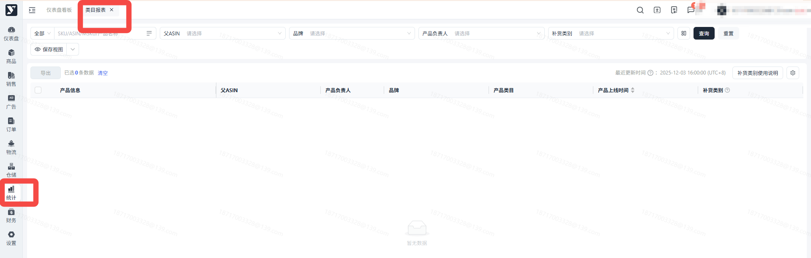
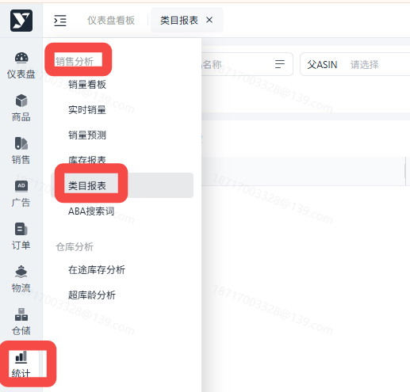
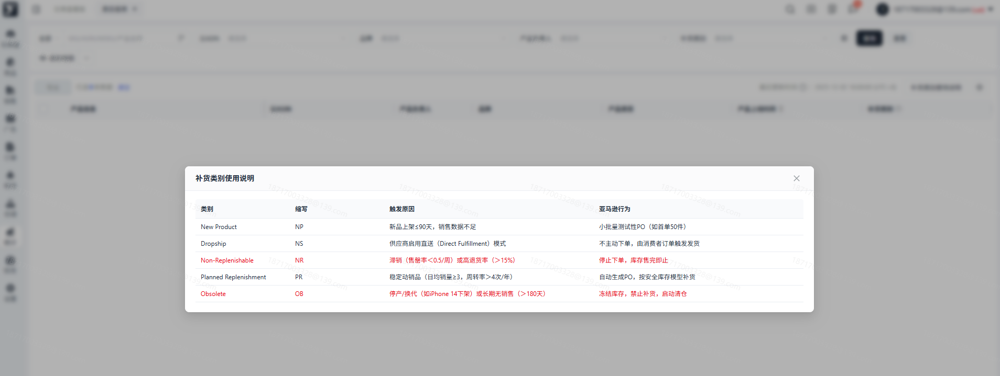

# 飞书文档：类目报表

## 功能介绍

1. 此报表展示了每个ASIN下所属的产品类目、产品上线时间、亚马逊提供的补货类别；
2. 同步亚马逊更新日期，每日定时拉取；

## 注意事项

1. 仅显示ASIN的最新更新的数据，没有历史情况的查询；
2. 产品上线时间取用的是，商品->Catalog中，多个offer中最早的创建时间，作为该产品的上线时间；

## 操作流程

### 页面路径

1. 统计->销售分析->类目报表

补货类别和补货类别参考代表了亚马逊视角下对该ASIN的定义，亚马逊提供的补货类别代表了亚马逊对该ASIN的定义和可能会发生的动作，仅供参考。

1. 内容和入口如图

