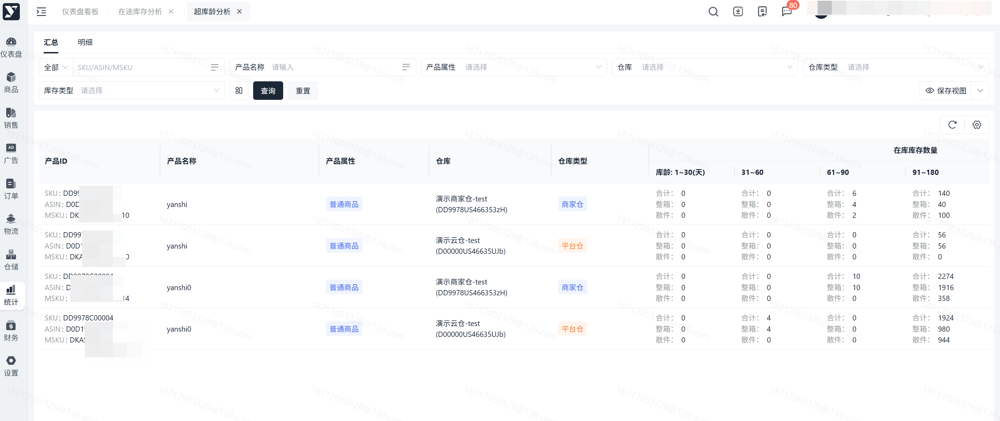
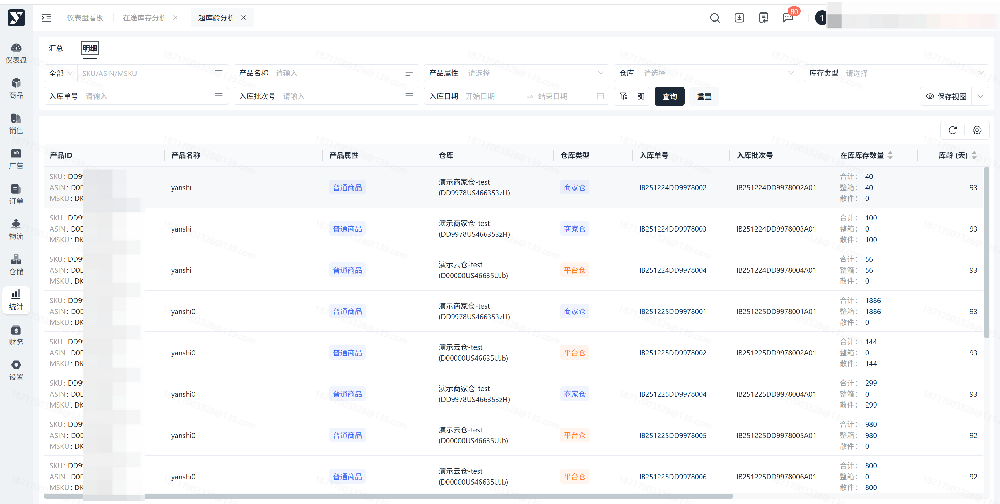

# 飞书文档：超库龄分析

## 功能介绍

显示在库库存的库龄分布情况。

汇总表：以 “产品ID+仓库” 维度 统计在库库龄。

明细表：以 “产品ID+时间+入库单号+入库批次号” 维度 统计在库库龄。

## 页面路径

【统计】-【海外仓报告】-【超库龄分析】

## 注意事项

## 操作流程

## 操作指南

### 查看在库库龄

1. 操作步骤

 1. 汇总页面：默认按 “产品ID+仓库” 显示所有在库库龄；也可通过输入或选择查询条件，查看指定库龄数据

 

 1. 明细页面：默认按 “产品ID+时间+入库单号+入库批次号” 显示所有在库库龄；也可通过输入或选择查询条件，查看指定批次库龄数据

 
