# 飞书文档：退货洞察

## 功能介绍

1. 退货洞察（Concession Hub）有助于了解客户行为和偏好，识别并解决产品相关缺陷，通过数据驱动产品迭代升级；
2. 数据每周周日22点（北京时间）更新一次，按月保存数据；

特别说明：系统仅展示2026年4月以及之后月份的数据，之前月份的数据因系统未同步，统一都展示为0。亚马逊每个月非固定日期更新一次，所以数据可能需要每隔3\~4周才会变化。

## 名词解析

| 售后让步数量 | 让步单位总数，包含：退回、更换、退款或其他补偿 |
|-|-|
| 售后让步率 | 售后让步数量占发货数量的百分比，公式：售后让步数量 / 发货数量 × 100% |
| 批判性评论率 | 差评（1-3星）占总评论数的百分比，公式：1-3星评论数 / 总评论数 x 100% |
| ASIN风险等级 | 综合风险评估评级，整合了客户体验（CX）、合规性、产品质量、财务绩效四大维度数据，用于判断该产品对亚马逊平台、买家及供应商自身的潜在风险程度，直接决定亚马逊对该 ASIN 的流量分配、采购计划、上架权限乃至 强制下架（Suppressed），有4种风险等级：Andon Cord（紧急下架预警）、High Return Rate（高退货率） 、Suppression Risk（限流风险 / 屏蔽风险） 、At Risk HRR（退货率预警 / 高危退货率苗头） |

## 页面路径

【统计】-【数据分析】-【退货洞察】

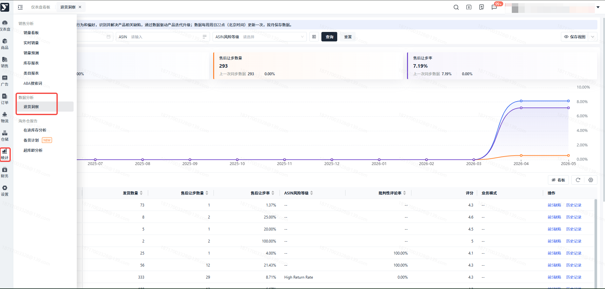

## 操作说明

### 功能须知

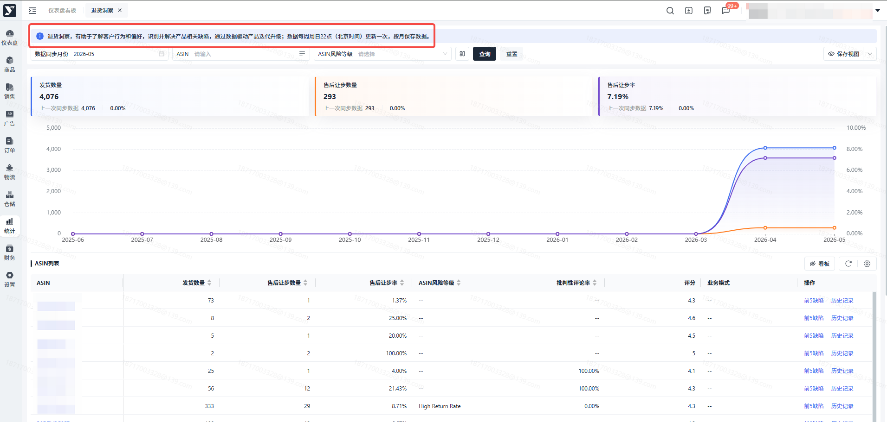

### 只能查看自己有权限的ASIN

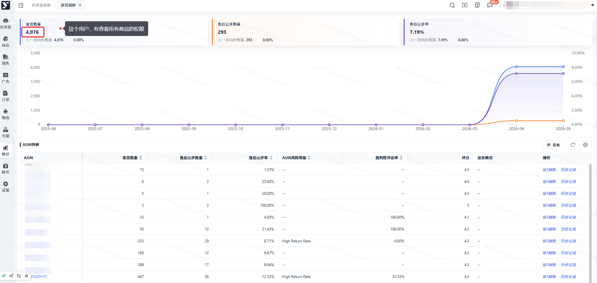

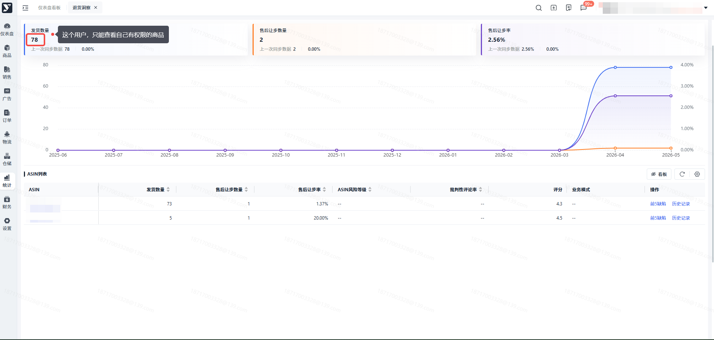

### 搜索条件，数据同步月份：当前北京时间大于等于8号，默认查询本月，小于8号，默认查询上月

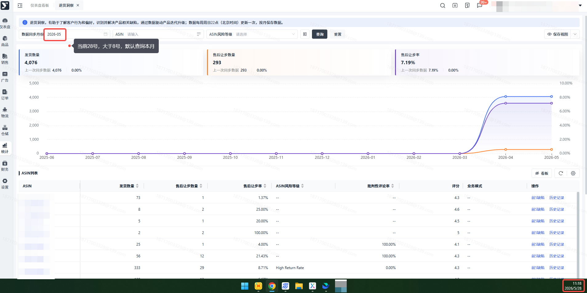

### 支持按 数据同步月份、ASIN、ASIN风控等级、平台运营经理、供应商 筛选

> - 数据同步月份：最小值：2026-04，最大值：当前年月
> - ASIN：支持输入多个的输入框，最多输入200个，精准搜索
> - ASIN风险等级：下拉选择框，单选

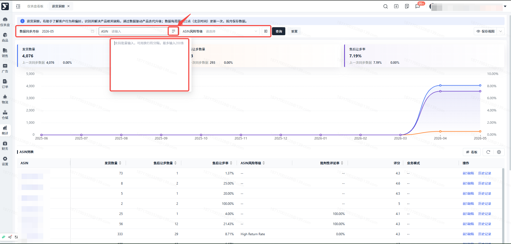

### 展示查看月和之前一个月的 发货数量、售后让步数量、售后让步率 3个汇总指标数据，并展示2个月的变化情况

> - 数据与上方搜索条件联动
> - 售后让步数量和售后让步率 变小，下降小图标绿色，发货数量 小，下降小图标红色

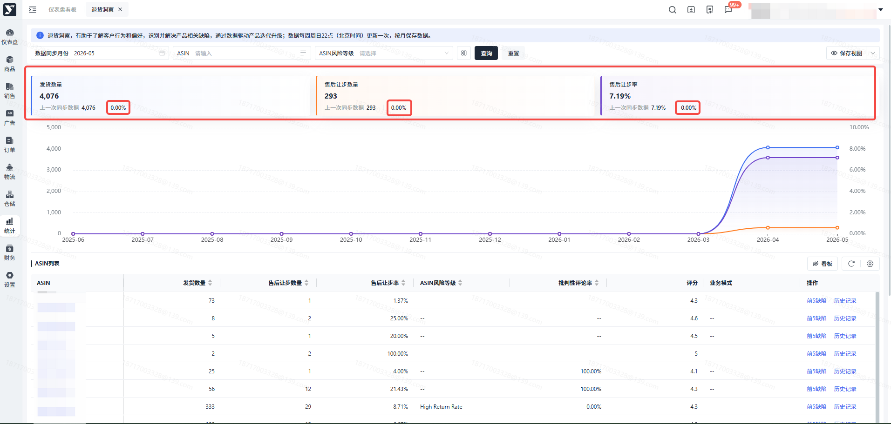

### 展示查询月以及之前11个月的趋势图表

> - 数据与上方搜索条件联动

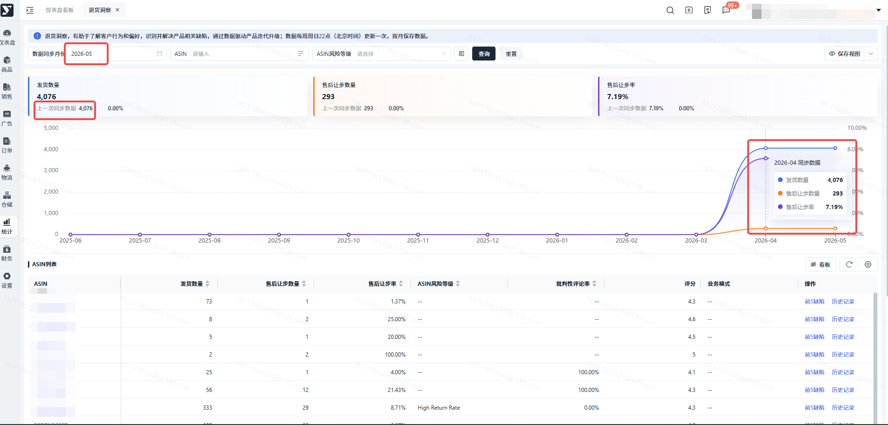

### 隐藏和展示看板

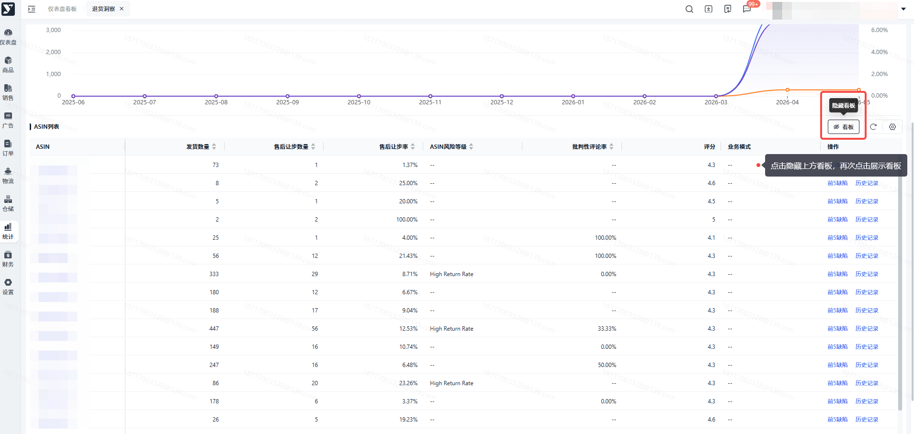

### ASIN列表，展示 ASIN、发货数量、售后让步数量、售后让步率、ASIN风险等级、批判性评论率、评分、业务模式 指标

> - 点击ASIN浏览器新窗口访问亚马逊详情页
> - 发货数量、售后让步数量、售后让步率、ASIN风险等级、批判性评论率 支持排序
> - 数据与上方搜索条件联动

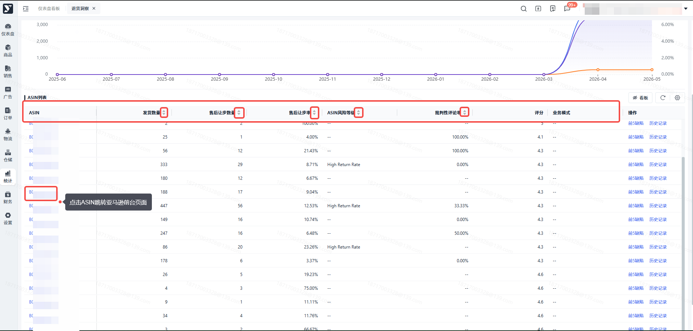

### 查看某个ASIN前5缺陷和客户评论

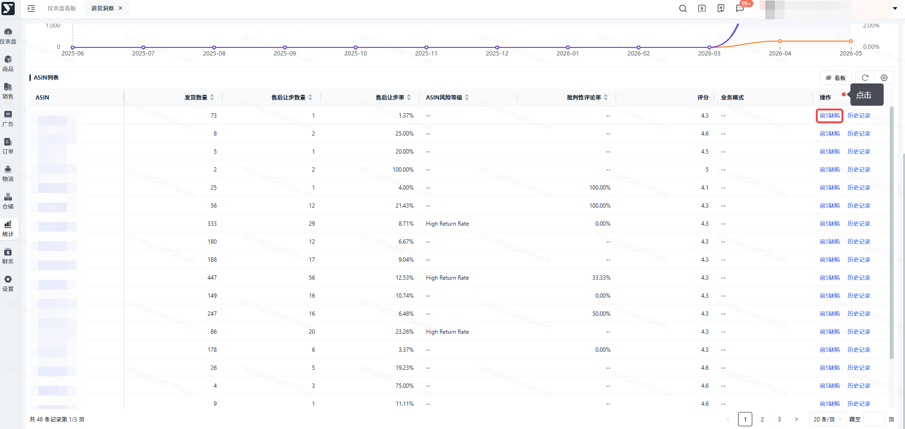

### ASIN前5缺陷和客户评论弹窗，展示缺陷内容、占比和建议措施，以及评论

> - 缺陷列表默认按占比倒序
> - 查看建议措施，悬停到查看蓝色文字
>
> 特别说明：缺陷和客户评论，不一定要有5个，可能小于5个

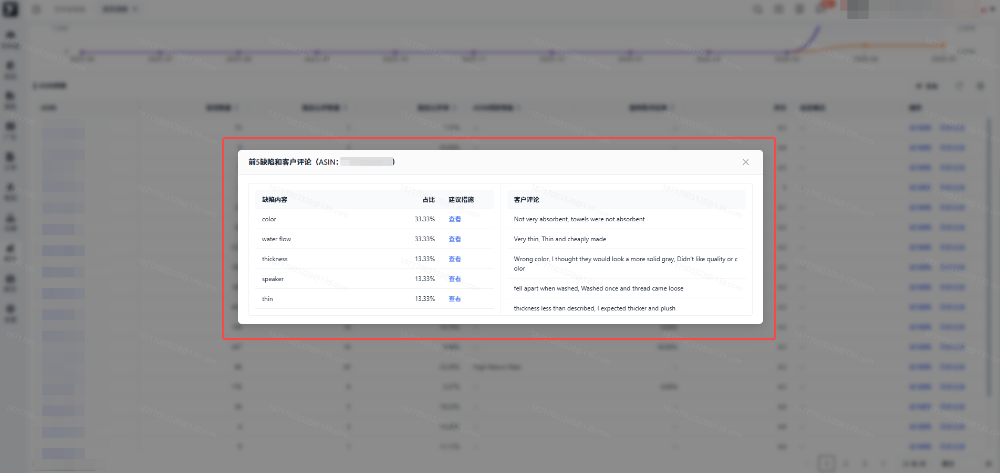

### 查看某个ASIN历史记录

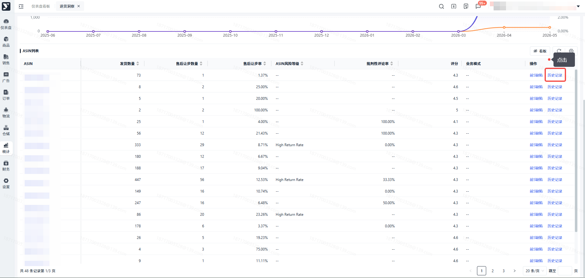

### ASIN历史记录弹窗，上方图表，展示最近12个月的数据，下方左侧缺陷表格，按占比倒序

> 特别说明：需悬停到图表某个月，下方才会展示缺陷和评论

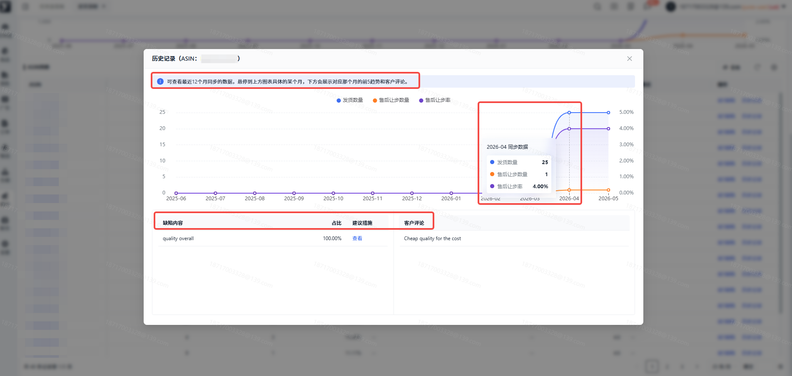
