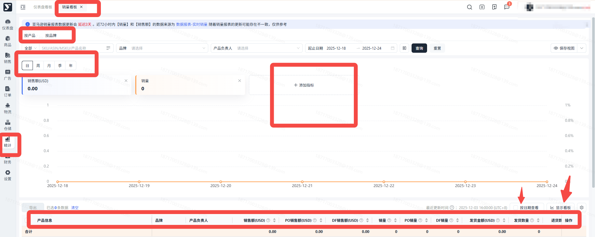
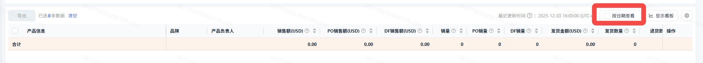
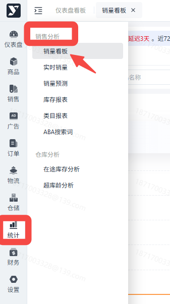
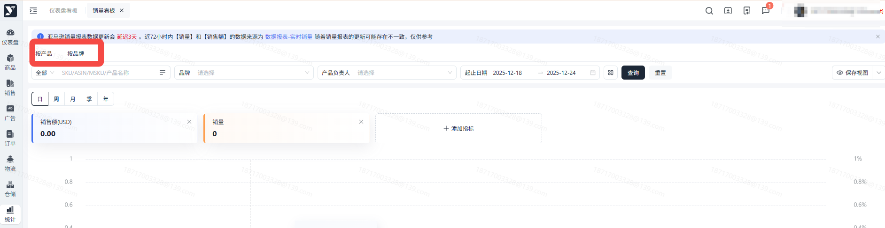
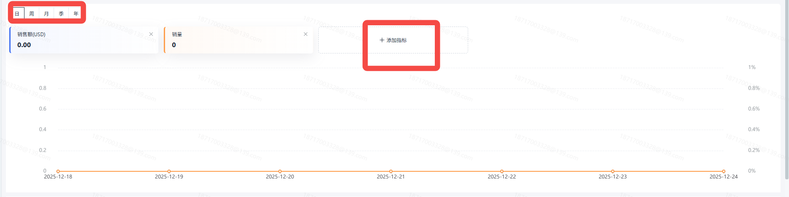
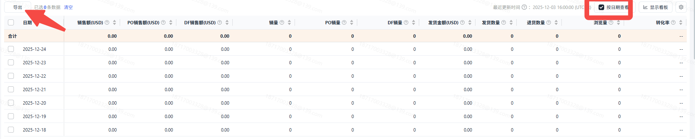
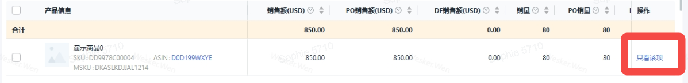

# 飞书文档：销量看板

## 功能介绍

销量报表提供了ASIN过去的销量、销售额等数据，是最能直观体现产品近期销售表现的报表；销量报表的更新频率一般会有2-3天延后（跟亚马逊的报表数据保持一致）

报表默认展示更新日期最新一天的数据，如果想查看历史数据，可以将日期查询调整到想要查看的日期上。

你现在可以查看某个ASIN，或者某个品牌的历史销量销售额趋势。通过“添加指标”可以筛选更多指标的进行趋势展示。

## 注意事项

1. 过去的统计数据有可能会产生变化，若您发现某个报表数据跟以前不一样，请以最新的数据为准。
2. 最近2\~3天的“销售额”和“销量”数据由【实时销量】填充而来，并非亚马逊销量报表更新这段时间的数据。当你切换为“按日期查看”时，有2\~3天的“发货数量”和“退货数量”“浏览量”数据为0时，你就可以知道这几天的其他字段数据来源于【实时销量】

1. PO销售额与PO销量数据，均为总销售额、销量扣除DF订单部分计算而来，仅作为参考。

## 操作流程

### 页面路径

1. 统计->销售分析->销量看板

点击屏幕上方的“按产品”、“按品牌”来切换下方筛选和表格内的聚合维度。需要注意按按品牌时，运营负责人查看自己负责的ASIN数据不生效。

支持多指标，在折线图中进行聚合查看。可通过点击的方式添加/隐藏指标，最多同时显示5个指标。

勾选表格右上角的“按日期查看”，表格内的数据会切换为逐日颗粒度的数据。在此查看方式下，日维度下的细分数据将会被隐藏，同归属于单日数据。

通过下方表格中的操作栏“只看该项”，点击后可以快速将当前ASIN/品牌回填至上方筛选项，并完成筛选。

有数据才有【只看该项】。

