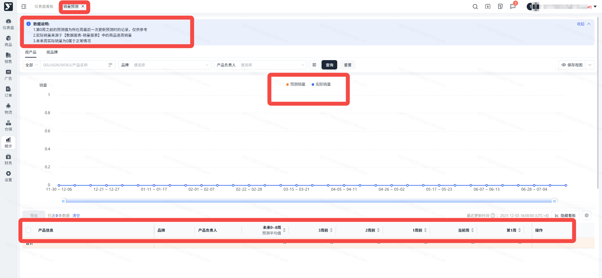
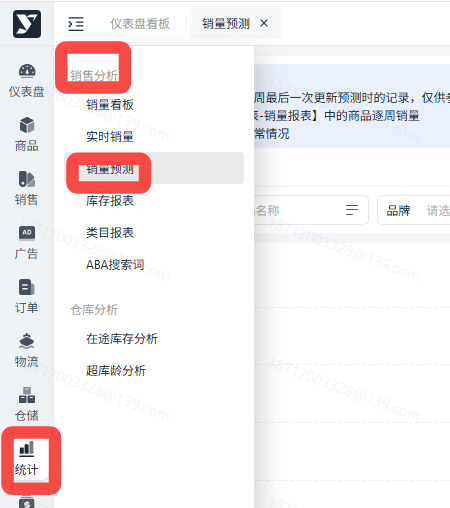
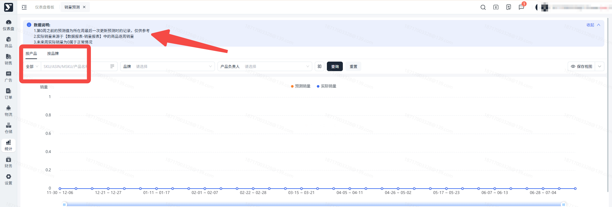
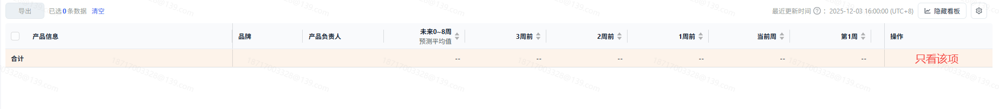

# 飞书文档：销量预测

## 文档信息

| 项 | 内容 |
| --- | --- |
| 远程文档 | https://q1njej8cpab.feishu.cn/wiki/KyshwwEHFi3vrekBVL4csix8nTd |
| 图片处理 | 本地下载（assets/images） |
| 快照时间 | 2026-08-06 |
| 来源命令 | `lark-cli docs +fetch --api-version v2 --doc https://q1njej8cpab.feishu.cn/wiki/KyshwwEHFi3vrekBVL4csix8nTd --doc-format markdown --as user --format json --jq .data.document.content` |
| 格式处理 | fd-doc-markdown-sync/scripts/normalize-feishu-doc-markdown.mjs |

---

销量预测

## 功能介绍

此报表展示了亚马逊对商品未来30周的销售量的预测。

现在你可以通过曲线图查看预测销量。预测销量保留了最近三周的历史预测数据，并且引入了最近三周的实际销量，方便与历史预测数据进行对比。

## 注意事项

1. 亚马逊预测报表只有周颗粒度的数据，更新频率为每周一次；
2. 如果你预定了未来周的促销计划，在下次更新时，在促销所在时间段可能看见预测销量产生对应变化；
3. 此报表并不代表亚马逊会下对应数量的采购订单，仅供做备货策略的辅助决策。
4. 亚马逊更新此处销量预测仅依靠VC端的历史销售记录，所以如果该ASIN开展VC业务时间较短/销量较小，预测报表的数据偏差会比较大。

## 操作流程

### 页面路径

1. 统计->销售分析->销量预测

##

点击屏幕上方的“按产品”、“按供应商”、“按品牌”来切换下方筛选和表格内的聚合维度。需要注意按供应商和按品牌时，运营负责人查看自己负责的ASIN数据不生效。

##

点击表格操作栏的“只看该项”，可以在快速回填并筛选当前ASIN/品牌，查看其预测销量趋势。

