# 飞书文档：BBO询价单

## 功能介绍

BBO，全称Bulk Buy Offer，亚马逊批量采购询价单，是在现有PO供货价的基础上，提供更多的采购数量以及更长的备货时间，以换取更低供货价的PO订单。当卖家接受BBO报价后，亚马逊会在BBO询价结束后下发采购订单，BBO-PO 接单、发货流程同正常PO一致。

## 页面路径

【订单】-【VC订单】-【BBO询价单】

## 注意事项

1. BBO一直未处理，End Time 截止后，系统会自动拒单，不可再操作接受询价、拒绝询价、调整询价数量
2. 可还价产品ID，若未“还价”直接操作接受询价、拒绝询价、调整询价数量，不可再发起还价
3. 在End Time 截止前可多次操作接受询价、拒绝询价、调整询价数量
4. 还价审核通过后的BBO询价单，不可再调整询价数量

## 系统流程

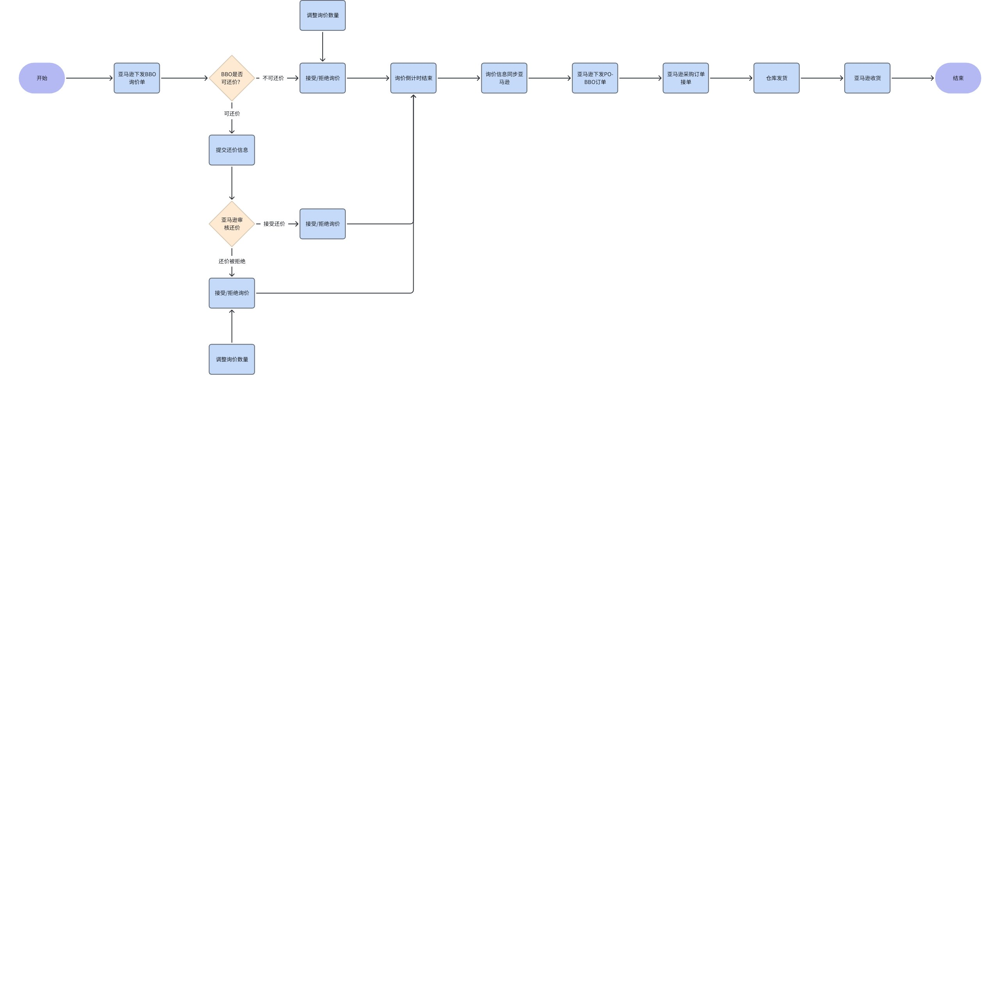

## 操作指南

### 新BBO询价单通知

1. 获取到新询价单，系统消息通知用户；可在通知中心查看消息，并在消息详情点击链接自动进入新询价单界面

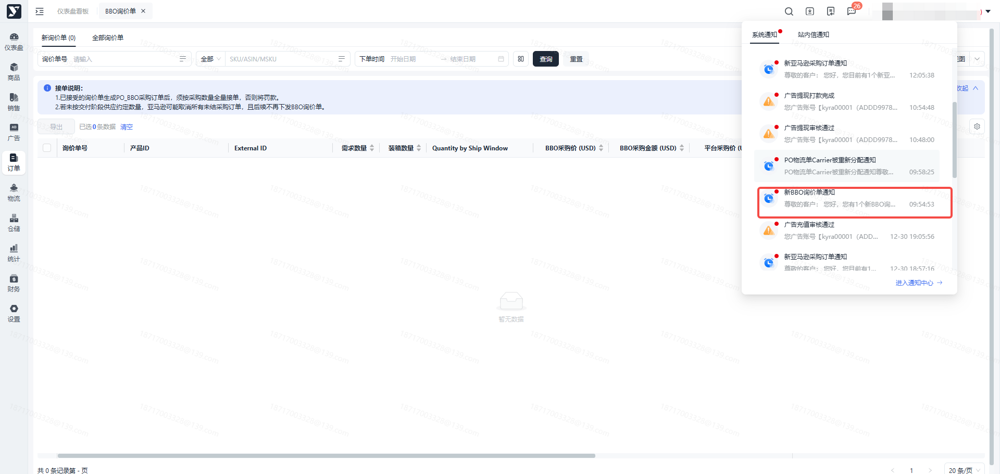

### 查看BBO询价单列表

1. 列表分新询价单、全部询价单两个tab页显示；询价单按“询价单号+产品ID”平铺展示

 1. 新询价单：落单成功，显示待处理状态的BBO询价单，可在此界面操作还价、接受询价、拒绝询价、调整询价数量

 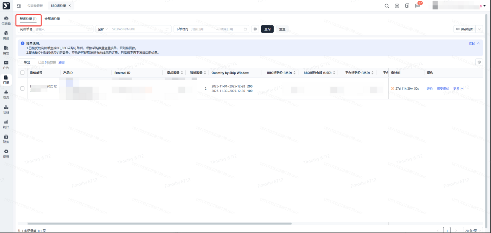

 1. 全部询价单：所有状态的BBO询价单都显示在此界面
 2.

 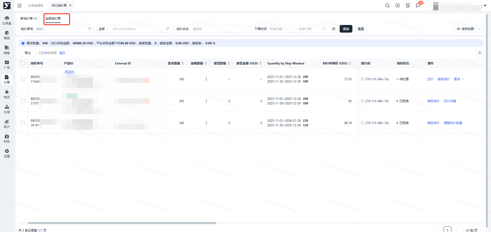

### 还价

1. 功能描述：产品ID有“可还价”标识时，表示该ASIN在接受、拒绝询价之前有一次还价机会。是否还价成功，以审核结果为准；

 1. 若还价审核通过，默认询价被接受，询价状态更新为“已接受”；同时，列表的“BBO采购价”会更新为审核通过后的价格，并重新计算BBO采购金额、BBO折扣率
 2. 若还价审核被拒绝，仍可操作接受询价、拒绝询价、调整询价数量
 3. 特别说明：

 1. 产品ID还价状态为“还价被拒绝”时，不可再发起还价
 2. 询价状态为“已接受、已拒绝”状态时，不可再发起还价
2. 操作步骤：注意：“期望BBO采购价格”输入限制必须大于0，且不能大于平台采购价

 1. 产品ID标记“可还价”，点击【还价】按钮

 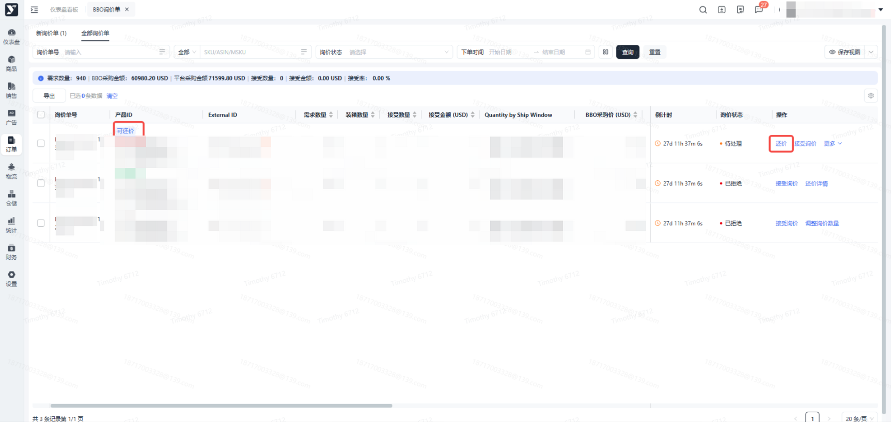

 1. 进入还价界面，输入“期望BBO采购价格”，点击【确定】按钮，提交还价

 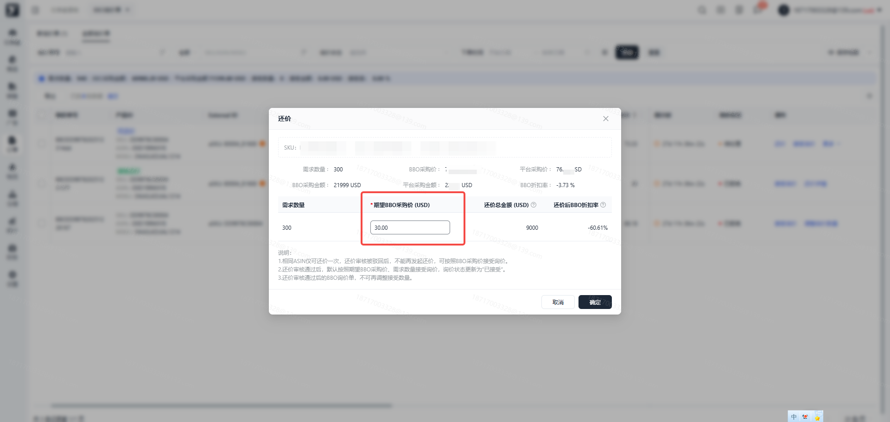

 1. 提交成功，产品ID标记“还价审核中”，等待审核

 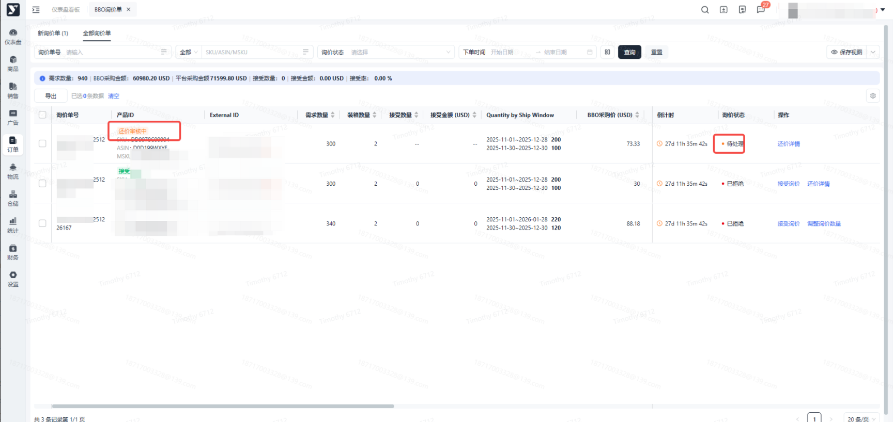

 1. 还价审核通过，产品ID标记“接受还价”，询价状态更新为“已接受”

 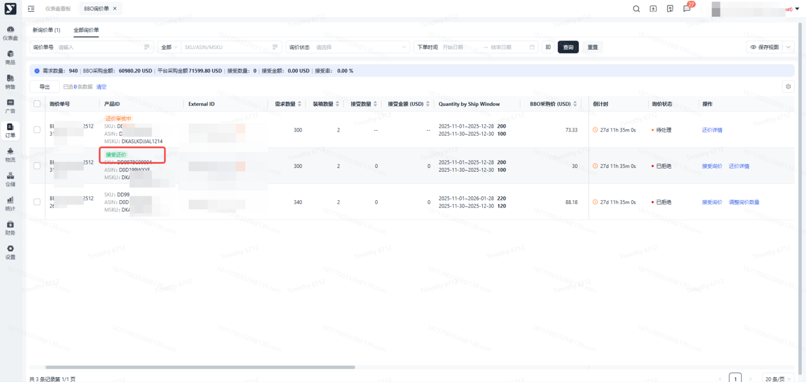

 1. 还价审核驳回，产品ID标记“还价被拒绝”，询价状态仍为“待处理”

 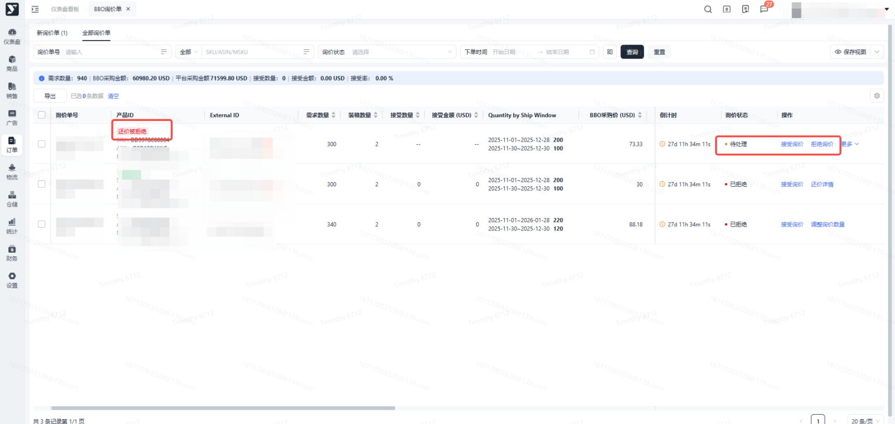

### 接受询价

1. 功能描述：询价状态为 “待处理” 或 “已拒绝” 时，可接受询价；在End time 结束前可多次修改询价结果
2. 操作步骤：

 1. 点击【接受询价】按钮， “接受数量” 默认等于“需求数量”，询价状态更新为“处理中”，同步VC后，询价状态更新为“已接受”

 1. 询价状态为“已接受”，可操作拒绝询价

 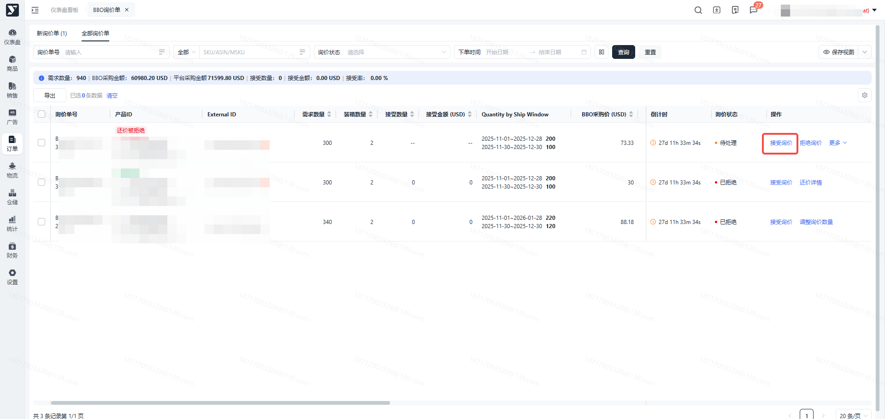

### 拒绝询价

1. 功能描述：询价状态为 “待处理” 或 “已接受” 时，可拒绝询价；在End time 结束前可多次修改询价结果
2. 操作步骤：

 1. 选中需拒绝询价的产品ID，点击【拒绝询价】按钮，“接受数量” 默认等于0，询价状态更新为“处理中”，同步VC后，询价状态更新为“已拒绝”

 1. 询价状态为“已拒绝”，可操作 接受询价、调整询价数量

 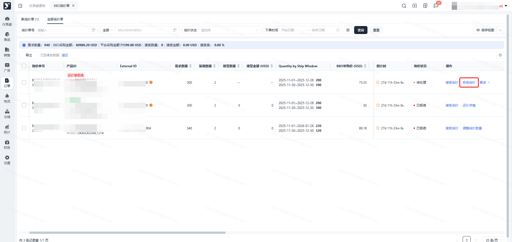

### 调整询价数量

1. 功能描述：询价状态为 “待处理” 或 “已拒绝” 时，可调整数量后接受询价；在End time 结束前可多次修改询价结果
2. 操作步骤：

 1. 选中需调整接受数量的产品ID，点击【调整询价数量】按钮

 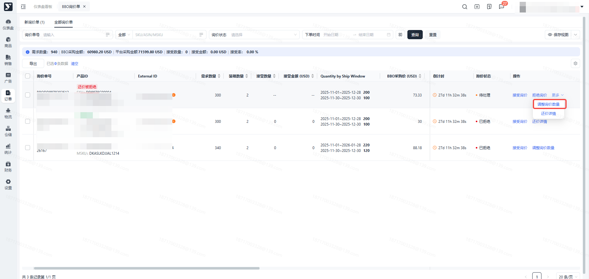

 1. 进入弹窗页面，输入“接受数量”，点击【提交并接受询价】同ASIN有多窗期说明：

 - 按窗期维护 接受数量，窗期接受数量输入限制 ≥ 0
 - ASIN 接受数量之和必须＞0，且≤ ASIN总需求数量

 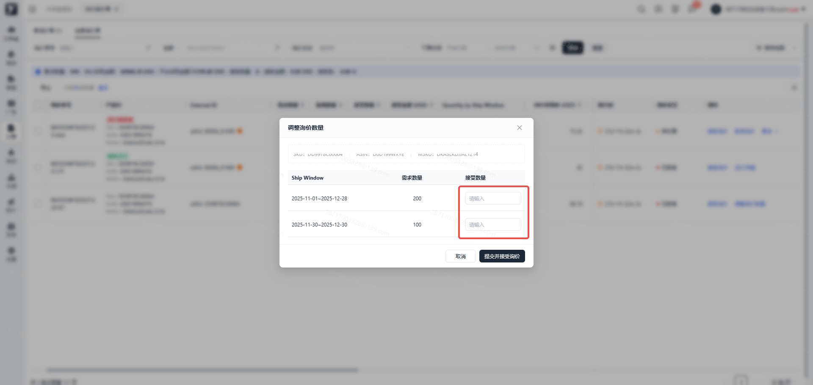
 2. 调整询价数量提交成功后，询价状态更新为“处理中”，同步VC后，询价状态更新为“已接受”

 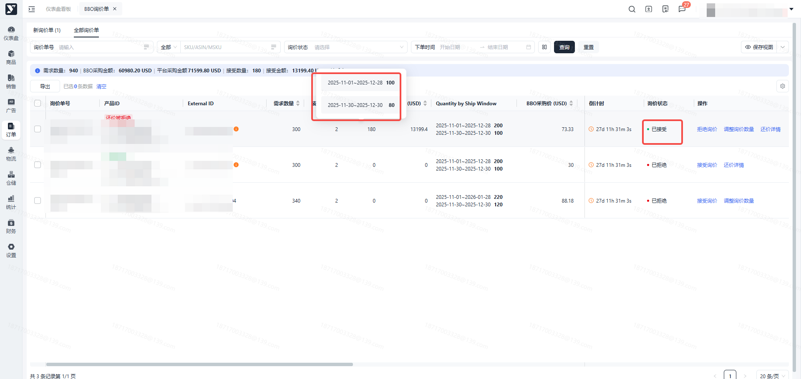

### 导出

1. 功能描述：支持全量、按条件搜索、勾选导出BBO询价单列表
2. 支持导出的界面：新询价单、全部询价单
3. 操作步骤：注意：筛选条件和勾选并存时，按勾选的内容导出

 1. 点击【导出】按钮，导出全部或按条件搜索的询价单

 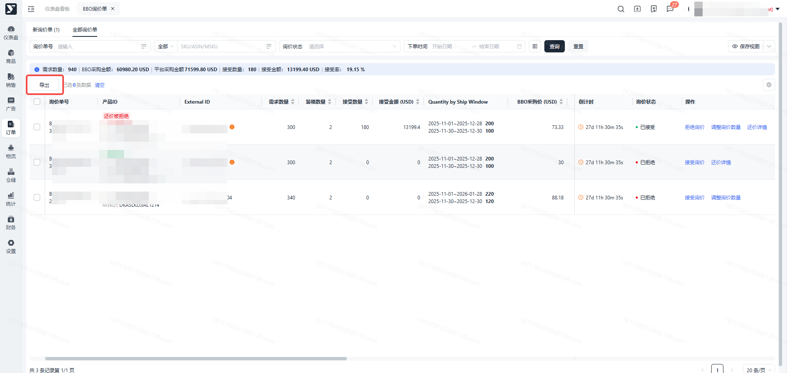

 1. 勾选列表上需导出的询价单，点击【导出】”按钮

 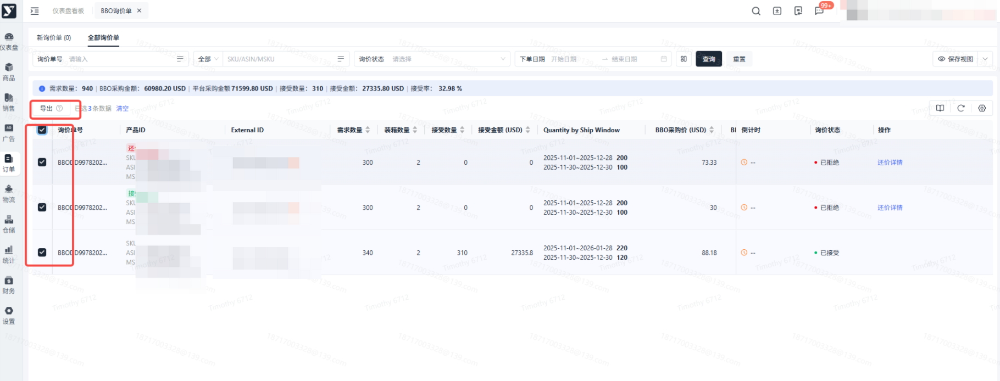
