# 飞书文档：BTR订单

## 功能介绍

全称Born to Run，是一个卖家主动向亚马逊提出采购需求的功能。卖家可以针对部分产品向亚马逊申请指定数量的采购订单（PO订单）。当亚马逊接受了卖家的请求后，相应的BTR订单会出现在采购订单界面中。

## 页面路径

【订单】-【VC订单】- 【BTR订单】

## 注意事项

1. BTR订单对于可申请的ASIN和数量都有严格要求，请酌情发起申请。
2. 每个企业申请的ASIN数量有一定限额，额度使用完后亚马逊将不会再批准提交的申请，直至下个周期开始。
3. 每个ASIN同一时间内只能有一笔BTR订单，所以当一个ASIN的申请被亚马逊接受后，请勿再为其申请另一笔BTR订单。
4. 申请通过的产品数量必须在销售期内售完，否则亚马逊将产生罚款，填写申请数量时请根据产品的真实售卖情况进行评估。

## 系统流程

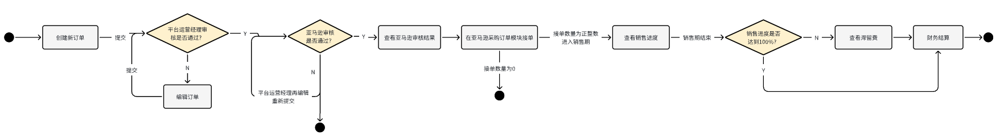

## 操作指南

### BTR订单列表

1. 功能描述：新增BTR订单、管理BTR订单申请进度、以及查看BTR销售进度
2. 订单状态说明：

 1. 处理中：BTR订单提交成功后，客服审核中
 2. 审核未通过：客服审核驳回
 3. 创建失败：BTR订单在亚马逊VC后台创建失败
 4. 申请失败：亚马逊驳回BTR订单
 5. 进行中：BTR订单成功，且在销售期内
 6. 已结束：

 1. 订单销售期结束
 2. 或 在销售期内，订单售卖率为 100%

 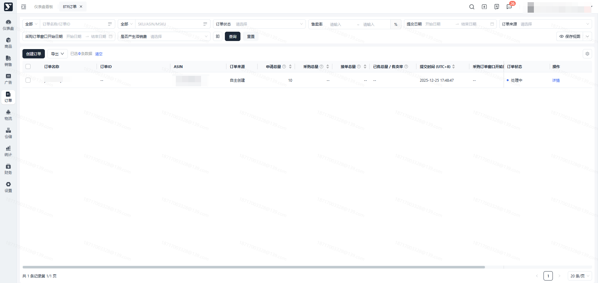

### 创建BTR订单

1. 功能描述：在页面手工新增BTR订单
2. 操作步骤：注意：选择ASIN时，若ASIN查询不到，请联系客服处理注意：申请数量需大于0，且为装箱数量的整数倍 说明：

 1. 点击【创建订单】按钮，进入BTR订单新增页面

 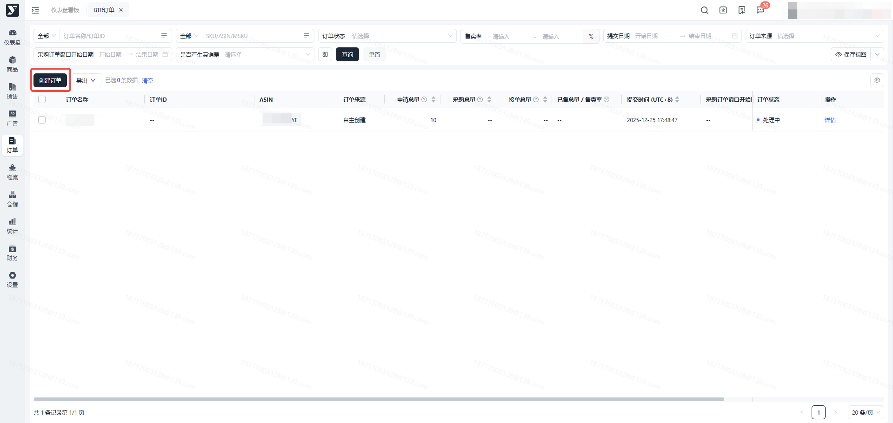

 1. 输入订单名称，选择ASIN

 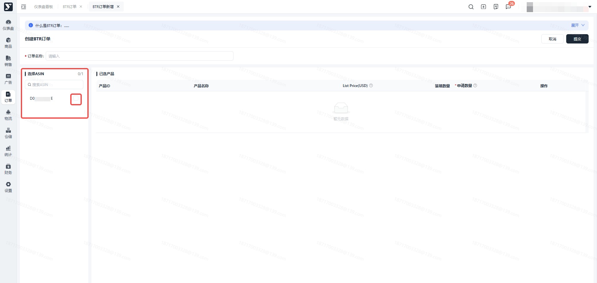

 1. 在已选产品栏位，输入申请数量

 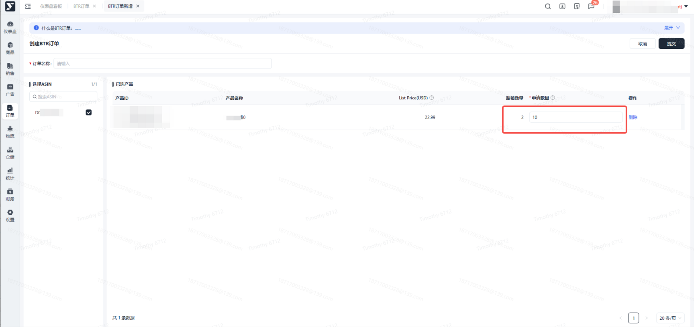

 1. 点击【提交】后返回列表，订单状态更新为 “处理中”，等待客服审核

 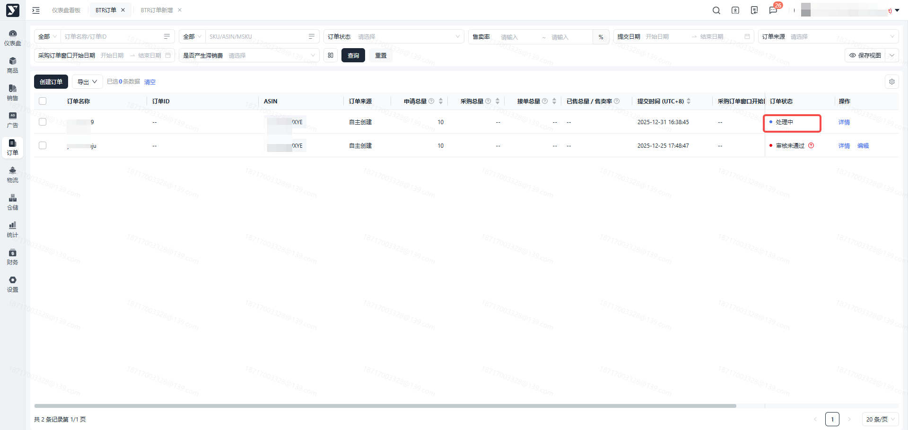

 1. 亚马逊接受BTR订单时，订单列表相应显示【订单ID、采购总量】，订单状态更新为 “进行中”

 1. 亚马逊接受BTR订单后，会在24小时内下达采购订单，请前往【VCPO订单】模块接单
 2. 采购订单建议全接，否则 会产生亚马逊罚款或影响后续BTR订单通过率
 3. 请确保在BTR订单销售期结束之前达到100%售卖率，否则 可能将产生罚款

 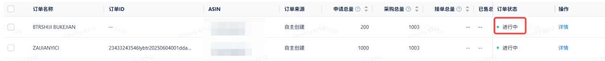

 1. 亚马逊拒绝BTR订单时，列表和详情会显示原因，具体原因请咨询平台运营负责人

 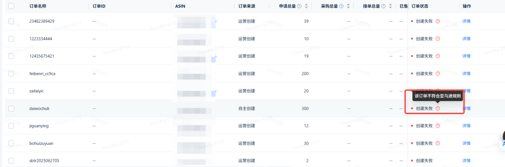

### 编辑

1. 功能描述：BTR订单被客户审核驳回时，可修改申请数量重新提交

 1. 满足编辑的前提条件：订单状态为 “审核未通过”
2. 操作步骤：

 1. 点击【编辑】按钮，进入编辑页面

 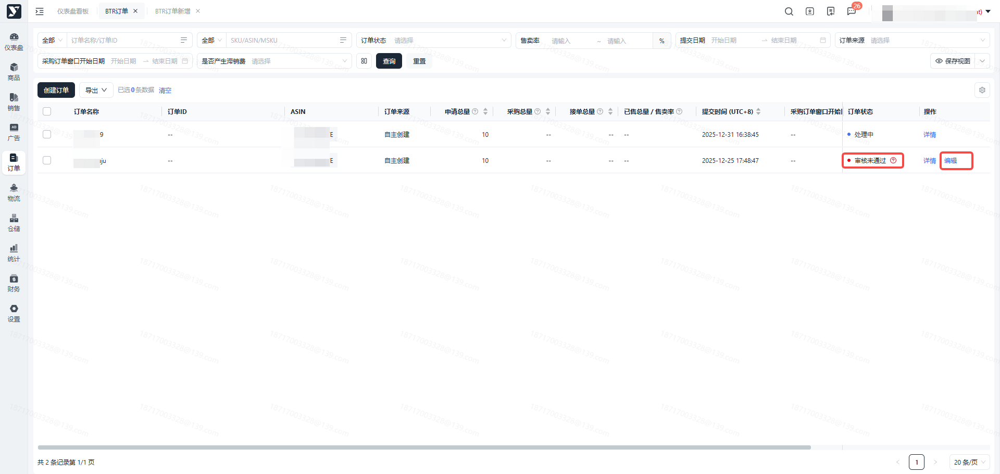

 1. 在新申请数量栏位，点击【编辑】按钮，输入新申请数量，点击【保存】按钮
 2. “申请数量” 更新为 “新申请数量” 填写的值

 - 新申请数量输入限制：不可为0，且是装箱数量的整数倍，且小于等于原申请数量

 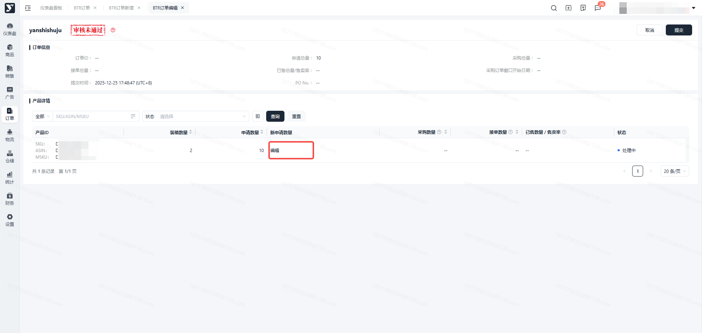

 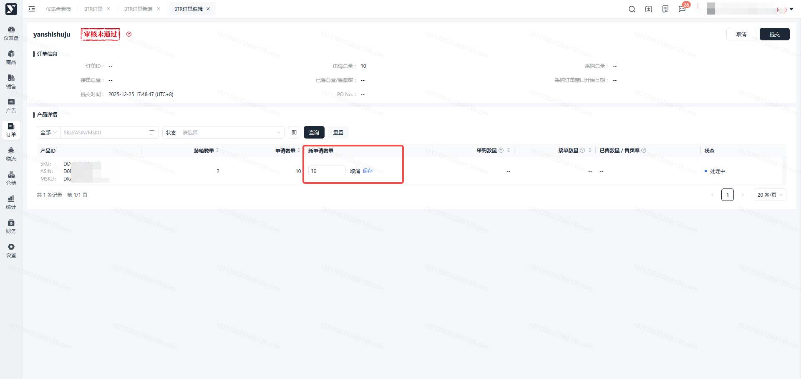
 3. 编辑完成，点击【提交】按钮，返回弹窗点击【确定】按钮，状态更新为“处理中”，重新提交审核

 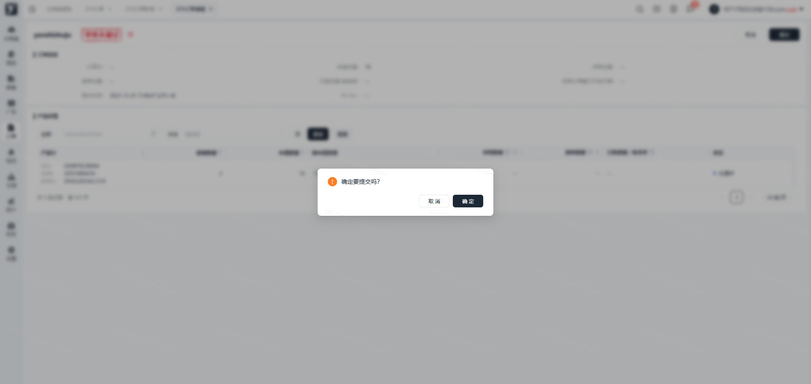

 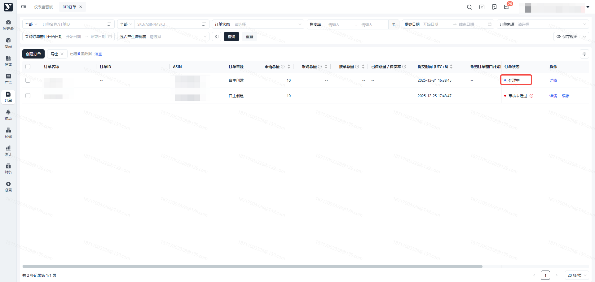

 ## 滞留费

 1. 功能描述：BTR订单状态为 “已结束” 时，系统自动计算滞留费并显示在订单列表
 2. 操作步骤：

 1. 点击【滞留费】按钮，查看BTR订单产生的滞留费用

 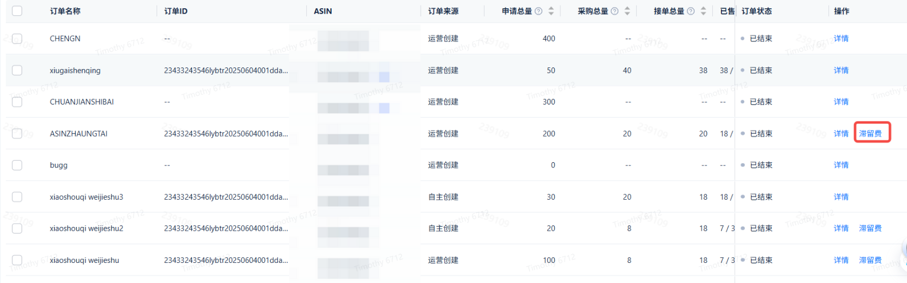

 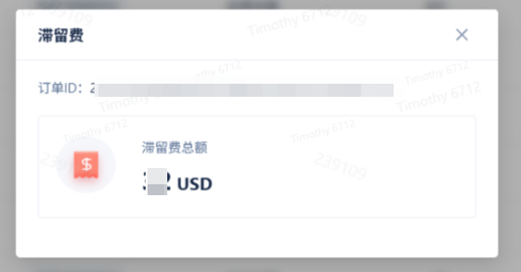

 ## 导出

 1. 功能描述：支持批量勾选、按条件搜索后，导出订单列表和订单详情
 2. 操作步骤：

 1. 批量勾选或按条件搜索后，点击【导出列表】或【导出详情】按钮，导出订单列表和订单详情至Excel 文档

 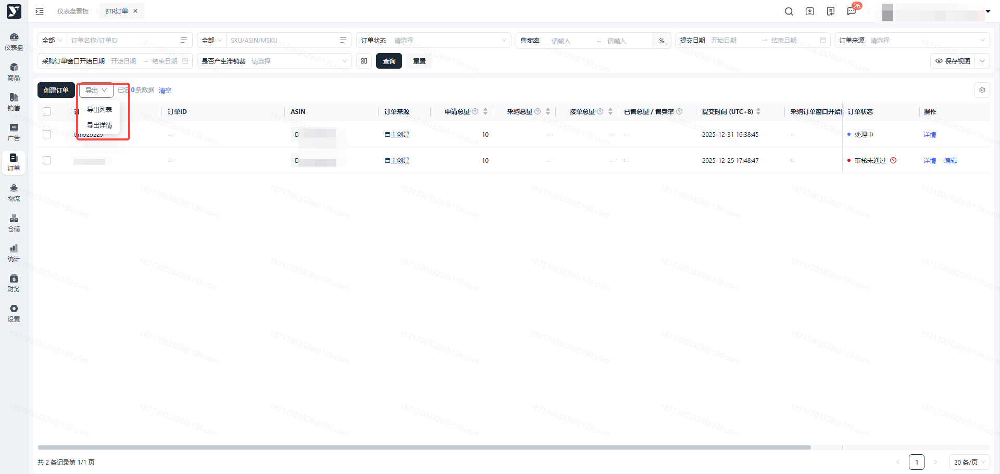

 # 常见问题

 #### 为什么有些ASIN在创建订单时找不到？
 答：可申请BTR订单的数据为生效成功的产品，请检查此ASIN在产品列表模块的状态是否为生效成功，若已经为生效成功状态但申请时仍然找不到此ASIN，则表示此ASIN不符合亚马逊的申请要求，请寻求客服的帮助。

 #### 一个ASIN的上一个BTR销售期还没结束，能不能再创一个BTR订单？
 答：不可以，同一个ASIN只能同时存在一个BTR订单。

 #### BTR订单申请后，大概多久能审核通过？
 答：一般需要3-5天，且亚马逊审核不一定能100%通过。

 #### BTR订单审核通过后，PO订单什么时候来？
 答：亚马逊审核通过后，对应的PO订单基本都会在当天下PO订单过来，如果审核通过但迟迟未下单，请联系平台运营负责人。

 #### PO订单需要在24小时内接吗？超过24小时不接有什么影响？PO只接了部分数量有什么影响？
 答：PO订单需要在23小时内在平台端内进行接单，否则系统会自动拒单。超过24小时不接单，可能会导致亚马逊罚款。PO订单如果海外仓无足够的对应箱规下的库存允许进行部分接单，不会产生其他影响。但是BTR通过后下过来的PO订单，尽量100%接单。

 #### 为什么BTR订单申请了100个，最终PO只下来了70个订单数量？
 答：亚马逊会审核你的BTR申请数量是否过多，如果数量过多，运营这边会下调申请数量，再提交给亚马逊审核。

 #### 销售期是从哪一天开始计算的？
 答：BTR对应的PO订单发货后，从亚马逊最早收到库存日期+7天后开始计算BTR订单的销售日期。

 #### BTR的销售数据为什么迟迟未更新？更新频率是怎么样的？
 答：亚马逊系统自动更新，如果对应的PO物流已经送达超过一周，BTR销售进度仍未更新请联系平台运营负责人。

 #### BTR订单为什么会申请失败？有哪些原因？我应该怎么解决？
 答：BTR申请的审核是否通过取决于亚马逊系统的自动判断。失败的原因常见的是产品问题、申请数量过多（亚马逊结合产品当前销量、VC的可售库存数量等评估）

 #### 一直提不上BTR，还有别的方法吗？
 答：通过DF模式让VC offer加快出单销售，积累销量数据，后续可以再尝试申请BTR或者等PO自动下单。
