# 飞书文档：FBA订单

## 文档信息

| 项 | 内容 |
| --- | --- |
| 远程文档 | https://q1njej8cpab.feishu.cn/wiki/SXS7wsTKTieEujkohaacnp3Gnac |
| 图片处理 | 本地下载（assets/images） |
| 快照时间 | 2026-08-06 |
| 来源命令 | `lark-cli docs +fetch --as user --doc "<remote>" --jq ".data.markdown"` |
| 格式处理 | fd-doc-markdown-sync/scripts/normalize-feishu-doc-markdown.mjs |

---

FBA订单

## 功能介绍

亚马逊 FBA（Fulfillment by Amazon）订单是指卖家将商品存储在亚马逊海外仓，由亚马逊负责订单处理、仓储、打包、配送、客服及退换货等全流程服务的订单模式。

注：仅当使用”平台仓“发货至FBA仓库时，创建FBA订单

## 页面路径

【订单】-【渠道订单】-【FBA订单】

## 系统流程

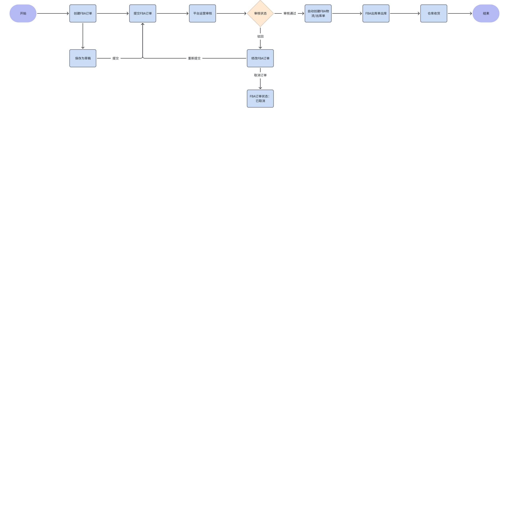

> 画板来源：token=`AgszwqF5ChOCtFbw1PtcK0rln7e`

## 操作指南

### FBA订单列表

1. 功能描述：展示您所有的FBA订单信息
2. 订单状态：

 1. 草稿：订单已创建未提交
 2. 待审核：客户创建并提交订单，待客服审核
 3. 已驳回：客服驳回客户订单创建申请
 4. 处理中：审核通过的订单，系统正在执行定时任务给仓库
 5. 配货中：仓库配货中
 6. 运输中：订单已出库，且物流轨迹还未被签收
 7. 已完成：订单已签收
 8. 取消待审核：订单状态为”处理中、配货中“时，客户取消订单，等待客服审核
 9. 已取消：FBA订单被取消

 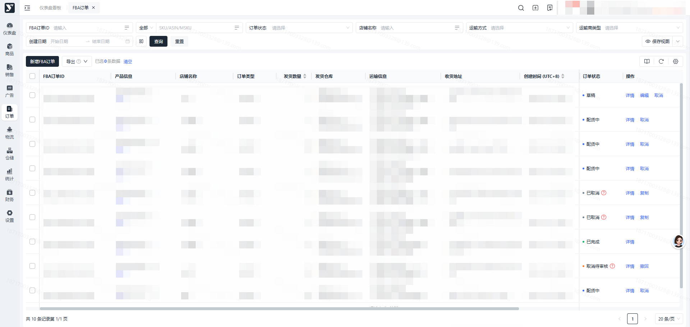

### FBA订单详情

1. 功能描述/操作步骤：点击【详情】按钮，可查看FBA订单详细信息

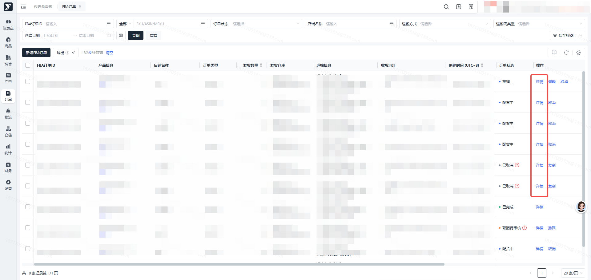

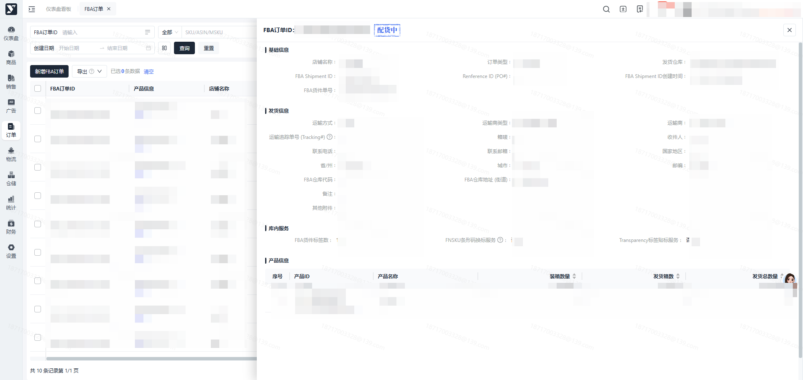

### 新增FBA订单

1. 功能描述：手工创建FBA订单
2. 操作步骤：说明：标记 \* 字段为必填内容说明：仅当Transparency标签贴标服务选择【是】时，才需上传Transparency标签；仅当FNSKU条形码换标服务选择【是】时，才需输入FNSKU

 1. 点击【新增FBA订单】按钮

 ![图片展示的是FBA订单操作指南中新增FBA订单的页面。页面上方有“新增FBA订单”按钮，左侧有导航栏，底部有“1/1页”和“20条/页”选项。页面中部显示了FBA订单列表，包含订单编号、产品名称、总箱数、发货箱数、FNSKU、发货仓库、状态、操作等信息，如订单编号为FBA1234567890123456789012345678901234567890123456789012345678901234567890123456789012345678901234567890123456789012345678901234567890123456789012345678901234567890123456789012345678901234567890123456789012345678901234567890123456789012345678901234567890123456789012345678901234567890123456789012345678901234567890123456789012345678901234567890123456789012345678901234567890123456789012345678901234567890123456789012345678](./assets/images/图片展示的是FBA订单操作指南中新增FB-4af5ab8b0582.png)

 1. 进入新增页面，维护【基础信息、发货信息、库内服务】

 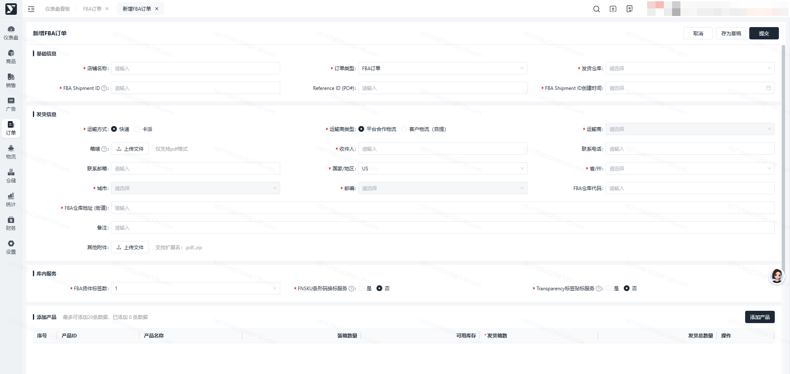

 1. 【基础信息、发货信息、库内服务】维护完毕，点击【添加产品】按钮

 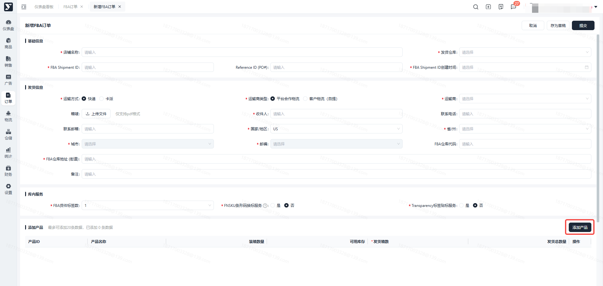

 1. 弹窗进入选择产品ID页面，勾选产品ID，点击【确定】按钮，弹窗消息返回新增页面

 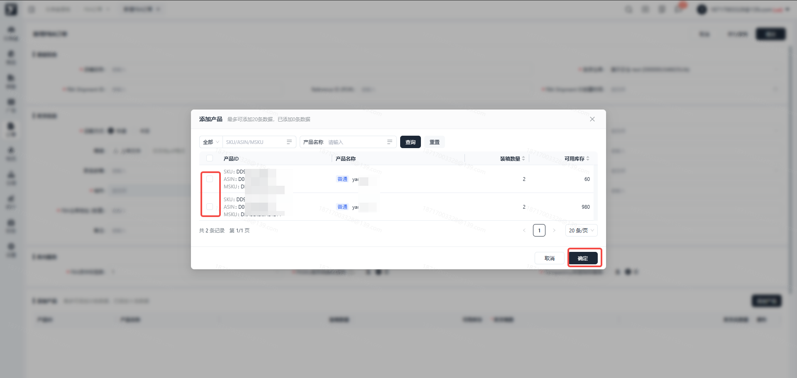

 1. 上传【Transparency标签】、输入【发货箱数】【FNSKU】

 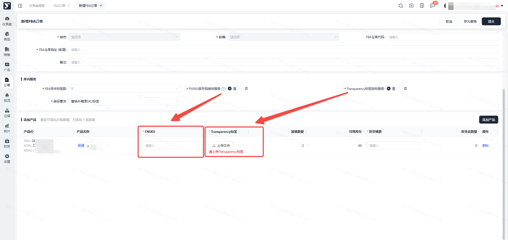

 1. 确定订单信息填写无误后，点击提交按钮，提交成功，订单状态更新为 “待审核”

 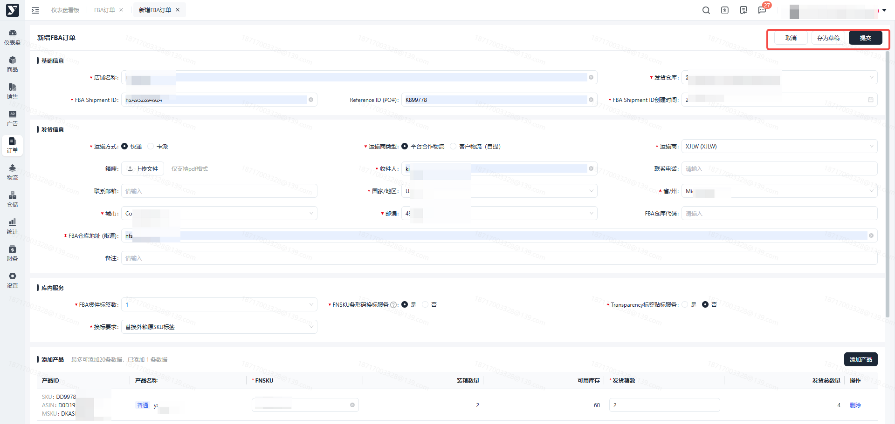

 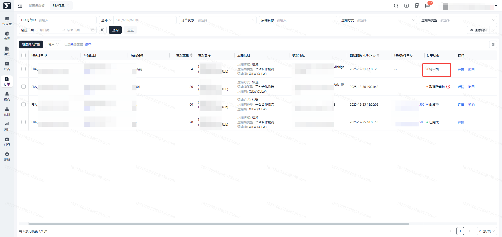

 1. 也可在新增订单页面点击【存为草稿】，退出新增页面，订单状态更新为 “草稿”

 

 1. 待审核的订单：客服审核通过后，订单状态更新为 处理中”；客服审核驳回后，订单状态更新为 “已驳回”

 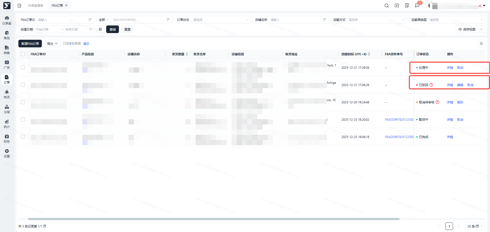

### 撤回

1. 功能描述：订单状态为 “待审核、取消待审核” 时，可操作撤回

 - 订单状态为 “待审核” 时，撤销成功，订单状态更新为 “草稿”
 - 订单状态为 “取消待审核” 时，撤销成功，订单状态更新为操作取消时的状态（处理中或配货中）
2. 操作步骤：

 1. 选中需撤回的订单，点击【撤回】按钮

 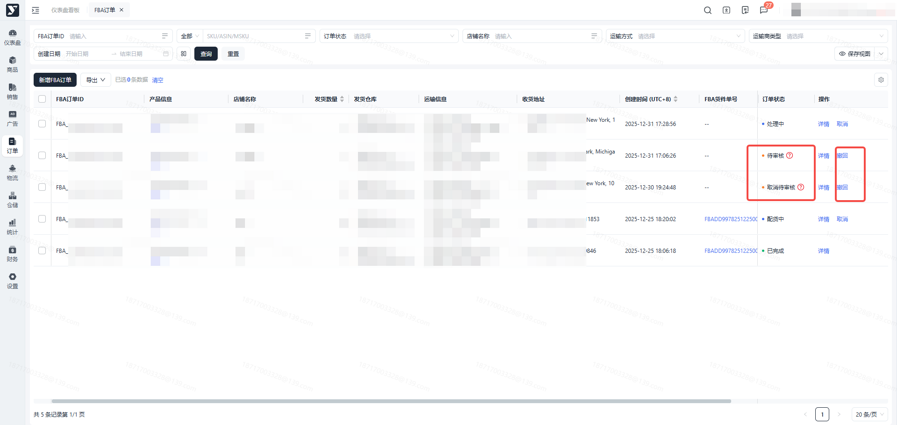

 1. 二次弹窗点击【确定】，撤回成功，订单状态更新为 “草稿” 或 “处理中” 或 “配货中”

 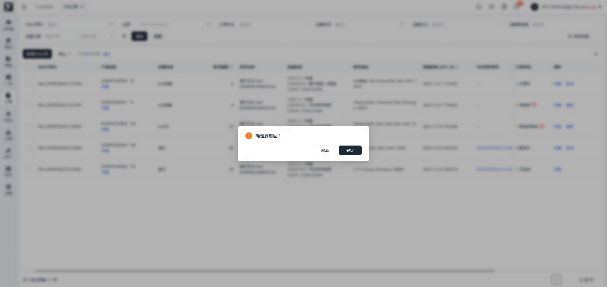

 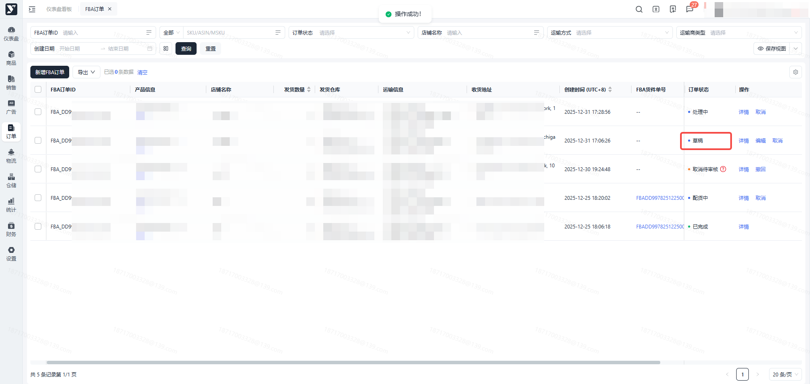

### 编辑

1. 功能描述：订单状态为 “草稿、已驳回” 时，可编辑订单
2. 操作步骤：

 1. 选中需编辑的订单，点击【编辑】按钮

 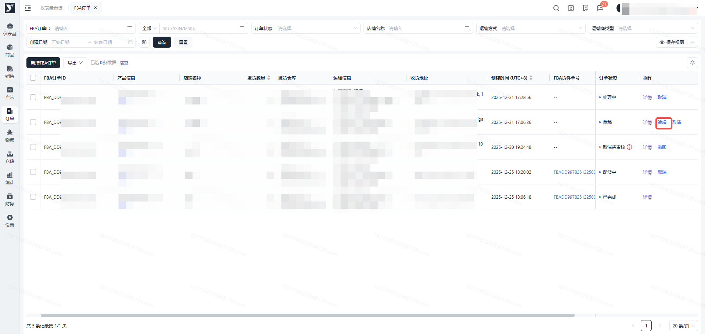

 1. 进入编辑FBA订单页面，编辑订单信息后，点击【提交】按钮

 ![图片 addCriterion图片展示了FBA订单管理界面中订单详情页面。页面上方有订单编号、订单状态、订单创建时间等信息。订单状态 addCriterion图片展示了FBA订单管理界面中 addCriterion图片展示了FBA订单管理界面中订单详情页面。页面上方有订单编号、订单状态、订单创建时间等信息。订单状态为“ addCriterion图片展示了FBA订单管理界面中订单详情页面。页面上方有订单编号、订单状态、订单创建时间等信息。订单状态为“待审核”，右侧有“撤回”按钮，该按钮被红色框线突出显示。此图与上下文“撤回”操作 addCriterion图片展示了FBA订单管理界面中订单详情页面。页面上方有订单编号、 addCriterion图片展示了FBA订单管理界面中订单，图片中订单状态为“待审核”，右侧有“撤回”按钮，该按钮被红色框线突出显示。此图与上下文“撤回”操作步骤中选中需撤回订单后点击“撤 addCriterion图片展示了FBA订单管理界面中订单详情页面。页面上方有订单编号、订单状态、订单创建时间等信息。订单状态为“待审核”，右侧有“撤回”按钮，该图片与上下文“撤回”操作步骤中选中需撤回订单后点击“撤回”按钮的内容对应，直观呈现了操作位置。](./assets/images/图片-addCriterion图片展示了-3e8741987264.png)

 1. 提交成功，订单状态更新为 “待审核”

 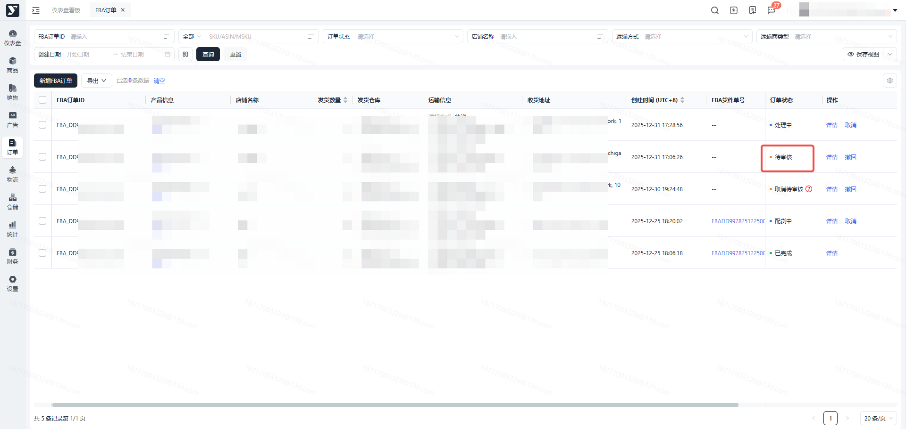

### 取消

1. 功能描述：订单状态为 “草稿、已驳回、配货中” 时，可取消订单

 - 订单状态为 “草稿、已驳回” 时，提交取消，订单状态直接更新为“已取消”
 - 订单状态为 “处理中、配货中” 时，提交取消，订单状态更新为“取消待审核”，等待客服审核

 - 处理中、配货中时取消订单，可能会产生拦截费用
 - 客服审核通过，订单状态更新为 “已取消”
 - 客服审核驳回，订单状态不变，仍为操作取消时的状态
2. 操作步骤：

 1. 选中需取消的订单，点击【取消】按钮

 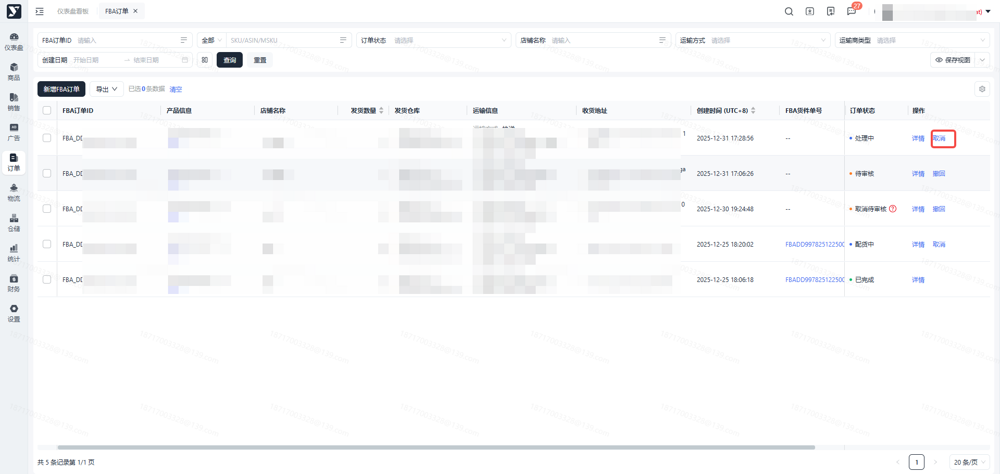

 1. 在取消订单弹窗中填写取消原因后，点击【确定】按钮

 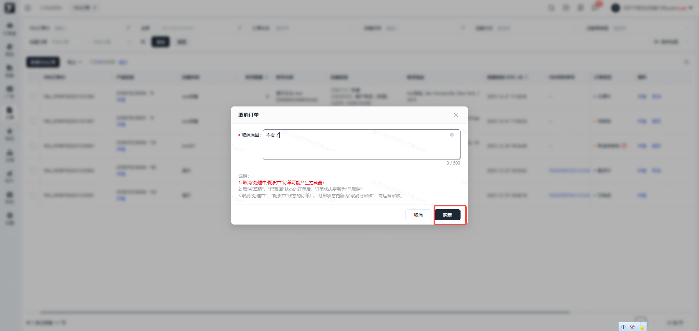

 1. 取消成功，订单状态更新为 “已取消” 或 “取消待审核”

 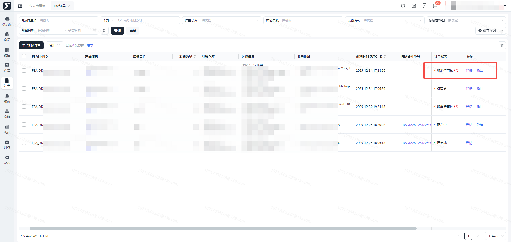

### 复制

1. 功能描述：订单状态为“已取消”时，可复制订单
2. 操作步骤：

 1. 选择需要复制的订单，点击“复制”按钮

 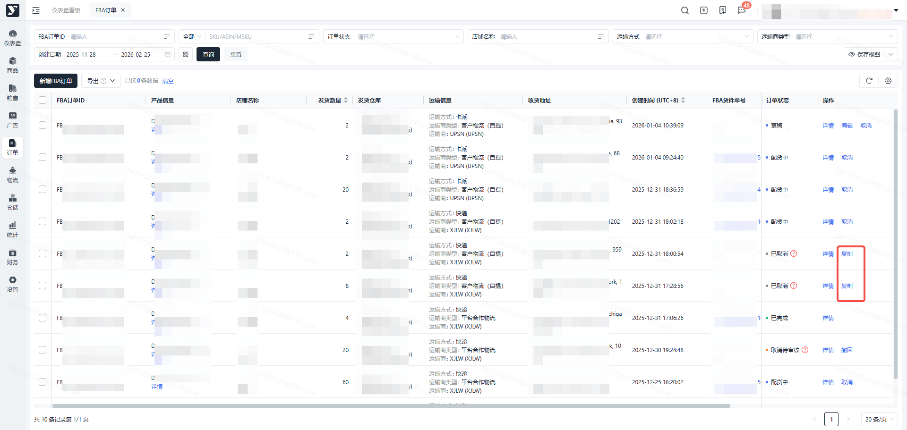

 1. 在复制订单页面中维护订单信息，点击“存为草稿”或“提交”按钮后生成新订单

 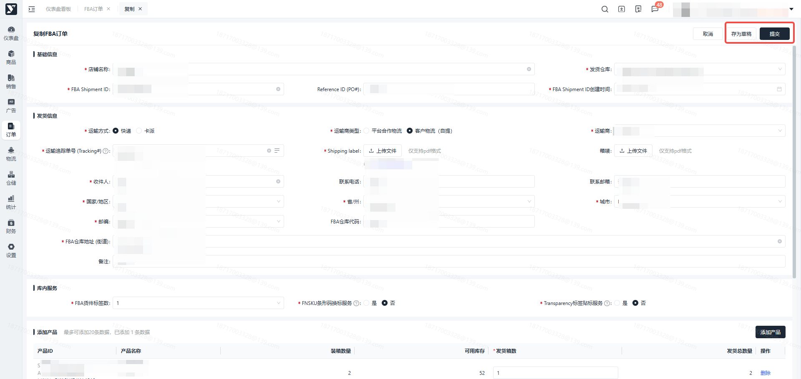

### 导出

#### 导出列表

1. 功能描述：支持全量、按条件搜索、勾选导出FBA订单列表
2. 操作步骤：

 1. 点击【导出列表】按钮，导出FBA订单列表

 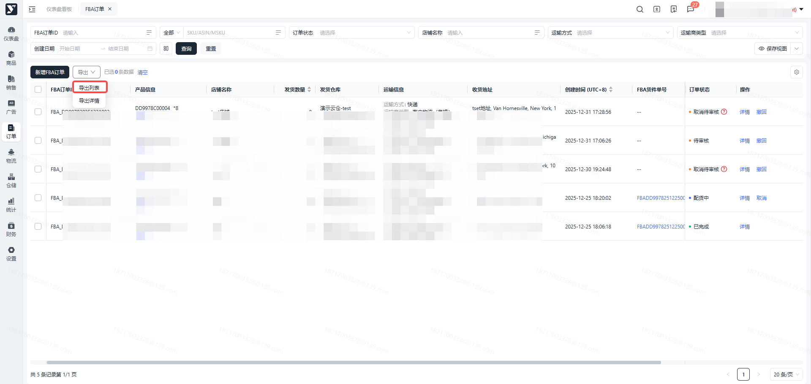

#### 导出详情

1. 功能描述：支持全量、按条件搜索、勾选导出FBA订单详情
2. 操作步骤：

 1. 点击【导出详情】按钮，导出FBA订单详情

 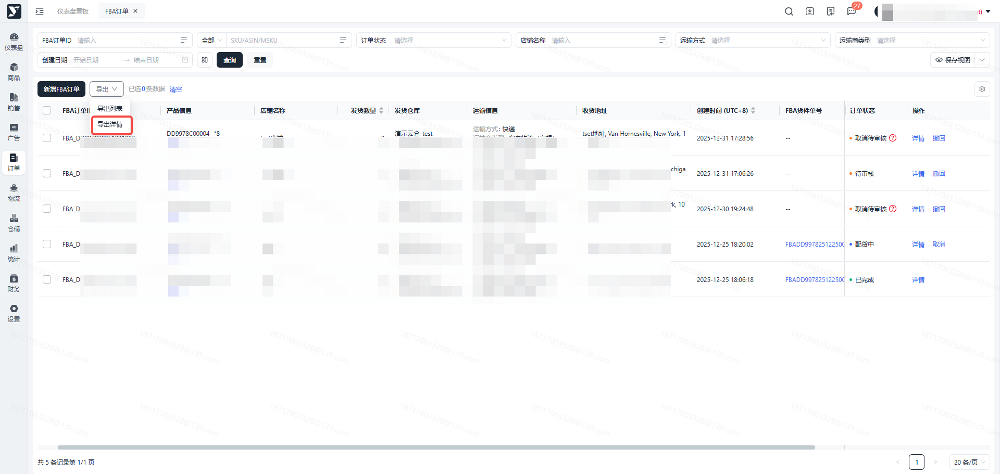
