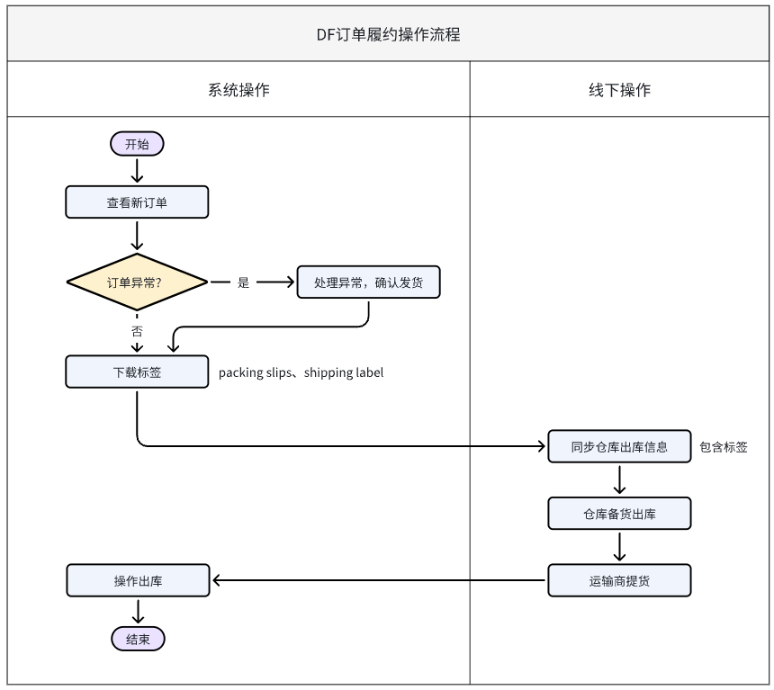
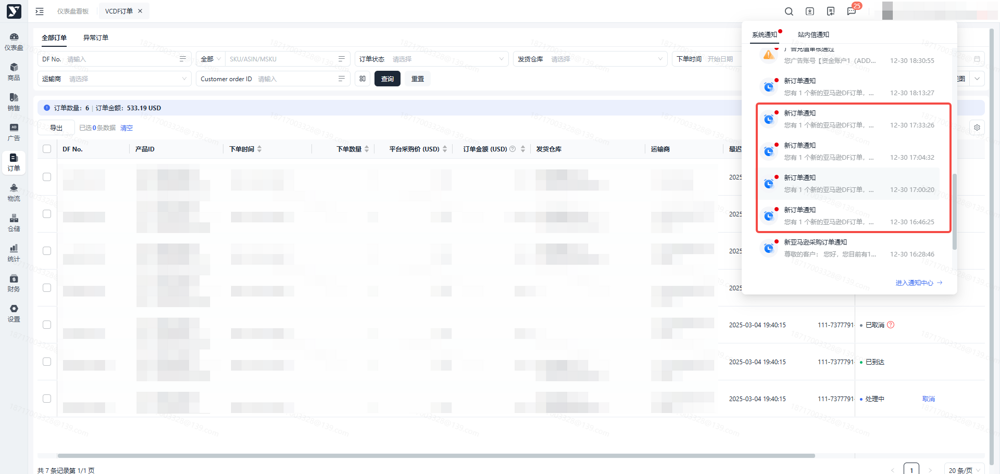
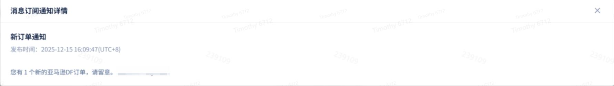
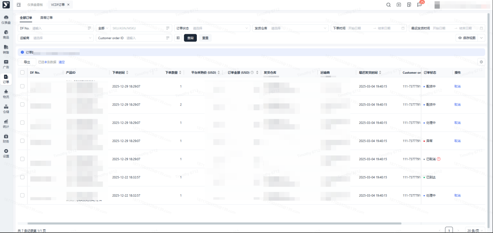
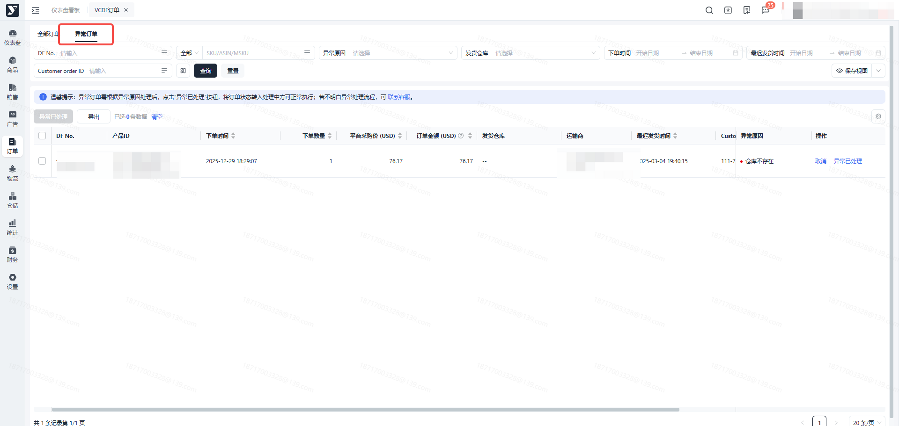
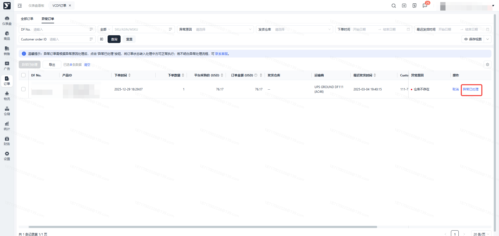
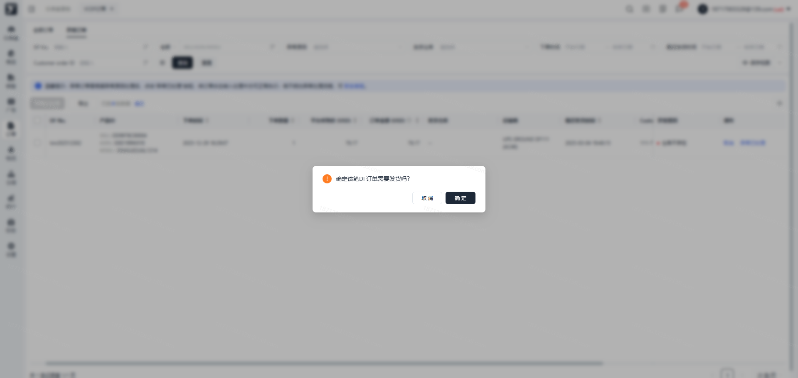
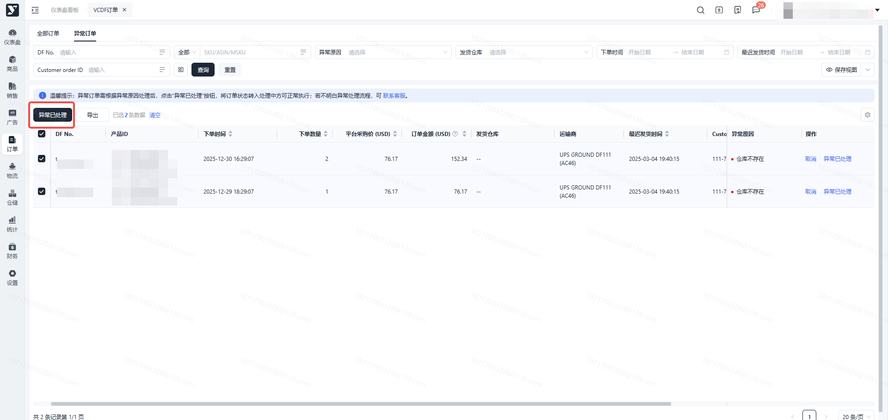
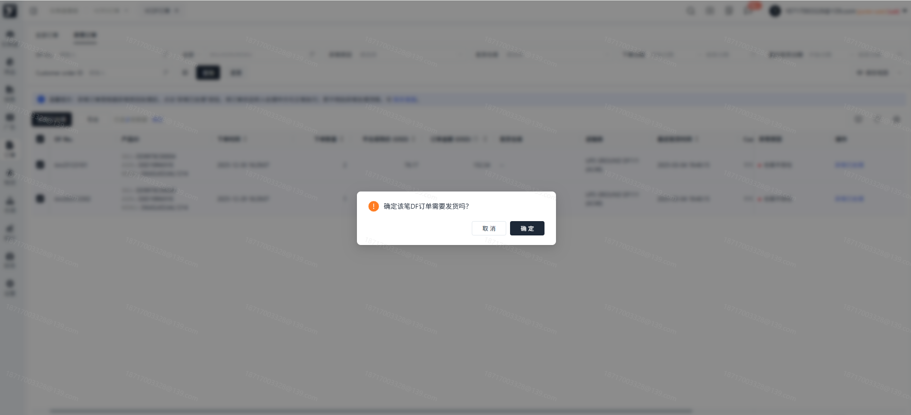
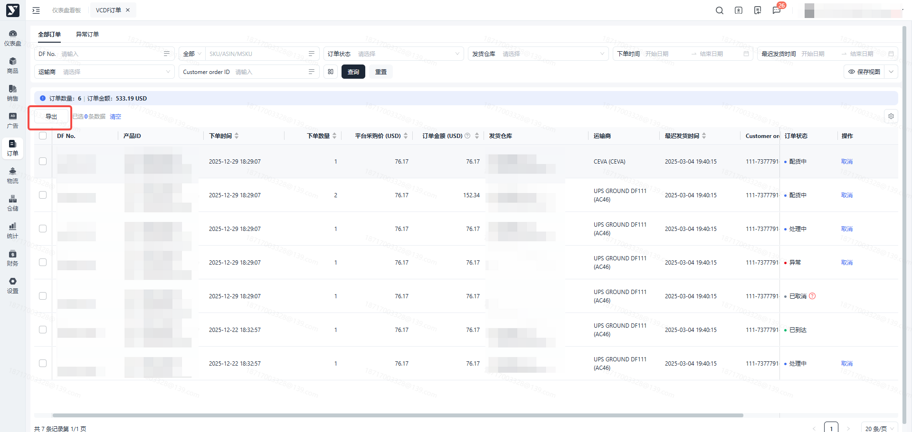

# 飞书文档：VCDF订单

## 文档信息

| 项 | 内容 |
| --- | --- |
| 远程文档 | https://q1njej8cpab.feishu.cn/wiki/DIE1wsBR5irHrkkcWwNcRoYBnce |
| 图片处理 | 本地下载（assets/images） |
| 快照时间 | 2026-08-06 |
| 来源命令 | `lark-cli docs +fetch --api-version v2 --doc https://q1njej8cpab.feishu.cn/wiki/DIE1wsBR5irHrkkcWwNcRoYBnce --doc-format markdown --as user --format json --jq .data.document.content` |
| 格式处理 | fd-doc-markdown-sync/scripts/normalize-feishu-doc-markdown.mjs |

---

VCDF订单

## 功能介绍

亚马逊DF订单，指买家在亚马逊平台下单后，系统会实时拉取亚马逊VC后台DF订单信息并展示在此模块，通常一笔DF订单只会有1个产品1个数量。

## 页面路径

【订单】-【VC订单】-【VCDF订单】

## 注意事项

1. 拉取VC后台的DF订单时，系统会判断该笔订单是否异常，可能的异常原因有：库存不足、仓库被停用等，需要您处理异常后再确认发货。
2. 若您确认发货，则您需要在最迟发货时间之前下载面单，并告知商家仓备货发货。

## 系统流程

## 操作指南

### 新订单通知

1. 功能描述：亚马逊下达新DF订单后，系统消息通知用户。可在平台首页或右上角消息通知，查看消息内容。
2. 操作步骤：

 1. 在【首页】-【通知中心】-【系统通知】查看主旨为“新订单通知”的消息。
 2. 点击右上角消息图标，直接进入【通知中心】-【系统通知】查看主旨为“新订单通知”的消息。

 

 

### 查看全部订单

1. 功能描述：显示亚马逊下发的所有亚马逊DF订单、订单状态。
2. 订单状态说明：

 1. 异常：亚马逊DF订单落单异常，异常订单会显示在【异常订单】tab页
 2. 处理中：系统正在自动处理任务
 3. 配货中：仓库作业中，此状态可下载货件标签
 4. 运输中：已在出库单管理提交出库，但货件单下所有的包裹还未签收
 5. 已到达：货件单下所有的包裹都已全部签收
 6. 已取消：亚马逊DF订单被取消

 

### 异常订单

功能描述：DF落单异常的订单显示在【异常订单】页面，主要的异常原因一般为【仓库不存在、仓库已停用、运输商已停用、库存不足】。

#### 查看异常订单

1. 操作步骤：依次点击【订单管理】- 【VCDF订单】-【异常订单】

#### 处理异常

1. 异常处理方式：

 1. 异常原因为【库存不足】时，核实海外仓真实库存可满足订单数量后，前往【仓储】-【入库单列表】新增库存
 2. 异常原因为【仓库不存在、运输商已停用】时，联系客服处理
 3. 异常原因为【仓库已停用】时，结合仓库实际情况，前往【仓储】-【仓库配置】启用仓库或联系客服处理

#### 异常已处理

1. 功能描述：按异常原因处理异常后，勾选异常单据，点击【异常已处理】按钮，将订单更新为“备货中”状态。
2. 操作步骤：

 1. 处理单个异常订单：点击异常订单上的【异常已处理】按钮，二次弹窗点击【确定】后，系统校验通过，订单状态更新为“备货中”

 

 

 1. 处理多个异常订单：批量勾选异常订单，点击【异常已处理】，二次弹窗点击【确定】后，系统校验通过，订单状态更新为“备货中”

 

 

 ## 导出

 1. 功能描述：支持全量、按条件搜索、勾选导出订单列表
 2. 操作步骤：

 1. 直接点击【导出】”按钮，默认导出全部订单
 2. 按条件搜索后，点击【导出】按钮，导出搜索结果
 3. 勾选列表上需导出的订单明细，点击【导出】按钮，导出搜索结果

 
