# 飞书文档：VCPO订单

VCPO订单

当前版本：v1.0.4

## 功能介绍

亚马逊PO订单，该模块的目的是定时拉取亚马逊下发的采购订单，并由贵司确认是否需要接单，若需要接单并发货，则需填写发货仓库和接单数量

## 页面路径

【订单管理】-【VC订单】- 【VCPO订单】

## 注意事项

1. 请在倒计时结束前确认订单（倒计时将从下单时间开始计算）；
2. 接单数量不得大于采购数量，且接单数量必须是装箱数量的整数倍；若您需要变更装箱数量，请在接单前联系客服进行修改；
3. 在系统下单后的23小时内，您可以编辑接单数量，请前往"全部订单"页面进行修改；
4. 若您未能及时确认，系统将默认接单数量为0，该笔订单自动转入"全部订单"页面；
5. 若系统下单后超过23小时，您仍然需要编辑接单数量，请联系客服进行修改（注：此操作可能会造成亚马逊罚款）

## 操作流程

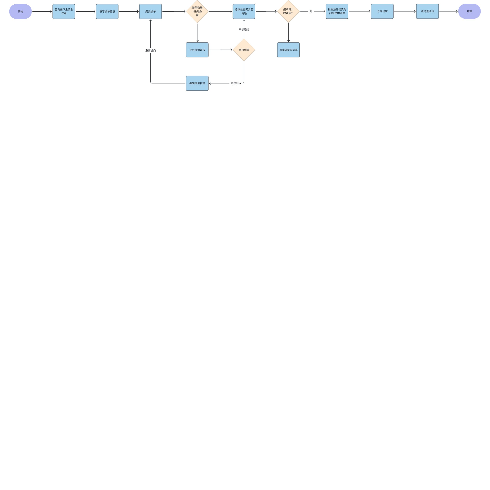

> 画板来源：token=`R0b2w44SVhTG9TbbxQzc56lBn8d`

## 操作指南

### 新订单通知

1. 功能描述：亚马逊下达新PO订单后，系统消息通知用户。可在平台首页或右上角消息通知，查看消息内容。
2. 操作步骤：

 1. 在【首页】-【通知中心】-【系统通知】查看主旨为“PO新订单通知”的消息

 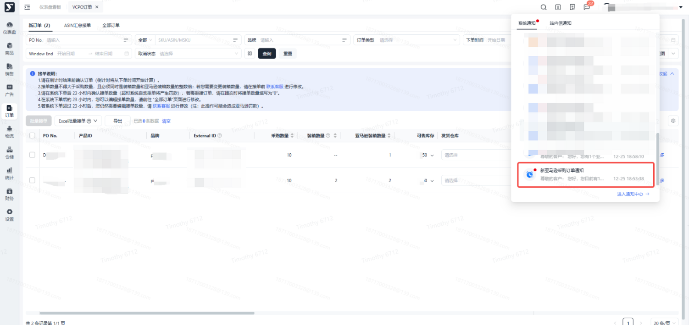

 1. 点击右上角消息图标，直接进入【通知中心】-【系统通知】查看主旨为“PO新订单通知”的消息点击消息标题，可查看通知内容详情，点内容中“点击此处”可跳转到亚马逊采购订单新订单页面

 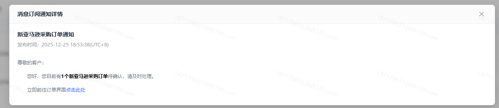

### 订单列表

1. 功能描述：

 1. 亚马逊下达新PO订单后，会显示在【新订单、ASIN汇总接单、全部订单】三个tab页
 2. 系统会根据客户在库存管理维护的ASIN可售库存，推荐PO订单的【接单数量、发货仓库】，推荐的数量及仓库显示灰色字体，请留意区分
 3. 预计提货时间默认显示【Window End】, 可修改
2. 操作步骤：

 1. 查看 新订单：还未操作接单，即订单状态为【待确认】时，按“PO+ASIN” 平铺，显示在此页面

 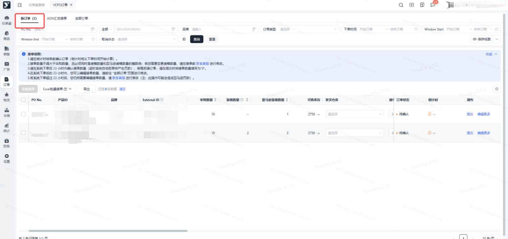

 1. 查看 ASIN汇总接单：还未操作接单，即订单状态为【待确认】时，按“ASIN+窗期+订单类型+装箱数量+亚马逊装箱数量”平铺，显示在此页面

 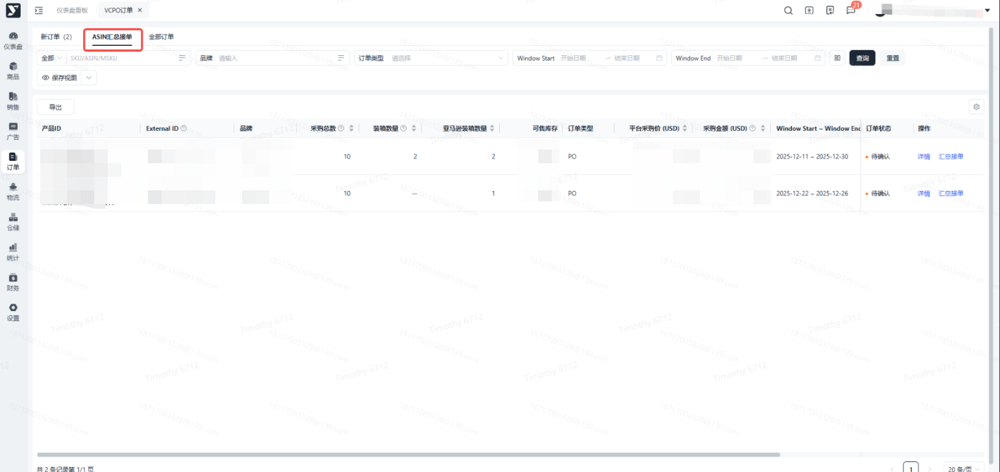

 1. 查看 全部订单：亚马逊下达的所有PO订单，不限状态；按“PO+ASIN” 平铺，显示在此页面

 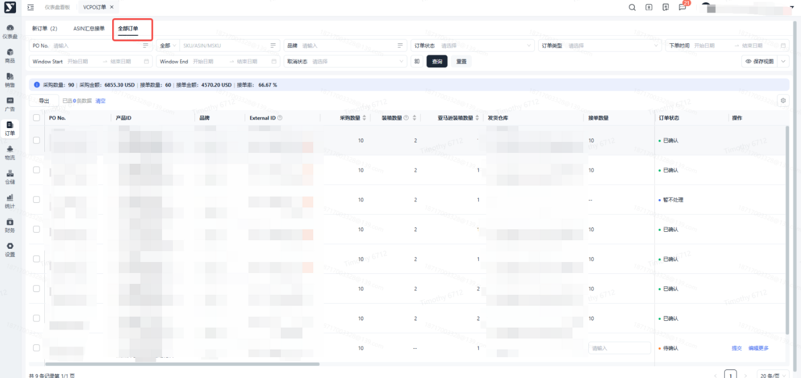

### 接单

#### 单个PO+ASIN接单

1. 功能描述：仅当少量PO+ASIN 需接单时，可在行上直接维护【发货仓库、接单数量、预计提货时间】，提交接单
2. 操作步骤：

 1. 在【新订单】页面，维护【发货仓库、接单数量、预计提货时间】三个信息
 2. 确定信息维护无误后，点击【提交】按钮，提交成功，PO+ASIN 从新订单页面移除，转入【全部订单】

 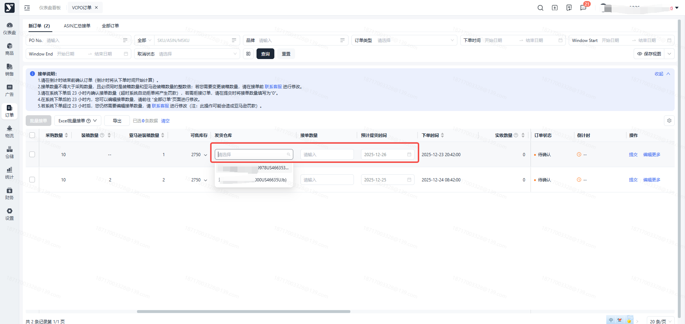

#### 推荐接单

##### 按库存分配接单

1. 功能描述：新订单页面默认按库存分配规则推荐接单信息，系统计算后自动推荐发货仓库、接单数量，推荐信息字体颜色显示为灰色

注意：暂时仅支持在一个仓库有库存的ASIN作推荐

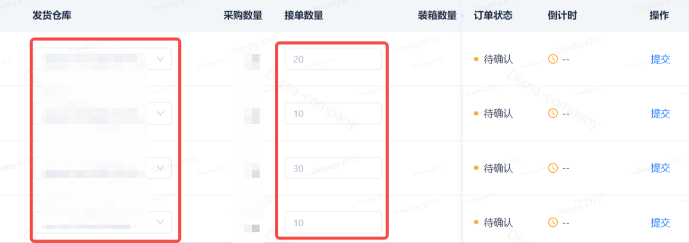

##### 按距离分配接单

1. 功能描述：系统优先分配距亚马逊收货仓库更近的仓库库存，系统计算后自动推荐发货仓库、接单数量、预计提货时间
2. 操作步骤：

 1. 勾选需要按距离分配接单的新订单

 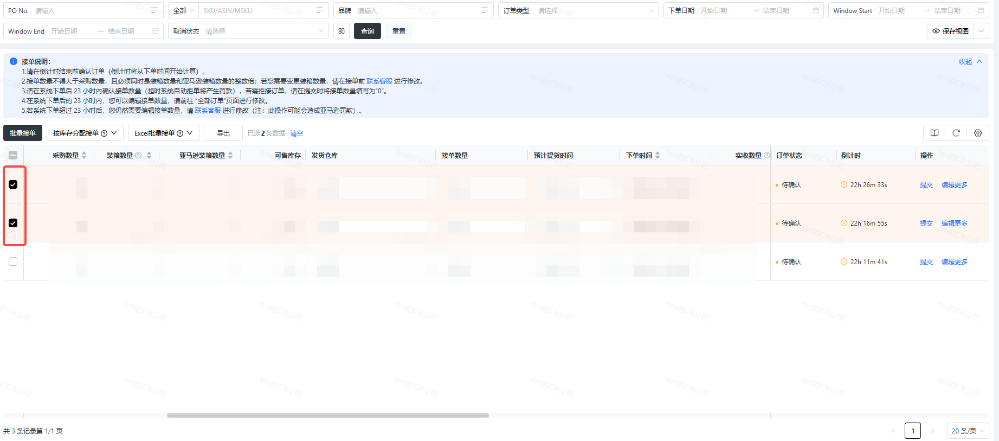

 1. 点击“按距离分配接单”按钮

 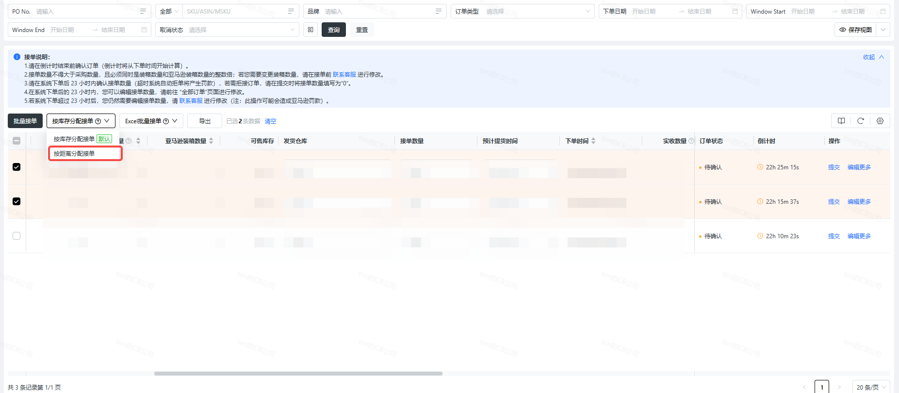

 1. 在按距离分配接单页面系统自动分配接单数据后，可核对和调整接单信息

 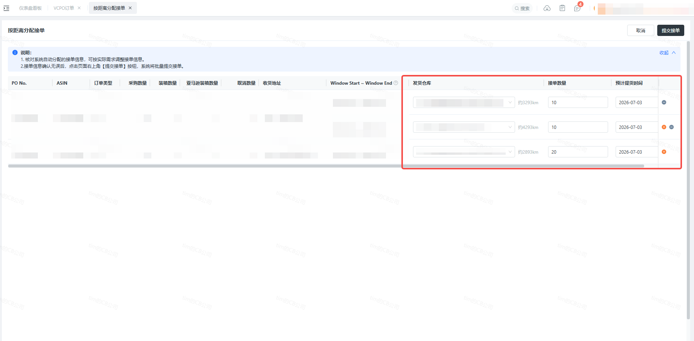

 1. 接单信息核对完成后，点击“提交接单”按钮

 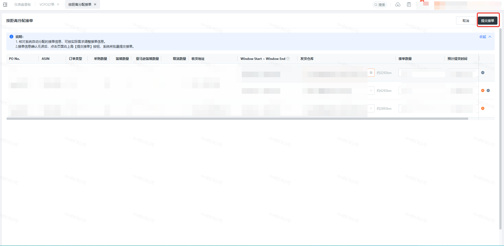

#### 编辑更多

1. 功能描述：同PO+ASIN 需从多仓发货，或从同一个仓库发货 但预计提货时间不一样，可通过【编辑更多】维护多组接单信息来支持如上场景
2. 操作步骤：

 1. 点击“编辑更多”按钮，进入编辑界面

 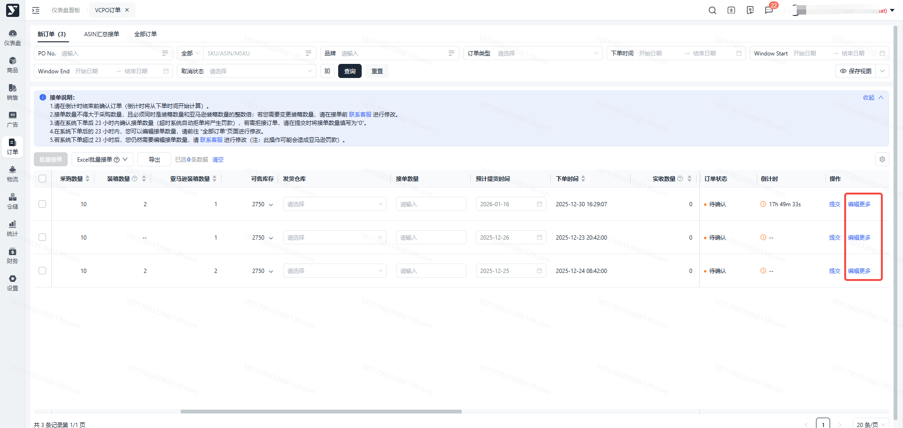

 1. 填写“发货仓库”、“接单数量”、“预计提货时间”

 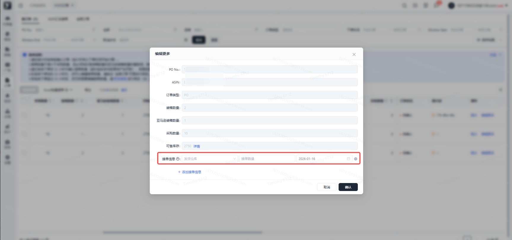

 1. 需增加更多发货仓库时，点击“添加接单信息”图标，添加新的接单信息栏位

 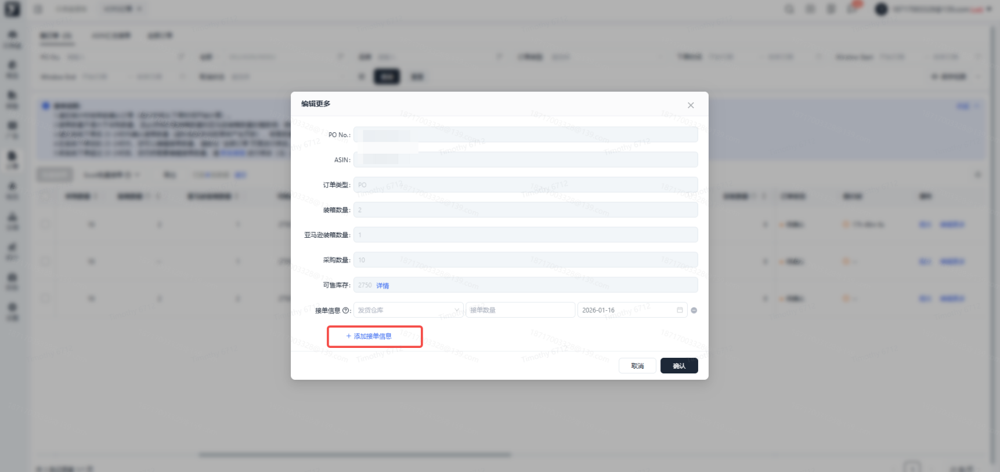

 1. 维护好接单信息后，点击“确认”按钮，订单列表自动更新

 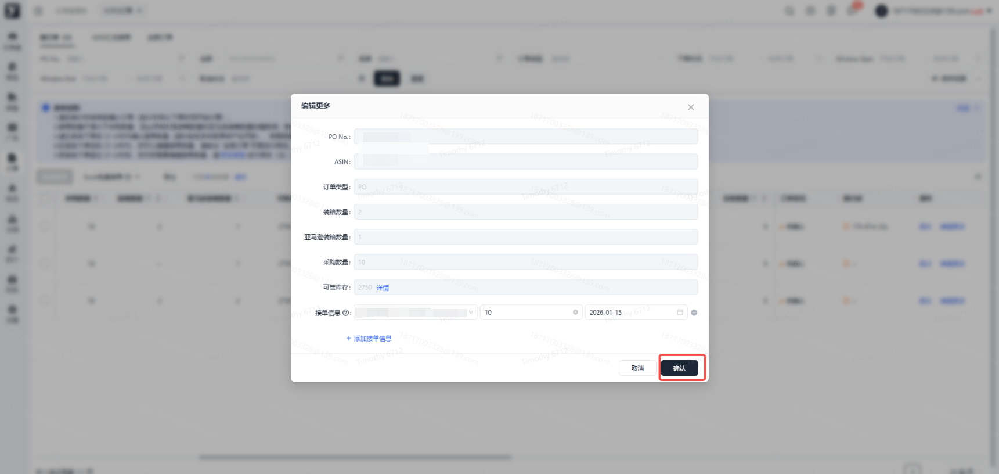

#### 批量接单

1. 功能描述：在行上维护【发货仓库、接单数量、预计提货时间】后，批量勾选PO+ASIN，批量提交接单信息
2. 操作步骤：

 1. 在【新订单】页面，维护【发货仓库、接单数量、预计提货时间】三个信息
 2. 确定信息维护无误后，批量勾选PO+ASIN，点击【批量接单】按钮

 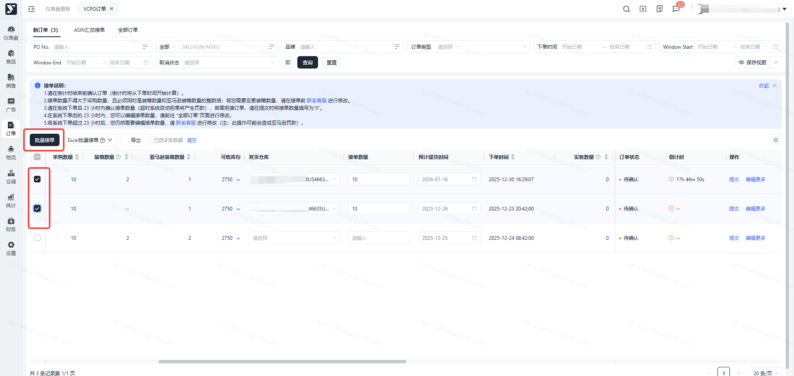

 1. 二次弹窗确认“选中ASIN 确定批量接单？”，点击【确定】，提交成功，PO+ASIN从新订单页面移除，转入【全部订单】页面

 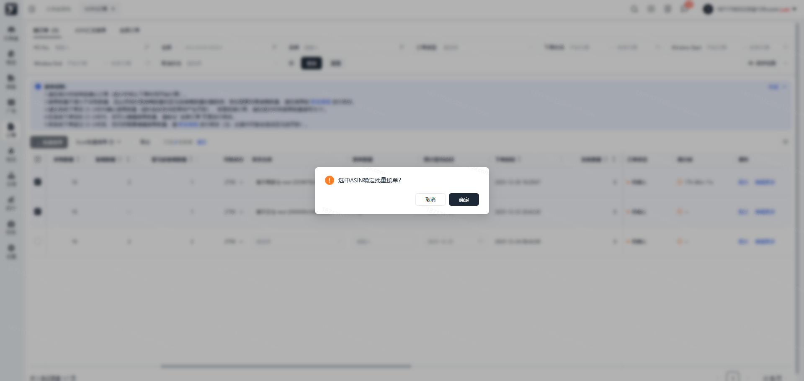

 1. 全部接单成功，PO+ASIN转入全部订单，订单状态变更为“已确认-处理中”

 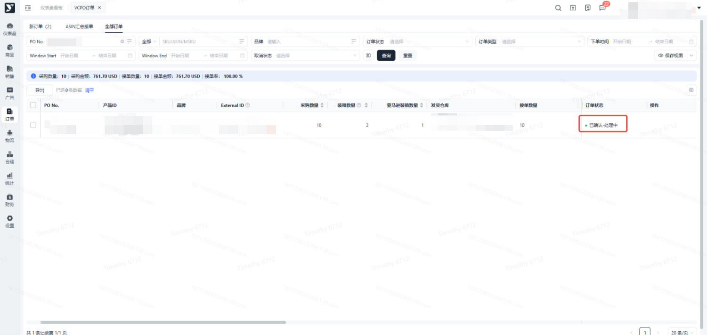

 1. 批量接单，若接单数量小于采购数量，弹窗返回“如下ASIN 接单数量小于采购数量，确认接单？”，点击确认，提交接单，点击取消，弹窗消失，停留新订单列表界面，可直接在行上修改

 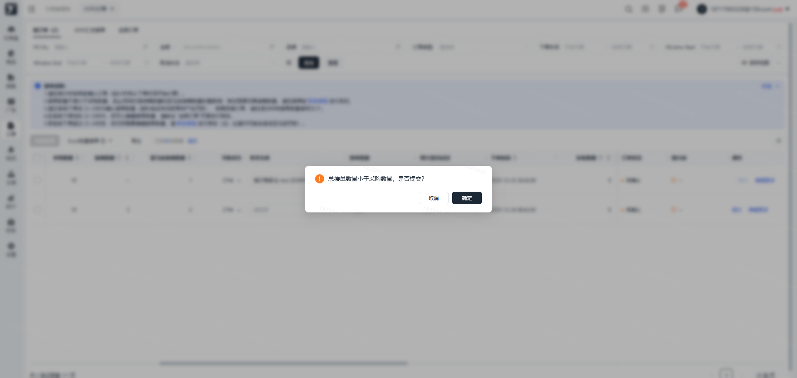

 1. 批量接单，若部分提交失败，接单结果弹窗返回失败的PO+ASIN及失败原因，点击下载结果文件，可跳转下载中心，下载失败的ASIN明细到本地电脑。

 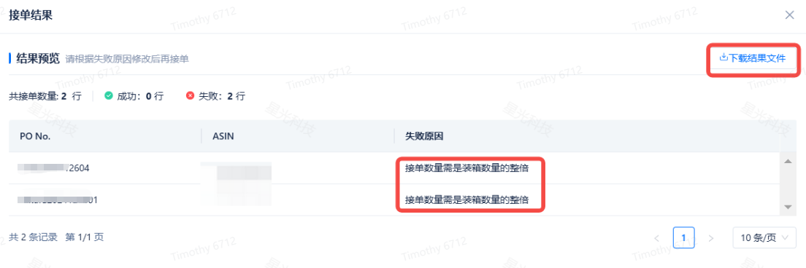

#### ASIN汇总接单

1. 功能描述：

 1. 系统按相同“ASIN+窗期+订单类型+装箱数量+亚马逊装箱数量” 汇总“亚马逊采购数量”，显示在此页面
 2. 支持用户按ASIN汇总接单：当同一个ASIN分布在多个PO订单时，推荐采用此方式，提升接单效率
 3. 接单信息提交成功后，系统自动将接单信息分配至PO+ASIN 的【接单数量】栏位
2. 操作步骤：

 1. 点击【ASIN汇总接单】Tab页面，显示可汇总接单的ASIN列表，操作按钮显示【详情、汇总接单】

 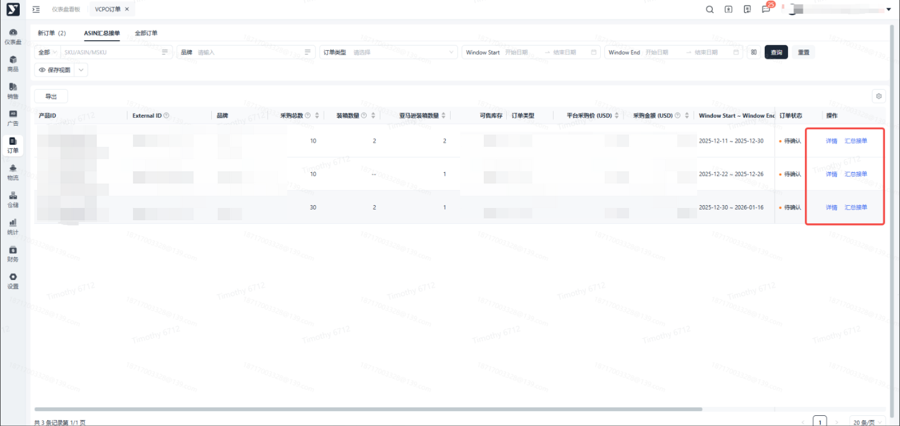

 1. ASIN汇总接单-详情

 1. 点击【详情】按钮，进入汇总订单详情页面，可查看该汇总ASIN 对应的PO订单明细；也可在此详情页面按PO+ASIN 方式提交接单，操作步骤见 5.3.1

 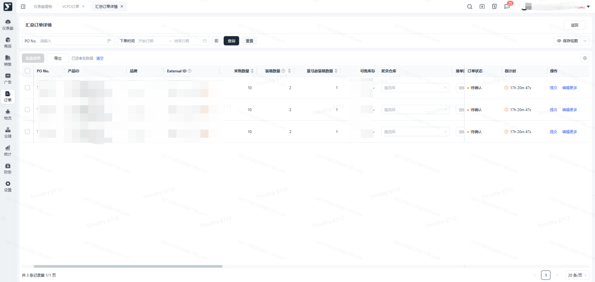
 2. ASIN汇总接单-汇总接单

 1. 点击【汇总接单】按钮，弹窗进入汇总接单页面
 2. 在汇总接单信息栏位 维护【发货仓库、接单数量、预计提货时间】

 1. 多仓发货，点击【添加接单信息】字段，添加新的接单信息栏位

 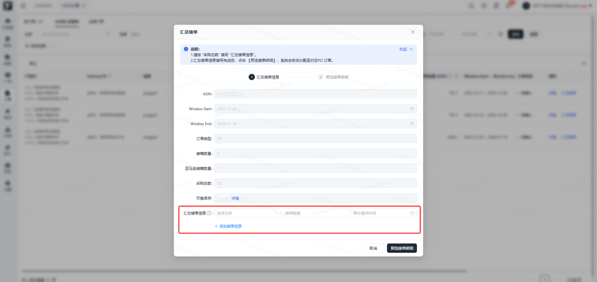
 3. 维护完接单信息后，点击【预览接单明细】按钮，系统根据接单信息自动分配【发货仓库，接单数量，预计提货时间】到订单明细

 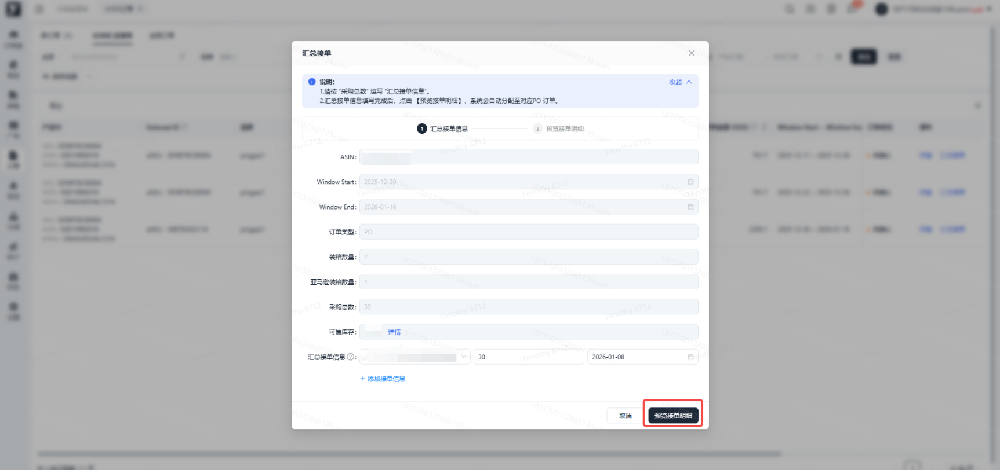

 1. 也可在预览界面还可再次修改接单信息：

 - 如需多仓发货，点击对应行的 “⊕、⊖” 按钮增减【接单信息】
 - 如需拒单，将接单数量修改为 “0”
 - 如暂不接单，将接单数量置为空（不填写）

 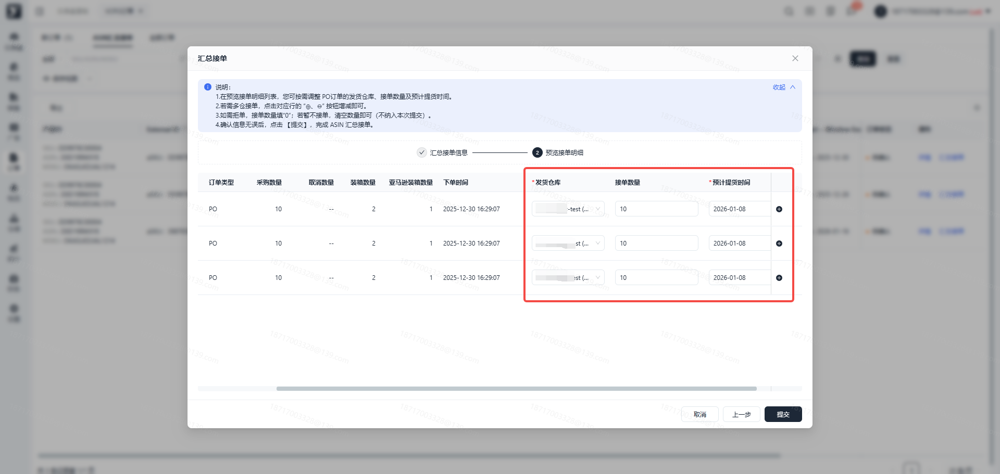

 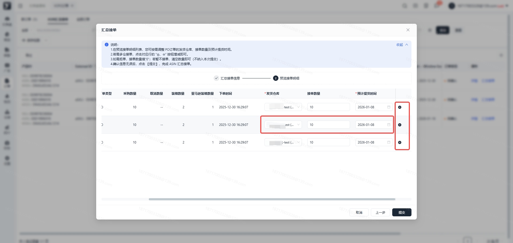
 2. 接单信息确认无误后，点击【提交】按钮，，提交成功后，ASIN汇总接单列表重新刷新

 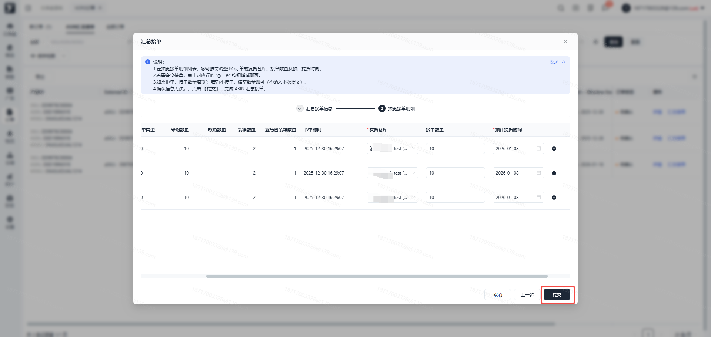

#### Excel批量接单

1. 功能描述：新订单界面，待确认状态订单可下载接单数据，维护接单信息后批量上传进行接单
2. 操作步骤：

 1. 新订单页面筛选或勾选需要接单的待确认订单，在【维护接单数据】按钮下拉点击【下载接单数据】，下载接单数据模版

 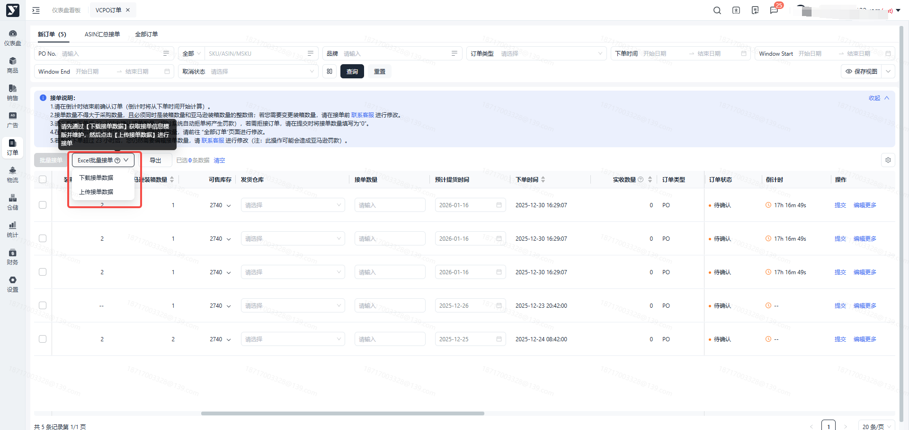

 1. 在的下载的接单数据模版Excel中，维护订单对应的【发货仓库、接单数量、预计提货时间】

 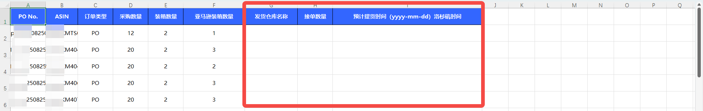

 1. 接单数据维护完成后，新订单页面【维护接单数据】按钮下拉点击【上传接单数据】，打开批量上传接单数据弹窗

 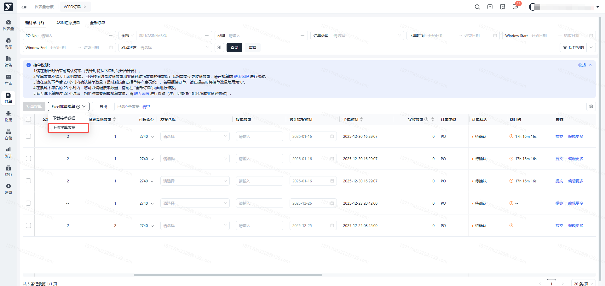

 1. 在批量上传接单数据弹窗中，点击【上传文件】按钮，选择已维护好接单数据的Excel文件上传

 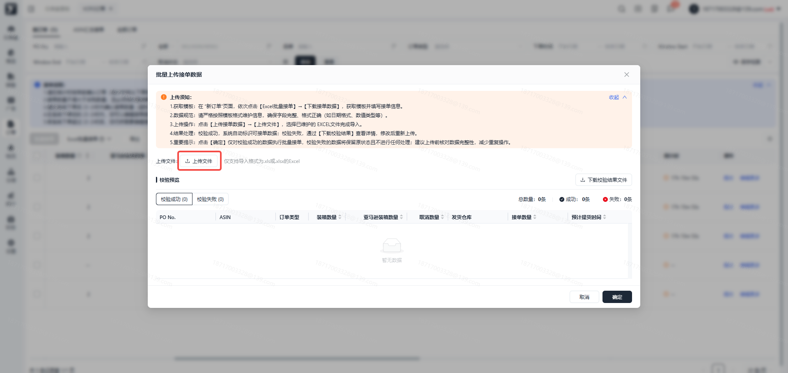

 1. 上传接单数据后，可预览校验成功或失败的接单数据，点击【下载校验结果文件】可导出校验结果数据，校验失败的接单数据可根据失败原因修改后重新上传

 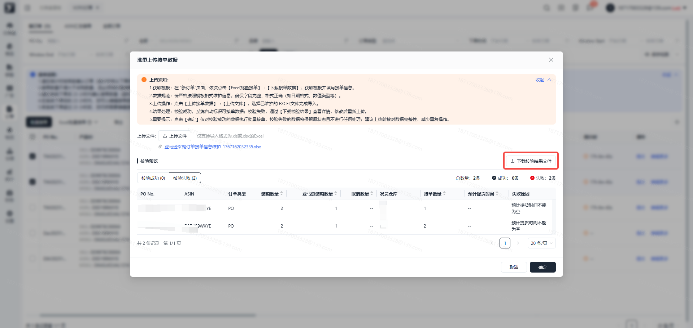

 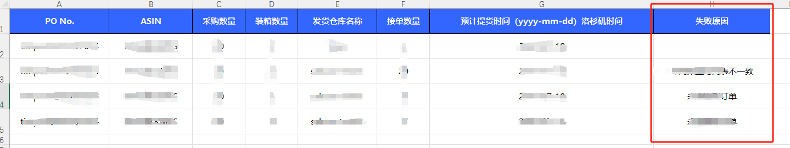

 1. 校验成功的接单数据可点击弹窗【确认】按钮提交接单，系统弹窗批量接单进度弹窗

 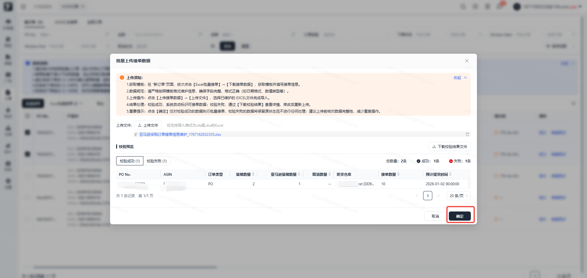

 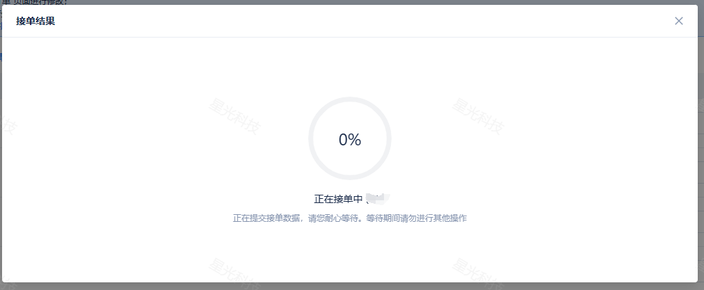

 1. 批量上传完成后，系统自动更新订单接单信息。

 1. 若部分提交失败，接单结果弹窗返回失败的PO+ASIN及失败原因，点击下载接单结果文件，可下载失败的PO+ASIN明细到本地电脑。

 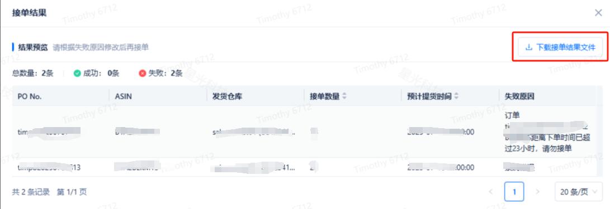

### 编辑

1. 功能描述：订单状态为【已确认】时，可在倒计时结束前（下单后的23小时内）修改接单信息
2. 操作步骤：

 1. 选择订单状态为【已确认】的PO+ASIN，点击【编辑】按钮

 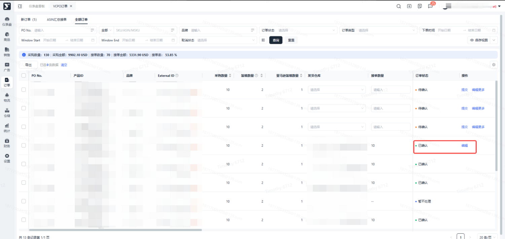

 1. 弹窗进入编辑页面，可修改【接单数量、发货仓库、预计提货时间】
 2. 修改完毕后，点击【确认】，修改成功，系统自动更新订单列表

 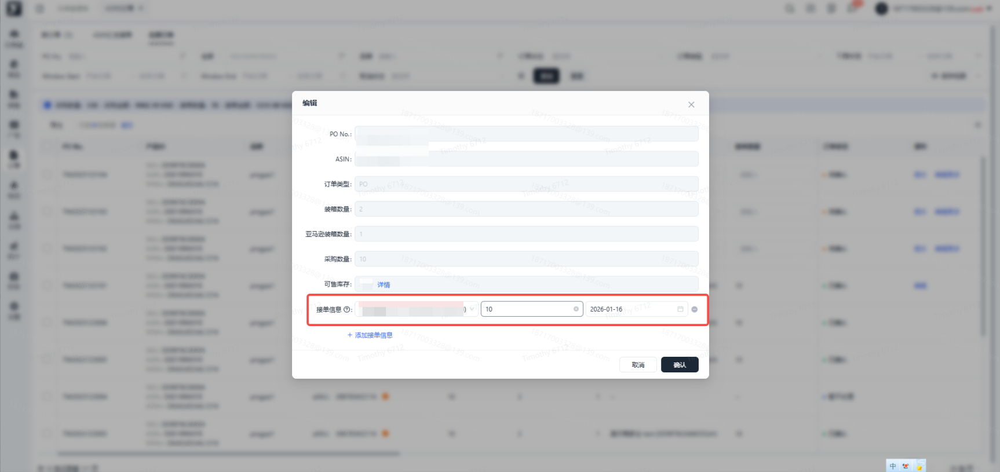

### 修改发货仓库

1. 功能描述：支持接单后修改发货仓库，但需同时满足如下前提条件：

 1. 当前时间距离下单时间大于24小时
 2. 当前时间小于窗期结束时间（Window End ）
 3. PO+ASIN未创建货件单
2. 操作步骤

 1. 点击【修改发货仓库】按钮，编辑发货数量、发货仓库、预计提货时间；
 2. 该笔订单下单时间超过24小时，且未创建货件单时，可以修改发货信息；但修改发货信息的接单数量必须等于原接单数量；

 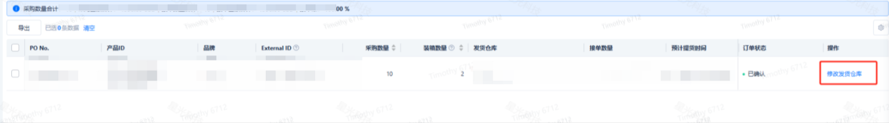

 1. 填写发货仓库、接单数量、预计提货时间

 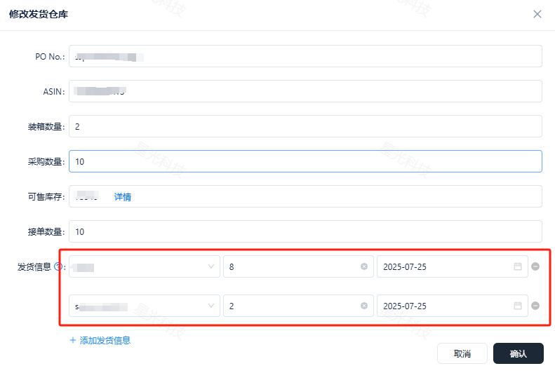

 1. 修改好接单信息后，点击“确认”按钮，提交接单信息

 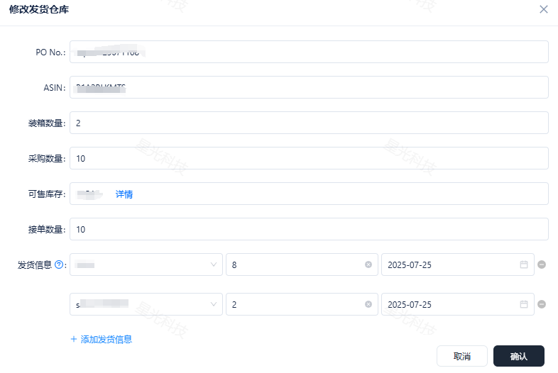

### 导出

1. 功能描述：支持全量、按条件搜索、勾选导出亚马逊采购订单列表
2. 操作步骤：

 1. 点击【导出】按钮，导出新订单列表

 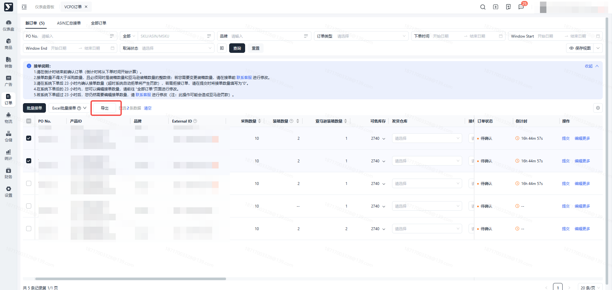

 1. 点击【导出】按钮，导出全部订单列表

 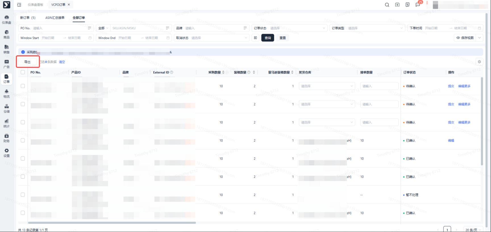

### 自动拒单通知

1. 功能描述：待确认订单距离自动拒单时间不足3小时、1小时，系统通知用户；可在平台首页或右上角消息通知，查看消息内容。
2. 操作步骤：

 1. 在【首页】-【通知中心】-【系统通知】查看主旨为“PO订单即将自动拒单通知”的消息
 2. 点击右上角消息图标，直接进入【通知中心】-【系统通知】查看主旨为“PO订单即将自动拒单通知”的消息

 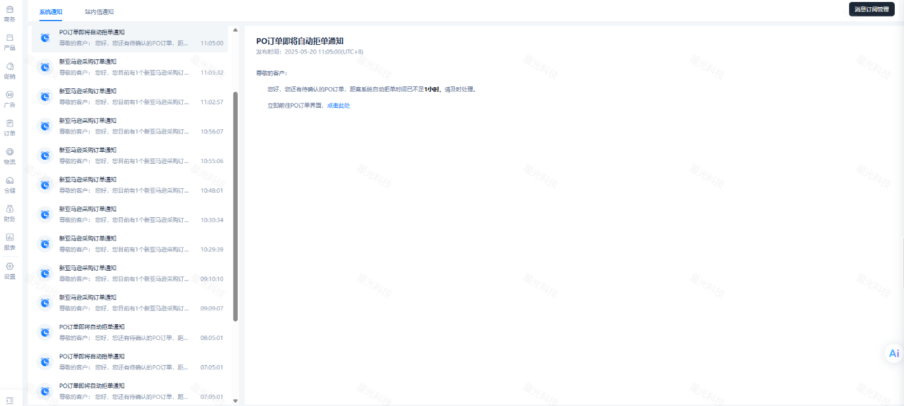

### 订单取消通知

1. 功能描述：PO订单采购数量被亚马逊取消时，系统获取到PO订单取消信息后，站内消息通知用户
2. 操作步骤：

 1. 在【首页】-【通知中心】-【系统通知】查看主旨为“PO订单被取消通知”的消息
 2. 点击右上角消息图标，直接进入【通知中心】-【系统通知】查看主旨为“PO订单被取消通知”的消息

 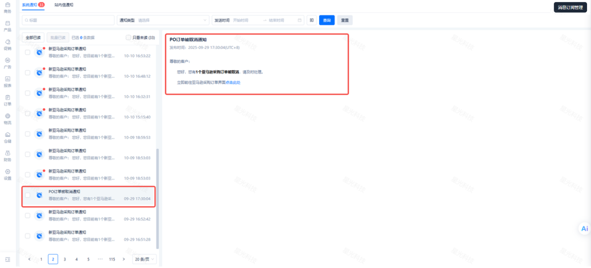
