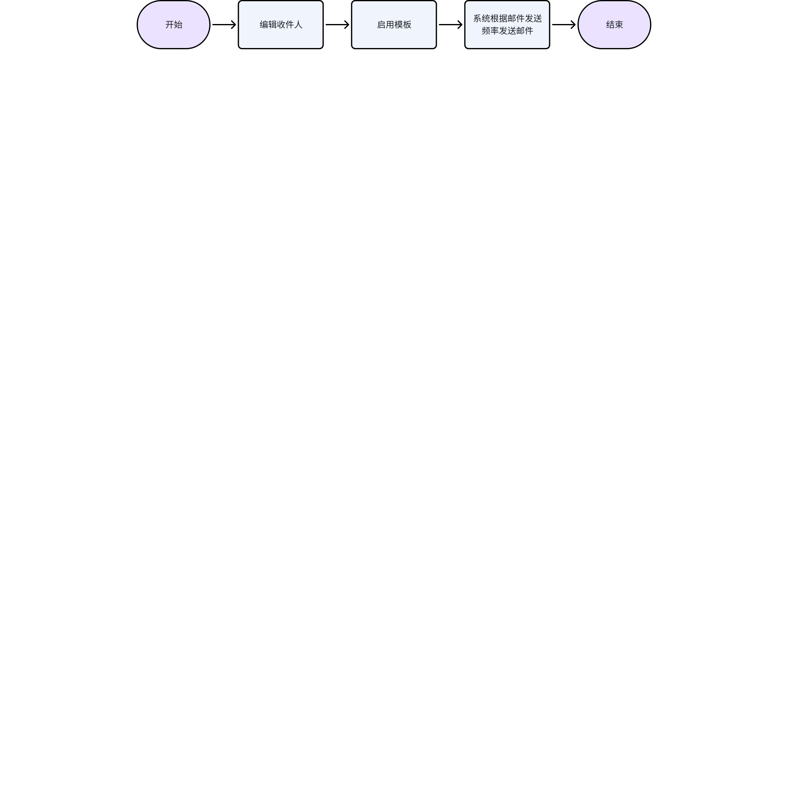
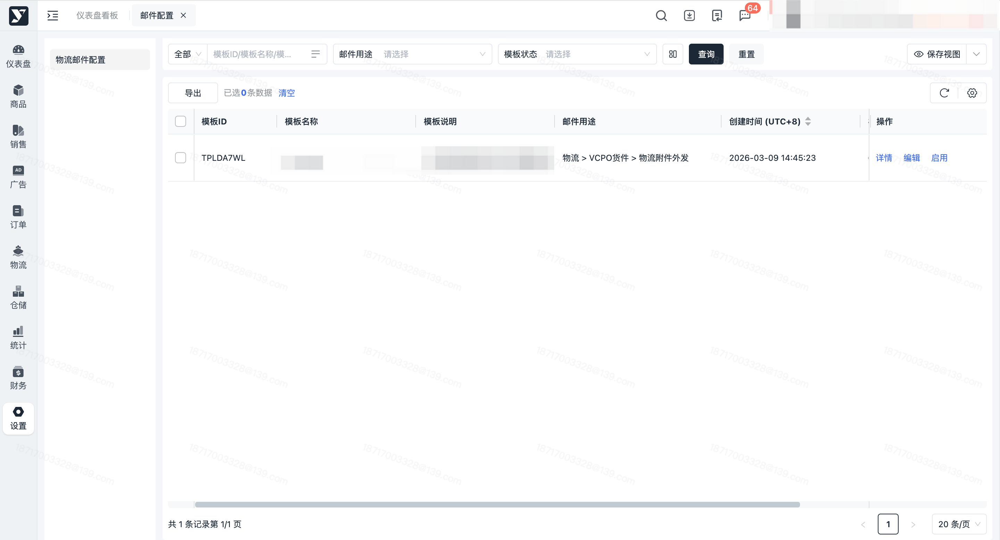
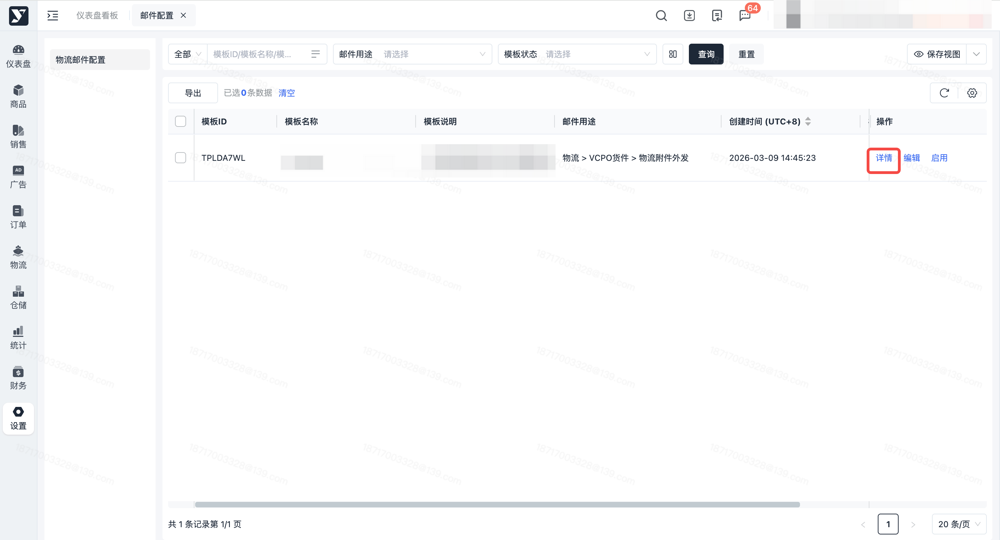
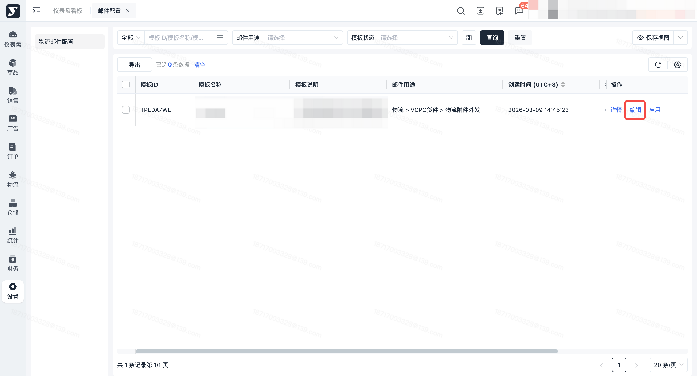
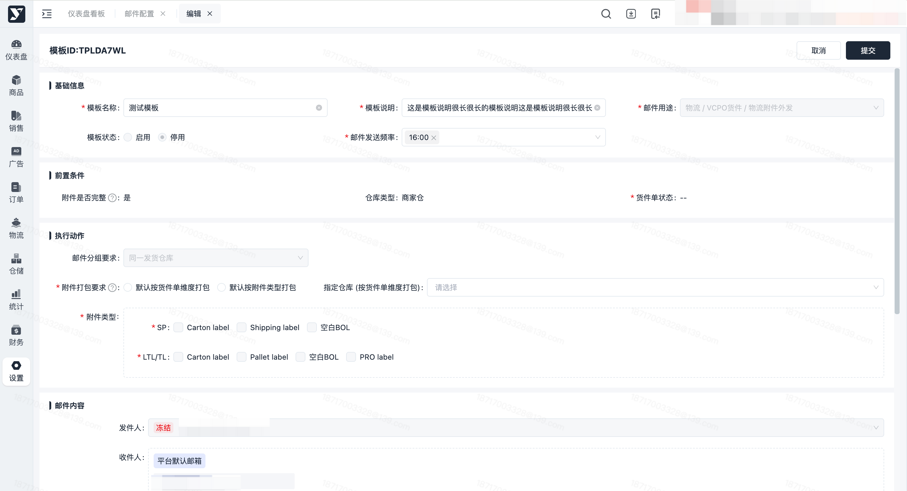
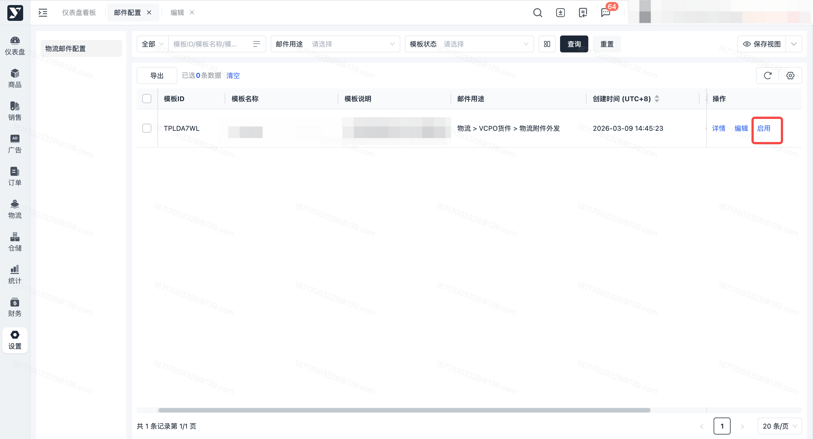
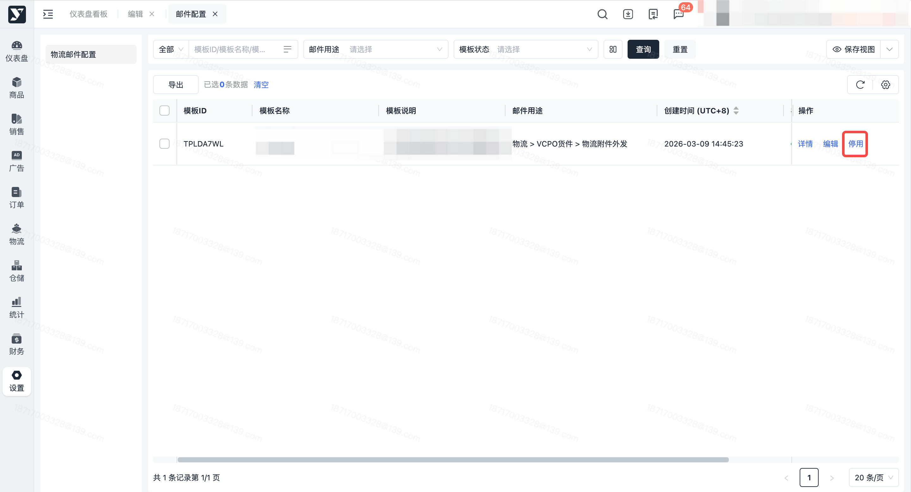
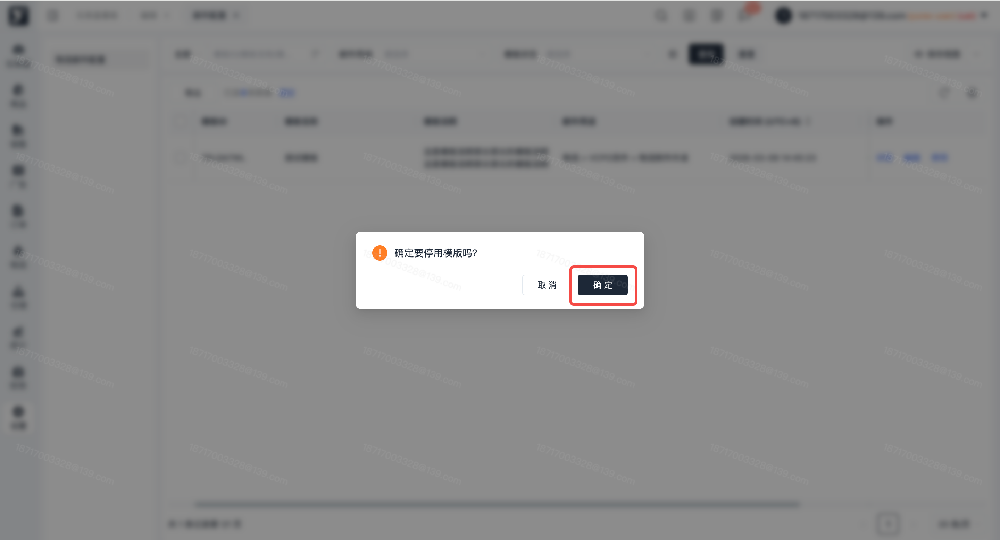
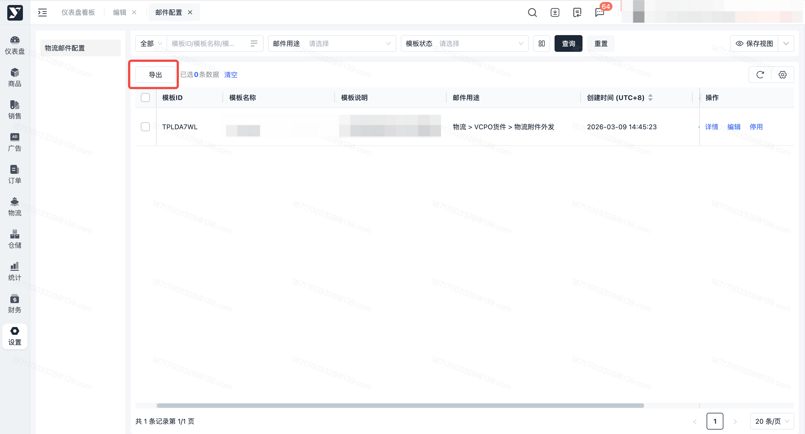

# 飞书文档：邮件配置

## 文档信息

| 项 | 内容 |
| --- | --- |
| 远程文档 | https://q1njej8cpab.feishu.cn/wiki/AH8NwsXFtiN4edkUKkjc0ZWmn9f |
| 图片处理 | 本地下载（assets/images） |
| 快照时间 | 2026-08-06 |
| 来源命令 | `lark-cli docs +fetch --as user --doc "<remote>" --jq ".data.markdown"` |
| 格式处理 | fd-doc-markdown-sync/scripts/normalize-feishu-doc-markdown.mjs |

---

邮件配置

## 功能介绍

可配置邮件模板，控制邮件发送频率、收件人等

## 页面路径

【设置】-【业务配置】-【邮件配置】

## 注意事项

1. 邮件发送：系统仅会针对启用状态的发送邮件
2. 物流附件外发邮件：若货件单发生运输商/运输模式变更、手动生成托盘标等情况，仍需到系统里下载附件

## 系统流程

> 画板来源：token=`F7SMwOSZGhxmrpbJb54cy2Lkngh`

## 操作指南

### 查看模板列表

1. 功能描述：支持查看模板列表
2. 操作步骤：点击菜单【设置】-【业务配置】-【邮件配置】，查看列表

 

### 查看模板详情

1. 功能描述：支持查看模板详情
2. 操作步骤：点击菜单【设置】-【业务配置】-【邮件配置】，点击【详情】按钮

 

### 编辑模板

1. 所有邮件用途的模板都可编辑：模板名称、模板说明、邮件发送频率，收件人-自定义邮箱、抄送-自定义邮箱

#### 编辑【物流附件外发】模板

1. 功能描述：支持编辑模板，控制邮件发送频率、发送内容形式、收件人等

 1. 邮件用途=物流附件外发可编辑：附件打包要求（可指定仓库的附件打包要求）、指定仓库收件人&抄送
2. 操作步骤：

 1. 点击菜单【设置】-【业务配置】-【邮件配置】，点击【编辑】按钮

 

 1. 编辑模板，点击【提交】按钮

 

### 启用模板

1. 功能描述：针对停用状态的模板，可以操作启用模板

 1. 启用模板时，收件人-自定义邮箱须有值，否则会启用失败
2. 操作步骤：

 1. 点击菜单【设置】-【业务配置】-【邮件配置】，点击【启用】按钮

 

 1. 点击【确定】按钮

 

### 停用模板

1. 功能描述：针对启用状态的模板，可以操作停用模板
2. 操作步骤：

 1. 点击菜单【设置】-【业务配置】-【邮件配置】，点击【停用】按钮

 

 1. 点击【确定】按钮

 

### 导出模板列表

1. 功能描述：按条件搜索或勾选后导出模板列表
2. 操作步骤：按条件搜索或勾选指定模板后，点击【导出】按钮，导出模板列表信息

 
