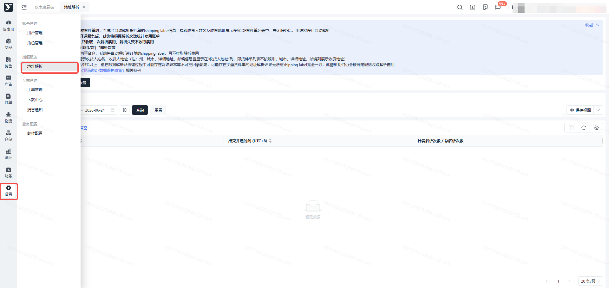
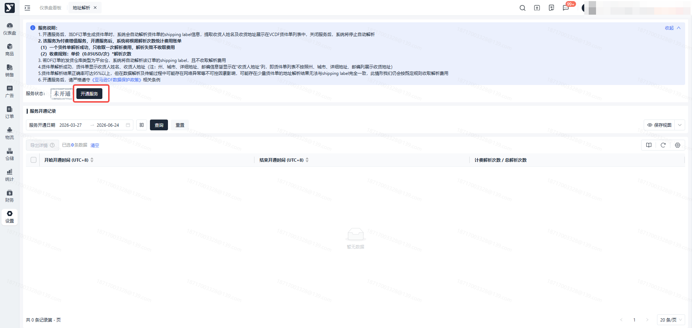
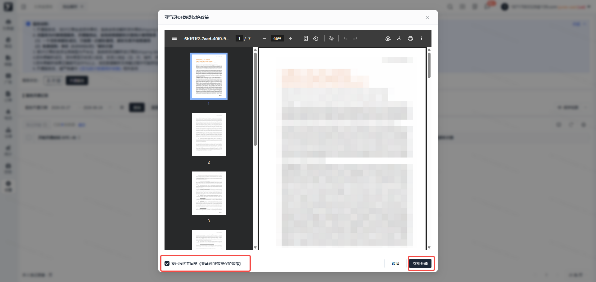
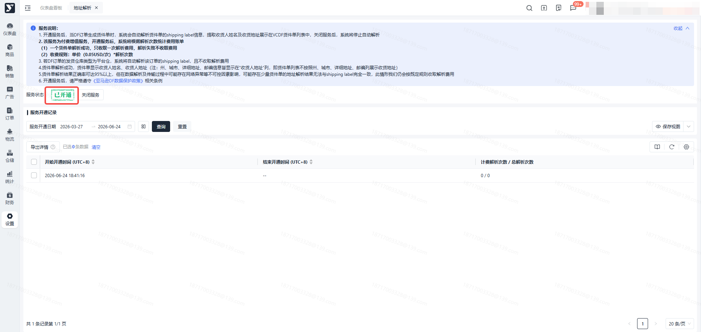
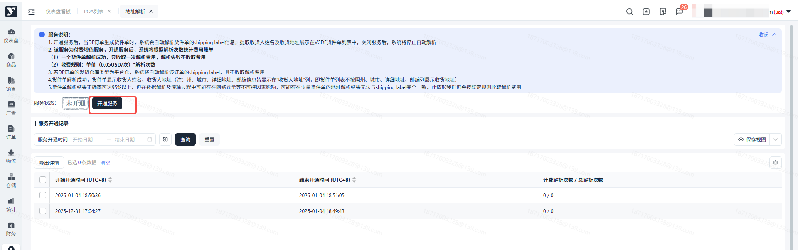
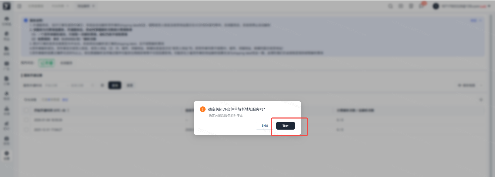
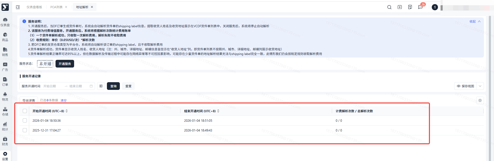
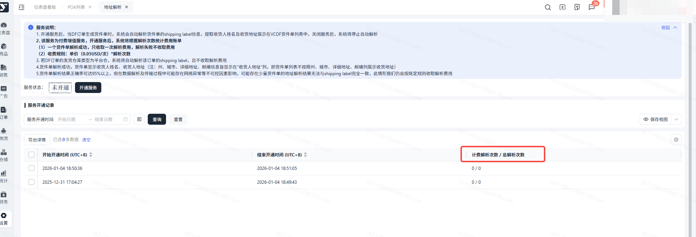
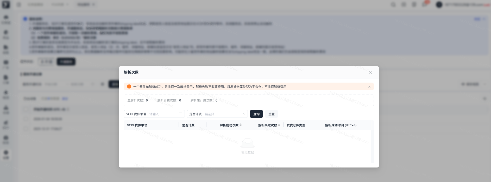
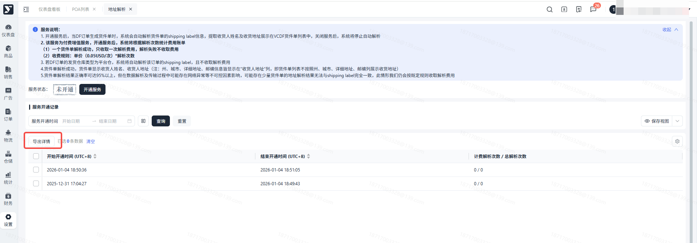

# 飞书文档：地址解析

## 功能介绍

解析DF订单收货地址增值服务。

当开通此服务后，系统会自动解析面单收货信息，将解析后的收货人姓名、地址等显示在DF货件单列表。

## 页面路径

【设置】- 【增值服务】-【地址解析】

## 注意事项

此为付费定制服务，计费标准请参考地址解析服务说明

1. 一个货件单解析成功，只收取一次解析费用，解析失败不收取费用
2. 若DF订单的发货仓库类型为平台仓/自营仓，系统将自动解析该订单的Shipping label，且不收取解析费用

## 系统流程

## 操作指南

1. 功能描述：开通/关闭解析地址增值服务
2. 操作步骤：

 1. 依次点击【设置】-【增值服务】-【地址解析】按钮

 

 1. 开通服务：点击【开通服务】按钮

 

 1. 开通服务：在二次弹窗中，勾选“我已阅读并同意《亚马逊DF数据保护政策》”后，点击【立即开通】按钮，开通成功，状态更新为“已开通”

 

 

 1. 关闭服务：点击【关闭服务】按钮，在二次弹窗中，点击【确定】，关闭成功，状态更新为 “未开通”

 

 

 1. 查询开通记录：可按服务开通时间查询开通记录

 

 1. 点击【计费解析次数/总解析次数明细】，可查看解析次数对应的货件单明细

 

 

 1. 点击【导出详情】按钮，可导出服务开通详情至Excel

 
