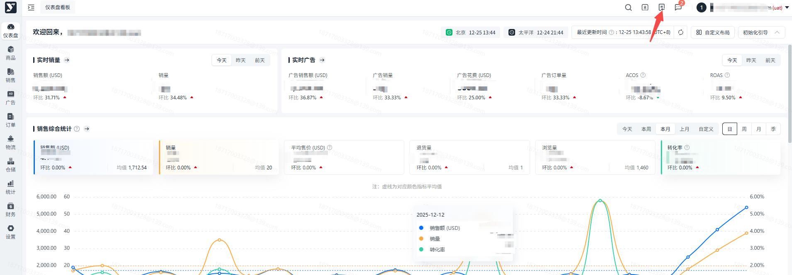
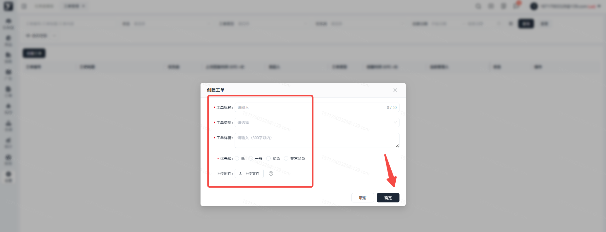
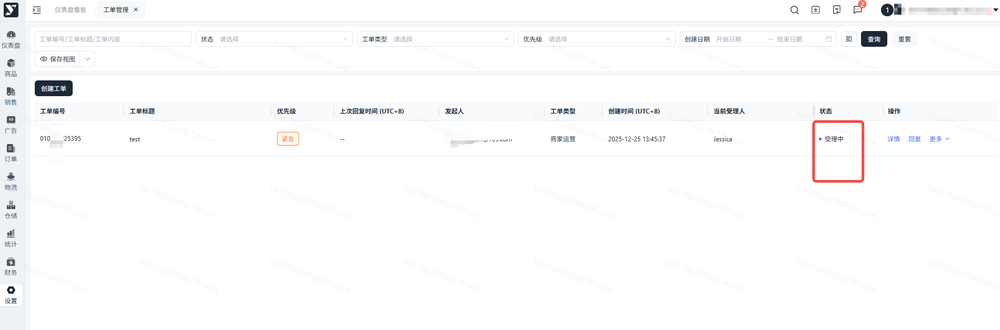
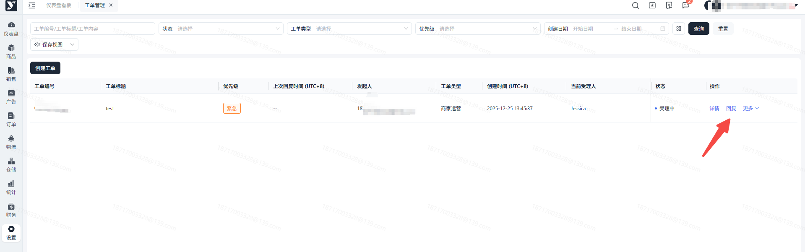
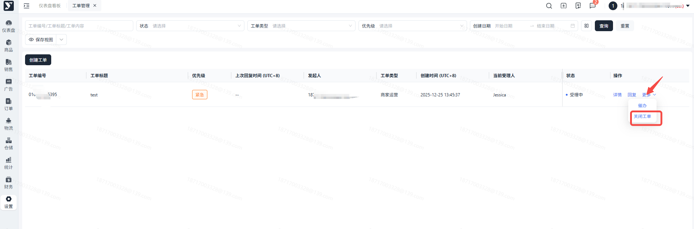
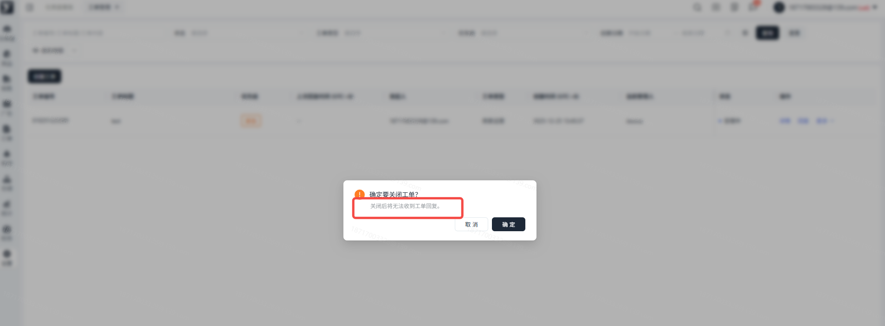
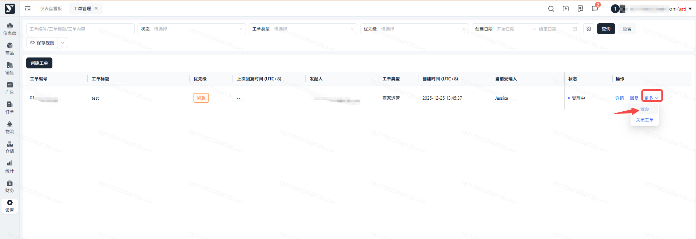

# 飞书文档：工单管理

## 功能介绍

工单为联系客服寻求帮助的渠道，在使用系统的过程中您遇到任何问题，都可以通过工单管理向我们寻求帮助，我们会尽快为您解决问题。

## 操作流程

### 创建工单

#### 操作入口：点击头像旁的图标进入工单管理

#### 填写工单

点击页面右上角【创建工单】，填写弹窗内容。

1. 工单标题：简单描述一下您遇到的问题
2. 工单类型：商品、销售、统计、设置模块属于商家运营类型；订单、物流、仓储属于物流仓储类型；财务属于财务类型；非以上模块的问题，请选择其他。
3. 工单详情：请详情描述您遇到的问题
4. 优先级：根据问题的重要性和紧急程度进行优先级的选择，我们会优先处理优先级更高的工单。
5. 上传文件：最好能附带页面截图以便于我们更好帮助您解决问题

#### 提交工单

点击确认后，工单创建成功，我们将会尽快对工单进行处理

### 回复工单

#### 回复工单

当您需要回复工单内容或者有追加的信息，可以点击工单操作栏的【回复】，或者进入详情页直接回复。

### 关闭工单

#### 关闭工单

当工单问题已经被解决或者您不想再针对此问题发沟通时，您可以关闭工单，注意：工单关闭后双方都无法再发起回复。

### 催办工单

#### 催办工单

当您发起了工单，超过一个工作日还没有收到回复时，您可以使用催办功能。

点击工单操作区域的【催办】，输入催办原因并提交，此条工单将会指定，并显示催办标识，直到收到回复后催办状态才会消失，下次仍然可以对此工单催办。

