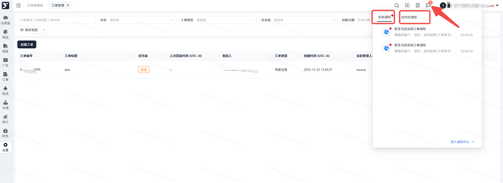
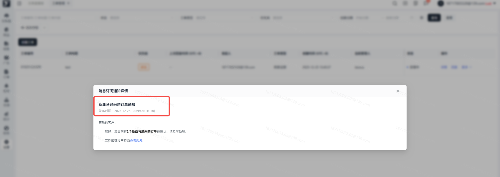
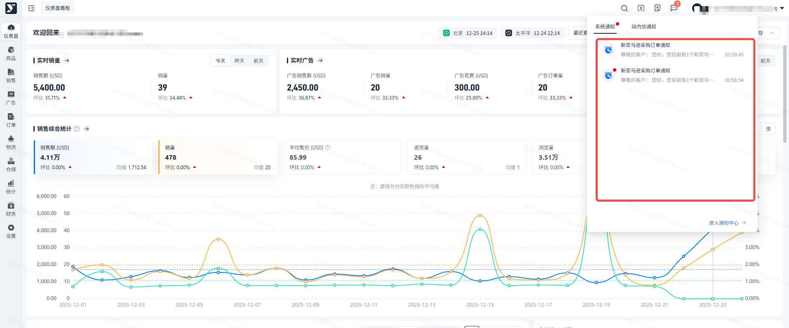
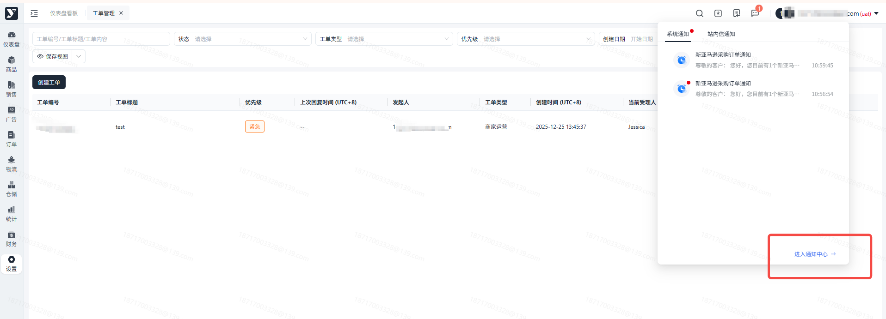
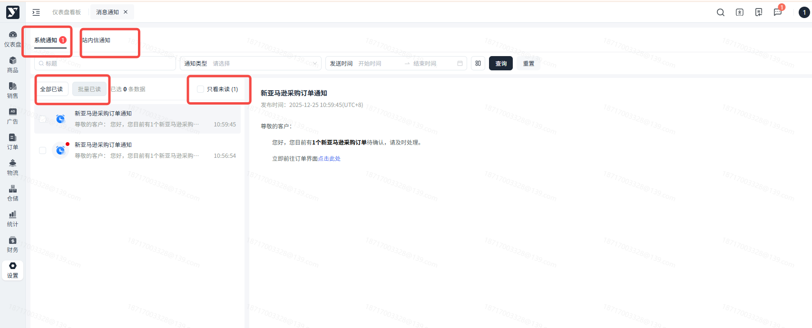
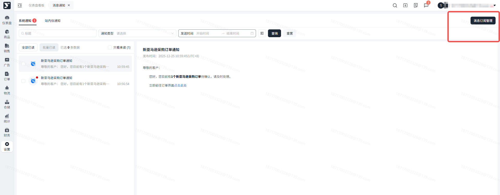
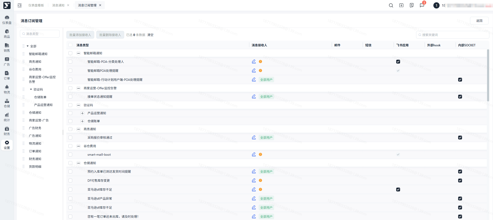
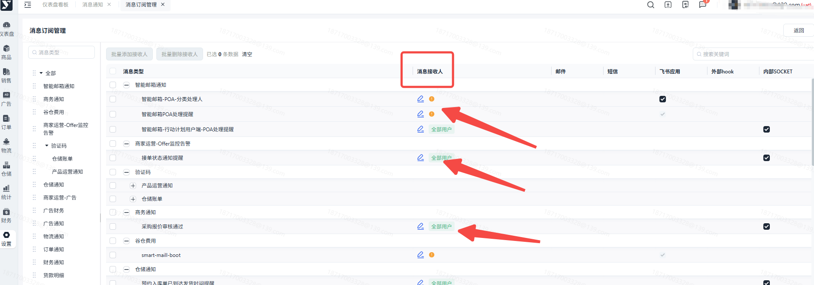
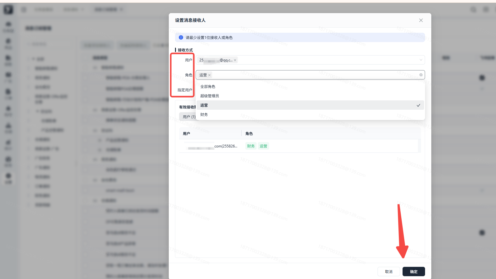

# 飞书文档：消息通知

## 功能介绍

通知中心就是专门搞定企业里各种消息传递问题的“一站式服务平台”。 它的目标很简单：让重要消息（比如预警、任务、订单状态）第一时间且准确无误地送达相关的人，避免信息淹没在邮件、群里找不着北。

通知中心打通了各个业务系统，所有业务板块在这里集中查看。这样大家办事快，沟通顺，效率自然就上去了。是企业高效协作的“消息大本营”和“指挥台”。

## 使用指南

### 接收消息

当用户收到消息时，系统右上角会提醒消息卡片，这时候点击查看详情，即可完整查看推送的消息。

### 消息通知列表

1. 点击右上角消息按钮，可以展开最近接收到的消息，页面会提示未读消息。

1. 点击进入通知中心，可查看消息通知列表。

1. 通知分为：系统通知、站内信通知，两种方式；

 1. 系统通知为业务环节上触发了某种规则，系统自动通知给用户进行处理。
 2. 站内信更多是Yurex平台发布的公告，如：版本更新通知、平台仓通知等等。
2. 通知支持搜索搜索，以及全部已读、批量已读、只看未读的操作。
3. 点击列表中通知，右侧则展开具体的内容。

### 消息订阅管理

1. 点击通知中心列表右上角的消息订阅管理按钮，进入到消息接收配置页面。

1. 用户可在左侧选择消息分类进行查找。也可通过搜索功能快速查找。

1. 用户可以在此处配置消息接收人，配置是否接收通知。

1. 在消息接收人列，点击编辑按钮，可在弹框中配置消息接收人。

1. 接收方式包括：用户、角色、指定用户，三种方式。

 1. 用户：可设置某个或多人用户接收该消息；
 2. 角色：可设置为某个或多个角色内所有用户接收该消息；
 3. 指定用户：基于不同业务中，可以选择指定人员来接收该消息。
 4. 表格下方展示当前配置的消息接收人有哪些。核对后，点击确定按钮，完成配置。
2. 用户也可多选消息，点击批量添加接收人或批量删除接收人按钮，完成批量处理（目前只能处理用户或角色）。
3. 目前消息通知方式仅包括：系统通知、短信、邮件，三种方式。取消勾选，则取消接收通知信息。
