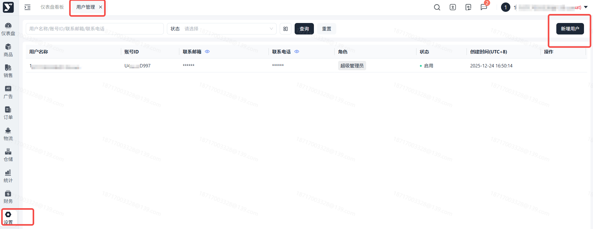
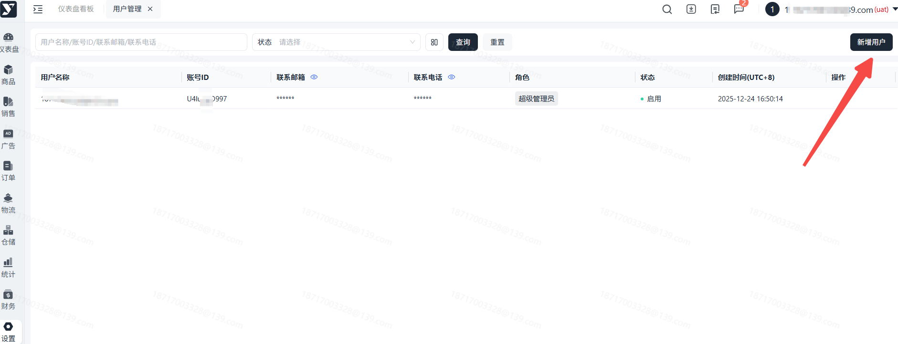
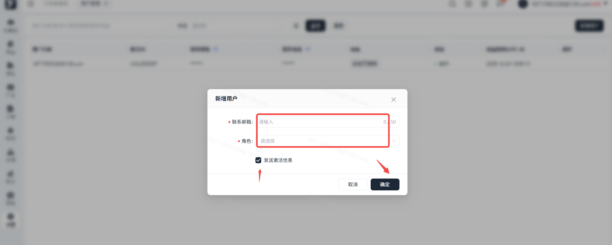
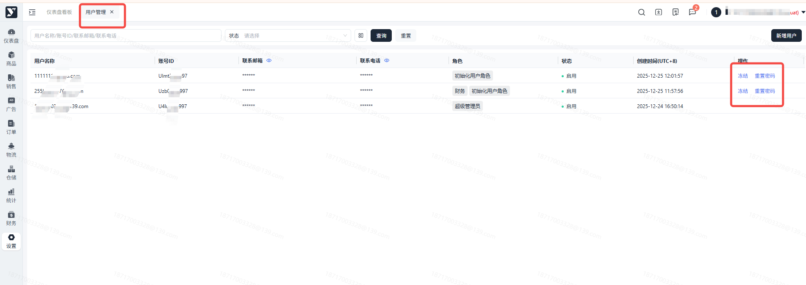
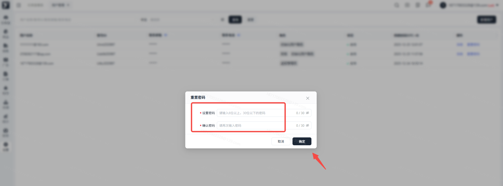

# 飞书文档：用户管理

## 功能介绍

用户管理是系统的基本功能和重要组成部分，通过用户管理功能可以快速维护登录系统的用户信息，并根据用户信息维护用户的操作权限和数据权限。

## 内置角色

1. **超级管理员**

超级管理员拥有对系统的完全访问权限，可以执行任何操作，组织的拥有者默认为超级管理员角色且不可移除。

1. **初始化用户角色**

初始用户角色被设定为无权限角色，其访问权限仅限于个人中心页面。当某个账户的所有角色被撤销时，系统会自动赋予其初始用户角色作为备选。值得注意的是，初始用户角色是不可删除的，一旦某账户被赋予了这一角色，您可以选择为该账户分配其他权限的角色，而一旦成功分配，初始用户角色将会自动失效，不再显示于该账户的角色列表中。

## 操作流程

### 操作路径

【设置】-【账号管理】-【用户管理】

### 新增用户

点击页面【新增用户】，填写新用户的邮箱号，为其分配角色。

注：邮箱号需可以接收邮件。

### 激活账号

确认后，告知用户查收激活邮件，根据邮件步骤进行账号的激活。

### 激活后账号生效。

### 冻结或启用账号

管理员可以控制子账号冻结或启用，如需限制某个子账号的使用权，可以将账号冻结，冻结行为可逆。

### 重置密码

若子账号忘记密码无法登录，也无法接收验证码，可以在此模块重置密码。

## 常见问题

答：超级管理员可以在用户管理模块重新对未激活的账号发送新的激活邮件。

答：可以另外新增一个用户，填写正确的邮箱号，或者点击错误账号的【发送激活邮件】，发送时写正确的邮箱号。

 答：暂不支持，您可以冻结不再使用的子账号。
