# 飞书文档：角色管理

## 文档信息

| 项 | 内容 |
| --- | --- |
| 远程文档 | https://q1njej8cpab.feishu.cn/wiki/KJ4Jwm1Q2itVIOksgNDcImABn6f |
| 图片处理 | 本地下载（assets/images） |
| 快照时间 | 2026-08-06 |
| 来源命令 | `lark-cli docs +fetch --api-version v2 --doc https://q1njej8cpab.feishu.cn/wiki/KJ4Jwm1Q2itVIOksgNDcImABn6f --doc-format markdown --as user --format json --jq .data.document.content` |
| 格式处理 | fd-doc-markdown-sync/scripts/normalize-feishu-doc-markdown.mjs |

---

角色管理

当前版本：v1.0.0

## 功能介绍

角色管理作为系统的重要基座主要负责管理和控制系统中不同用户角色的权限和访问级别。

## 注意事项

1. 拥有此模块权限的账号允许修改和分配其他账号的角色权限，请谨慎分配。
2. 超级管理员和初始化角色为系统内置角色，权限不可修改，超级管理员默认拥有系统全部权限，初始化角色默认无权限。

## 操作流程

##

#### 操作路径

【设置】-【账号管理】-【角色管理】

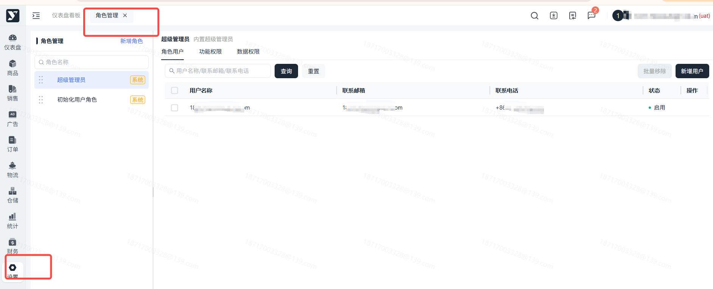

#### 点击角色列表右上角的【新增角色】，展开弹窗

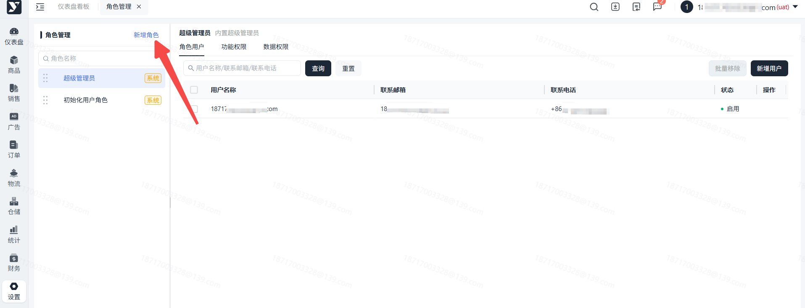

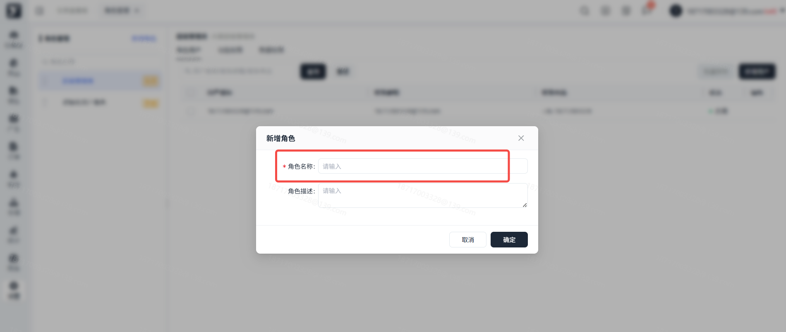

#### 输入角色名称和角色描述，点击确认

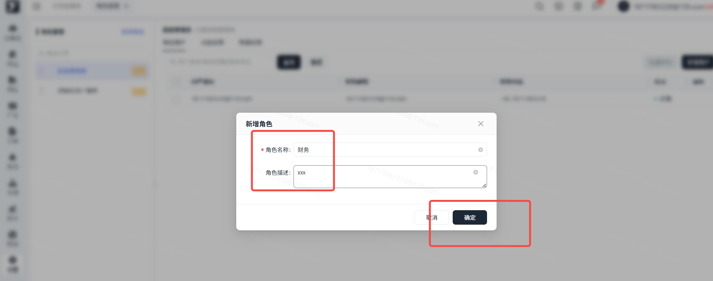

#### 角色创建成功后，点击此角色可以查看此角色的详情，对角色进行编辑和删除操作。

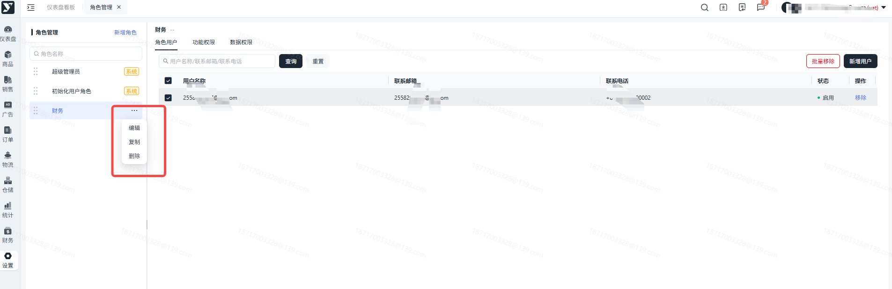

##

#### 选择对应角色，切换到【功能权限】，根据业务情况勾选需要分配给此角色的权限，勾选完成后点击【保存】即可生效。

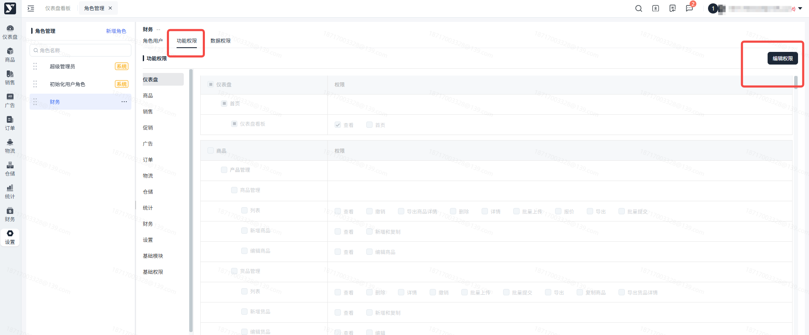

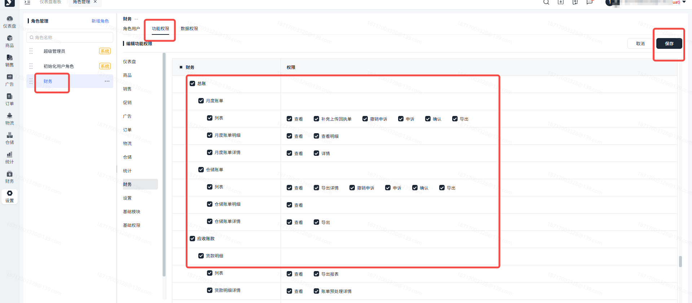

##

选中左侧角色，进入数据权限，根据菜单勾选需要分配给此角色的数据权限。

数据权限是基于产品SKU进行配置，可至商品中心分配产品负责人。

可选配置项：

1. 全部可见：拥有所有SKU的数据权限
2. 负责人可见：拥有“自己”所负责产品SKU的数据权限
3. 部分可见：拥有“自己”和“选择产品负责人”所负责产品SKU的数据权限

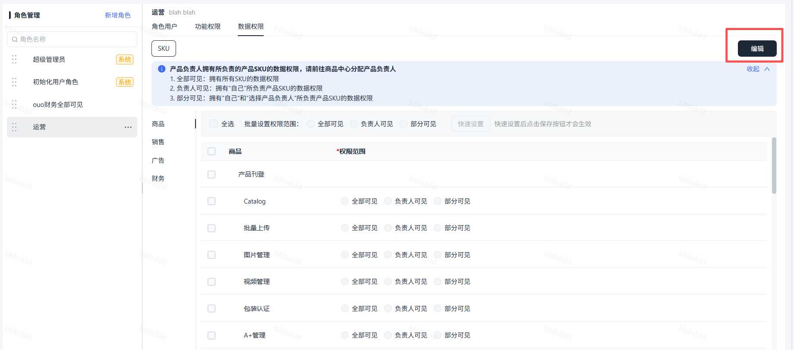

快速设置：

1. 第一步：页面支持多选快速配置，勾选需要配置的菜单，在上方选择批量设置的权限范围。
2. 第二步：点击快速设置按钮，则被勾选的菜单，全部配置为所选权限范围。
3. 第三步：点击页面右上角保存按钮，完成配置。

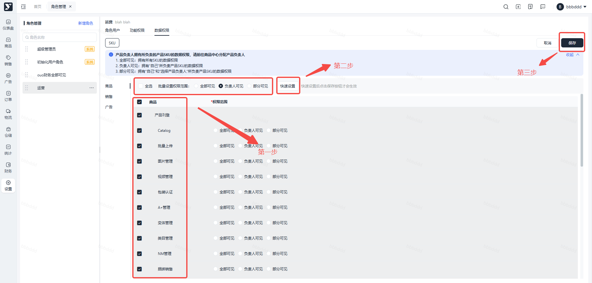

##

#### 选择对应角色，在【角色用户页面】，点击【新增用户】

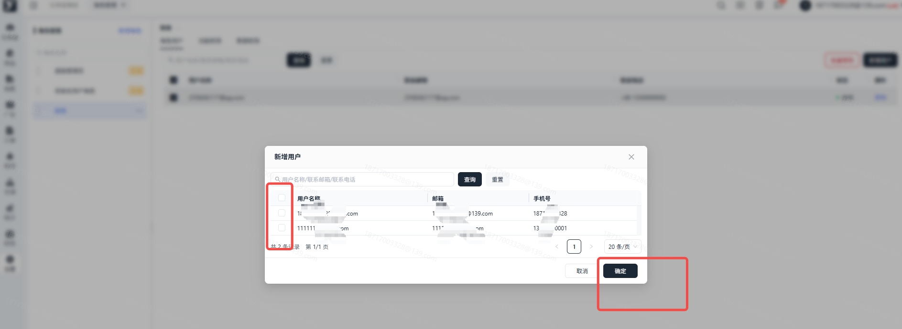

#### 勾选需要赋予此角色的账号，点击确认

##

#### 点击账号操作栏的【移除】，或勾选账号后点击批量移除

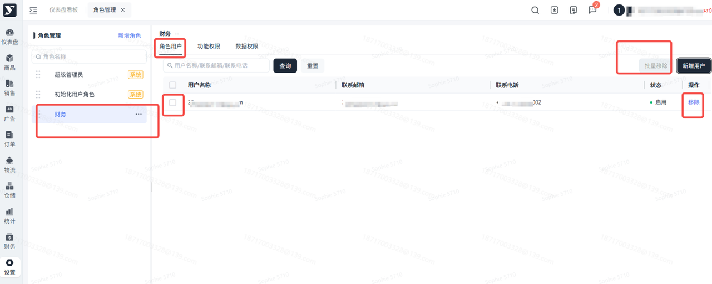

## 常见问题

### **

答：系统会取多个角色权限的并集，角色的全部权限都会对该用户生效。

##

答：只有超级管理员角色会自动拥有全部权限，其他角色需要手动增加角色权限。
