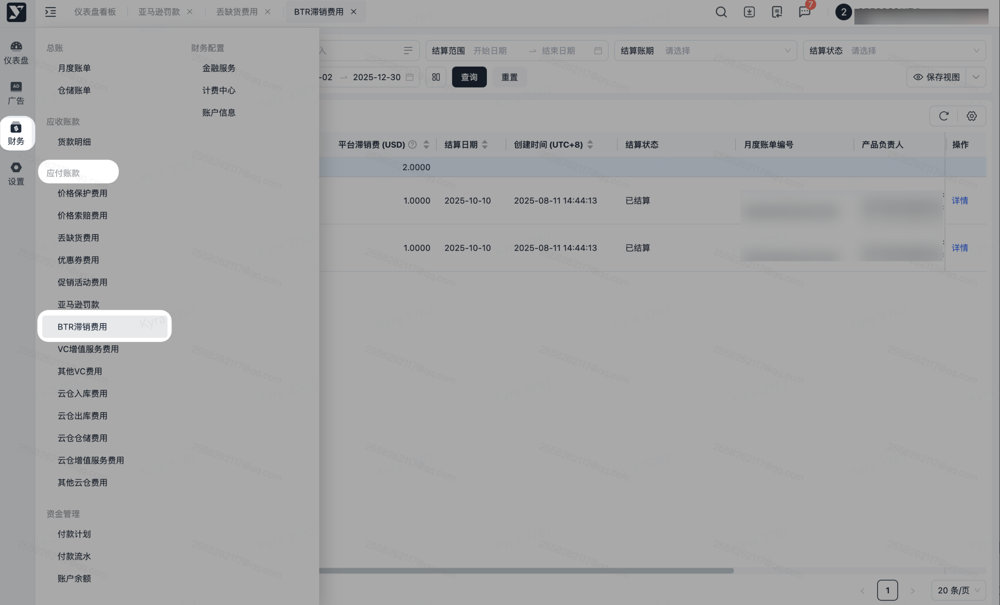
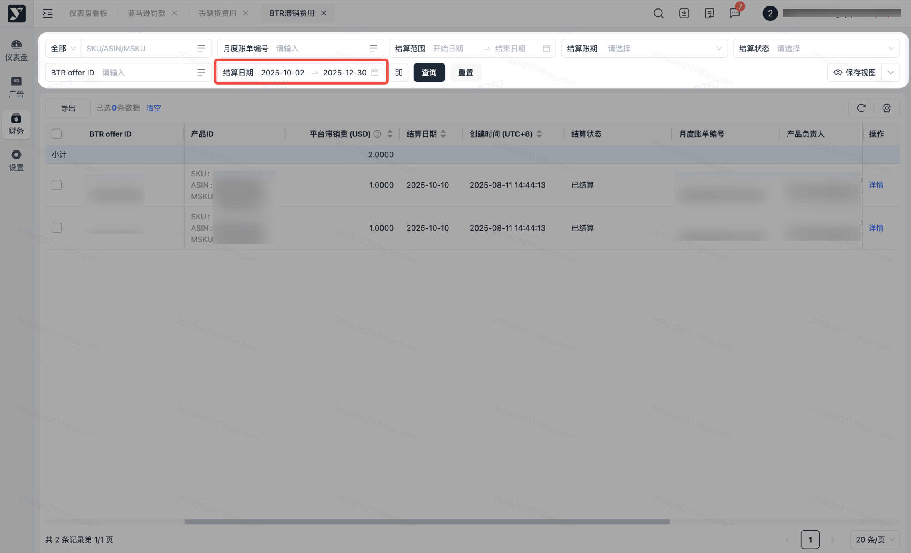
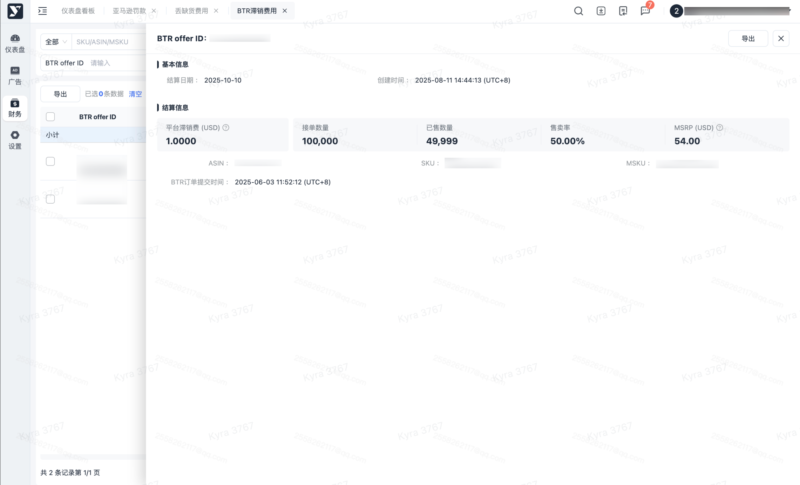
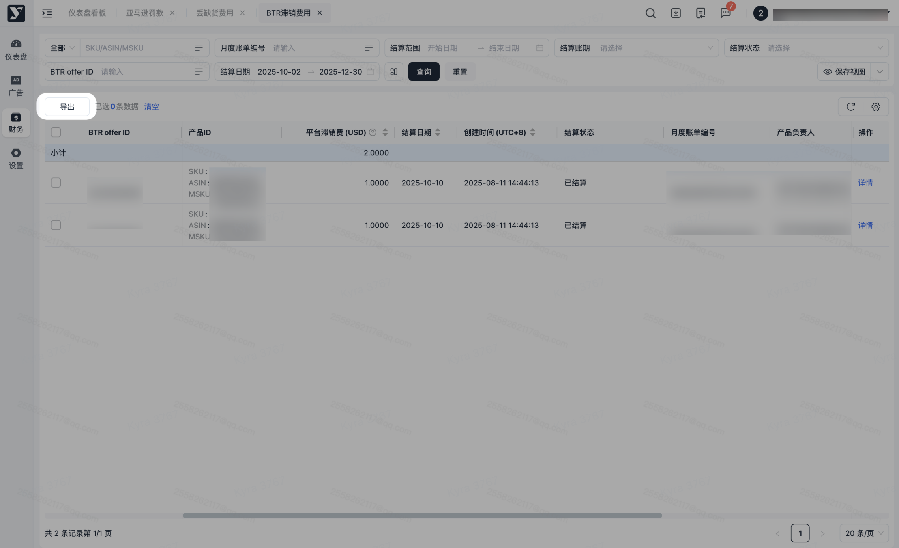

# 飞书文档：BTR滞销费用

## 功能介绍

1. BTR全称Born to Run，是一个卖家主动向亚马逊提出采购需求的功能。卖家可以针对部分产品向亚马逊申请指定数量的采购订单（PO）。当亚马逊接受了卖家的请求后，相应的BTR订单会出现在采购订单界面中。
2. 当在规定时间内货物的售卖率没有达到100%时，系统会自动根据剩余货物的占比进行滞留费的计算，并根据coop发票数据生成对应的滞留费明细。

## 对账思路

1. 产生原因：当您在Yurex平台成功申请BTR订单后，若未能在亚马逊规定的销售期内完成全部接单数量的销售，系统将自动收取BTR滞留费。
2. 核对方式：按照订单中【BTR订单】数据，与月度账单中BTR滞留费明细通过“订单ID”核对
3. 数据生成维度：同一BTR offer+ASIN
4. 滞留费计算逻辑：

 1. **售卖率 ≥ 50%： 滞留费 = 滞销库存数量 \* MSRP \* 20%**
 2. **售卖率 ＜ 50%：滞留费 = 滞销库存数量 \* MSRP \* 20% +BTR到期后销售率低于50%的滞销库存数量 \* MSRP \* 30%**
5. 导出路径

 1. 月度账单-BTR滞留费：财务

### 操作路径

【财务】-【应付账款】-【BTR滞留费】

### 列表筛选及查询

1. 进入页面后可根据筛选条件查询数据，以及重置后可清空筛选条件
2. 数据展示：进入页面后默认加载结算日期为最近三个月的数据。

### BTR滞留费数据查看

1. 点击该条数据任意位置进入详情页。

1. 可批量导出或指定数据导出，可按需进行导出。
2. 若进行筛选后，导出内容则会跟筛选条件一致。
3. 点击【导出】，若当前列表数据无勾选，则导出全量数据；若当前列表有勾选，则导出被勾选的数据。

