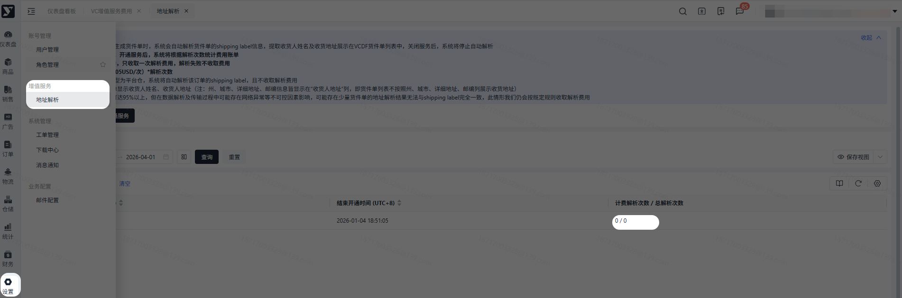
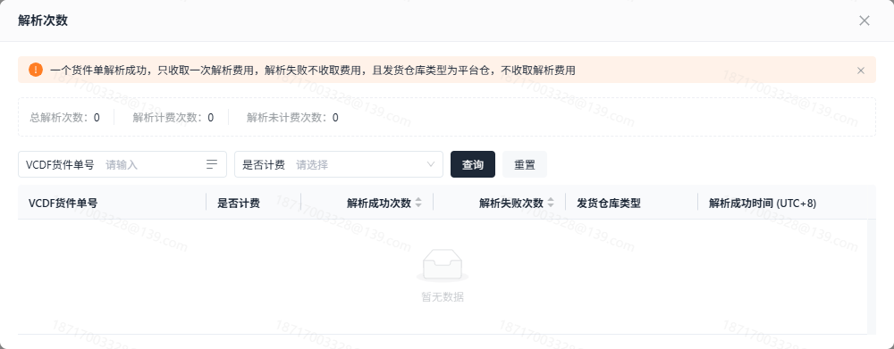
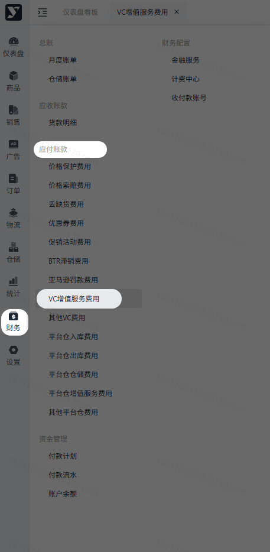
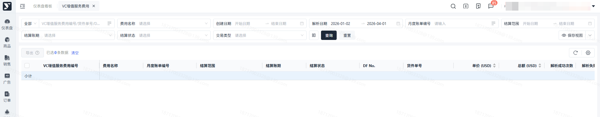
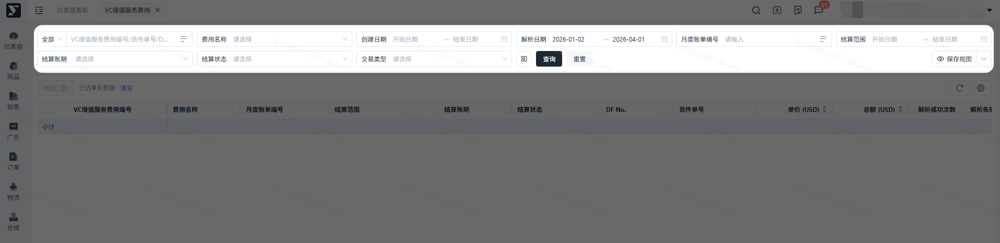
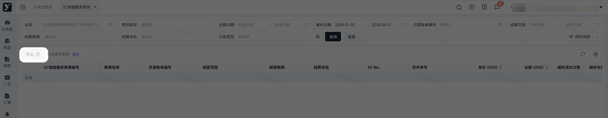

# 飞书文档：VC增值服务费用

## 功能介绍

当您开通地址解析服务后，解析成功后，会按解析成功的货件单号/次收取费用。

## 注意事项

该服务为付费增值服务，开通服务后，系统将根据解析次数统计费用账单。

1. 一个货件单解析成功，只收取一次解析费用，解析失败不收取费用
2. 收费规则：单价（0.05USD/次）\*解析次数
3. **注：**从平台仓发货的DF订单将自动解析且不收取解析费用。

## 对账思路

**上游业务数据查询：【设置】——【增值服务】——【地址解析】**

根据服务开通时间找到对应时间段的开通记录，点击解析次数可进入详情，可根据货件单号对比费用金额。

- **费用=解析次数\*0.05**

## 操作流程

### 操作路径

【财务】-【应付账款】-【VC增值服务费用】

### 数据查询&重置

- 勾选后导出对应数据；
- 不勾选导出筛选条件下所有数据。

