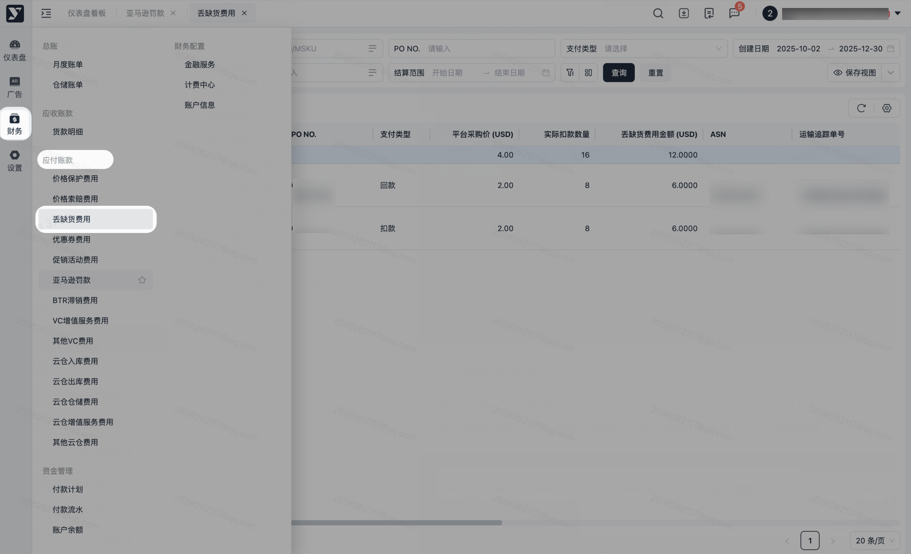
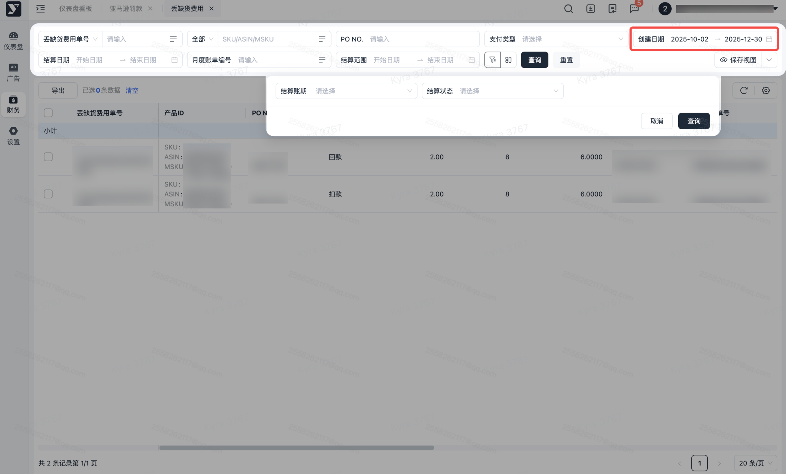
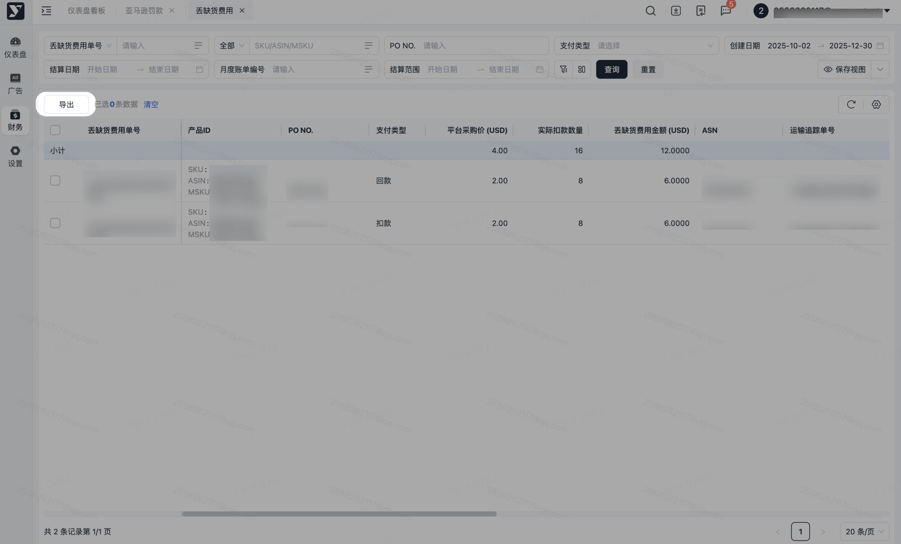

# 飞书文档：丢缺货费用

## 文档信息

| 项 | 内容 |
| --- | --- |
| 远程文档 | https://q1njej8cpab.feishu.cn/wiki/Xczcwi0gaiatEZkqHJPc0viinFE |
| 图片处理 | 本地下载（assets/images） |
| 快照时间 | 2026-08-06 |
| 来源命令 | `lark-cli docs +fetch --api-version v2 --doc https://q1njej8cpab.feishu.cn/wiki/Xczcwi0gaiatEZkqHJPc0viinFE --doc-format markdown --as user --format json --jq .data.document.content` |
| 格式处理 | fd-doc-markdown-sync/scripts/normalize-feishu-doc-markdown.mjs |

---

丢缺货费用

当前版本v1.0.1

## 功能介绍

1. 本功能用于查询丢缺货产生的丢缺货费用信息，您可以通过本功能页面查询和导出所有丢缺货费用及明细数据。

## 对账思路

1. 产生原因：当亚马逊收货记录与供应商发货数量存在差异时，亚马逊会生成短缺索赔发票，系统将基于亚马逊开具的发票生成短缺明细数据。
2. 核对方式：

 1. **计算公式：丢缺货扣款金额=平台采购价\*差异数量。**
 2. 按照应付账款中【丢缺货费用】查询结算日期数据，与月度账单中丢缺货费用明细核对。
3. 争议数据：若供应商能够提供完整的发货凭证（包括但不限于提单BOL、签收证明POD等），将证明材料提交至平台运营经理，我方会向亚马逊发起申诉申请。若申诉成功，系统将在**财务-应付账款- 丢缺货费用**中生成对应的回款数据，回款数据将自动纳入下一结算周期支付。
4. 数据生成维度：PO订单+ASIN
5. 导出路径

 1. 月度账单-丢缺货费用：财务

#### 操作路径

【财务】-【应付账款】-【丢缺货费用】

#### 搜索及展示

1. 进入页面，可对数据进行搜索，下方的列表可根据搜索条件，进行对应的展示。
2. 默认数据加载：进入页面，会默认加载创建时间为最近三个月的数据。

##

1. 可批量导出或指定数据导出，可按需进行导出。
2. 若进行筛选后，导出内容则会跟筛选条件一致。
3. 点击【导出】，若当前列表数据无勾选，则导出全量数据；若当前列表有勾选，则导出被勾选的数据。

## 常见问题

### 问：足量发货后却收到了丢缺货扣款？

**答：若您确认在该笔订单中未少发/漏发，请联系平台运营经理提供BOL及其他可以佐证您完整发货的材料，我方会积极配合您向亚马逊进行申诉，若亚马逊认可您的申诉，将开具该订单的回款发票，回款发票会生成对应的回款数据纳入结算中。**
