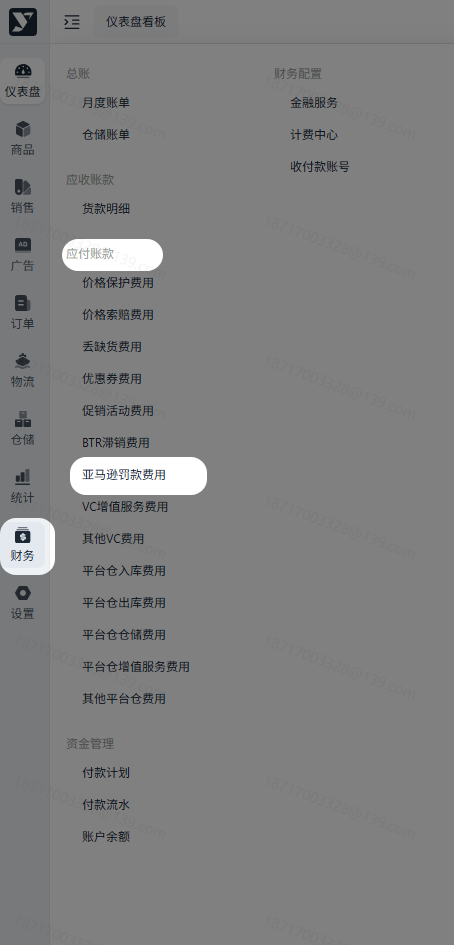
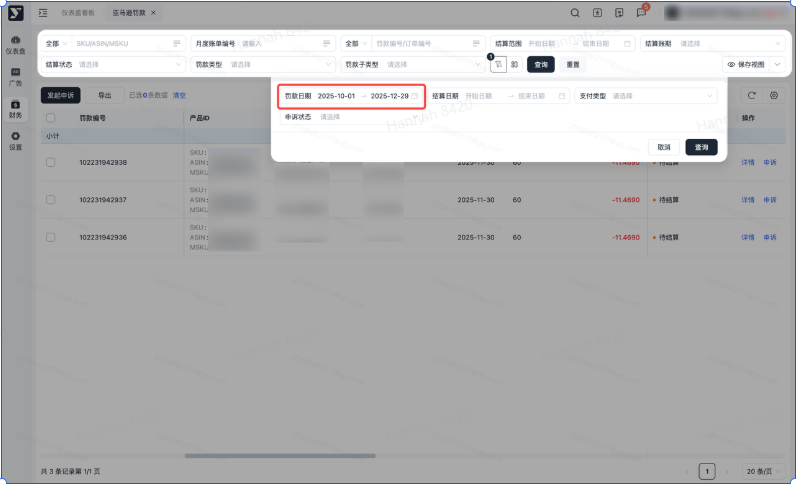
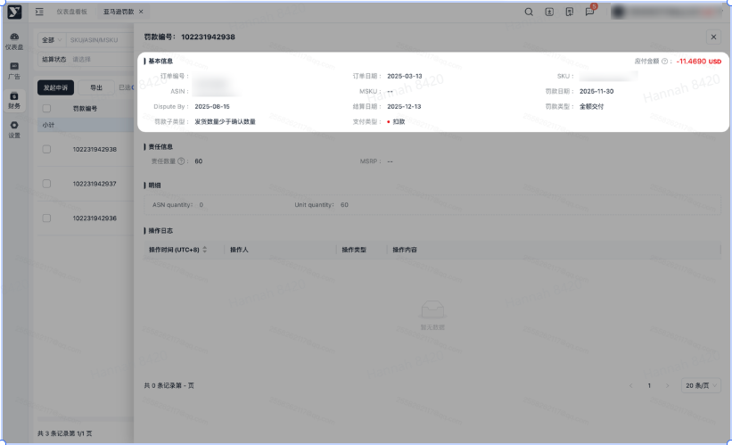
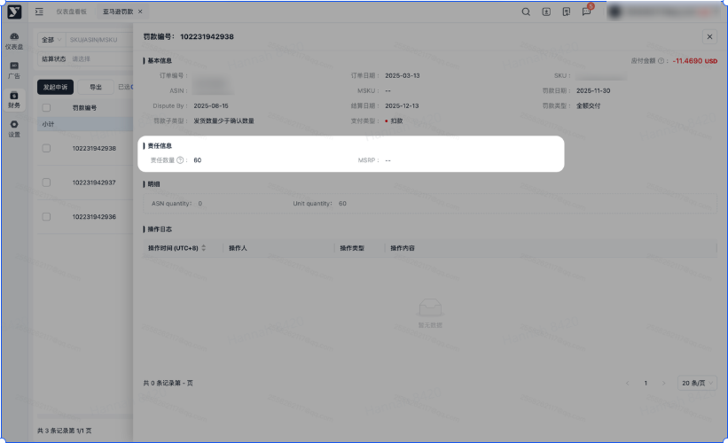
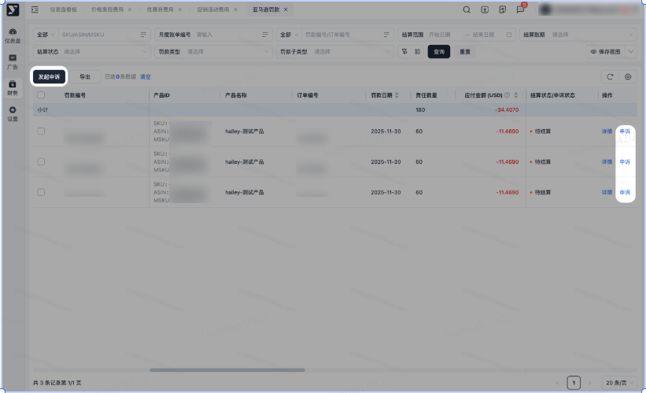
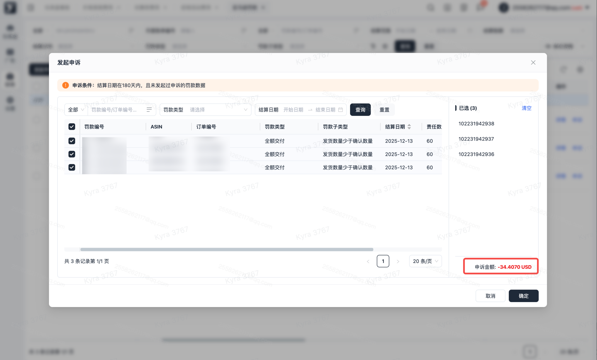
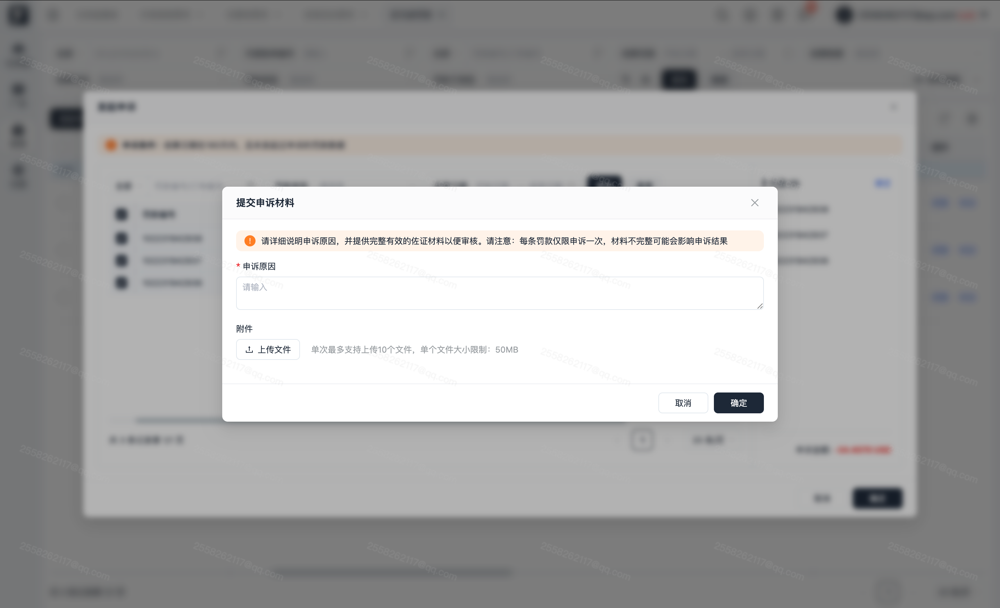
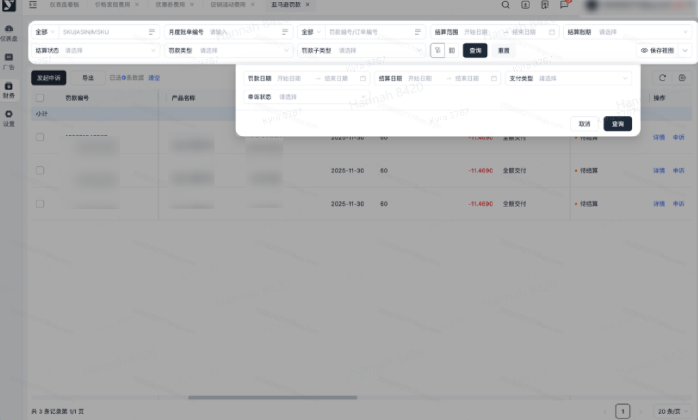
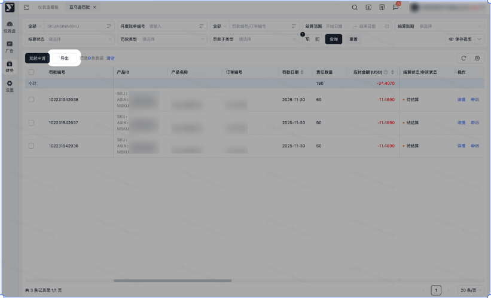

# 飞书文档：亚马逊罚款费用

## 文档信息

| 项 | 内容 |
| --- | --- |
| 远程文档 | https://q1njej8cpab.feishu.cn/wiki/PbSCwrgIMi1oXMklmSAchVbbn2f |
| 图片处理 | 本地下载（assets/images） |
| 快照时间 | 2026-08-06 |
| 来源命令 | `lark-cli docs +fetch --api-version v2 --doc https://q1njej8cpab.feishu.cn/wiki/PbSCwrgIMi1oXMklmSAchVbbn2f --doc-format markdown --as user --format json --jq .data.document.content` |
| 格式处理 | fd-doc-markdown-sync/scripts/normalize-feishu-doc-markdown.mjs |

---

亚马逊罚款费用

当前版本：v1.0.4

## 功能介绍

1. 当有不规范的业务行为发生后，可能会导致亚马逊产生对应的罚款信息。
2. 在当前模块中可查看亚马逊产生的罚款数据及对应罚款数据产生的费用。

## 注意事项

1. 产生原因：当您在运营过程中违反平台规则时，亚马逊系统将自动生成相应的罚款数据。
2. 核对方式：按照应付账款中【亚马逊罚款】查询结算日期数据，与月度账单中亚马逊罚款明细通过“罚款类型”核对。
3. 导出路径

 1. 月度账单-亚马逊罚款：财务

#### 操作路径

【财务】-【应付账款】-【亚马逊罚款】

#### 展示及搜索

1. 进入页面默认展示罚款日期为近三个月的罚款数据：
2. 可根据筛选条件筛选数据，点击查询后列表展示符合条件的数据。

#### 罚款详情

1. 点击【详情】或者该条数据任意位置，可查看对应的罚款详情信息，不同的罚款类型会展示不同的信息。
2. 基本信息：所有罚款的基本信息字段一致，可能存在不同类型的罚款对应字段缺失，则缺失字段显示为--。

1. 责任信息：根据不同罚款会显示不同的责任信息字段。

##

1. 申诉条件：

 1. 结算日期在180天内。
 2. 罚款数据的支付类型为扣款。
 3. 在本平台未发起过申诉。
 4. 通过罚款编号无法匹配到回款数据。

 每条罚款仅可发起一次申诉，若申诉未被通过，将无法再次发起申诉，请谨慎提交。

2. 申诉入口：

 1. 批量申诉：点击主按钮【发起申诉】唤起申诉弹窗。
 2. 单个申诉：点击某条罚款操作栏的【申诉】唤起弹窗。
 3. 注：仅满足上一条申诉条件的数据才提供申诉入口，无申诉入口的数据即不满足条件，无法发起申诉。

 
3. 选择申诉数据，勾选完成后点击确定。

 1. 勾选需进行申诉的数据，右侧列表会展示所有勾选的数据并计算预进行申诉的总金额。

1. 输入申诉原因，若存在佐证材料，请一并提交便于帮助申诉审核。

注：若在第一步勾选了多条数据，您所填写的申诉原因和附件将应用于所有已选数据。此为批量操作，如需为不同场景分别申诉，请分开提交申请。

1. 已提交申诉的数据将新增【申诉中】标签，可通过标签进行申诉状态的跟进。
2. 筛选区新增申诉状态的查询条件，您可通过此功能快捷搜索出所有发起过申诉的罚款数据。

注：若在您的设备上未显示申诉状态的查询，可点击漏斗展开被折叠的查询字段。

##

1. 可批量导出或指定数据导出，可按需进行导出。
2. 若进行筛选后，导出内容则会跟筛选条件一致。
3. 命名规则为：亚马逊罚款+日期。
4. 点击【导出】，若当前列表数据无勾选，则导出全量数据；若当前列表有勾选，则导出被勾选的数据。

