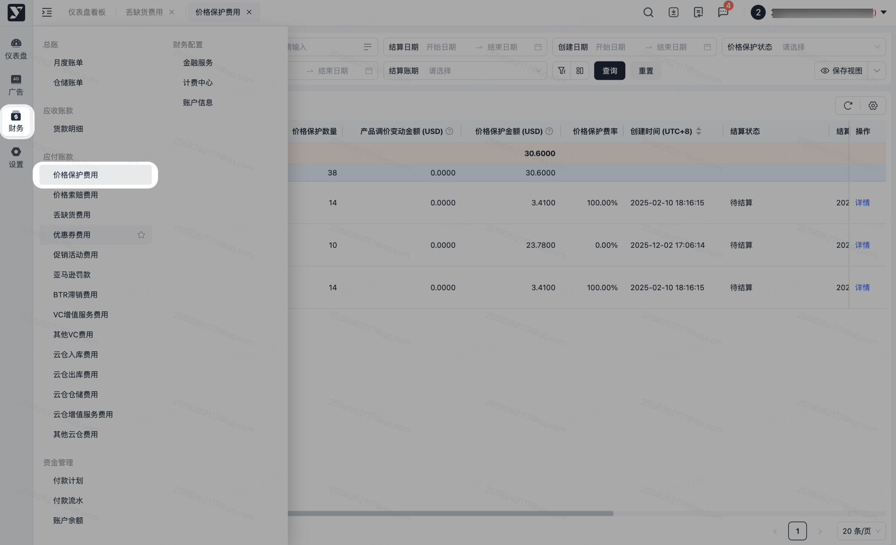
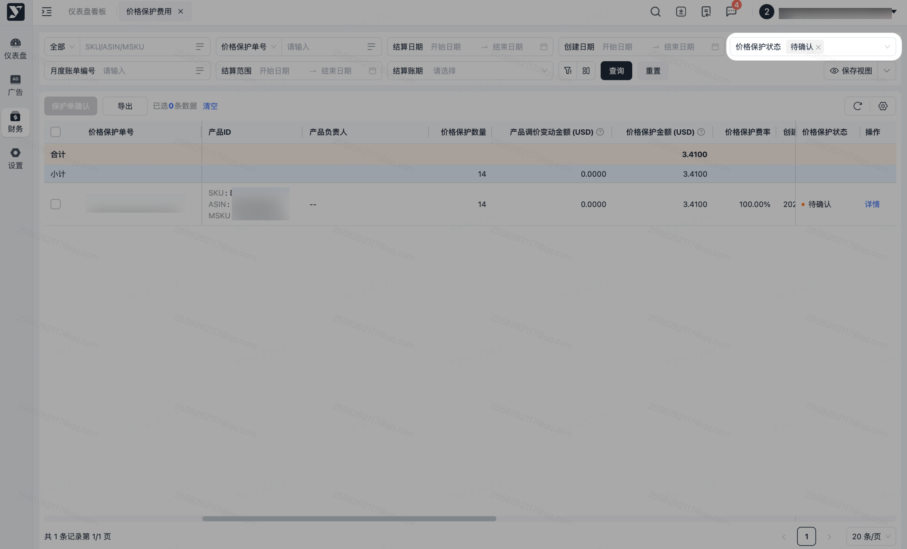
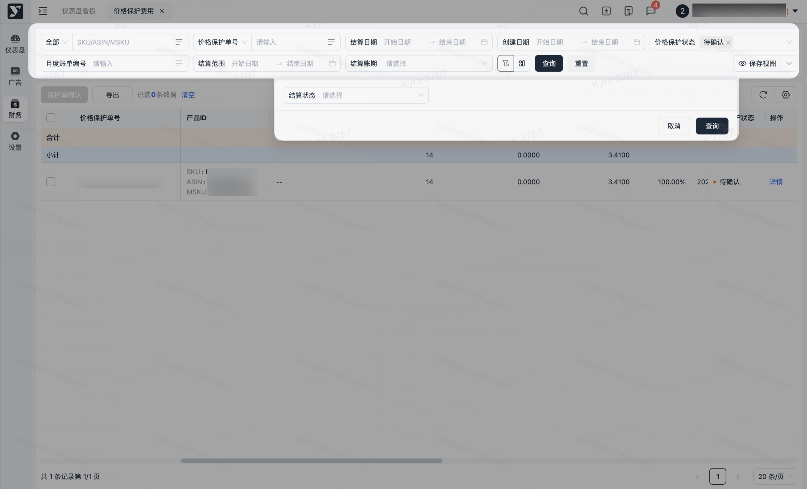
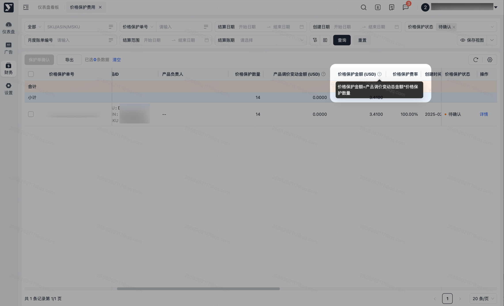
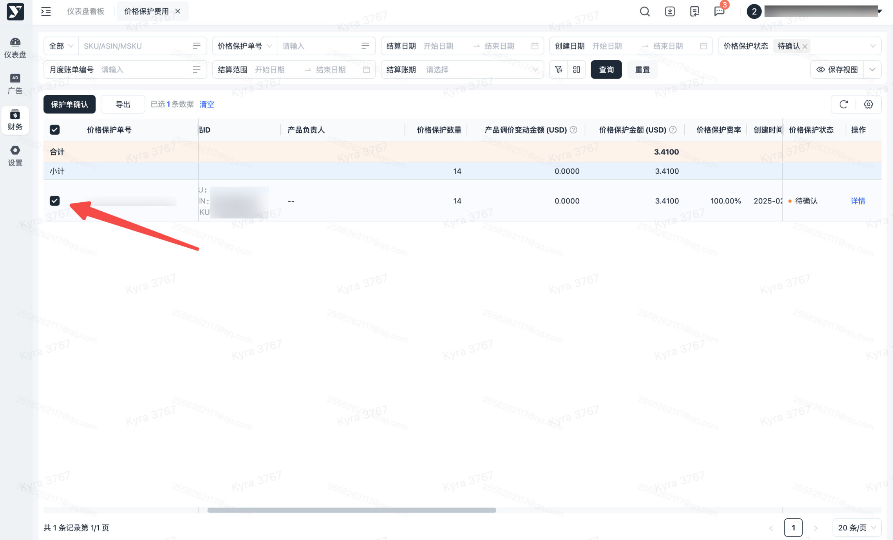
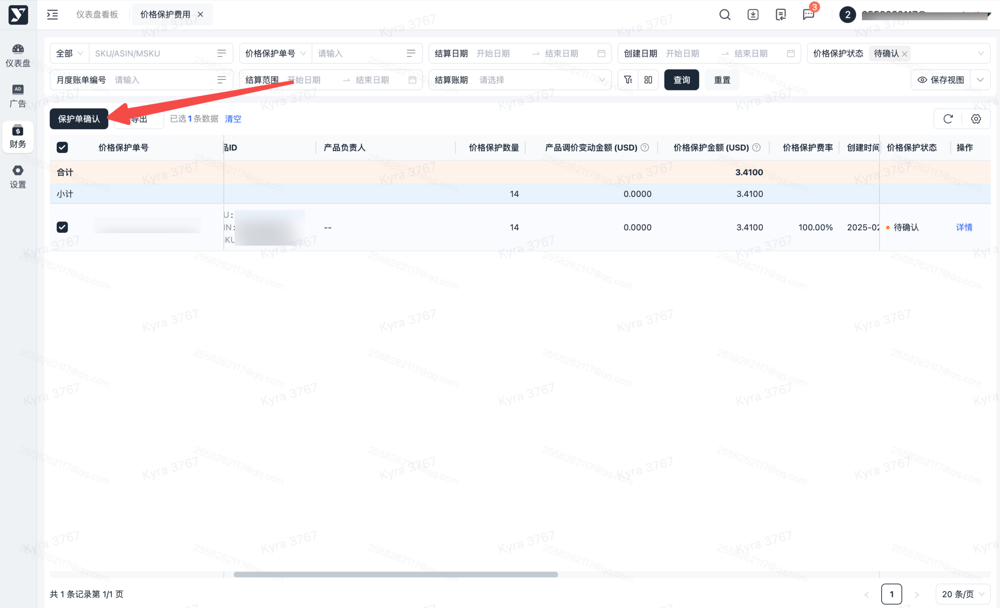
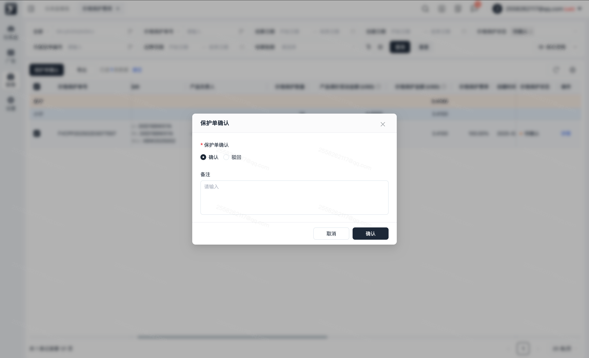
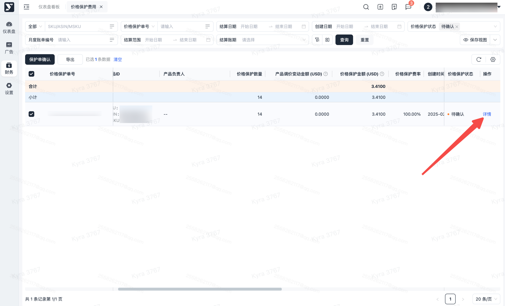
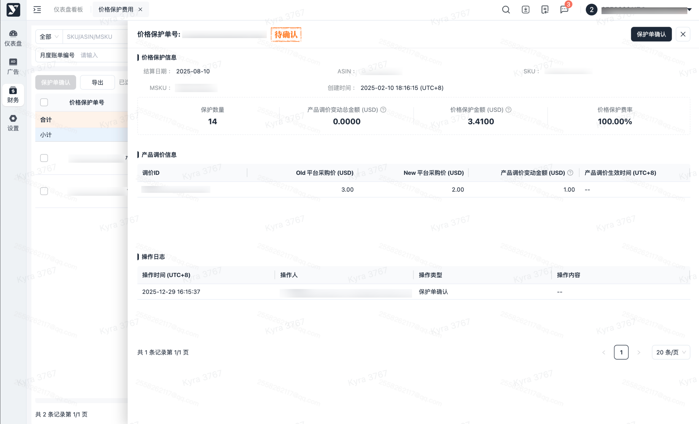
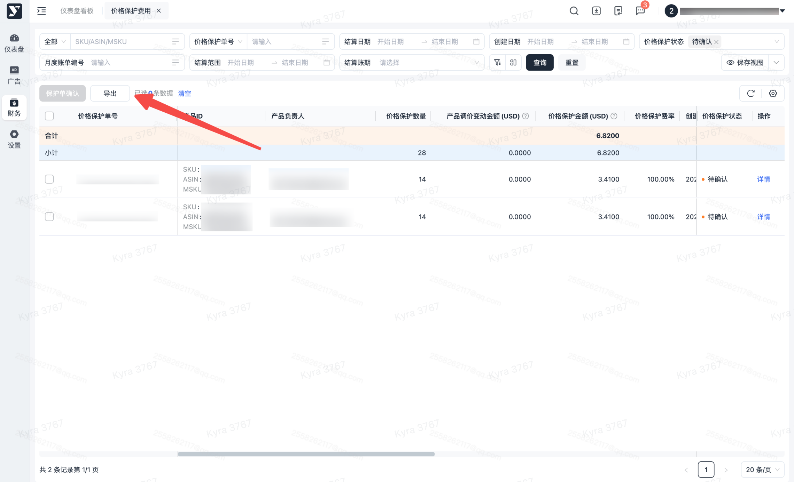

# 飞书文档：价格保护

## 功能介绍

- **规则**：价格保护是由于供应商下调平台采购价时，亚马逊可以按照价格保护条款采取以下任一行动：

 1. **调整未结采购订单（即尚未收到、履行或关闭的采购订单）的成本**
 2. **通过制定价格保护协议向供应商收取差价，降低现有可销售和在途库存的成本**
- **责任方**: 由供应商发起平台采购价、MSRP调整所产生的价格保护罚款均由供应商自行承担；

## 对账思路

1. 产生原因：当产品价格下调后，亚马逊将对仍在FBA仓库中尚未售出的货物启动价格保护机制，并按照最新成本价追溯调整货款差额。
2. 核对方式：

 1. 价格保护费用计算公式：**（原采购价格 - 新采购价格）× 保护数量 +（原采购价格 - 新采购价格）× 保护数量 × 价格保护费率。**
 2. 按照应付账款中【价格保护查询】发票日期数据，与月度账单中价格保护明细核对。
3. 争议数据：若供应商并未主动发起调价，但仍接收到亚马逊开具的价格保护单据，请向平台运营经理协同核实并向亚马逊提交争议。
4. 数据生成维度：ASIN

## 操作流程

#### 操作路径

【财务】-【应付账款】-【价格保护费用】

#### 默认数据加载

进入页面后默认加载创建日期为最近三个月且价格保护状态为待下发和已驳回的数据

#### 搜索及展示

进入页面，可对数据进行搜索

下方的列表可根据搜索条件，进行对应的展示。若对字段存在疑惑，可点击【?】查看对应的解释。

对价格保护单的扣款费用进行确认操作，默认按钮置灰。

勾选价格保护单后，保护单确认按钮可操作。

点击保护单确认后弹窗，您可以操作确认和驳回，确认后代表所选价格保护单产生的费用无误，操作后返回主页面。驳回后代表所选保护单产生的费用存在问题，需备注您认为存在的费用问题，操作后返回主页面。

点击详情按钮跳转至详情页面。

详情页面您可以查询价格保护单信息及对应的产品调价数据和操作记录。

1. 可批量导出或指定数据导出，可按需进行导出。
2. 若进行筛选后，导出内容则会跟筛选条件一致。
3. 点击【导出】，若当前列表数据无勾选，则导出全量数据；若当前列表有勾选，则导出被勾选的数据。

