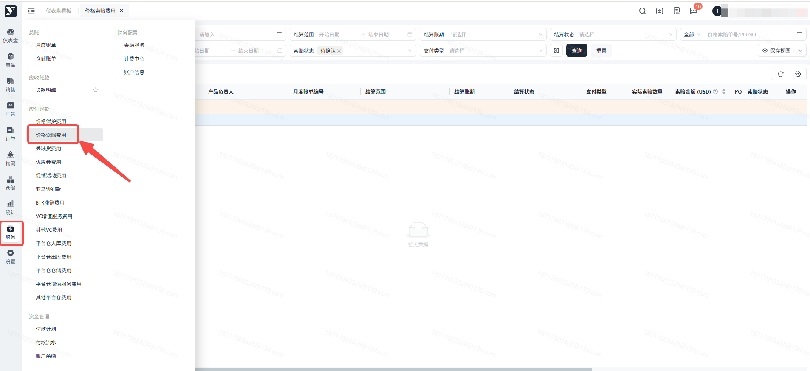
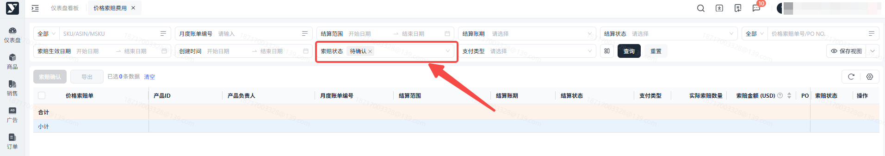
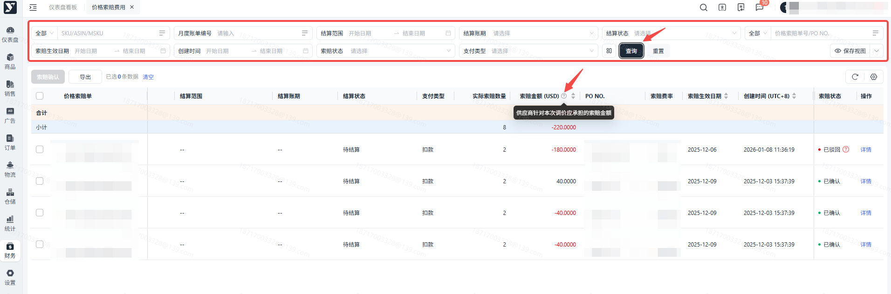
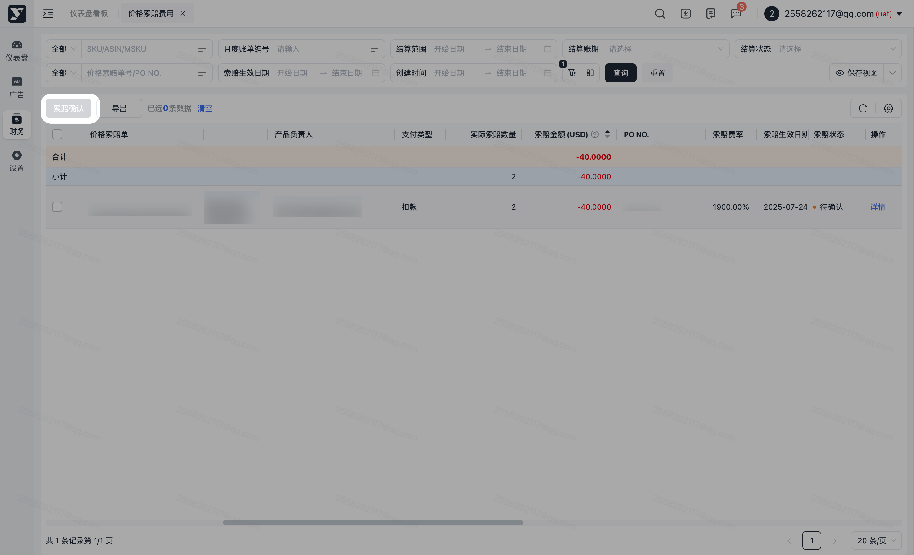
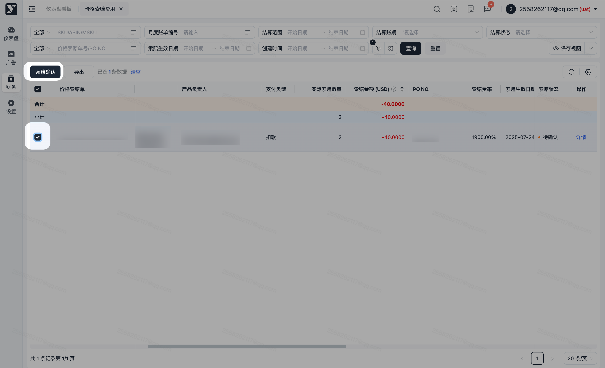
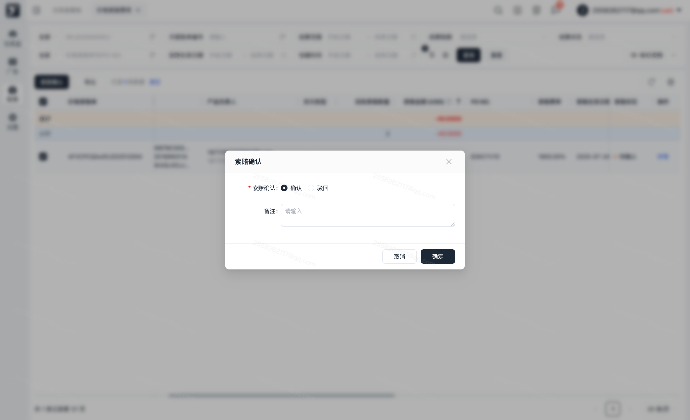
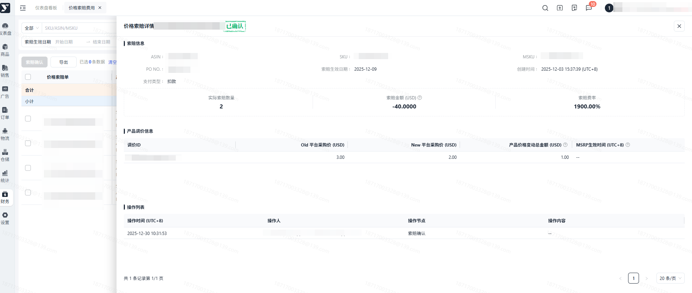
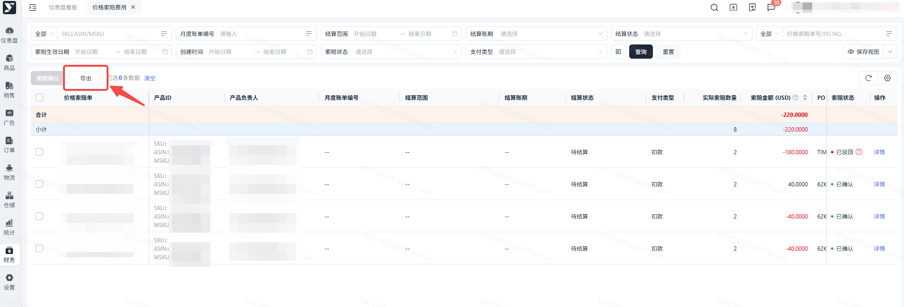

# 飞书文档：价格索赔

## 功能介绍

简称PC，**指提交的发票中平台采购价和确认的PO订单的平台采购价不一致时**（发票的平台采购价高于PO订单确认的平台采购价）。通常是发生于供应商在确认PO订单后发起成本变更有关，或者没有发生平台采购价变更但仍存在以较高的成本向亚马逊开票。

**责任方**: 由供应商发起平台采购价、MSRP调整所产生的价格索赔罚款均由**供应商**承担；

**扣款款项**：价格索赔总额=(原采购价格-新采购价格)×数量×(1+索赔费率)

本功能用于确认和查询因产品调价产生的价格索赔扣款信息，您可以通过本功能页面查询和导出所有价格索赔明细。

## 对账思路

1. 产生原因：当供应商提交的发票金额 高于 亚马逊采购订单上确认的成本价时，系统会自动触发 价格差异索赔。亚马逊会向供应商追讨差额部分。
2. 核对方式：

 1. **索赔费用计算公式：(原采购价格-新采购价格)×数量×(1+索赔费率)**
 2. 按照应付账款中【价格索赔】查询索赔生效日期数据，与月度账单中价格索赔明细核对。
 3. 索赔发票是基于PO+ASIN维度生成的，若调价期间该ASIN存在多笔在途PO单，每笔PO都会产生对应的索赔发票，这属于正常业务逻辑，并非重复收费。供应商可以通过核对PO NO.+ASIN来验证每笔索赔的唯一性。
3. 争议数据：若供应商并未主动发起调价，但仍接收到亚马逊开具的价格索赔单据，请向平台运营经理协同核实并向亚马逊提交争议。
4. 数据生成维度：PO订单+ASIN

## 操作流程

### 操作路径

【财务】-【应付账款】-【价格索赔费用】

### 默认数据加载

进入页面，会默认加载价格索赔状态为待确认的数据

### 搜索及展示

下方的列表可根据搜索条件，进行对应的展示。若是有字段名称不了解，可点击【?】查看对应的解释。

对价格索赔单的扣款费用进行确认操作，默认按钮置灰。

勾选价格索赔单后，索赔确认按钮可操作。

点击索赔确认后弹窗，您可以操作确认和驳回，确认后代表所选价格索赔单产生的费用无误，操作后返回主页面。驳回后代表所选索赔单产生的费用存在问题，需备注您认为存在的费用问题，操作后返回主页面。

点击该条数据展开详情页面。

详情页面您可以查询价格索赔单信息及对应的产品调价数据和操作记录

1. 可批量导出或指定数据导出，可按需进行导出。
2. 若进行筛选后，导出内容则会跟筛选条件一致。
3. 点击【导出】，若当前列表数据无勾选，则导出全量数据；若当前列表有勾选，则导出被勾选的数据。

