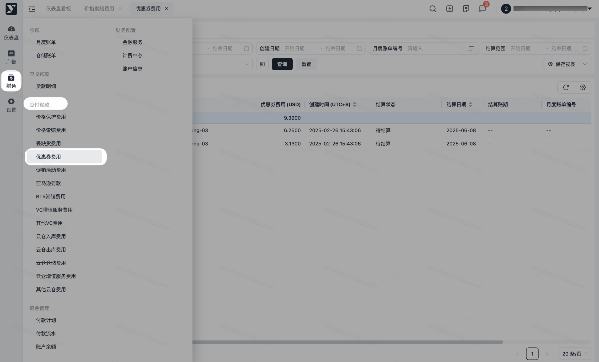
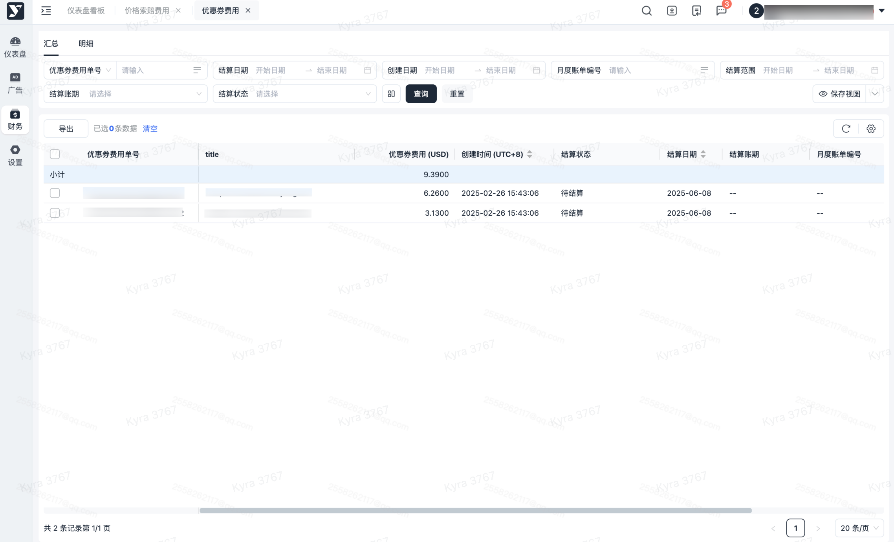
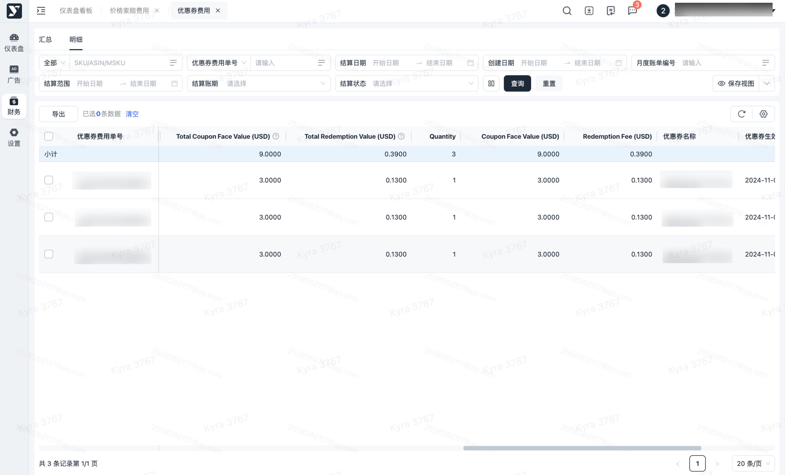
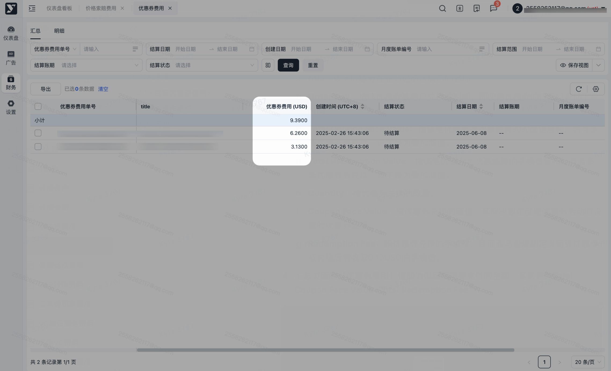
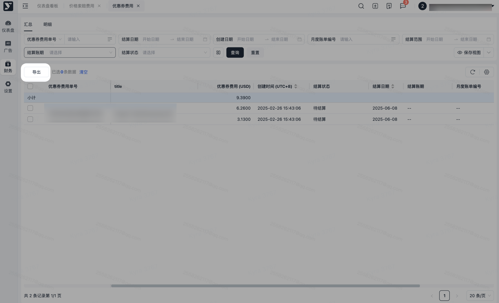

# 飞书文档：优惠券费用

## 功能介绍

1. 本功能用于查询优惠券活动产生的费用信息。

## 对账思路

1. 产生原因：在您通过优惠券模块创建优惠券促销活动后，系统将针对每张成功兑换的优惠券收取相应费用。具体收费机制如下：

 1. **Coupon Face Value**：每张优惠券被兑换使用时，系统将自动产生一笔促销费，金额与优惠券面值相等；
 2. **Redemption fee**：根据亚马逊规则，每笔兑换交易还将收取0.13美元的手续费。
2. 核对方式：

 1. **计算公式：（Coupon Face Value+Redemption Fee）\*Quantity（数量）=优惠券促销费用**
 2. 本明细数据源自亚马逊平台开具的发票；根据亚马逊结算规则，单个优惠券活动可能对应多张发票；如需查询某促销活动的全部费用，请使用优惠券名称作为筛选条件进行检索。
3. 争议数据：

 1. 可在【销售-营销推广-优惠券】中查看优惠券活动的实际兑换数量，如发现亚马逊收取的优惠券费用与系统显示的兑换数量不一致，属正常情况，因最终费用以亚马逊发票为准，如需校正兑换数据，可联系您的Yurex运营经理，我们将协助更新优惠券信息（注：数据更新后仍可能存在一定误差，不保证完全匹配）。

#### 操作路径

【财务】-【应付账款】-【优惠券费用】

1. 优惠券明细数据分为汇总页和明细页；基础数据由亚马逊方提供。
2. 汇总页的数据维度为单个优惠券活动+发票维度；明细页的数据维度为每张优惠券被兑换的维度。

1. 字段说明：

 1. **title：**该条优惠券在亚马逊前台展示的名称。
 2. **Order Day：**指该优惠券被用户兑换的时间，即使用优惠券的该笔订单的下单时间。
 3. **Total Coupon Face Value：**指该笔优惠券本次被结算的面值总和，若有多条优惠券被兑换，该字段为叠加取值。
 4. **Total Redemption Value：**指该笔优惠券本次被结算的手续费总和；若有多条优惠券被兑换，该字段为叠加取值。
 5. **Quantity：**指优惠券兑换的数量。
 6. **Coupon Face Value：**指优惠券兑换的面值，其取决于您在创建优惠券活动时设置的优惠券面额。
 7. **Redemption Fee：**指优惠券兑换的手续费，目前亚马逊规则定义每张优惠券被兑换后需收取0.13USD的手续费。
2. 汇总页面的【优惠券费用】值即为供应商需要支付的金额，其来源为**Total Coupon Face Value+Total Redemption Fee**

1. 可批量导出或指定数据导出，可按需进行导出。
2. 若进行筛选后，导出内容则会跟筛选条件一致。
3. 点击【导出】，若当前列表数据无勾选，则导出全量数据；若当前列表有勾选，则导出被勾选的数据。

