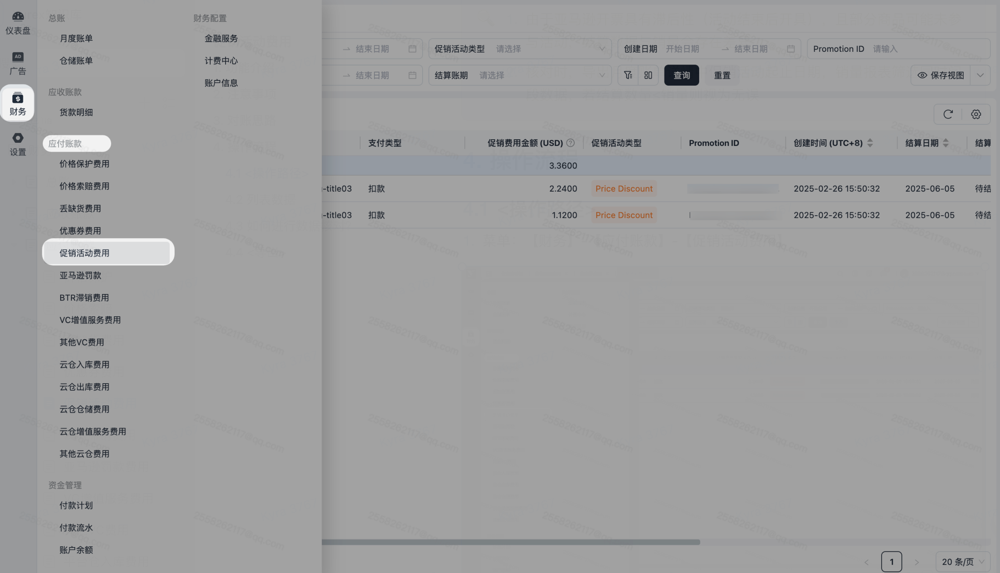
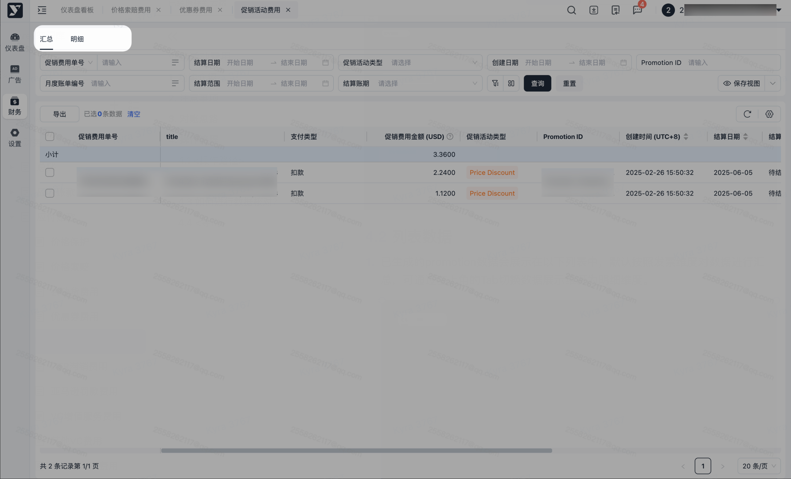
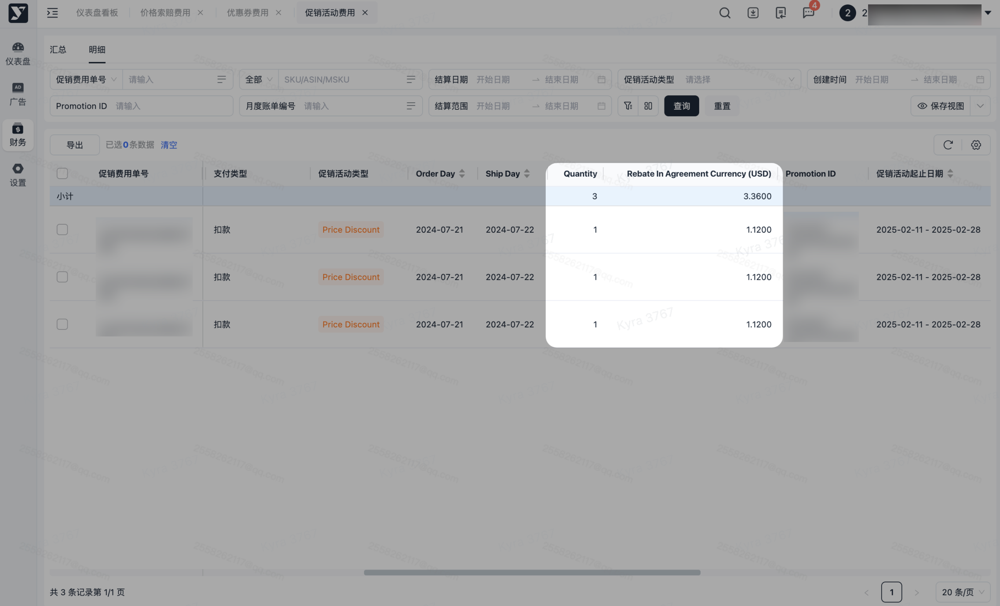
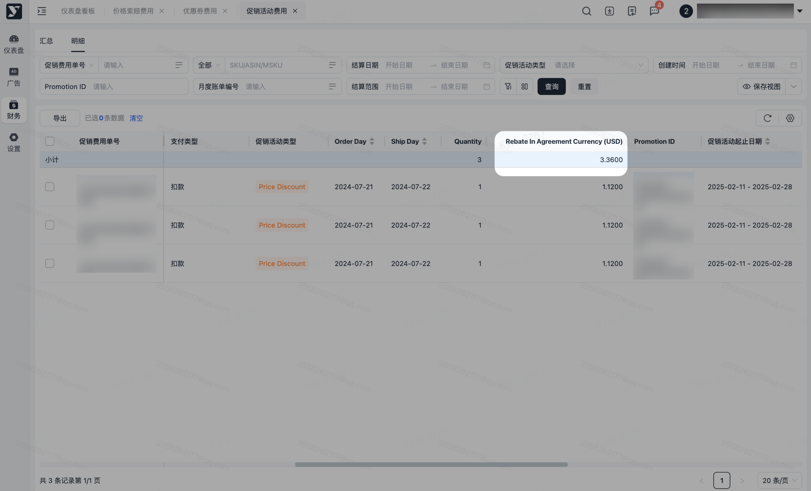
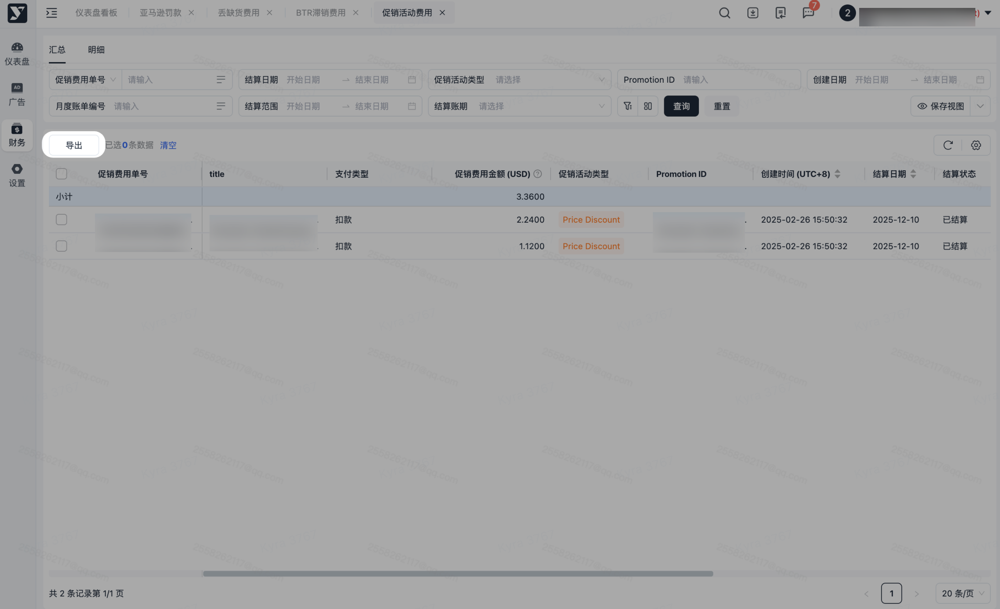

# 飞书文档：促销活动费用

促销活动费用

当前版本：v1.0.1

## 功能介绍

亚马逊的Promotion是卖家用来提升销量、清理库存或推广新品的营销工具，主要包括最佳促销（Best Deal）、价格折扣（Price Discount）、秒杀（Lightning Deals） 等。这些促销活动会产生相应的费用，需由供应商承担。

当供应商在系统进行了促销活动后，亚马逊会开出对应的促销发票，收取促销折扣金额\*销量的促销费，您可以在本模块查看到促销活动后需支付给亚马逊的费用明细。

## 注意事项

1. 促销费用具有滞后性，一般会在促销结束后一个月左右开出所有的发票。
2. 单个活动的账单可能会通过多笔账单开具，若您发现账单中的金额和促销数量与实际不符，可耐心等待亚马逊补开账单。

## 对账思路

1. 产生原因：当您通过【销售-营销推广-促销活动】模块创建促销活动（包括Best Deal、Price Discount、Lightning Deal等）后，活动期间产生的订单将按实际折扣金额和销量收取相应促销费用。
2. 核对方式：

 1. **计算方式：Rebate In Agreement Currency = Quantity（数量） × 实际折扣金额**
 2. 实际折扣金额可在【销售-营销推广】模块中通过promotion ID查询。
 3. 所有明细项的Rebate In Agreement Currency总和即为款项结算金额。
 4. 本明细数据源自亚马逊平台开具的发票；根据亚马逊结算规则，单个促销活动可能对应多张发票；如需查询某促销活动的全部费用，请使用Promotion ID作为筛选条件进行检索。
 5. 销量为0的数据亚马逊不会开具发票。
3. 争议数据：

 1. 可在【销售-营销推广-促销活动】中查看促销的销量，如发现亚马逊收取的促销费用与系统显示的销量不一致，属正常情况，因最终费用以亚马逊发票为准，如需校正销量数据，可联系您的平台运营经理，我们将协助更新促销销量信息（注：数据更新后仍可能存在一定误差，不保证完全匹配）。
4. 导出路径

 1. 月度账单-促销活动：财务
1. 由于亚马逊开票具有滞后性（活动结束后开具），且部分商品可能未参与活动，结算数据与销量会存在差异。
2. 核对时，导出月度账单详情中促销活动起止日期，销量报表筛选同时间段数据，若结算数量≤销量则视为无误

## 操作流程

##

1. 菜单：【财务】-【应付账款】-【促销活动费用】

### 列表数据

1. 已生成的promotion数据会展示在以下列表中，默认按照发票维度对数据进行汇总，可通过左上角的Tab切换数据展示维度为明细维度。

 
2. 明细数据按照促销活动+ASIN的维度平铺展示数据，支持查询单个活动中某个ASIN的销量和促销费用。

 1. **Quantity（销售数量）：指该促销活动明细项中，单笔交易所产生的实际销售件数。**
 2. **Rebate In Agreement Currency（协议货币返利金额）：以美元为结算货币，表示该笔交易明细根据促销协议条款应支付的促销费用金额。**

 

### 如何进行数据核对？

1. 您可在Promotion费用明细页面，通过输入准确的Promotion ID进行检索，系统将返回该促销活动产生的全量费用明细数据。

> 注意：Promotion ID可确保获取全量关联数据的检索条件，使用其他筛选方式可能导致数据不完整。

1. 统计该活动的**Quantity总计数量，查看是否跟促销板块统计的销量一致，若不一致，可能存在以下几种情况：**

 1. 促销销量大于账单总计数量：可能是因为该活动的账单尚未完全生成，建议持续观察后续一月的出账情况，以确认数据是否最终匹配。
 2. 促销销量小于账单总计数量：这是由于促销板块的业务数据在促销结束七天后会停止自动更新，如果亚马逊在七天后调整了促销销量数据，系统将无法同步最新数据。您可以联系您的平台运营经理，请求手动更新促销数据。
 3. **需要注意的是，实际促销销量和最终收费均以账单数据为准，业务促销销量仅作为参考。由于数据同步可能存在延迟或调整，账单与业务销量存在一定差异属于正常现象。如果对数据有疑问，建议保存相关截图记录，以便后续核对。**
2. 账单金额的计算公式如下：

 1. Rebate In Agreement Currency（协议货币返利金额）= Quantity（销量）× 折扣金额
 2. 账单总金额即为所有Rebate In Agreement Currency的汇总值。

 

##

1. 可批量导出或指定数据导出，可按需进行导出。
2. 若进行筛选后，导出内容则会跟筛选条件一致。
3. 点击【导出】，若当前列表数据无勾选，则导出全量数据；若当前列表有勾选，则导出被勾选的数据。

