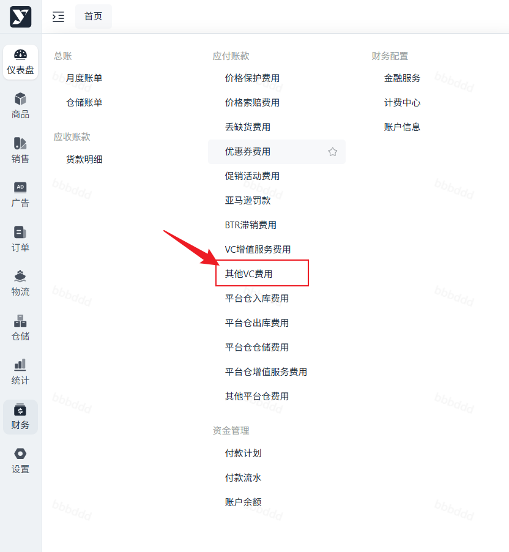
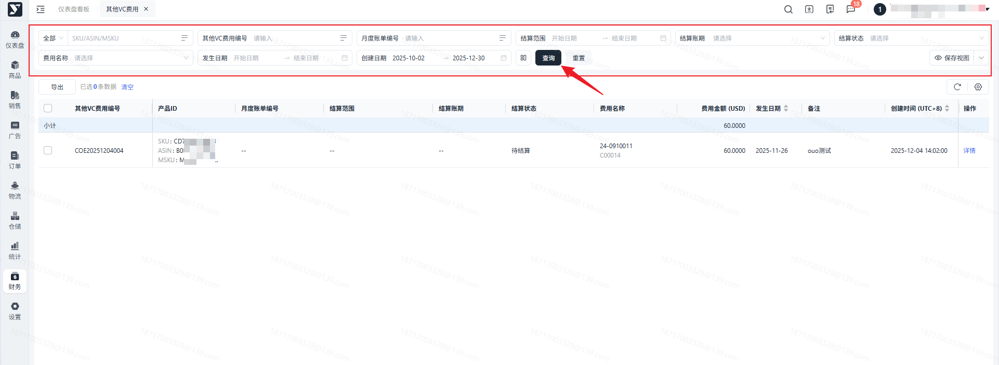
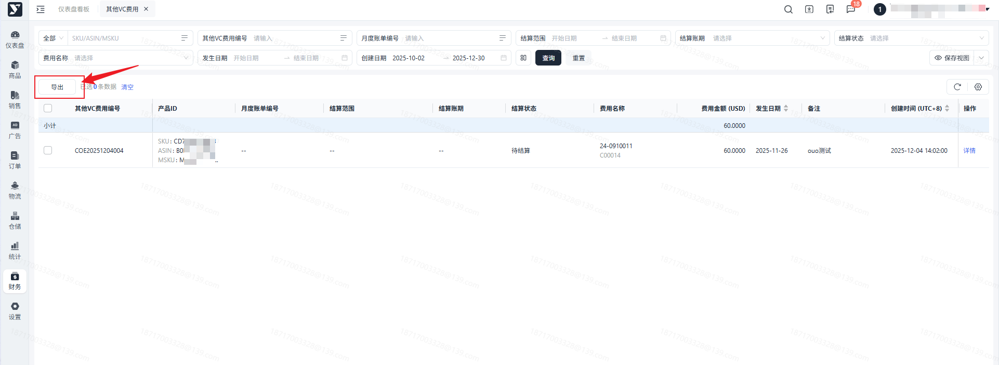

# 飞书文档：其他VC费用

## 功能介绍

为维护财务结算数据的完整性，当存在系统中暂未上线的费用项需进行结算时，财务可在其他VC费用中进行人工录入，录入后会在User端进行对应展示。

## 注意事项

1. 若对新增的其他VC费用明细存疑，可联系运营进行咨询。

## 对账思路

可通过其他VC费用明细中的**ASIN**及**费用名称**及对应的**备注**进行业务核对。

## 操作流程

### 操作路径

【财务中心】-【应付账款】-【其他VC费用】

### 搜索及展示

进入页面，可对数据进行搜索。

下方的列表可按创建时间进行正倒序排序。

- 可批量导出或指定数据导出，可按需进行导出。

 - 导出所选：勾选对应数据，导出勾选数据。
 - 导出全部：根据筛选展示内容，导出所有数据。

## 常见问题

若您对其他VC费用明细存在异议，请联系您的财务负责人进行对应咨询。
