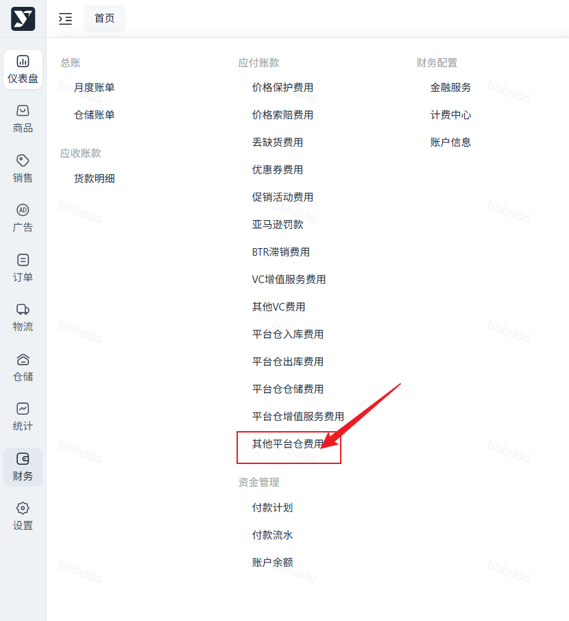
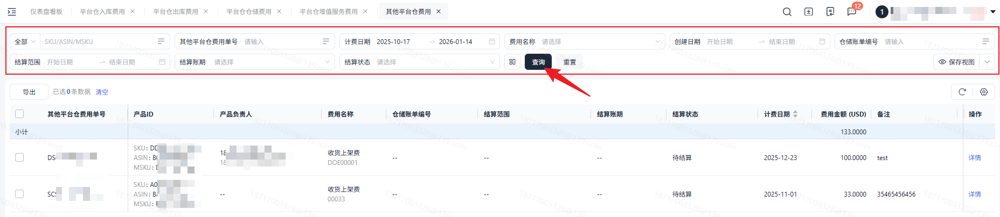
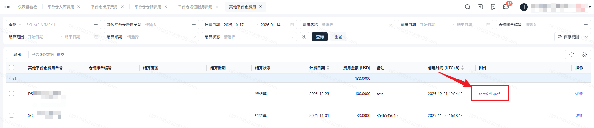
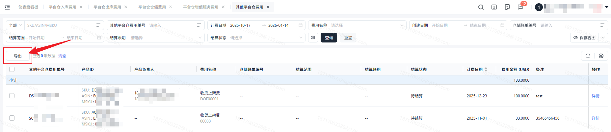

# 飞书文档：其他平台仓费用

## 功能介绍

1. 本功能用于查询供应链产生的相关费用信息，您可以通过本功能页面查询和导出所有其他平台仓费用及附件文件下载查看费用明细。

## 对账思路

1. 该模块为其他未进行收取的仓储类费用，为财务手动录入。
2. 客户进行核对时可根据产品+费用名称进行核对，或者可**下载附件**，进行费用核对。

## 操作流程

### 操作路径

【财务】-【应付账款】-【其他平台仓费用】

### 默认数据加载

进入页面，会默认加载计费日期为最近三个月的数据

### 搜索及展示

进入页面，可对数据进行搜索，列表展示对应数据。

### 附件下载

可通过页面列表附件列点击下载附件

点击【导出】可导出其他平台仓费用数据。

导出根据筛选条件进行导出，导出内容与列表数据一致。

