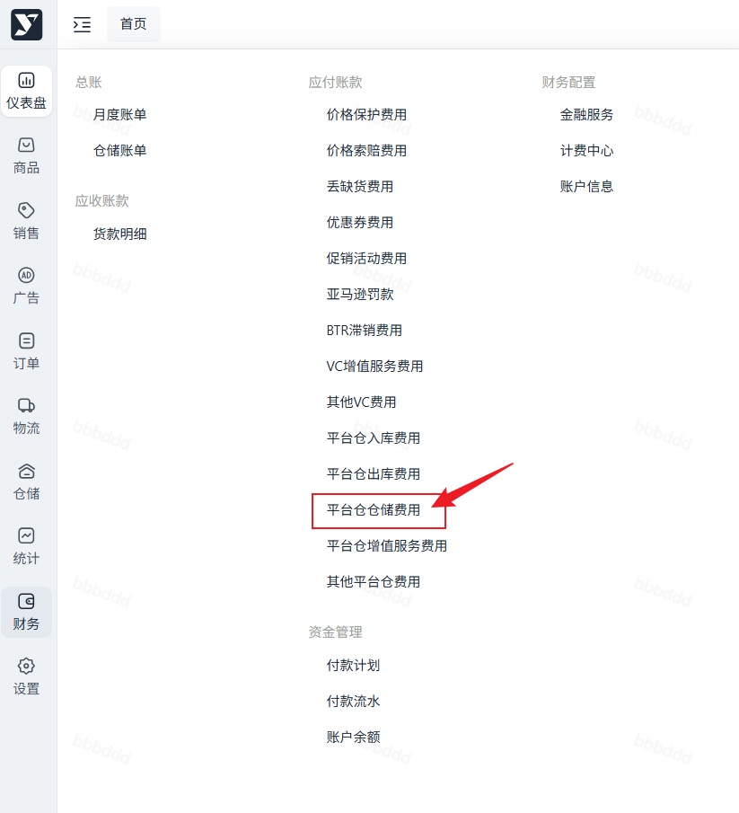
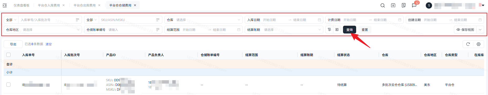
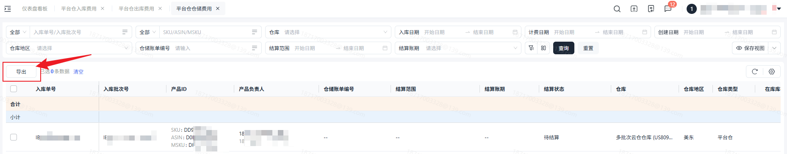

# 飞书文档：平台仓仓储费用

## 功能介绍

当货物发往海外仓库，海外仓库验收入库后，针对库龄超过报价天数的产品，仓库保管货物所产生的仓租费用及其各类附加费用。您可以通过本功能查询仓租费、超库龄附加费、超尺寸附加费、旺季费明细。

## 注意事项

1. 货物到达仓库后免租期详见海外仓仓储服务报价
2. 仓租费及其附加费用以产品体积进行计算

## 对账思路

### 上游数据

上游业务数据查询：【仓储】——【库存管理】——【库存管理】——【库存快照】

仓库类型为：平台仓，合作仓，自营仓则会参与计费。

**注意：**库存快照明细为对应ASIN计费日期当天的库存信息，分为整箱和散件。**整箱与散件的体积和货型不同。**

### 计费规则

| 列1 | 列2 | 列3 | 列4 |
| --- | --- | --- | --- |
| 费项 | 计费单位 | 计算规则 | 备注 |
| 仓租费 | CBM/天 | 根据货型匹配单价， 货型单价×外箱体积×箱数×天数（1天） | 每天计算当天的仓租费。 |
| 超库龄附加费 | CBM/天 | 超出天数， 单价×外箱体积×箱数×超期天数 | |
| 超尺寸附加费 | CBM/天 | 超出尺寸的外箱尺寸， 单价×外箱体积×箱数×存放天数 | 测算时都是按整箱库存进行计算的。 实际业务场景区分了散件库存和整箱库存。散件库存是按商品尺寸信息判断。 |
| 旺季附加费 | CBM/天 | 单价×外箱体积×箱数×旺季天数 | |
| 注意：仓储费是每天都会进行计算，对应单价取值跟库龄挂钩。 1. 库龄=计费时间-入库时间 | | | |

## 操作流程

### 操作路径

【财务】-【应付账款】-【平台仓仓储费用】

### 数据查询&重置

支持筛选勾选数据或全部数据导出

