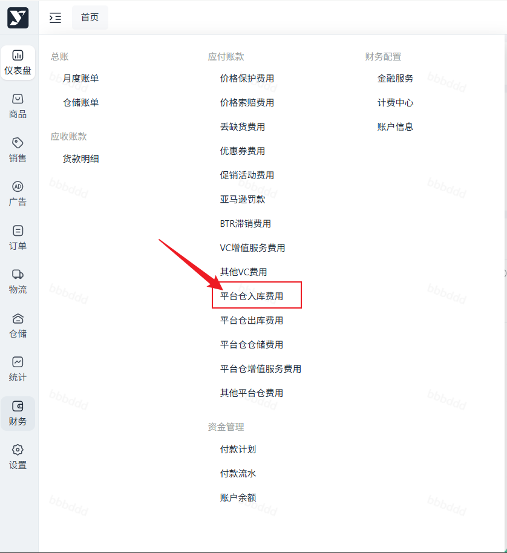
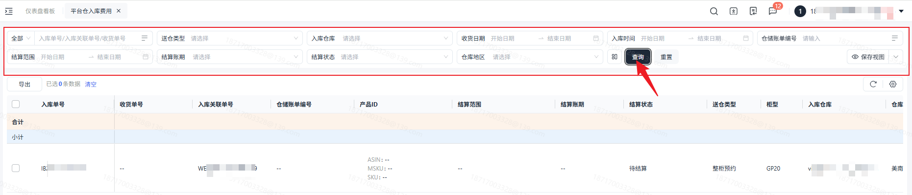
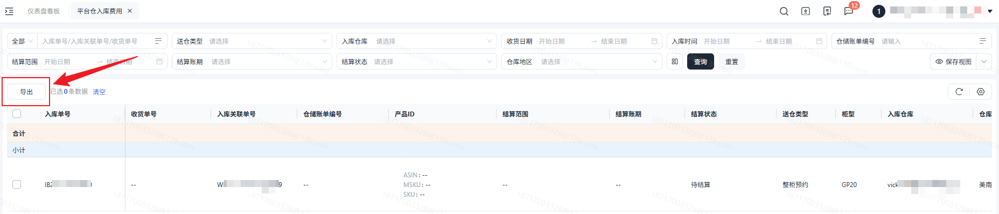

# 飞书文档：平台仓入库费用

## 功能介绍

当货物发往海外仓库，海外仓库验收入库过程中产生的操作费用。您可以通过本功能查询入库操作产生的卸货费、超箱附加费、来货分拣费、收货上架费、续重费。

## 注意事项

1. 入库操作费用计算详见海外仓仓储服务报价。
2. 卸货费根据您送仓类型是整柜还是非整柜来计算卸货费用，来货分拣费根据您入库批次中的产品种类数量进行计费。

## 对账思路

### 上游数据

上游业务数据查询：【仓储】——【入库管理】——【收货单列表】

入库类型为：采购入库。仓库类型为：平台仓，合作仓，自营仓则会参与计费。

### 计算规则

下方为计算规则，具体单价以运营提供的报价表为准。

| 列1 | 列2 | 列3 | 列4 | 列5 |
| --- | --- | --- | --- | --- |
| 费项 | | 计费单位 | 计算规则 | 备注 |
| 卸货费 | 整柜卸货费 | 柜 | 柜型单价×1 | 目前都是单柜的情况 |
| 卸货费 | 超箱附加费（整柜） | 箱 | 超出整柜限制的箱数， 单价×超箱数量 | 注意：匹配单价的重量单位为kg，体积单位为cbm。若单位不同需要进行转换。 |
| 卸货费 | 非整柜卸货费 | CBM | 单价×外箱体积×箱数 | 注意：匹配单价的重量单位为kg，体积单位为cbm。若单位不同需要进行转换。 |
| 来货分拣费 | 来货分拣费 | SKU种类 | 单价×产品种类数量 | 注意：匹配单价的重量单位为kg，体积单位为cbm。若单位不同需要进行转换。 |
| 收货上架费 | 收货上架费 | 箱重 | 当前版本都是整箱入库，故都是按照箱重匹配的单价。 单价×箱数 | 注意：匹配单价的重量单位为kg，体积单位为cbm。若单位不同需要进行转换。 |
| 续重费（收货上架费） | 续重费（收货上架费） | KG | 超出限重量的箱子重量， 单价×超重重量×箱数 | 注意：匹配单价的重量单位为kg，体积单位为cbm。若单位不同需要进行转换。 |

## 操作流程

### 操作路径

【财务】-【应付账款】-【平台仓入库费用】

### 数据查询&重置

- 勾选后导出对应数据；
- 不勾选导出筛选条件下所有数据。

