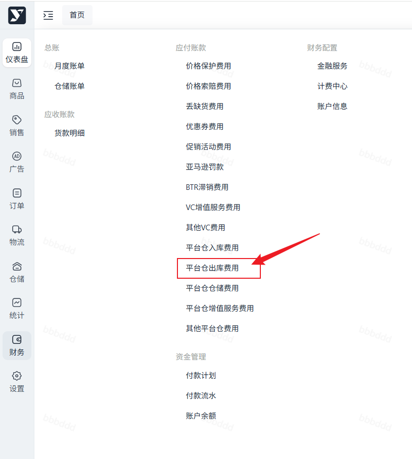
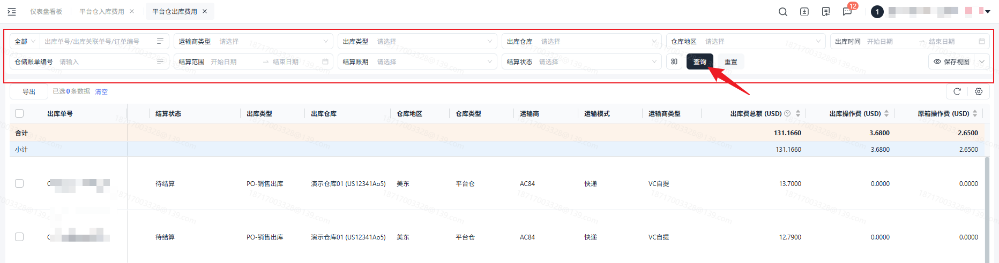
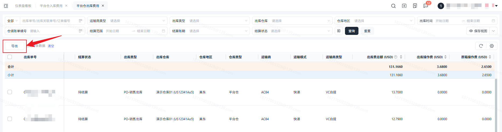

# 飞书文档：平台仓出库费用

## 功能介绍

当货物在海外仓库出库时，海外仓库在出库过程中产生的操作费用。您可以通过本功能查询出库操作产生的出库操作费，续重费，箱唛费，自提附加费，运力使用费，打板费。

## 注意事项

1. 出库操作费用计算详见海外仓仓储服务报价；
2. B2B出库和B2C出库所收取的费项和计费规则不同。

## 对账思路

### 上游数据

上游业务数据查询：【仓储】——【出库管理】——【出库明细】

出库类型为：PO/DF/FBA/一件代发—销售出库

仓库类型为：平台仓，合作仓，自营仓则会参与计费。

**注意：**出库明细为ASIN维度，出库费用计算需对出库单进行聚合。

### 计费规则

#### B2B出库

- **PO及FBA出库**

| 列1 | 列2 | 列3 | 列4 |
| --- | --- | --- | --- |
| 费项 | 计费单位 | 计算公式 | 备注 |
| 最低收费 | 出库单 | 与原箱操作费对比，没满足最低收费标准则收取最低收费。 | |
| 原箱操作费 | 箱 | 外箱重量（KG）匹配单价， 单价×箱数 | |
| 装箱操作费 | 件 | 非原箱出库 | 当前版本仅支持原箱出库 |
| 装箱附加费 | 箱 | 非原箱出库 | 当前版本仅支持原箱出库 |
| 箱唛费 | 箱 | 单价×箱数 | |
| 自提附加费 | KG | 单价×外箱重量（KG）×箱数 | 1. 出库单维度总重量，有最低收费标准。 2. 平台合作物流不收取自提附加费。 |
| 运力使用费 | 箱 | 运输方式为快递的模式下收取该费用； 单价×箱数 | |
| 打板费 | 托盘数 | 运输方式卡派的模式下收取该费用； 单价×托盘数量 | |

#### B2C出库

- **DF及一件代发出库**

| 列1 | 列2 | 列3 | 列4 |
| --- | --- | --- | --- |
| 费项 | 计费单位 | 计算规则 | 备注 |
| 出库操作费 | 件 | 按商品重量匹配单价， 单价×箱数×装箱数量 | |
| 续重费 | 件 | 超重商品收费， 超重单价×商品超重重量（KG）×箱数×装箱数量 | |
| 自提附加费 | KG | 单价×商品重量（KG）×箱数×装箱数量 | 1. 出库单维度总重量，有最低收费标准。 2. 平台合作物流不收取自提附加费。 |
| 运力使用费 | 箱（件） | 运输方式为快递的模式下收取该费用； 单价×箱数×装箱数量 | |
| 打板费 | 托盘数 | 运输方式卡派的模式下收取该费用； 单价×托盘数量 | |

## 操作流程

#### 操作路径

【财务】-【应付账款】-【平台仓出库费用】

#### 数据查询&重置

支持筛选勾选数据或全部数据导出

