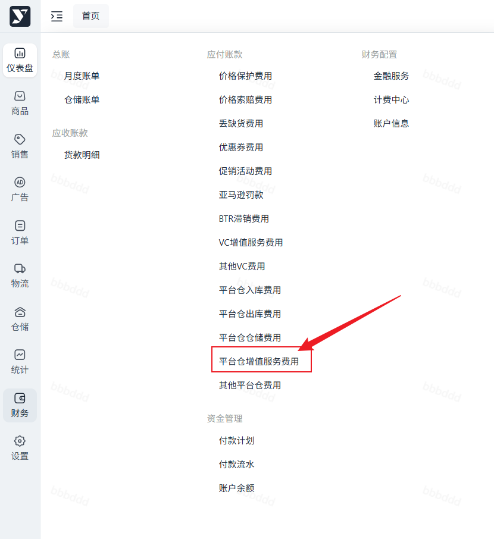
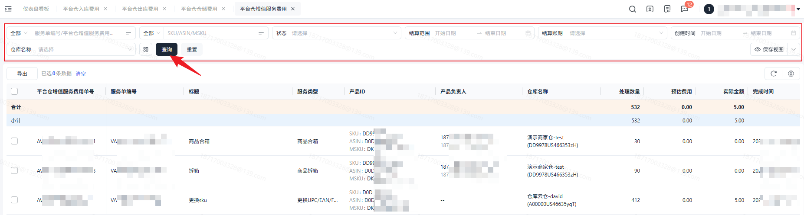
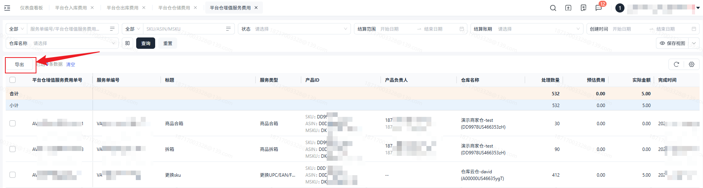

# 飞书文档：平台仓增值服务费用

## 功能介绍

当货物发往海外仓库后，排除基础的仓库作业如入库/出库等，您需要其他的服务，可通过创建库内服务的模式进行发起。

## 对账思路

### 上游数据

1. 上游业务数据查询：【仓储】——【库内管理】——【库内服务】
2. Tab选择：自营仓/平台仓
3. 选择已完成的库内服务进行实际费用金额核对。

### 计费规则

在平台仓增值服务费用中，会根据上游的实际费用进行计费。

**注意：**增值服务费会以产品维度进行展示，即一条库内服务可能会对应多条计费，无需担心，实际费用总金额是一致的。

## 操作流程

### 操作路径

【财务】-【应付账款】-【平台仓增值服务费用】

### 数据查询&重置

支持筛选勾选数据或全部数据导出

