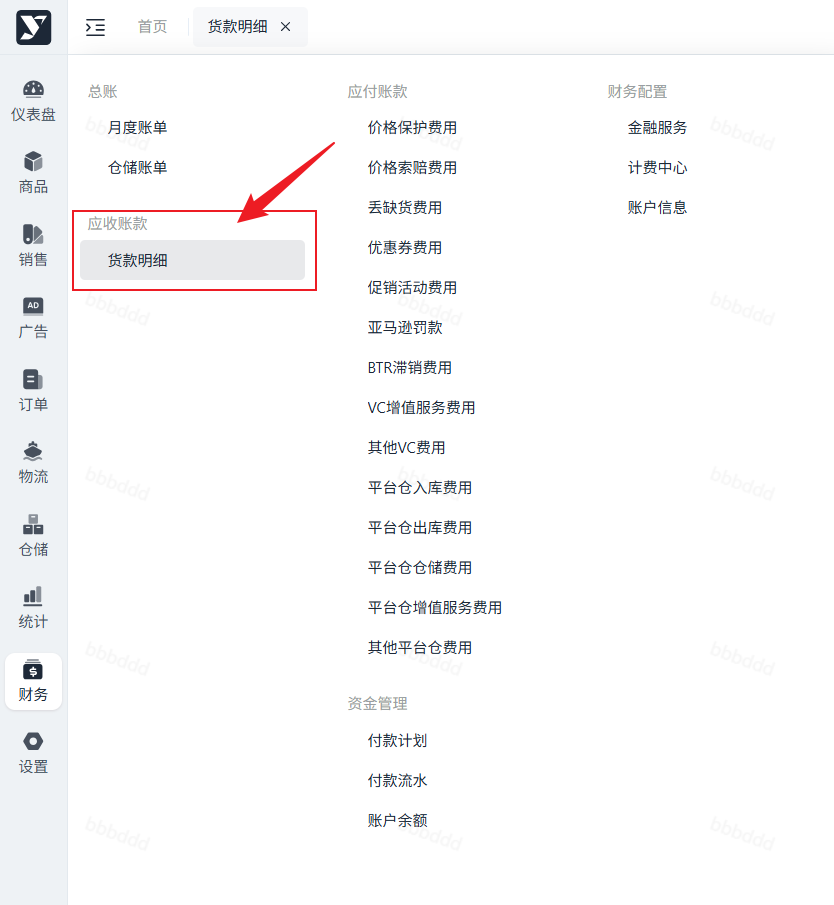
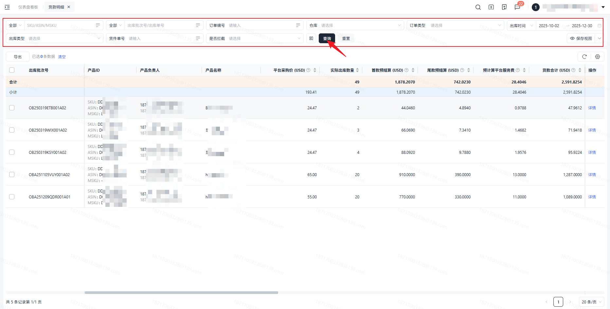
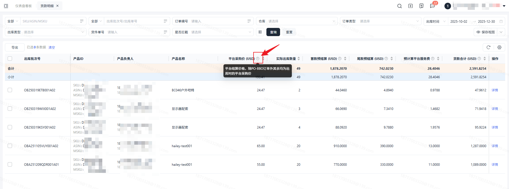
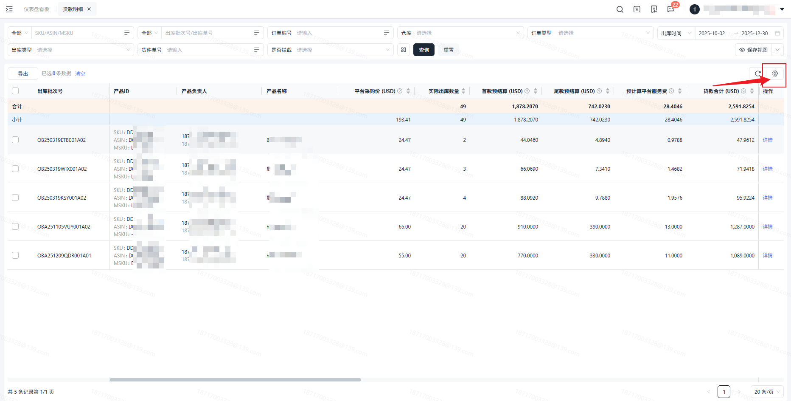
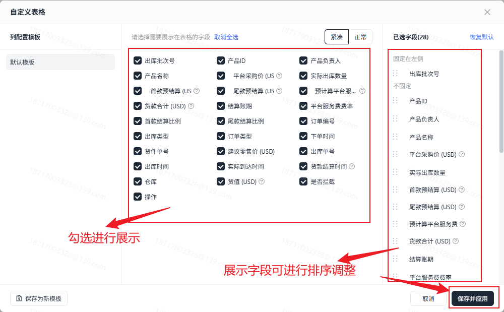
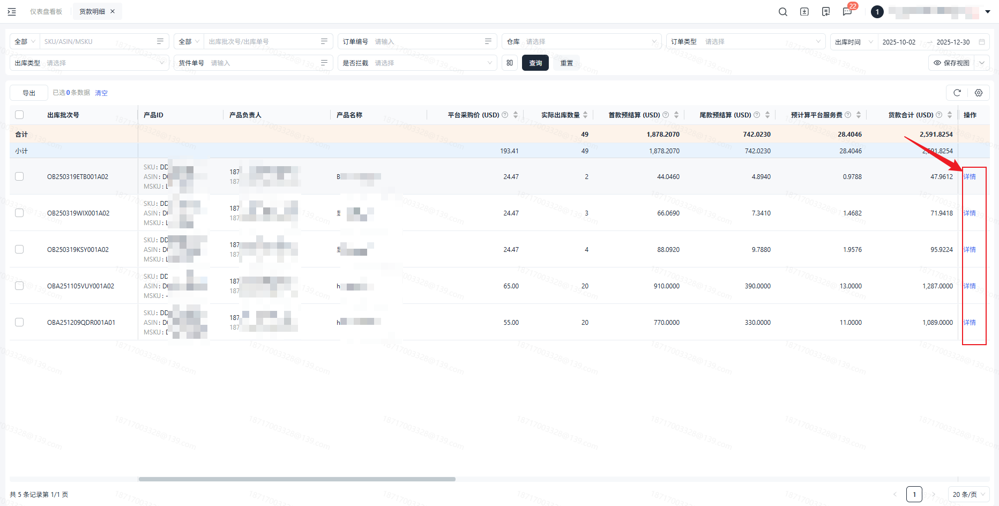
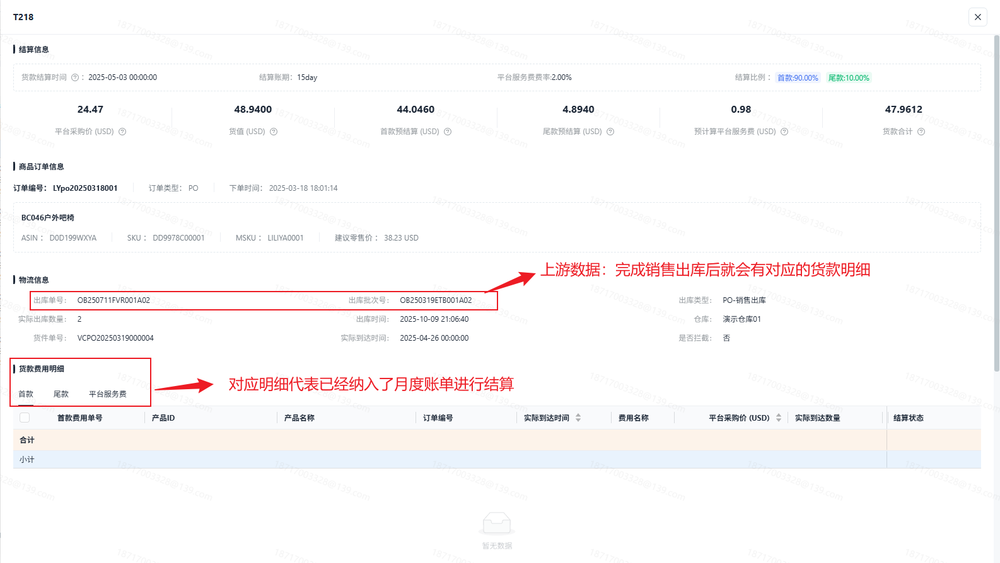
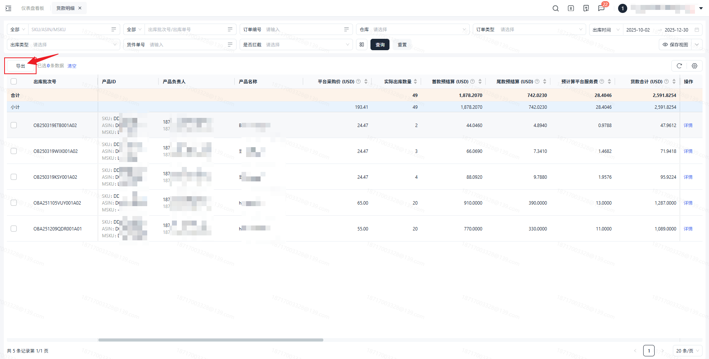

# 飞书文档：货款明细

## 文档信息

| 项 | 内容 |
| --- | --- |
| 远程文档 | https://q1njej8cpab.feishu.cn/wiki/WubKwXwFaiuNrLkw4fycKXc6nGb |
| 图片处理 | 本地下载（assets/images） |
| 快照时间 | 2026-08-06 |
| 来源命令 | `lark-cli docs +fetch --api-version v2 --doc https://q1njej8cpab.feishu.cn/wiki/WubKwXwFaiuNrLkw4fycKXc6nGb --doc-format markdown --as user --format json --jq .data.document.content` |
| 格式处理 | fd-doc-markdown-sync/scripts/normalize-feishu-doc-markdown.mjs |

---

货款明细

当前版本v1.1.0

## 功能介绍

1. 您可以在【货款明细】中查看对应的货款信息，货物在海外仓出库后，对应每一笔出库批次号能结算多少首款和尾款，预计在什么时间节点进行结算。
2. 货款明细的数据来源：当货物从海外仓发货后，我们就会把对应的出库信息以出库批次号的维度展示在货款明细当中。

## 注意事项

1. 货款的结算价是：平台采购价×实际出库数量×对应的结算比例。其中平台采购价的取值是取的【销售】-【采购报价】对应出库时间节点的价格。

 1. **注意：**当货款明细对应订单类型为PO-BBO时，平台采购价则为平台-BBO采购价，取的对应ASIN，BBO订单询价时确认的价格。
2. 当前版本的统计信息，订单类型为PO订单和DF订单。

## 对账思路

##

1. 核对方式：根据当期【货款明细】中实际到达时间，与月度账单里“采购货款-首款”明细数据核对
2. 导出路径

 1. 采购货款-首款：财务>月度账单>详情>采购货款-首款明细>导出
 2. 货款明细：财务>货款明细>筛选实际到达时间>导出

##

1. 核对方式：根据当期【销量报表】数据，与月度账单中尾款明细进行结算数量核对

 1. 注意：需结完首款后再结算尾款，可能出现尾款结算数量小于销量情况，属于正常情况
2. 导出路径

 1. 采购货款-尾款：财务>月度账单>详情>采购货款-尾款明细>导出
 2. 销量看板：统计>销量看板>筛选起止日期>导出

- 尾款结算数量＜销量：部分订单未到达致未结算首款，不符合尾款结算条件
- 尾款结算数量＞销量：

 - 销量可能因换货某天呈负数，系统会过滤此类数据，不进行扣款
 - 按结算范围搜索销量时，若前期部分销量未达到结算条件，本期满足后将在当期结算

## 操作流程

##

#### 操作路径

【财务】-【应收账款】-【货款明细】

#### 搜索及展示

进入页面，默认展示数据为近三个月出库时间的数据信息。

- 可对数据进行搜索，其中时间的搜索，默认为对【出库时间】进行对应搜索，但可点击【下翻键】，切换搜索时间类型。

下方的列表可根据搜索条件，进行对应的展示。若是有字段名称不了解，可点击【?】查看对应的解释。

##

因为货款明细展示的列表字段较多，为了方便快速找到你所需的字段信息，可点击【设置】

按钮进行自由设置显示字段以及字段排序。

默认展示全部字段，可根据自身需求，自由调整显示及顺序。

- **注意：更改自定义表单设置后，需要点击【确定】按钮才能生效。**

##

点击查看详情，可查看该条货款明细的所有数据信息。详情里的数据信息展示不跟自定义表单设置挂钩。

##

点击【导出】可导出当前筛选条件下所有货款数据。

## 常见问题

##

若您存在这个问题，是因为您当前数据的出库时间节点未签订对应的合同，请联系您的运营负责人补签合同。

##

1. 平台结算价通常情况为出库时间节点的平台采购价，请注意您是否产生了调价。
2. 若订单类型为PO-BBO则需注意，该订单类型的价格为询价时您所确认的平台-BBO采购价。
