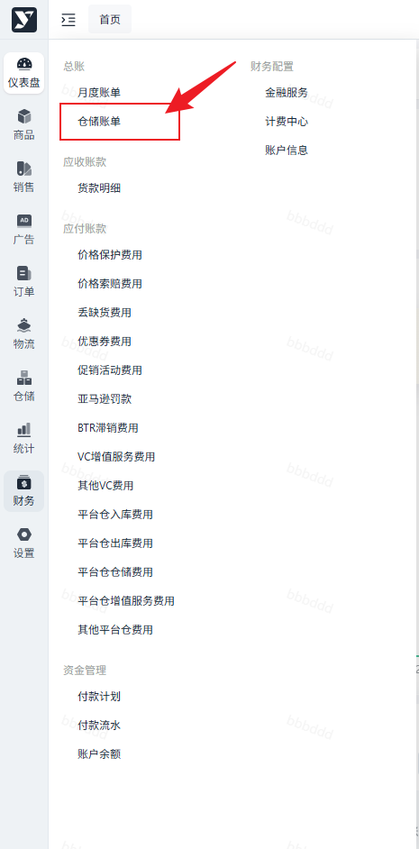
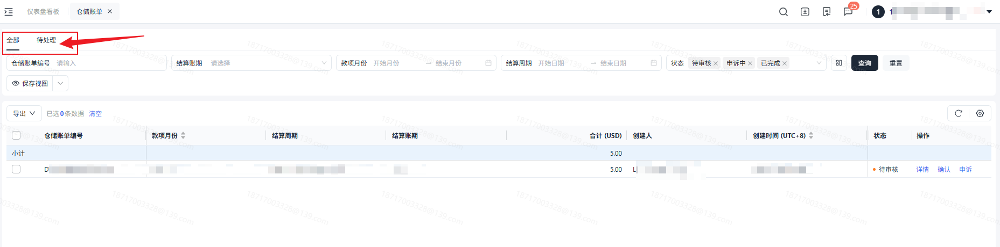
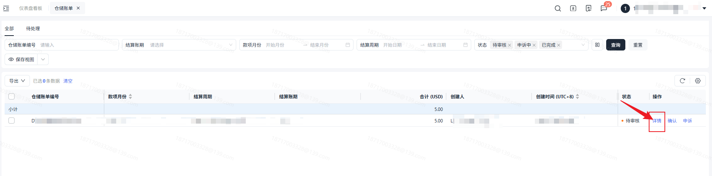
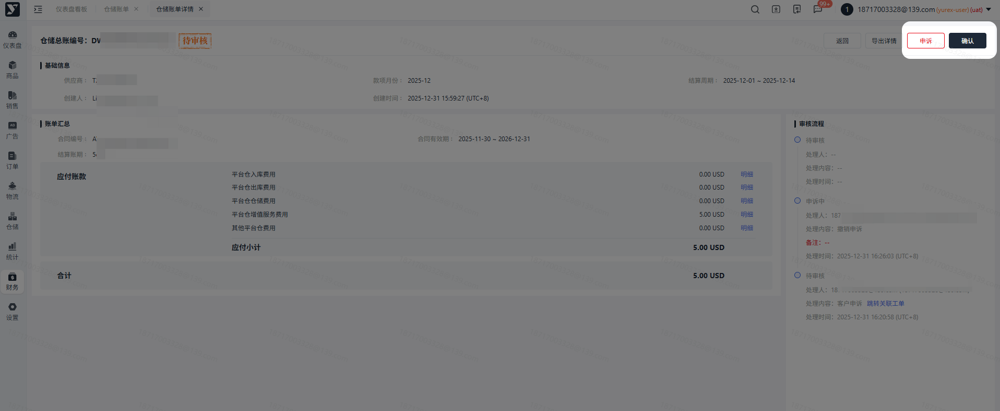
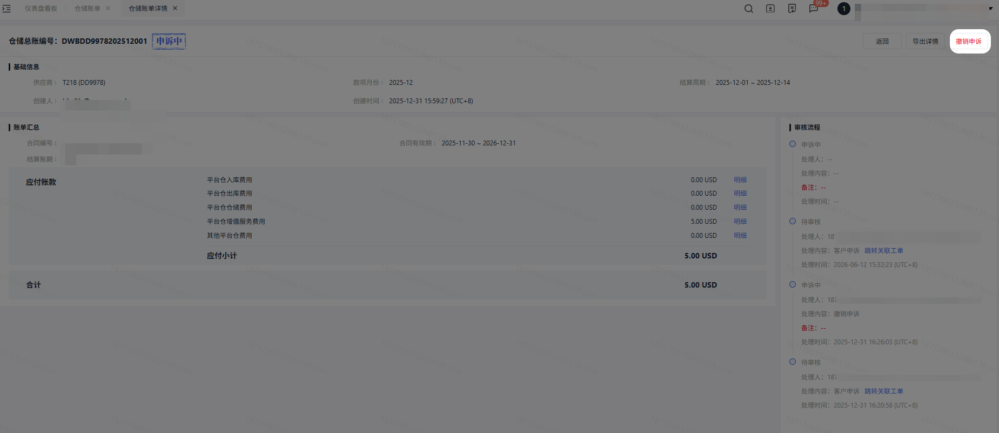
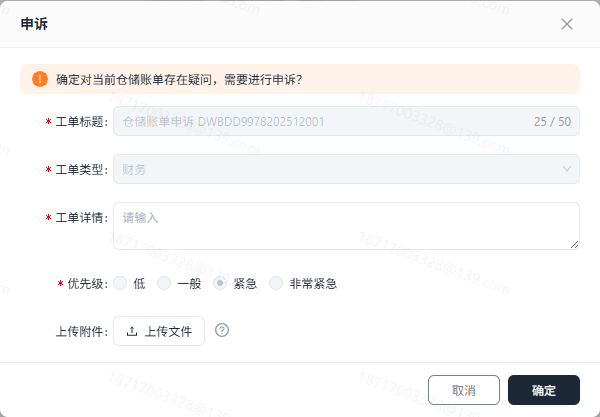
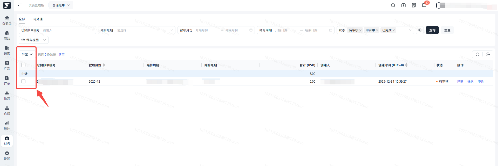
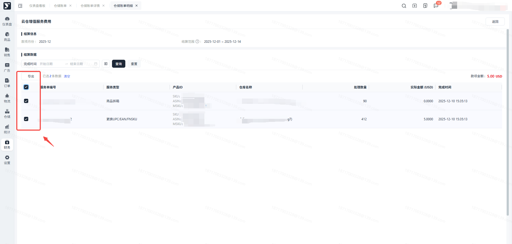

# 飞书文档：仓储账单

## 功能介绍

财务会根据合同约定的结算范围的业务数据，生成对应的仓储账单。供应商可对仓储账单进行审核，审核通过后，则会纳入月度账单中通过货款进行抵扣对应仓储费用。

## 名词解释

| 名词 | 释义 |
|-|-|
| 仓储账单 | 根据合同约定生成对应结算范围的仓储总账。仓储账单含有的款项暂为供应链渠道费用。 |
| 申诉 | 对仓储账单存在异议，可提交工单进行申诉。 |

## 注意事项

1. 若对生成的仓储账单存在疑问，可提交工单也可以联系对应的运营人员进行询问。

## 操作流程

### 操作路径

【财务】-【总账】-【仓储账单】

### 展示及搜索

可根据筛选条件筛选数据，点击查询后列表展示符合条件的数据。

1. 全部：默认展示不为【已作废】的仓储账单信息。
2. 待处理：展示【待审核】状态下的仓储账单信息。

### 仓储账单详情

不同状态下，仓储账单的信息可能会有所不同。

1. 进入详情后，点击【明细】，可查看明细数据。

1. 待审核：针对【待审核】的仓储账单可进行【申诉】和【通过】操作。

1. 申诉中：针对【申诉中】的仓储账单可进行【撤销申诉】操作。

### 审核账单

当接收到仓储账单后，可对推送的仓储账单进行审核（申诉或通过）。

#### 申诉

若对生成的仓储账单存在异议，则可点击【申诉】，申诉将联动工单。进行申诉后，会有对应的运营人员跟您进行联系，跟进处理申诉问题，同时，仓储账单的状态也会扭转为【申诉中】。

且可以在工单中查看对应的处理情况。

#### 撤销申诉

申诉后，若发现仓储账单无问题，可点击【撤销申诉】，对应仓储账单的状态将会扭转为【待审核】，需要您重新进行审核确认。

#### 确认

若对生成的仓储账单没有异议，则可点击【确认】。

1. 可批量导出或指定数据导出，可按需进行导出。

1. 若需导出明细数据，可在列表或详情页点击【导出】，即可导出对应仓储账单的明细数据。

