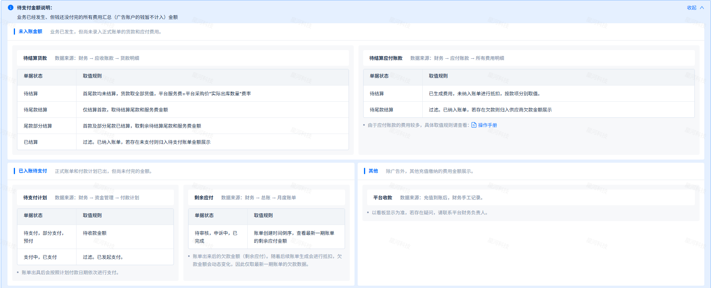
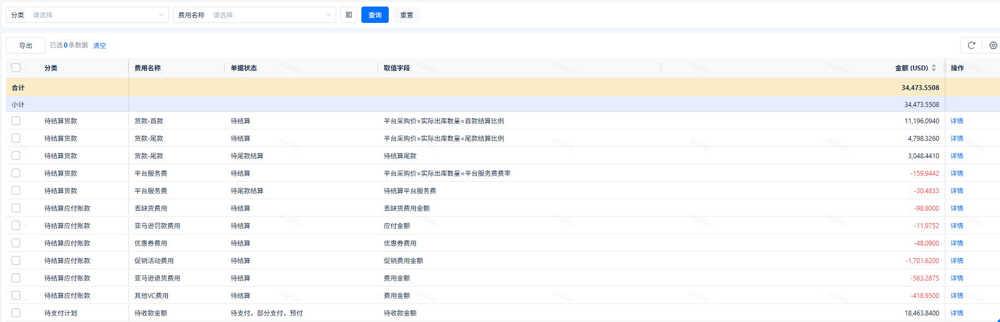

# 飞书文档：待结算看板

## 功能介绍

1. 功能说明：该看板针对业务已经发生、但钱还没付完的所有费用汇总（广告账户的钱暂不计入）
2. 看板更新时间：实时更新。

 1. **注：长期停留该页面，请进行刷新。**

## 页面路径

【财务】-【看板】-【待结算看板】

## 名词解释

| 类型 | 名词 | 释义 |
| --- | --- | --- |
| —— | 待支付金额 | 1. 业务已经发生、但钱还没付完的所有费用汇总金额 &nbsp;&nbsp;&nbsp;&nbsp;a. 广告账户的钱暂不计入 |
| —— | 单据状态 | 代表应收账款和应付账款明细中的状态信息，代表该笔费用是否纳入账单。 |
| —— | 取值字段 | 应收账款和应付账款明细中对应的金额取值字段。 |
| 分类/指标 | 待支付金额 | 已生成账单但未支付完全的金额 |
| 分类/指标 | 剩余应付 | 账单生成后应付款项大于应收款项时，供应商欠款金额 |
| 分类/指标 | 待结算货款 | 已出库但未纳入账单的货款金额，包含预计算的平台服务费 |
| 分类/指标 | 待结算应付款项 | 已产生费用数据但未纳入账单的应付账款金额 |
| 分类/指标 | 其他 | 其他金额统计，如线下充值等 |

## 看板介绍

待支付金额：业务已经发生、但钱还没付完的所有费用汇总（广告账户的钱暂不计入）金额
- 由：【未入账金额】+【已入账待支付】+【其他】组成

### 未入账金额

业务已发生，但尚未录入正式账单的货款和应付费用。

#### 待结算货款

*数据来源：财务 → 应收账款 → 货款明细*

#### 待结算应付账款

*数据来源：财务 → 应付账款 → 所有费用明细*

**具体费用项取值：**

### 已入账待支付

正式账单和付款计划已出，但尚未付完的金额。

#### **待支付计划**

*数据来源：财务 → 资金管理 → 付款计划*

- 账单出具后会按照计划付款日期依次进行支付。

#### **剩余应付**

*数据来源：财务 → 总账 → 月度账单*

- 账单出来后的欠款金额（剩余应付）。随着后续账单生成会进行抵扣，欠款金额会动态变化，因此仅取最新一期账单的欠款数据。

### 其他

除广告外，其他充值缴纳的费用金额展示

#### **平台收款**

*数据来源：充值到账后，财务手工记录。*

- 以看板显示为准，若存在疑问，请联系平台财务负责人。

- 总计=待支付计划+剩余应付+待结算货款+待结算应付款项+其他
- 待支付金额：已生成账单但未支付完全的金额
- 剩余应付：账单生成后应付款项大于应收款项时，供应商欠款金额
- 待结算货款：已出库但未纳入账单的货款金额，包含预计算的平台服务费
- 待结算应付款项：已产生费用数据但未纳入账单的应付账款金额
- 其他：其他金额统计，如线下充值等

该模块展示存在待支付金额的所有费用项。

会展示：分类，费用名称，单据状态，取值字段，金额。

> 1. 分类：跟指标统计一致
>
> - 待支付金额：已生成账单但未支付完全的金额
> - 剩余应付：账单生成后应付款项大于应收款项时，供应商欠款金额
> - 待结算货款：已出库但未纳入账单的货款金额，包含预计算的平台服务费
> - 待结算应付款项：已产生费用数据但未纳入账单的应付账款金额
> - 其他：其他金额统计，如线下充值等
> 2. 费用名称：费用项名称。货款分为货款-首款，货款-尾款，平台服务费。
> 3. 单据状态：代表应收账款和应付账款明细中的状态信息，代表该笔费用是否纳入账单。
> 4. 取值字段：代表应收账款和应付账款明细中对应的金额取值字段。
> 5. 金额：代表应收账款和应付账款明细中的金额信息，代表该笔费用供应商应该承担的金额。
>
> 1. 正数为收款金额，负数为支付金额
> 6. 详情：点击可携带单据状态跳转到对应的费用详情页面。

## 常见问题
