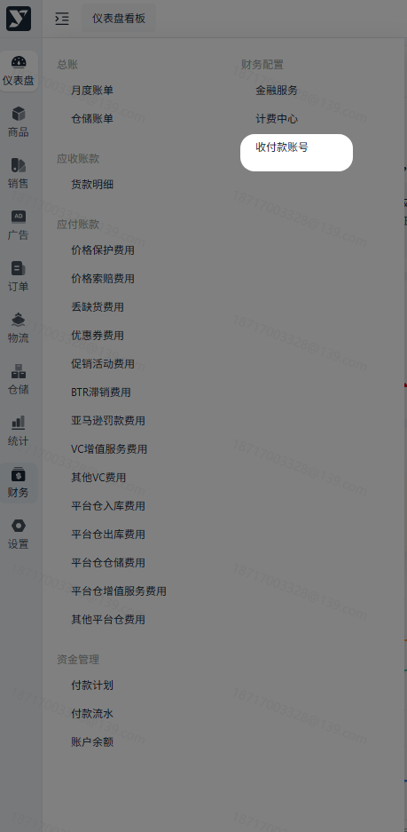
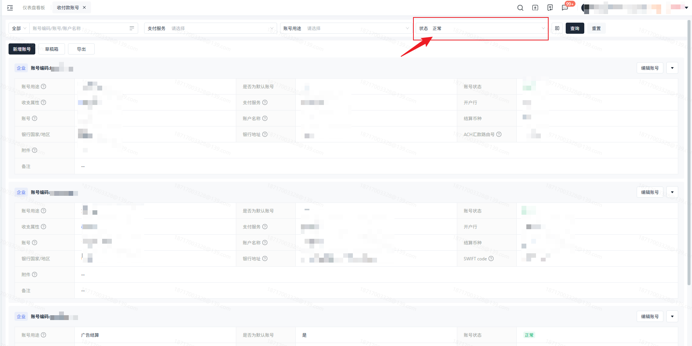
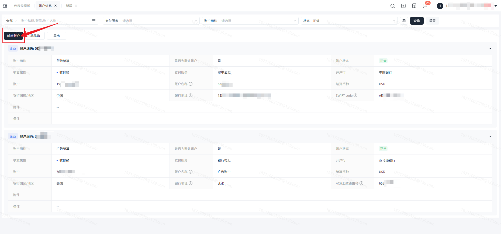
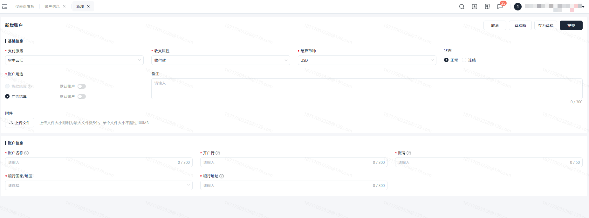
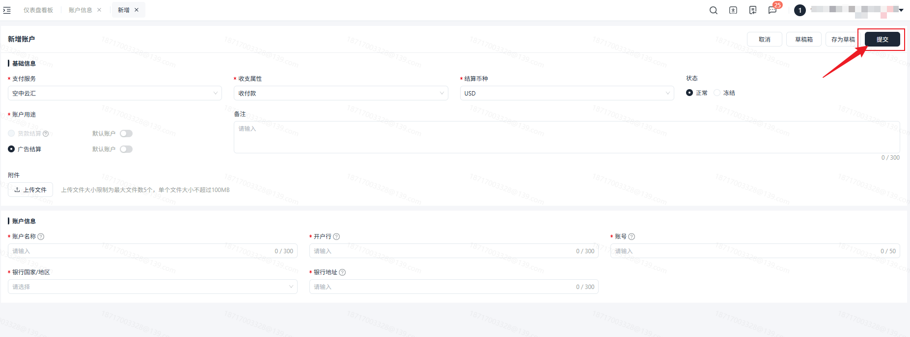
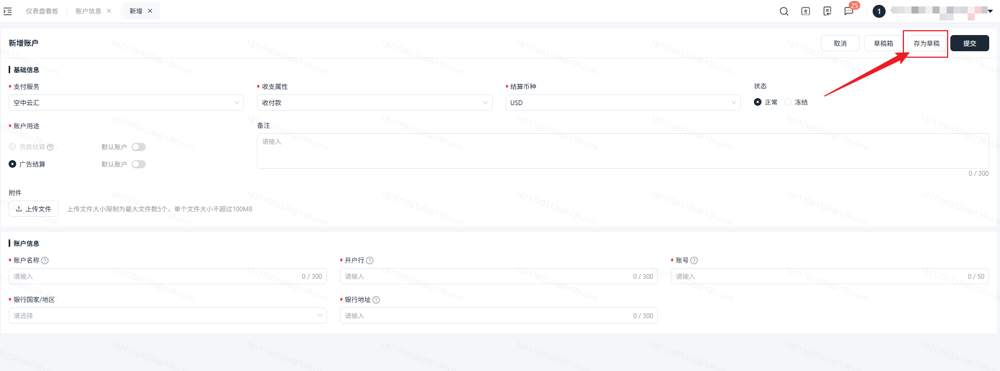
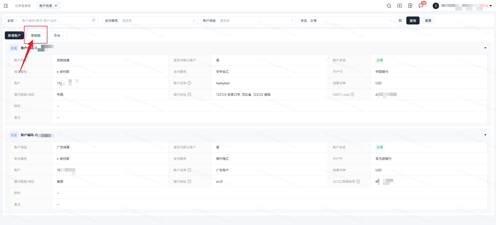
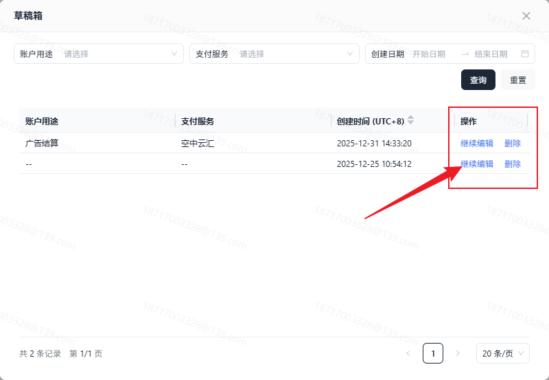
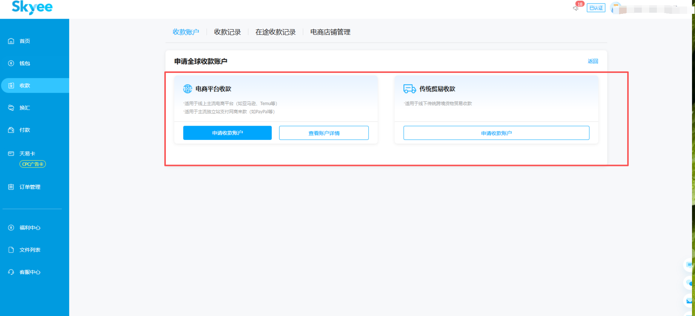
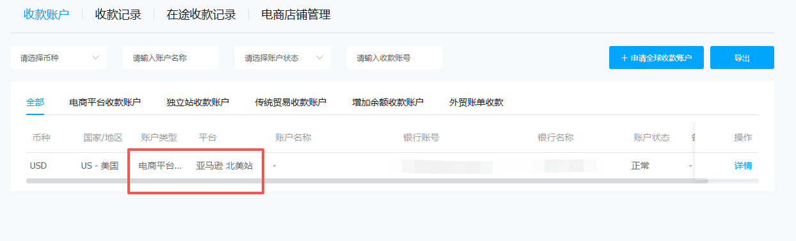

# 飞书文档：收付款账号

## 功能介绍

在系统中需要进行收付款账号的维护，以便在后续的支付流程中确认收付款账号是否准确。

## 名词解释

| 列1 | 列2 |
| --- | --- |
| 名词 | 释义 |
| 支付服务 | 显示该账户支持支付服务方式，单选。 1. Skyee：支持货款结算； &nbsp;&nbsp;&nbsp;&nbsp;a. 您可以选择Skyee为支付服务，根据您的实际情况，填写正确的银行收付款账号即可。 |
| 收支属性 | 确定该账户用于收款，付款还是收付款。 |
| 账户用途 | 确定该账户用于什么功能模块进行收付款，单选。 当前版本有以下用途： 1. 货款结算：用于货款收款账户，具有唯一性（即正常生效的货款结算账户有且只有一个）。 &nbsp;&nbsp;&nbsp;&nbsp;a. 支付服务可选择：Skyee &nbsp;&nbsp;&nbsp;&nbsp;b. 收支属性可选择：收款/收付款 &nbsp;&nbsp;&nbsp;&nbsp;c. 根据真实情况进行填写收付款账号，若货款收款收付款账号与合同信息不一致，需告知平台运营经理并提供相关文件。 &nbsp;&nbsp;&nbsp;&nbsp;&nbsp;&nbsp;&nbsp;&nbsp;i. 使用Skyee作为收货款账户需要变更信息： &nbsp;&nbsp;&nbsp;&nbsp;&nbsp;&nbsp;&nbsp;&nbsp;&nbsp;&nbsp;&nbsp;&nbsp;1. 若账号公司主体一致，但收款账号信息改变（需要至少提前10个工作日进行书面通知）： &nbsp;&nbsp;&nbsp;&nbsp;&nbsp;&nbsp;&nbsp;&nbsp;&nbsp;&nbsp;&nbsp;&nbsp;2. 若账号公司主体改变：需提交委托收款协议 &nbsp;&nbsp;&nbsp;&nbsp;&nbsp;&nbsp;&nbsp;&nbsp;ii. 若合同中关于收款收付款账号存在缺漏，需提供补充说明文件（首次打款之前完成）： 2. 广告结算：用于广告的充值/提现账户，可添加多个。 &nbsp;&nbsp;&nbsp;&nbsp;a. 支付服务可选择：pingpong。 &nbsp;&nbsp;&nbsp;&nbsp;b. 收支属性可选择：付款/收付款。（若有提现需求，可选择收付款） &nbsp;&nbsp;&nbsp;&nbsp;c. 若广告结算收付款账号与广告服务协议信息不一致，需告知平台运营经理并提供相关文件。 3. 仓储结算：用于仓储费用的充值/提现账户。当前版本不用维护仓储结算收付款账号，仓储费用会用货款金额进行抵扣。 |
| 账户编码 | 系统自动生成的编码信息，保障账户的唯一性。跟支付信息无关。 |

## 注意事项

1. 当您发现收付款账号发生变更或填写错误时，请提交工单，联系对应的财务管理员进行调整。

## 操作流程

### 操作路径

【财务】-【财务配置】-【收付款账号】

### **搜索**

1. 可对账户编码/账号/账户名称进行模糊查询。
2. 账户主体进行下拉搜索。
3. 支付服务进行下拉搜索。

**默认展示状态为正常的收付款账号。**

若存在需要添加账户时，可点击【新增】进行收付款账号添加。需根据真实情况进行填写。

带\*的为必填项，必须进行填写。

信息填写完成后，可点击提交。

**注意：提交前请核对填写信息是否正确，提交后若发现信息错误，请及时提交工单联系运营人员进行变更。**

内容未维护完成时，可暂存为草稿箱下次继续编辑。

点击草稿箱，可对之前的草稿账户进行编辑/删除/提交。

根据当前展示信息进行导出，即跟搜索条件来导出，可按需进行导出。

## 常见问题

### 系统账户配置里的支付服务如何选择？

若需要进行货款结算，您可以选择skyee为支付服务，根据您的实际情况，填写正确的银行收付款账号即可。

若需要进行广告充值，您可以选择pingpong为支付服务，根据您的实际情况，填写正确的银行收付款账号即可。

#### 如何查看是否到账？

转账成功后，在【资金管理】-【付款流水】里可下载对应支付平台回传的支付凭证。

#### 供应商有skyee账号， 但没开户行等信息，没法填写悦来ERP要求填写的框，怎么办？

您需要在skyee 这边申请一个收款账户，然后维护进ERP；同时还可以把您的skyee 账户代码、名称维护在备注里，这样付款时可以互转，省一笔手续费。

#### 供应商在skyee申请银行账户那边没有查到Yurex平台的名称，为什么？

需要问下您的银行客户经理，表明要收取来自买方的货款，需要申请什么样的账户，银行客户经理会给您指导。

#### 供应商我没有用过skyee，到底要怎么申请？

选skyee的电商平台收款，不用绑定店铺；申请收款时，勾选准备开新店铺，就不用跳转授权。

注：如供应商需结汇人民币，自行上传订单就行。如有必要，悦来可导出vc的订单给供应商上传。上传订单需要添加一个收款店铺，但不需要真的过来收款（只是一个上传通道）。

#### 我可以用空中云汇收货款吗？

否。空中云汇是不支持skyee入账。

#### 我可以用对公美金线下银行收货款吗？

最好是skyee；若要用美金对公银行账户收款，请与您的银行经理确认下是否能正常收来自skyee的款项。
