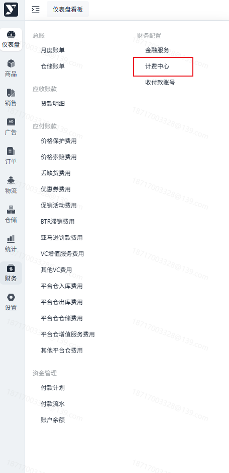
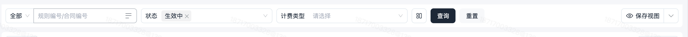
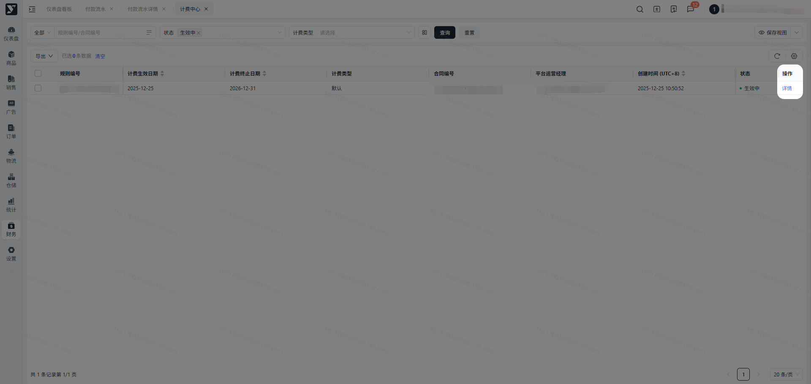
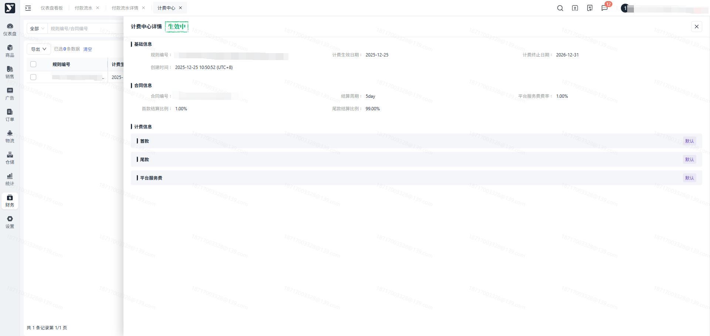
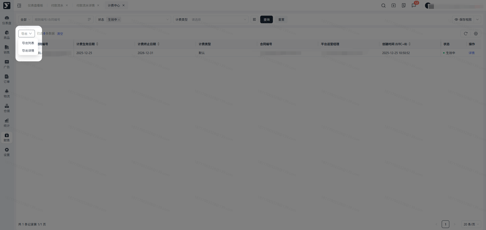

# 飞书文档：计费中心

## 功能介绍

展示根据合同约定的结算规则，进行维护的计费规则。

## 名词解释

| 列1 | 列2 |
| --- | --- |
| 名词 | 释义 |
| 计费类型 | 默认：无特殊计费规则约定，即为默认。 阶梯：通常对供应商整体的账期和费率进行约定，当满足对应条件后按新的计费规则进行结算，若不满足则按原有计费规则进行结算。 评级：当前版本只有尾款及对应尾款平台服务费率会受评级模式影响。 1. 若采用评级模式结算，会根据供应商的评级等级进行尾款回款账期及费率的调整，且评级模式下尾款结算不跟销量挂钩，结算了首款就会结算对应的货款尾款。 2. 注意：评级模式下尾款的付款日期始终会晚于等于首款的付款日期。 |
| 状态 | 计费规则的状态分为：待生效，生效中，已过期。默认展示生效中的计费规则。 待生效：当前日期还未满足 |
| 月结算款金额 | 月度账单的账单金额 |
| 失效条件 | 当一定时间段内未满足月结算款金额则会失效，变更为初始合同设置账期及费率。 1. 假定失效条件：连续2月失效，则代表着若两个月都为满足对应的阶梯判断条件，则会按照合同约定的账期及费率进行结算。 |
| 生效类型 | 提前生效： 1. 虽然还未满足生效条件，但是合同/商务约定，提前按照满足条件后的规则给客户进行结算。 2. 提前生效截止年月：为账单的所对应的款项月份，会包含所设置的年月也会按照规则计费。 &nbsp;&nbsp;&nbsp;&nbsp;a. 假定设置的截止年月为2025-12，那么代表着结算范围为2025-12-31及之前的数据均会按照提前生效的结算规则进行结算。 满足后生效： 3. 需要满足生效条件，才会按照满足条件后的规则给客户进行结算，否则就按未满足的条件的计费规则给客户进行结算。 |
| 尾款费率 | 当供应商既存在阶梯，又存在评级的情况下时，需要确认尾款平台服务费率的取值。 1. 固定阶梯：固定按照阶梯的费率进行结算。 2. 固定评级：固定按照评级的费率进行结算。 3. 低费率优先：对比两个费率，哪个费率低取对应的费率。 4. 高费率优先：对比两个费率，哪个费率高取对应的费率。 注意：因阶梯配置需满足对应的条件，当不满足阶梯条件的时候，就只会用评级进行结算，不会采用阶梯费率。只有当既满足了阶梯条件又存在评级设置，才会进行优先级判断。 |

## 注意事项

1. 当您对计费规则存在疑问时，可联系对应的财务管理员。

## 操作流程

### 操作路径

【财务】-【财务配置】-【计费中心】

### 搜索

默认展示生效中的计划信息。若需查找已过期的计划，可对状态进行筛选。

注意：已过期的计费规则在对应计费生效时间段内仍是有效的，是否过期只是根据当前时间节点是否大于计费生效范围进行判断。

点击可查看对应的计费规则详情。

根据当前展示信息进行导出，即跟搜索条件来导出，可按需进行导出。

1. 导出列表：导出字段为列表展示字段。
2. 导出详情：导出字段携带详情信息。

## 常见问题

若您发现计费规则跟合同上约定的不一致，请联系您对应的运营负责人。
