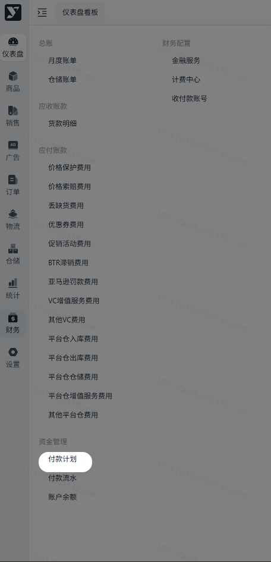
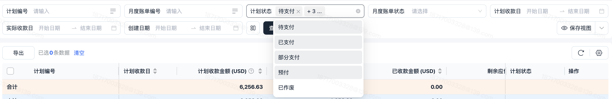
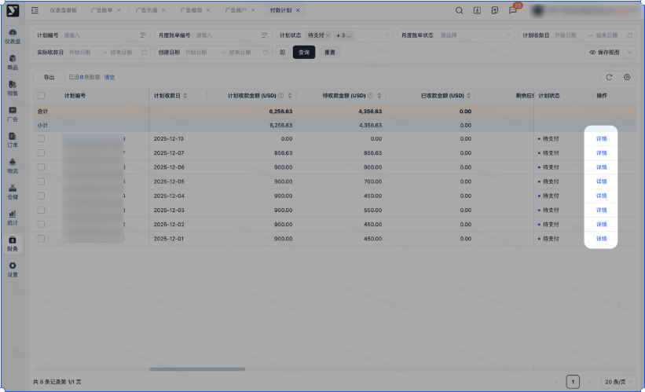
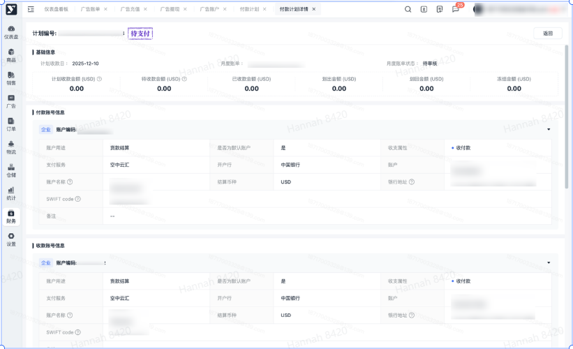
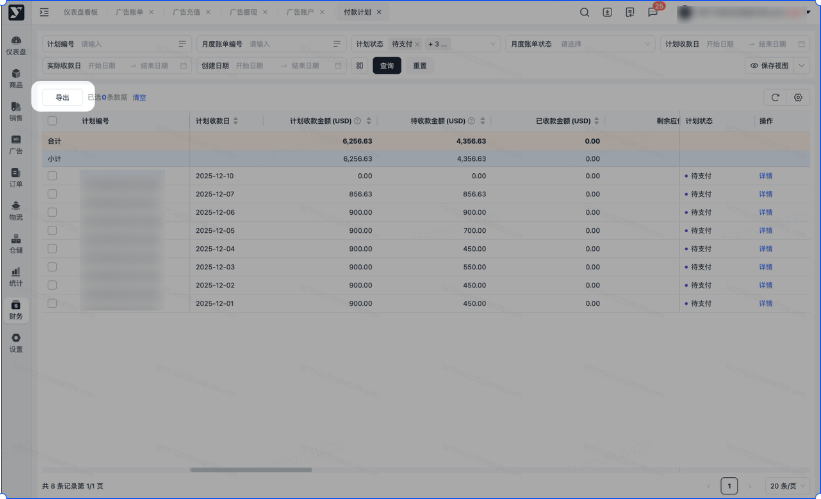

# 飞书文档：付款计划

## 功能介绍

展示月度账单中已生成的付款计划信息，可进行查看对应计划状态。

## 名词解释

| 列1 | 列2 |
| --- | --- |
| 名词 | 释义 |
| 计划收款日 | 1. 按照对应月度账单生成的计划收款日。 2. 货款首款的计划收款日=实际到达时间+结算账期 3. 货款尾款的计划收款日 &nbsp;&nbsp;&nbsp;&nbsp;a. 当销量日期早于实际到达时间时，则为实际到达时间+结算账期； &nbsp;&nbsp;&nbsp;&nbsp;b. 当销量日期晚于等于实际到达时间时，则为销量日期+结算账期； |
| 计划收款金额 | 计划在对应收款日能收到多少金额 |
| 实际收款日 | 该笔计划金额会在实际收款日进行打款 |
| 流水编号 | 可查看该计划对应的流水编号，可查看对应的流水信息及付款证明。 |
| 计划状态 | 分为：待支付，已支付，已作废。 |
| 账户信息 | 所设置的用于货款结算的收款账号信息。 注意：若您对货款账户进行了修改，处于【待支付】状态计划的收款账户信息会随着进行变更。 |

## 注意事项

1. 当您对付款计划存在疑问时，可联系对应的财务管理员。

## 操作流程

### 操作路径

【财务】-【资金管理】-【付款计划】

### 搜索

默认展示正常的计划信息。若需查找已作废的计划，可对计划状态进行筛选。

点击可查看对应的计划详情。

- 关联流水：当计划进入支付流程时，可查看对应付款流水。
- 收付款详情：当前计划所含有的款项及月度账单信息。

根据当前展示信息进行导出，即跟搜索条件来导出，可按需进行导出。

## 常见问题

**变更前提：**

1. 您修改的账户为【货款结算】账户。
2. 只有处于【待支付】计划的账户才会更新为最新的账户信息。

**若前提是满足的，请联系运营进行查看：**

因为我司按计划进行付款时需进行财务审核，所以存在虽然是【待支付】的计划但是实际流程已进入OA审核流程，需联系工作人员进行撤销。
