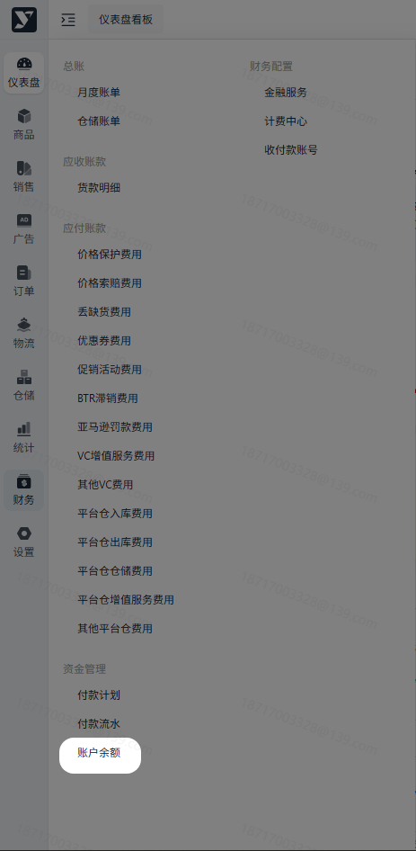
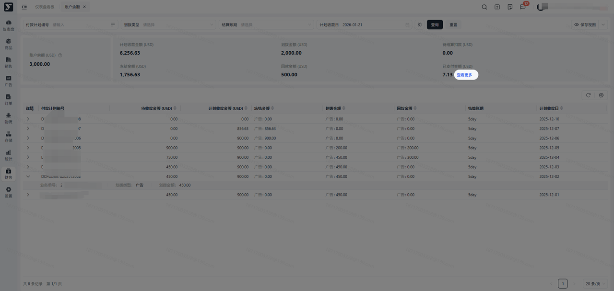
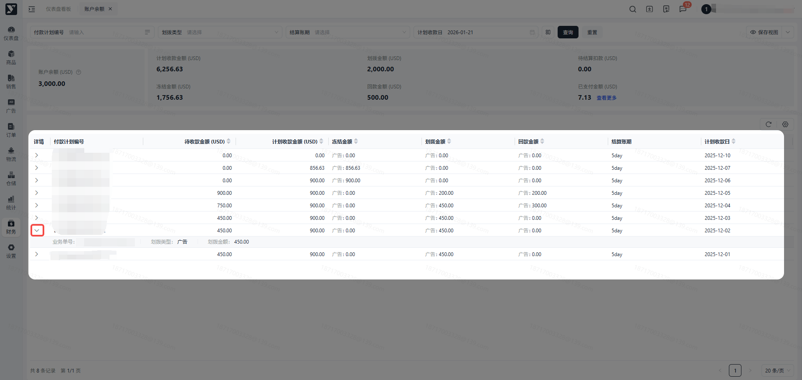

# 飞书文档：账户余额

## 功能介绍

在该模块您可查看当前账号的货款账户余额信息，了解您当前的资金结构及详情信息。

## 名词解释

| 名词 | 释义 |
|-|-|
| 账户余额 | 已生成资金计划但未支付的金额；  账户余额=计划收款金额-冻结金额-划拨金额+回款金额 |
| 待结算扣款 | 因月度账单生成后若存在负数，在当期不会向供应商收取欠款，会在后续账单中进行抵扣，这部分剩余应收款即为待结算扣款。 |
| 已支付金额 | 资金计划中已经支付的账单金额 |
| 计划支付金额 | 根据月度账单生成，预计支付的金额。  **注意：**可能存在把待支付货款划拨到广告的场景，所以计划支付金额不等于已支付金额 |
| 划拨金额 | 该笔资金计划划拨到广告的金额。 |
| 冻结金额 | 已提交货款划拨到广告申请，但仍处于审批中的金额。 |

## 注意事项

1. 如果您对账户余额信息存在疑问，请联系您的运营/财务经理。

## 操作流程

### 操作路径

【财务】-【资金管理】-【账户余额】

### 筛选及展示

点击【查看更多】可查看支付明细。

点击【详情里的翻转】按钮，可查看明细。

