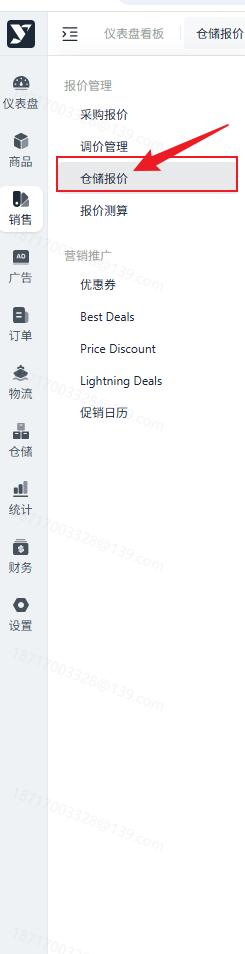
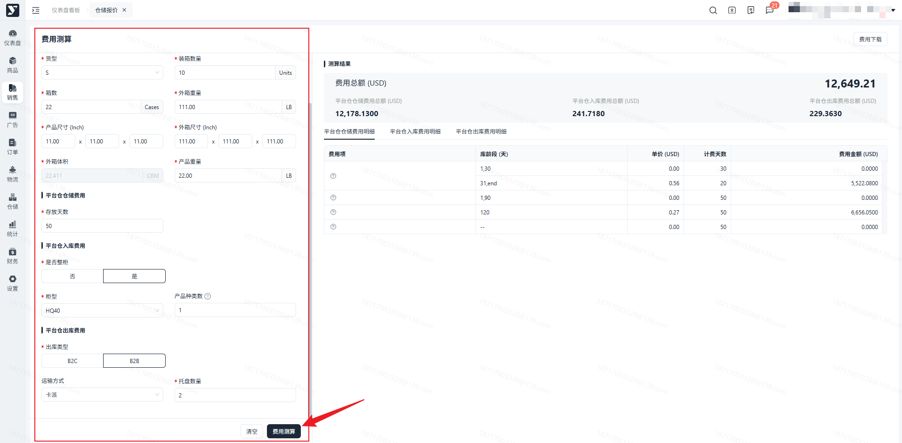
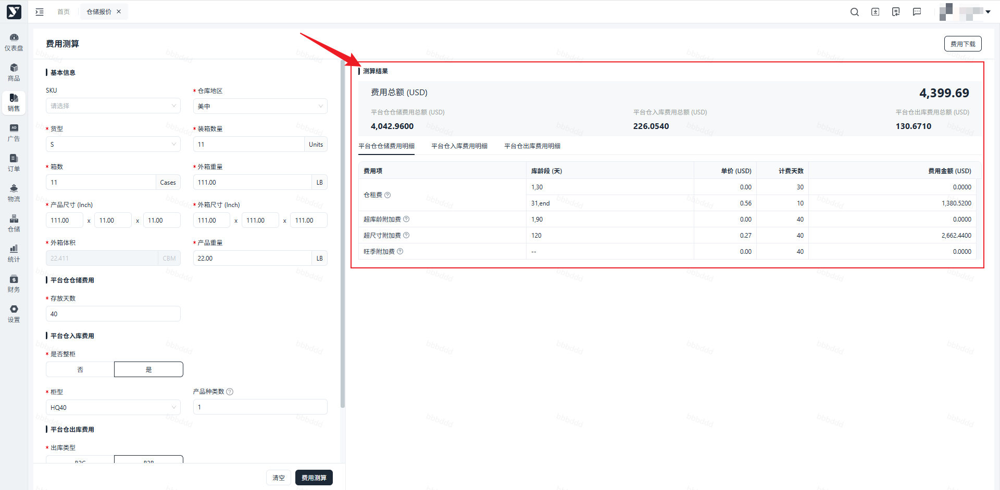
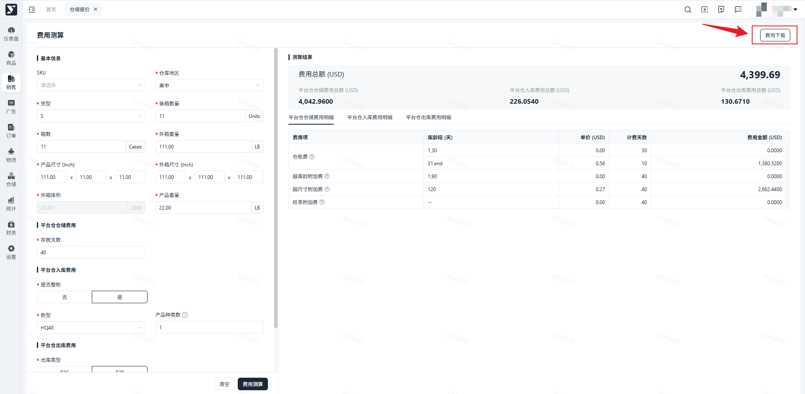

# 飞书文档：仓储报价

## 功能介绍

该模块旨在帮助运营和客户测算出仓储各费用明细，客户根据自身业务情况估算费用选择仓储方案。包括入库费、仓储费、出库费（B2C 出库和 B2B 出库）的费项、计费单位、计算规则及备注

## 注意事项

1. 装箱数量和箱数需填写整数，如填写小数，则采用四舍五入法为整数；
2. 当前版本暂无法支持物流费用测算。

## 操作流程

### 操作路径

【销售】-【报价管理】-【仓储报价】

### 费用测算

填写【费用测算】左侧的必填项，点击【费用测算】

1. 仓库地区请根据实际情况选择，不同仓库地区对应的价格不同。
2. 产品/外箱尺寸/重量单位为**英制**
3. FBA/一件代发的费用测算分别对应B2B/B2C出库，对应的物流费用不在测算范围中。

### 在右方即可看到相应的测算结果，包括【仓储费】、【出、入库费用】

修改测算数据后，需重新点击【费用测算】，测算结果才会进行更新。

### 导出测算结果

