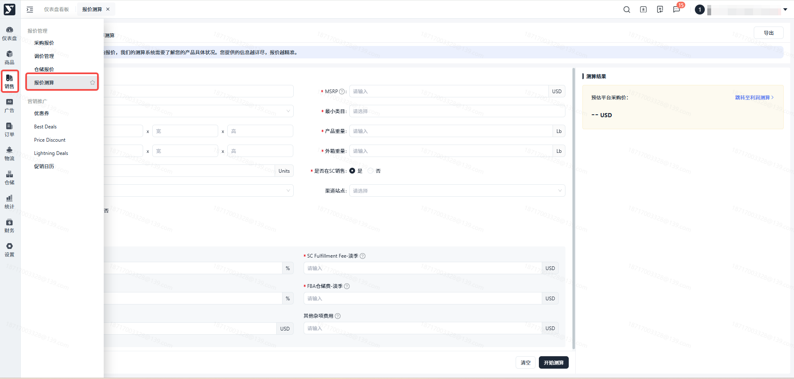
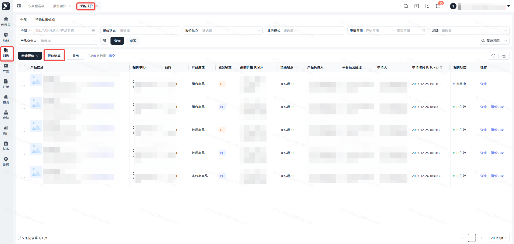
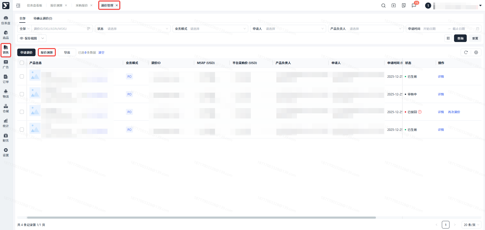
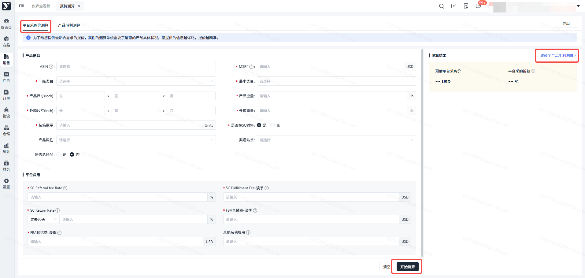
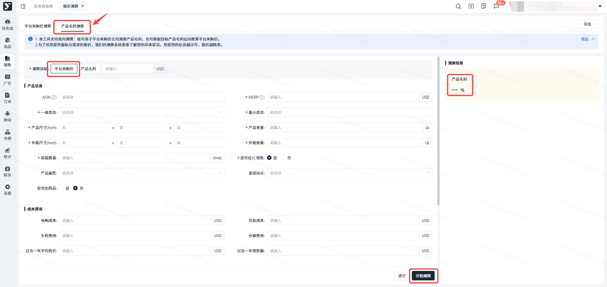
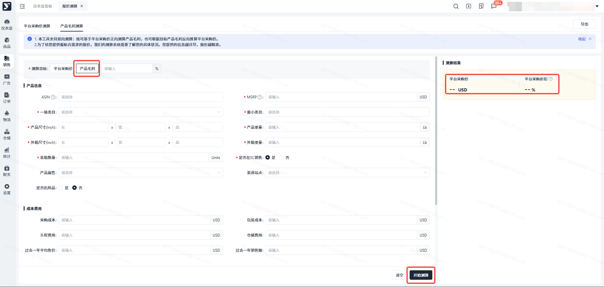

# 飞书文档：报价测算

## 文档信息

| 项 | 内容 |
| --- | --- |
| 远程文档 | https://q1njej8cpab.feishu.cn/wiki/DVwnwYGbSiGm3tkZoQqclb5jnOc |
| 图片处理 | 本地下载（assets/images） |
| 快照时间 | 2026-08-06 |
| 来源命令 | `lark-cli docs +fetch --api-version v2 --doc https://q1njej8cpab.feishu.cn/wiki/DVwnwYGbSiGm3tkZoQqclb5jnOc --doc-format markdown --as user --format json --jq .data.document.content` |
| 格式处理 | fd-doc-markdown-sync/scripts/normalize-feishu-doc-markdown.mjs |

---

报价测算

## 功能介绍

本功能为预估平台采购价与利润测算的计算器。旨在助力您预估平台采购价，其操作便捷，只需输入相关数据，即可快速得出预估结果，为您的采购决策提供有力参考。若您对所预估的价格存在任何疑问，可直接联系平台运营经理。

## 注意事项

1. 此价格此为**预估价**，若您需要我司准确的报价，请联系平台运营经理；
2. 使用此功能，请注意带【\*】为必填项，必须输入完整的信息后才能触发计算；
3. 页面分为2个tab，帮助您测算平台采购价以及您的利润测算；
4. 是否在SC销售，指的是您的产品之前是否有在亚马逊销售过，若有请选择【是】；
5. 为了给您提供最贴合需求的报价，我们的测算系统需要了解您的产品具体状况。您提供的信息越详尽，报价越精准；

## 操作步骤

### 菜单路径

#### 路径一：【销售】-【报价管理】-【报价测算】

#### 路径二：【销售】-【报价管理】-【采购报价】-【报价测算】

#### 路径三：【销售】-【报价管理】-【调价管理】-【报价测算】

### 测算方式

#### 预估平台采购价测算

1. 可通过选择已生成ASIN的商品快速计算报价；
2. 可直接输入带【\*】必填项，从而计算出预估平台采购价；
3. 填写完信息后，点击“开始测算”，系统开始计算 预估平台采购价；
4. 查看到 预估平台采购价 结果后，可点击“跳转至利润测算”，基于已计算出的平台采购价，来计算利润率；

#### 产品毛利测算

1. 本工具支持双向测算：既可基于平台采购价正向测算利润，也可根据目标利润反向推算平台采购价；
2. 先输入测算目标，如已知平台采购价，计算出相应的利润率；已知利润率，计算出推荐的平台采购价；
3. 然后依次输入产品信息、成本费用、营销费用、其他费用；

